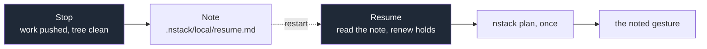

# Playbook — Pause and resume

> **Trigger.** Load this playbook when you are touching: stopping, restarting, handing work over,
> or resuming a session.
>
> **This project's own rules** on the subject, when it has any: `docs/project/rules/pause-and-resume.md`
> — read them with this playbook. They add to it or tighten it.

---

## The rule: the repository holds the state, a note points into it



*Legend: solid arrows are what you do in order; the dotted one is the session ending.*

A session ends without warning: a restart, a full context, a person's evening. What it knew must
already be where the next one reads it — commits, pull requests, holds — and the next one must
not have to re-read the history to find it. A note of a few lines says where to look; it never
replaces what it points to.

Your tool's own memory, a chat summary or a transcript are extras: useful to you, invisible to
another tool and to another person. The source is the repository and the forge.

---

## Stop

Before you stop, or when you are told the session will end:

1. **Nothing only in the working tree.** Commit what is in progress, on its work branch, and push
   it: the pushed branch shows it, and on GitHub the claim's draft pull request too when the work
   is on its first branch. A commit or a push a hook refuses: fix its cause; what you cannot fix
   before stopping stays as it is, and the note names it with the refusal — never `--no-verify`.
2. **Nothing running.** No background job, watcher or server left for the next session to find.
3. **Nothing left over.** Scratch clones, worktrees and local branches of your own that hold no
   work are removed; a worktree that holds work is pushed first. Never the start branch your
   claim made: `nstack deliver` removes it.
4. **Holds stay.** A deliverable you will resume stays held (`nstack plan` shows it). Past
   `hold_days` without work, anyone may take it over: give back with `nstack unclaim` what you
   will not resume by then.
5. **Write the note.**

## The note

`.nstack/local/resume.md` — one per clone, never committed (`.nstack/local/` is ignored).
Fifteen lines at most; over that, it repeats what the repository already says. Rewrite it
whole at each stop: it states the present, not a journal.

```markdown
# Resume — 2026-11-24 18:40, session <id>, for <person>
- Merged since the last note: D30 (#41)
- Open: D31, pull request #44 — next: answer the verifier's finding on the empty state; mine
- Open: D32, branch d32-export, pushed, no pull request yet — next: the test sheet; mine
- Owed by others: the decider's approval of #42; the verifier's run of #44
- Not pushed: (nothing) — or the commit, the files, and the hook's refusal
- Next id: D33
- Relaunch: nstack agent run <agent> -- <tool>
```

Handing over to another session or person: give them the note's text with the hand-over, and
give the hold back (`nstack unclaim`) for them to claim. Never hand over a clone.

## Resume

1. **Read the note, and only the note.** Not the history, not the transcripts. No note: `git
   status`, `git log` of your branches and `nstack plan` say the same, more slowly.
2. **Renew your holds** under this new session. In `nstack agent run`:
   `nstack claim <id> --person <person> --session <this session>` renews a hold your own agent
   held. Outside it, a new session of yours takes its hold over, on your person's word:
   `nstack claim <id> --take-over --person <person> --session <this session>`
   (`.nstack/handbook/project.md`, *Who holds a deliverable*).
3. **`nstack plan`, once**: what changed while you were away — merges, holds, what turned stale.
   Where it disagrees with the note, the repository is right; the note was the past.
4. **Continue at the noted gesture.** A gesture owed by someone else is not yours to redo.
