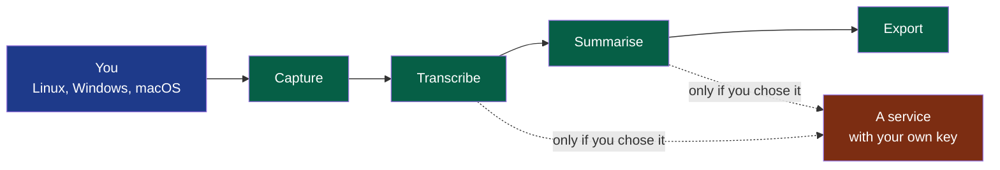

# Kitokey

**Be in the meeting. The minutes write themselves — and never leave your machine.**

Kitokey records a conversation, transcribes it and writes its minutes on Linux, Windows and macOS — four steps, each usable alone and with the provider you choose, on your machine by default — for people who want to keep control of their data and of their costs.

> Installing or updating the foundation this project is built on:
> [`.nstack/handbook/INSTALL.md`](.nstack/handbook/INSTALL.md). Delete this line when it no longer serves.

## What it is



**Legend** — blue: you, on your own machine · green: Kitokey's four steps, each usable
alone · red: what is outside your machine, reached only when you choose it.

No bot joins your meeting and no account is asked for. **You tell the other participants
that you are recording**: Kitokey shows them nothing.

## Install it

**On Fedora 43, 44 and 45**, from Copr, with the system's updates — version 0.2.6, built by Copr on 2026-11-18
from the tag `v0.2.6`:

```bash
sudo dnf copr enable @napkinstack/kitokey
sudo dnf install kitokey
```

**On Ubuntu 24.04 and Debian 13**, from a package built from this repository — none is published for them yet
(#1214). The `.deb` made for Ubuntu 24.04 also installs and starts on Debian 13, not on Debian 12
([`modules/install`](modules/install/#on-debian)). Building needs `git`, [`uv`](https://docs.astral.sh/uv/) and
`podman`:

```bash
git clone https://github.com/NapkinStack/kitokey && cd kitokey
bash .nstack/install-engine.sh                        # nstack, at the version this repository records

nstack release                                        # Fedora: every program, then the rpm
sudo dnf install ./dist/install/kitokey-*.x86_64.rpm

KITOKEY_TARGET=ubuntu-24.04 nstack release         # Ubuntu: built in its container, then the .deb
sudo apt install ./dist/install/kitokey_*_amd64.deb
```

If `nstack` is then not found, uv's folder of tools is not on your `PATH` yet: `uv tool update-shell` puts it
there, and a new terminal, in the clone, finds it.

How each package is made, and what a computer needs to run it — memory, disk, how long a meeting takes, measured:
[`modules/install`](modules/install/). On macOS, GitHub's runner makes the app on every change to a program on `main`, signed ad hoc, not by Apple.
On Windows, it makes a zip and an MSIX package for the Microsoft Store, not submitted yet. Each waits on a
colleague's trial, in the cycles after it. What a build holds and what leaves your
machine: [`docs/privacy.md`](docs/privacy.md).

| What runs | Its page |
|---|---|
| Kitokey, started with your session: a small window to record, and a call in another application offered to be recorded; the window lists your meetings and what they weigh, names each meeting by its minutes' title, shows one's minutes beside its transcript, its actions as rows and a copy in one click, plays it with its words following, frees space to the system's trash, from where it comes back, and holds the settings — each step's model, fetched on your word | [`modules/shell`](modules/shell/) |
| A recording, from a terminal: `kitokey-capture record <folder>` | [`modules/capture`](modules/capture/) |
| The transcript of a session, on the machine: `kitokey-transcription <session> --model <file>` | [`modules/transcription`](modules/transcription/) |
| The minutes of a transcript, from the provider you chose: `kitokey-summary <session> --provider <address> --model <name>` | [`modules/summary`](modules/summary/) |

Each source is kept as your system delivers it, at its own rate and channels, in 24 bits
([ADR-0004](docs/adr/0004-the-audio-as-recorded-is-kept-everything-else-is-derived.md)): about 2 GB free while an
hour records, then about 0.2 GB kept an hour once the meeting stops, compressed without loss (FLAC) — measured on
2026-11-25 on a laptop's meetings (#1216). Meetings recorded before FLAC stay as recorded (#1215).
**Known**: the engine on the machine still writes a few words where nobody speaks, and on a
lively meeting misses or mishears about one word in four.

## Contribute

[`CONTRIBUTING.md`](CONTRIBUTING.md) — how a change is proposed, verified and merged here.

## Licence

GPL-3.0 ([`LICENSE`](LICENSE)). Built from source, Kitokey is free on every system; the
signed builds for macOS and Windows are what is sold ([PDR-0001](docs/pdr/0001-wholeheard-open-on-linux-paid-on-macos-and-windows.md)).

## Decisions

| What | Where |
|---|---|
| Who it is for, and when it is finished | [`docs/project/`](docs/project/) — the charter and the cycles |
| What the product must do, and why | [`docs/pdr/`](docs/pdr/) |
| How it is built, and why | [`docs/adr/`](docs/adr/) |
| Its modules, and the contracts between them | [`modules/`](modules/) |
