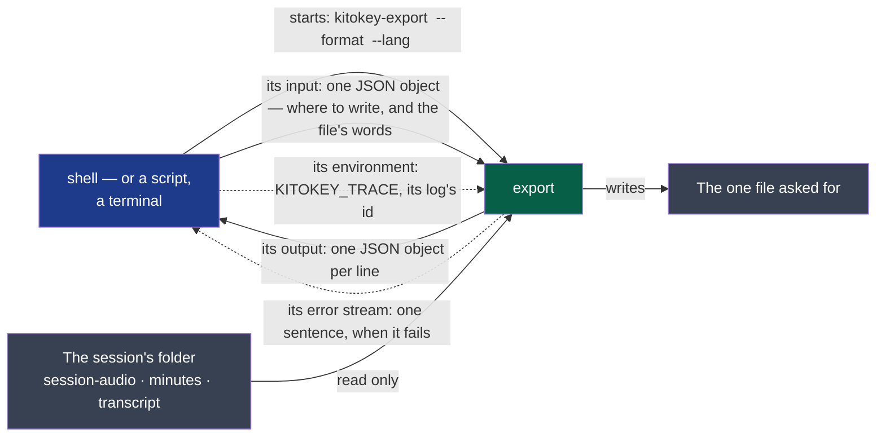

# exporting — version 1

How the program that writes a meeting as a file is started, what it is given, and what it says
while it works: one line of text per event, for whoever started it. D108's program, consumed by
the shell (D109).



**Legend** — green: the producer · blue: whoever started it, the consumer · grey: what it reads,
each file by its own contract, and the one file it writes. It contacts nothing: no network.

**For a machine**: [`input.schema.json`](./input.schema.json) says what its input is, and
[`event.schema.json`](./event.schema.json) what a line of its output is — each judged by the
project's comparator (ADR-0005). The order of the events, and what each means, are said here
and nowhere else.

## How it is started

`kitokey-export <session-folder> --format <format> --lang <language>`, then any of
`--without-summary`, `--without-transcript`, `--without-speakers`, `--without-times`; the options
in any order. The arguments hold no word of the meeting: a session's folder is named by the day
and hour it started (`session-audio`) — its path, under the folder the person chose, is an argument
as it is for `summarising/v1` — and every other argument is a choice of form. A process's arguments
are public to the machine's users; what is the person's goes on the input.

- `<format>`: `md` — CommonMark, a YAML front matter, the transcript a GFM table —, `html`, `docx`,
  `srt`, `vtt`, `pdf` — tagged, PDF/UA-1.
- `<language>`: a BCP 47 tag, `fr` or `en` today: the file's language (`<html lang>`, the PDF's
  `/Lang`). It translates nothing: the words come from the input.
- What is left out — the summary, the transcript, who spoke, when — is the person's choice.
  `srt` and `vtt` are the transcript alone, its times their very form: there, `--without-summary`
  and `--without-times` change nothing.

**Its input**: one JSON object, UTF-8, then the end of the input. Where to write and the meeting's
name are a person's, so they are never in the arguments, which any user of the machine may read.
Each value is on one line:

| Field | Holds |
|---|---|
| `to` | The path of the file to write. Its folder exists. A file already there is **replaced**: whether to replace it is the consumer's question to the person, asked before — a system's save dialog asks it |
| `name` | The meeting's name, for a meeting whose minutes hold no title: its `title.txt`, or the shell's name for it |
| `transcript`, `me`, `others`, `time`, `speaker`, `text` | The words a file shows that no contract carries, in the person's language: the transcript's heading, who spoke — the person, the others —, and the transcript's three columns |

**The fonts of a PDF** are the system's, static faces first; a variable face only where no static
one has the letters, at its default weight, and logged. None ships with the program.

## What it carries

**The output**: UTF-8, one JSON object per line, nothing else. Each has `event`:

| `event` | Other fields | Says |
|---|---|---|
| `written` | `file`: the path written, `to` as given; `bytes`: its size, a whole number | The file is whole at `file`. **Last**, and the only line, when it succeeds |
| `failed` | `code`: the cause, one of the codes below, on one line | The program is ending in failure. **Last**, and the only line |

**Writing**: whole or not at all — a file beside `to` first, then renamed over it. Whatever
happens, nothing else is written: no log beside the meeting, no file left half written, and the
session's folder is only read.

**Failing**: the program ends in failure with one sentence on its error stream, starting
`kitokey-export: `, and no `written`; `to` is as it was. When the cause is one a person acts on
differently, the output's one line names it: `failed`, with its `code`. Otherwise no line names it,
and the sentence alone does: wrong arguments, an input that is not this page's, an output that
closed.

| `code` | The cause | What a person does |
|---|---|---|
| `meeting.unreadable` | The session's folder, or a file in it, could not be read | Check the folder, then try again |
| `meeting.empty` | Nothing to write: neither summary nor transcript, as asked or as there | Include the summary or the transcript, or make them first |
| `file.unwritable` | The file could not be written where asked: no room, no right, the folder gone | Choose another place, or free space |
| `pdf.no_font` | No font of the system has the meeting's letters | Install the fonts of its script |
| `pdf.failed` | The PDF could not be laid out | Export in another format; the logs hold the detail |

A consumer reads a code this page does not list as no code: a later code is added here, never a
new version for it.

## What it promises

- It reads `session-audio`, `minutes` and `transcript/v1` by their contracts; a file absent is a
  part absent, never an error.
- A model's raw HTML, links and images are said as their words, in every format: no link is
  followed, nothing is fetched.
- Its logs follow ADR-0007: no word of the meeting, no path beyond its folder's name, under
  `KITOKEY_TRACE` when it is given.

## Examples

Started with:

```sh
echo '{"to": "<documents>/meeting.pdf", "name": "Réunion du 20 nov. 2026", "transcript": "Transcription", "me": "Moi", "others": "Les autres", "time": "Heure", "speaker": "Qui", "text": "Texte"}' \
  | kitokey-export <meetings>/2026-11-20_09-30 --format pdf --lang fr
```

It succeeded:

```json
{"event": "written", "file": "<documents>/meeting.pdf", "bytes": 48213}
```

It failed, and says why:

```json
{"event": "failed", "code": "file.unwritable"}
```
