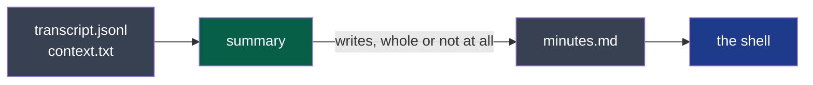

# minutes — version 4

A session's minutes are one text file a person reads as it is — highlights, actions, key
points — that says what made it, and that exists only when it is whole. Version 4 is
[version 3](../v3/README.md) and one thing more, optional: how long the making took (D97).
Versions 1 to 3 stay as they are, frozen (ADR-0005); a consumer reads all four.



**Legend** — green: the producer · grey: files in the session's folder · blue: the consumer.

## What it carries

`minutes.md` in the session's folder: UTF-8, Markdown, opening on a front matter.

| Front matter | Meaning |
|---|---|
| `contract` | `minutes/v4` |
| `made` | When, ISO 8601 with the local offset |
| `provider` | The host that answered, or `local` — never a key |
| `model` | The model's name, as the provider knows it |
| `context` | The text the provider received with the transcript, or `null` |
| `title` | Optional: the meeting's name, as the provider gave it — a few words in the meeting's language, on one line, at most 80 characters; never a key nor a path. Absent, the meeting has no name of its own: its date names it |
| `cost` | Optional: the price the provider reported for the call, a JSON number at least zero, as it reported it — `0.012`, `1.2e-6`. Never an estimate. Absent when the provider reported none |
| `currency` | Optional: that price's currency, an ISO 4217 code. `cost` and `currency` come both or neither |
| `made_in` | Optional: how long the making took, in seconds, from its start to the file written whole — a JSON number at least zero, `3.2`. The producer's own measure of this version, never the meeting's length. Absent when not measured |

Then exactly three sections of second level, in this order, their titles in the meeting's
language:

| Section | Holds |
|---|---|
| 1. Highlights | A few sentences: what the meeting was for and what came out of it |
| 2. Actions | A list; each item says **what**, **who** and **by when**, in that order, separated by ` — ` |
| 3. Key points | A list: decisions, figures, dates, what stays open |

An item of Actions or Key points may end with the time of the passage it came from: a space and
`[mm:ss]`, the form the transcript is given in, counted from the start of the recording — minutes
in two digits or more, seconds from 00 to 59. Under Actions it follows **by when** and is none of
the three parts.

- **What the meeting did not settle is said**, in the meeting's language: *not specified*, or
  that it was proposed and not accepted. An empty section says that there is none.
- **Whole or absent.** The file appears under its name only once it is complete; a provider
  that fails leaves the minutes that were there, or none.
- **Made again replaces.** There is one `minutes.md`; the one before is not kept by this
  contract, nor its `title`.
- **One key, one line.** The front matter is lines of `key: value`. The producer writes `contract`,
  `made`, `cost`, `currency` and `made_in` bare; `provider`, `model`, `context` and `title` as JSON strings in
  double quotes, so that a `"`, a `:` or a line break stays on its line; `context` may be `null`. A reader takes a
  value in double quotes as JSON and any other as written, bare; `null`, quoted or not, and an
  empty value are no value.
- **A title out of these bounds is no title.** A reader takes a `title` that holds no value or that
  cannot be read as JSON, that is blank, that holds a line break or a control character, or that
  runs over 80 characters — Unicode code points, counted as read — as absent: the minutes still
  read, and the date names the meeting. A producer given such a title writes the minutes without
  it. Whether a title is a key or a path, a reader cannot tell: that is the producer's to keep out.
- **A cost out of these bounds is no cost.** A reader takes a `cost` that is not a JSON number
  at least zero, a `currency` that is not three capital letters, or either one without the other,
  as neither: the minutes still read. A producer given such a cost writes the minutes without it.
- **A time taken out of these bounds is none.** A reader takes a `made_in` that is not a JSON number
  at least zero as absent: the minutes still read, without it. A producer given such a measure
  writes the minutes without it.
- **One time, at the end, or none.** Only the last characters of an item are a time, and an item
  has one: anything else in square brackets is the item's text, and so is `[12:75]`. A time that
  falls inside no segment of the transcript, or a list of times, the producer does not write: it
  keeps the line without them. A segment holds the whole seconds from its `start` to its `end`,
  each cut to its whole second, as the transcript is given. A time it keeps ends the item: no full
  stop and no space after it. A reader has the time as said: it cannot tell
  whether it is right.
- **A consumer reads all four versions.** `minutes/v1` to `minutes/v4` alike, with or without their
  optional parts; a key it does not know, it leaves aside. Minutes without `made_in` read as they do
  in v3. A consumer of v3 alone refuses v4, as v3's page asks of a contract it does not name: the
  producer writes v4 only once its consumers read it.
- **Versions 1 to 3 are not deprecated.** Minutes already on a user's disk stay as they are, are
  never rewritten for this, and stay readable: none has a removal date.

## What it never does

- It never promises that an action is right: it is a model's reading of a transcript. Who
  and by when may be wrong; the user reads them against the meeting.
- It never promises that a time is right, either: the model gave it. A time says where to listen,
  and a line without one proves nothing.
- It never carries the transcript, the audio, a key, or a path of the machine.
- Its sections' titles are never a fixed text: a consumer finds a section by its place, not
  by its name.

## Examples

Valid:

```markdown
---
contract: minutes/v4
made: 2026-10-13T15:12:40+02:00
provider: "openrouter.ai"
model: "anthropic/claude-sonnet"
context: null
title: "Date de l'événement et intervenants"
cost: 0.012
currency: USD
made_in: 3.2
---

## Points forts

La date de l'événement est fixée au jeudi 3 juin, avec le 10 en seconde date.

## Actions

- Contacter les trois intervenants et le comité scientifique — Alexandre — 26 avril [12:31]
- Pré-réserver les salles — non précisé — non précisé

## Points clés

- Réponse des intervenants attendue pour le 26 avril ; un plan B reste à trouver. [14:02]
- La date du 10 juin reste la seconde date.
```

To refuse: a file without the front matter or naming a `contract` other than `minutes/v1`,
`minutes/v2`, `minutes/v3` and `minutes/v4`; a line of the front matter that is not `key: value`; fewer or more than three
sections of second level.
