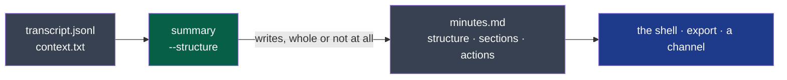

# minutes — version 5

A session's minutes are one text file a person reads as it is, that says what made it, and that
exists only when it is whole. Version 5 is [version 4](../v4/README.md) with its sections set by a
**structure**: the kind of meeting chosen for it (D111) — general, one-to-one, stand-up, client call,
interview, project review —, each section named by a stable `id` beside its title. `general` is v4's
three sections. Versions 1 to 4 stay as they are, frozen (ADR-0005); a consumer reads all five.



**Legend** — green: the producer, given the structure by `summarising/v1`'s `--structure` · grey:
files in the session's folder · blue: its consumers.

## What it carries

`minutes.md` in the session's folder: UTF-8, Markdown, opening on a front matter.

| Front matter | Meaning |
|---|---|
| `contract` | `minutes/v5` |
| `made` | When, ISO 8601 with the local offset |
| `provider` | The host that answered, or `local` — never a key |
| `model` | The model's name, as the provider knows it |
| `context` | The text the provider received with the transcript, or `null` |
| `title` | Optional: the meeting's name, as the provider gave it — a few words in the meeting's language, on one line, at most 80 characters; never a key nor a path. Absent, the meeting has no name of its own: its date names it |
| `cost` | Optional: the price the provider reported for the call, a JSON number at least zero, as it reported it — `0.012`, `1.2e-6`. Never an estimate. Absent when the provider reported none |
| `currency` | Optional: that price's currency, an ISO 4217 code. `cost` and `currency` come both or neither |
| `made_in` | Optional: how long the making took, in seconds, from its start to the file written whole — a JSON number at least zero, `3.2`. The producer's own measure of this version, never the meeting's length. Absent when not measured |
| `structure` | The structure the minutes were made in: its name, bare — lowercase letters, digits and `_`, at most 40 characters. The six this version names are below; a reader takes any other name as a name only |
| `sections` | The sections, in their order, as one JSON array on its line: an object for each, `{"id": …, "about": …}` — `id` lowercase letters, digits and `_`, at most 40 characters, each once; `about` one line, at most 200 characters, saying what goes in the section, in English, as the producer asked it of the model |
| `actions` | Optional: the `id` of the section that holds the meeting's actions — one of `sections`. Absent when the structure has none |

Then one section of second level for each object of `sections`, in its order — at least one, at
most six —, their titles in the meeting's language. **A consumer finds a section by its `id`**, the
`n`-th section of the body being the `n`-th object of `sections`; never by its title, which the model
writes.

- **The producer places the sections**, in the order of `sections`: their titles are the model's
  words, their order and their number the producer's.
- **No other line of the body opens on `## `**, nor any on `# `. An answer of the model holding
  another number of titles of second level than the structure has sections is not minutes, as v4's
  holding more than three: the producer writes nothing from it. A consumer cuts the body on `## `
  alone.

**The section named by `actions`** holds a list; each item says **what**, **who** and **by when**, in
that order, separated by ` — `, as v4's Actions. Every other section holds a few sentences or a list.

The six structures this version names, their sections in their order:

| `structure` | `sections`' ids | `actions` |
|---|---|---|
| `general` | `summary`, `actions`, `key_points` — v4's Highlights, Actions, Key points | `actions` |
| `one_to_one` | `updates`, `feedback`, `actions` | `actions` |
| `stand_up` | `progress`, `blockers`, `actions` | `actions` |
| `client_call` | `needs`, `questions`, `next_steps` | `next_steps` |
| `interview` | `background`, `answers`, `questions`, `next_steps` | `next_steps` |
| `project_review` | `status`, `risks`, `decisions`, `actions` | `actions` |

The producer's `about` for each is its own, and may be worded otherwise in a later version of the
producer: it says what goes in the section, and a consumer may show it; it never decides how a section
is read.

An item of a list, in any section, may end with the time of the passage it came from: a space and
`[mm:ss]`, the form the transcript is given in, counted from the start of the recording — minutes
in two digits or more, seconds from 00 to 59. In the section named by `actions` it follows
**by when** and is none of the three parts.

- **What the meeting did not settle is said**, in the meeting's language: *not specified*, or
  that it was proposed and not accepted. An empty section says that there is none.
- **Whole or absent.** The file appears under its name only once it is complete; a provider
  that fails leaves the minutes that were there, or none.
- **Made again replaces.** There is one `minutes.md`; the one before is not kept by this
  contract, nor its `title`.
- **One key, one line.** The front matter is lines of `key: value`. The producer writes `contract`,
  `made`, `cost`, `currency`, `made_in`, `structure` and `actions` bare; `provider`, `model`, `context`
  and `title` as JSON strings in double quotes, and `sections` as one JSON array, so that a `"`, a `:`
  or a line break stays on its line; `context` may be `null`. A reader takes a value in double quotes
  or in square brackets as JSON and any other as written, bare; `null`, quoted or not, and an empty
  value are no value.
- **A title out of these bounds is no title.** A reader takes a `title` that holds no value or that
  cannot be read as JSON, that is blank, that holds a line break or a control character, or that
  runs over 80 characters — Unicode code points, counted as read — as absent: the minutes still
  read, and the date names the meeting. A producer given such a title writes the minutes without
  it. Whether a title is a key or a path, a reader cannot tell: that is the producer's to keep out.
- **A cost out of these bounds is no cost.** A reader takes a `cost` that is not a JSON number
  at least zero, a `currency` that is not three capital letters, or either one without the other,
  as neither: the minutes still read. A producer given such a cost writes the minutes without it.
- **A time taken out of these bounds is none.** A reader takes a `made_in` that is not a JSON number
  at least zero as absent: the minutes still read, without it. A producer given such a measure
  writes the minutes without it.
- **One time, at the end, or none.** Only the last characters of an item are a time, and an item
  has one: anything else in square brackets is the item's text, and so is `[12:75]`. A time that
  falls inside no segment of the transcript, or a list of times, the producer does not write: it
  keeps the line without them. A segment holds the whole seconds from its `start` to its `end`,
  each cut to its whole second, as the transcript is given. A time it keeps ends the item: no full
  stop and no space after it. A reader has the time as said: it cannot tell
  whether it is right.
- **The front matter and the body agree, or the minutes are refused.** A reader refuses minutes whose
  `structure` or `sections` is missing or out of these bounds, whose body has another number of
  sections than `sections` has objects, or whose `actions` names no `id` of `sections`. A producer
  never writes such a file.
- **A consumer reads all five versions.** `minutes/v1` to `minutes/v5` alike, with or without their
  optional parts; a key it does not know, it leaves aside. It reads v1 to v4 as the `general`
  structure: their three sections, by their place, are `summary`, `actions` and `key_points`, and
  `actions` names the second. A consumer of v4 alone refuses v5, as v4's page asks of a contract it
  does not name: the producer writes v5 only when it is given a structure (`summarising/v1`'s
  `--structure`), and the consumer gives one only once it reads v5.
- **Versions 1 to 4 are not deprecated.** Minutes already on a user's disk stay as they are, are
  never rewritten for this, and stay readable: none has a removal date.

## What it never does

- It never promises that an action is right: it is a model's reading of a transcript. Who
  and by when may be wrong; the user reads them against the meeting.
- It never promises that a time is right, either: the model gave it. A time says where to listen,
  and a line without one proves nothing.
- It never carries the transcript, the audio, a key, or a path of the machine.
- Its sections' titles are never a fixed text: a consumer finds a section by its `id`, not by its
  title.
- It never carries how the structure asked each section of the model beyond `about`'s one line.
- It never judges a person. `interview` records what was asked and answered, never a candidate's
  strengths or weaknesses: an AI system intended « to evaluate candidates » is high-risk under the EU
  AI Act ([Regulation (EU) 2024/1689](https://eur-lex.europa.eu/eli/reg/2024/1689/oj), Annex III,
  point 4(a)), and the meeting does not say it.

## Examples

Valid:

```markdown
---
contract: minutes/v5
made: 2026-11-20T15:12:40+01:00
provider: "local"
model: "qwen3:8b"
context: null
title: "Point d'avancement du projet Atlas"
made_in: 41.5
structure: project_review
sections: [{"id": "status", "about": "Where the project stands against its plan, in a few sentences."}, {"id": "risks", "about": "Each risk or issue raised, one bullet each."}, {"id": "decisions", "about": "What was decided, one bullet each."}, {"id": "actions", "about": "Every task agreed on: what — who — by when."}]
actions: actions
---

## État

La recette commence lundi ; le lot 2 a une semaine de retard sur le plan.

## Risques et problèmes

- Le fournisseur des serveurs n'a pas confirmé la date de livraison. [04:12]

## Décisions

- Le lot 3 est reporté après la mise en production. [09:40]

## Actions

- Relancer le fournisseur des serveurs — Inès — vendredi [04:30]
- Préparer le plan de recette — non précisé — non précisé
```

To refuse: a file without the front matter or naming a `contract` other than `minutes/v1` to
`minutes/v5`; a line of the front matter that is not `key: value`; a v5 file without `structure` or
`sections`, with `sections` not an array of one to six objects, an `id` twice or out of its bounds, an `about`
empty, on two lines or over 200 characters, with `actions` naming no `id`, with another number of
sections than `sections` has objects, or with a line opening on `# ` in its body.
