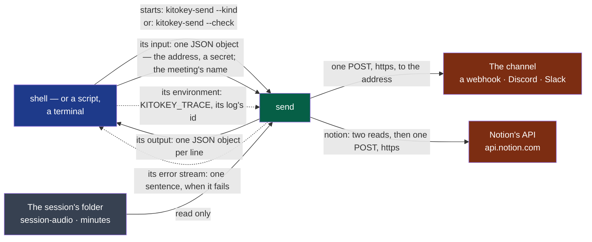

# posting — version 1

How the program that sends a meeting's summary to a channel is started, what it is given, what it
sends, and what it says: one line of text per event, for whoever started it. D110's program,
framed by [PDR-0007](../../../docs/pdr/0007-a-summary-leaves-for-a-channel-on-a-gesture-never-a-confidential-one.md),
consumed by the shell. D116 added Notion, a fourth kind, to this version (*Notion*): an additive change,
every earlier input, line and code unchanged.



**Legend** — green: the producer · blue: whoever started it, the consumer · grey: what it reads, each
file by its own contract · brown: what it contacts, off the machine, and nothing else.

**For a machine**: [`input.schema.json`](./input.schema.json) says what its input is,
[`event.schema.json`](./event.schema.json) what a line of its output is, and
[`payload.schema.json`](./payload.schema.json) what a generic webhook receives — each judged by the
project's comparator (ADR-0005). What a schema cannot say is said here and nowhere else.

## How it is started

- `kitokey-send <session-folder> --kind <kind>`, the options in any order: sends the meeting's
  summary once, to the address on its input. `<kind>` is `webhook`, `discord`, `slack` or `notion`: what
  the address is, and so what it is sent (*What it sends*, *Notion*).
- `kitokey-send --check`: sends nothing; says whether the address on its input would be refused.
  Settings asks it before keeping an address (PDR-0007, *Edge cases*).
- `kitokey-send --check --kind notion`: sends nothing; reads the database with the key, as a send would
  before it creates anything, and says whether both would do (*Notion*).

The arguments hold no word of the meeting and no address: a session's folder is named by the day and
hour it started (`session-audio`). A process's arguments are public to the machine's users; a
webhook's address is a secret — whoever holds it posts to the channel —, so it goes on the input.

**Its input**: one JSON object, UTF-8, then the end of the input. Each value is on one line:

| Field | Holds |
|---|---|
| `address` | The channel's webhook address, as the person pasted it; for `notion`, the database's link. Always |
| `name` | The meeting's name, for a meeting whose minutes hold no title: its `title.txt`, or the shell's name for it. `--check` ignores it |
| `key` | For `notion` alone, and always with it: the integration's key, as the person pasted it — a secret, as an address is. The other kinds ignore it |

## Which addresses it refuses

Before anything is sent, and by `--check`, an address is refused — `failed`, `address.refused` — when:

- it is not `https:`;
- it holds a user or a password (`https://user:secret@…`);
- its host is, or resolves to, an address of this computer or of a local network, one of:
  - loopback: `127.0.0.0/8`, `::1/128`;
  - unspecified: `0.0.0.0/8`, `::/128`;
  - private: `10.0.0.0/8`, `172.16.0.0/12`, `192.168.0.0/16`;
  - shared: `100.64.0.0/10`;
  - link-local: `169.254.0.0/16`, `fe80::/10`;
  - unique local: `fc00::/7`;
  - multicast: `224.0.0.0/4`, `ff00::/8`;
  - broadcast: `255.255.255.255/32`;
  - NAT64 for local use: `64:ff9b:1::/48`.

  An IPv6 address that carries an IPv4 one is judged as that IPv4 address: mapped (`::ffff:0:0/96`),
  and NAT64's well-known prefix (`64:ff9b::/96`).

**Every** address the host resolves to is judged, and the connection is made to one of the addresses
judged, never to a second resolution: a name cannot answer a public address to the check and a local
one to the connection. The host is judged as the parser the program connects with reads it, so an IPv4
written another way (`0x7f.1`, `2130706433`) is the address it stands for.

A redirect is never followed: an answer `3xx` is a refusal of the destination. No proxy is followed:
`HTTPS_PROXY`, `ALL_PROXY` and the system's are ignored, since a proxy would resolve the host itself,
beyond the judgement and the address it pins. The host is read lowercased, a name in another script as
its punycode (IDNA), before it is resolved.

## What it sends

The meeting's summary is its `minutes` (v1 to v5, by their contract): the title — the minutes' `title`,
or `name` when they hold none —, the sections as the minutes hold them, CommonMark, and the actions —
the second section of v1 to v4, the section `actions` names in v5, none when v5 names none —, each item
a string. **Never the audio, never the transcript**, and nothing of the front matter but the title.

| `--kind` | One POST to the address | Within |
|---|---|---|
| `webhook` | `application/json`: one object, [`payload.schema.json`](./payload.schema.json) — `title`; `summary`, the sections as Markdown, each opening on its `## ` title; `actions`, each item without its bullet | Nothing the program bounds |
| `discord` | `multipart/form-data`, as [Discord's *Execute Webhook*](https://discord.com/developers/docs/resources/webhook) takes it: `payload_json` whose `content` is the title in bold, then the summary's first lines, cut at a line's end, and `allowed_mentions` `{"parse": []}`: a webhook parses users' mentions by default, so a summary holding `<@id>` would ring that person; with it, no mention notifies anyone ([Allowed Mentions](https://discord.com/developers/docs/resources/message#allowed-mentions-object); [Execute Webhook](https://discord.com/developers/docs/resources/webhook#execute-webhook) sets it « to prevent unexpected mentions », both read by #1051's verifier, 2026-11-20); `files[0]`, the summary as a Markdown file, `# ` and the title then the sections, named after the session's folder (`2026-11-20_09-30.md`) | `content`, 2000 characters; the file, 20 MiB — Discord's default, read on that page, 2026-11-20 |
| `slack` | `application/json`: `{"text": …}`, the title in bold then the summary, in [mrkdwn](https://docs.slack.dev/messaging/formatting-message-text/) — Slack's own syntax, not Markdown: headings in bold, `**bold**` as `*bold*`, a link as `<url\|text>`, `&`, `<` and `>` escaped | 40,000 characters, past which Slack truncates a message ([chat.postMessage](https://docs.slack.dev/reference/methods/chat.postMessage/), read 2026-11-20) |

A summary that does not fit within the bounds is not cut to fit: `failed`, `summary.too_large`, and
nothing is sent. Discord's `content` is the one place cut, by design: the file carries the whole.

**Once**: one POST, never sent again by the program — not on a failure, not on a `429`. Whether to
send again is the person's gesture.

## Notion

`--kind notion` reaches Notion's API, never the address: the address is the link of a database the
person shared with their own internal integration, and the key is that integration's
([*Authorization*](https://developers.notion.com/docs/authorization)). Its rules, read on Notion's pages on
2026-11-23 — none of which shows the day it last changed:

- **The database** is the 32-character string the link holds after its last `/` and before any `?`,
  hyphens left out ([*Retrieve a database*](https://developers.notion.com/reference/retrieve-a-database));
  a link that is not `https:` or holds none is `address.refused`, nothing contacted.
- **Every request** goes to `https://api.notion.com`, with `Authorization: Bearer <key>` and
  `Notion-Version: 2026-03-11`, the version this contract pins
  ([*Versioning*](https://developers.notion.com/reference/versioning)); another is a change of this page.
  The rules of *Which addresses it refuses* — every resolved address judged, no redirect, no proxy — hold
  for that host.
- **A send** reads, then creates, within the 30 s of a send: `GET /v1/databases/<database>` for its first
  data source, `GET /v1/data_sources/<data source>` for the name of its one `title` property
  ([*Retrieve a data source*](https://developers.notion.com/reference/retrieve-a-data-source)), then **one**
  `POST /v1/pages` — the one request that creates, never sent again. A read that fails ends the send with its
  code: nothing was created.
- **The page** ([*Create a page*](https://developers.notion.com/reference/post-page)): its parent the data
  source; its title property, the title; its `children`, the summary as blocks
  ([*Block*](https://developers.notion.com/reference/block)) — a section's `## ` title a `heading_2`, a
  `### ` one a `heading_3`, a paragraph a `paragraph`, an item a `bulleted_list_item` or a
  `numbered_list_item`, a `> ` line a `quote`, a fenced block a `code` in `plain text`, `---` a `divider` —,
  and each action a `to_do`, left unticked. Inline, `**bold**`, `*italic*` and `` `code` `` become a rich
  text's `annotations`, a link `[text](url)` its `link` ([*Rich text*](https://developers.notion.com/reference/rich-text)).
- **Within Notion's limits** ([*Request limits*](https://developers.notion.com/reference/request-limits)):
  a rich text's `content` at most 2000 characters, a longer text split over several; at most 100 rich
  texts in a block; at most 100 blocks in `children`, one level, none nested; at most 500 KB a request.
  A summary that does not fit **one** request is `summary.too_large`, and nothing is created: a second
  request could fail after the first and leave half a page.

Notion's answers, read as its [*Status codes*](https://developers.notion.com/reference/status-codes) say:

| Status, Notion's `code` | `code` here | Nothing was created? | What a person does |
|---|---|---|---|
| `401` `unauthorized` | `key.refused` | Nothing | Paste the integration's key again, or a new one |
| `404` `object_not_found` | `database.unshared` | Nothing | Share the database with the integration — its « ••• » menu, *Connections* —, or set up a database that exists |
| `403` `restricted_resource` | `key.restricted` | Nothing | Give the integration the right to insert content, in Notion |
| `429` `rate_limited` | `destination.busy`, with `retry_after` from `Retry-After` | Nothing | Wait, then send again |
| `400` `validation_error`, and any other `3xx` or `4xx` | `destination.refused` | Nothing | Check that the link is a database's |
| `5xx` | `destination.failed` | Nothing | Try again later |

Notion gives `404` both for a database that does not exist and for one not shared with the
integration: `database.unshared` names both. No answer to the `POST` within the bound is
`destination.silent`: the page may have been created.

## What it carries

**The output**: UTF-8, one JSON object per line, nothing else. Each has `event`:

| `event` | Other fields | Says |
|---|---|---|
| `sent` | — | The destination answered `2xx`. **Last**, and the only line, when a send succeeds |
| `checked` | — | `--check`: the address is not refused. **Last**, and the only line |
| `failed` | `code`: the cause, one of the codes below, on one line; `retry_after`: seconds, a whole number, with `destination.busy` when the destination said it | The program is ending in failure. **Last**, and the only line |

**Failing**: the program ends in failure with one sentence on its error stream, starting
`kitokey-send: `, and no `sent`. The sentence never holds the address, nor any part of it: a
consumer logs it, and a client's error often names its URL, which here is the secret. When the cause is one a person acts on differently, the output's one
line names it: `failed`, with its `code`; the program exits 1. Otherwise no line names it, and the
sentence alone does, exit 2: wrong arguments, an input that is not this page's, an output that closed.
The destination's answer is external input: only its status, and `Retry-After`, are read — its body
is never shown, logged or written.

| `code` | The cause | Nothing was sent? | What a person does |
|---|---|---|---|
| `address.refused` | *Which addresses it refuses* | Nothing | Paste the channel's `https:` webhook address |
| `meeting.unreadable` | The session's folder, or a file in it, could not be read | Nothing | Check the folder, then try again |
| `meeting.confidential` | The meeting is said confidential (`session-audio`'s `confidential`) | Nothing | Nothing to do: a confidential meeting is never sent (PDR-0007) |
| `meeting.no_summary` | The meeting has no minutes, or none it can read | Nothing | Write the summary first |
| `summary.too_large` | It does not fit within the destination's bounds | Nothing | Send it as a file instead (`exporting`) |
| `network.unreachable` | No connection: no network, the host not found, its certificate refused | Nothing | Check the connection, then try again |
| `destination.silent` | Sent, and no answer within 30 s | **Maybe arrived** | Look in the channel before sending again |
| `destination.gone` | `401`, `403`, `404` or `410`: the webhook deleted, revoked or never one | Refused by it | Set the destination up again, with a new address |
| `destination.busy` | `429`: too many sends | Refused by it | Wait `retry_after` seconds, then send again |
| `destination.refused` | Any other `3xx` or `4xx` | Refused by it | Check that the kind matches the address |
| `destination.failed` | `5xx` | Refused by it | Try again later |
| `key.refused` | `notion`: `401`, the key not valid | Nothing | Paste the integration's key again, or a new one |
| `database.unshared` | `notion`: `404`, the database not shared with the integration, or gone | Nothing | Share the database with the integration, from Notion |
| `key.restricted` | `notion`: `403`, the integration without the right to insert content | Nothing | Give it that right, in Notion |

A consumer reads a code this page does not list as no code: a later code is added here, never a new
version for it.

## What it promises

- It reads `session-audio` and `minutes` by their contracts. The session's folder is only read: the
  record of a send — to which destination, when — is the consumer's (PDR-0007, decision 5).
- `meeting.confidential` is judged before the address is: a confidential meeting is never sent, whoever
  started the program.
- It contacts the address alone, once, over `https:`, within 30 s, and nothing else: no proxy, no
  telemetry. For `notion`, Notion's API alone, two reads then one creation, within the same 30 s.
- Its logs follow ADR-0007, under `KITOKEY_TRACE` when it is given: the kind, the outcome, the status
  and the size sent; **never the address, nor any part of it**, never the key, nor any word of the meeting.

## Examples

Started with:

```sh
echo '{"address": "https://discord.com/api/webhooks/<id>/<token>", "name": "Réunion du 20 nov. 2026"}' \
  | kitokey-send <meetings>/2026-11-20_09-30 --kind discord
```

It succeeded:

```json
{"event": "sent"}
```

For Notion — the key and the link made up:

```sh
echo '{"address": "https://www.notion.so/team/Notes-0123456789abcdef0123456789abcdef?v=1", "key": "ntn_made-up", "name": "Point hebdo"}' \
  | kitokey-send <meetings>/2026-11-20_09-30 --kind notion
```

It failed, and says why:

```json
{"event": "failed", "code": "destination.busy", "retry_after": 2}
```

Valid — a generic webhook received, for minutes whose second section is the actions:

```json
{
  "title": "Point hebdo",
  "summary": "## Résumé\n\nLe lancement est fixé.\n\n## Actions\n\n- Écrire la note — Léa — vendredi [12:04]\n",
  "actions": ["Écrire la note — Léa — vendredi [12:04]"]
}
```
