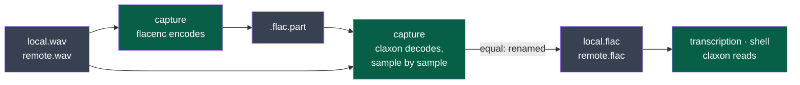

# ADR-0016 — FLAC written by flacenc, read by claxon, each checked against the other

> The framework's words: `.nstack/handbook/glossary.md`.

- **Status**: Proposed — the framer's, for cycle 09's D87
- **Date**: 2026-11-07
- **Decision makers**: the decider, `@napkinstack-admin`; proposed by an agent
- **Scope**: project — module `capture` writes, modules `transcription` and `shell` read; contract `session-audio/v3`
- **Reversibility**: easy — one function on each side, behind the contract's FLAC; any lossless FLAC library replaces it

---

**Legend** — green: Kitokey's programs and the library each calls · grey: the files of a meeting.

## Context

Cycle 09's D87 keeps a stopped meeting's tracks as FLAC (`contracts/session-audio/v3`): capture encodes,
decodes what it wrote and compares it with the WAV sample by sample before the WAV is removed; the
transcription and the shell read a FLAC as they read a WAV. Both sides are Rust programs built for Linux,
Windows and macOS, today with no C library to build but whisper.cpp. No module encodes or decodes FLAC yet.

## Problem

Which library encodes FLAC in capture, and which decodes it in capture's check and in the readers?

## Constraints

- **Lossless, 24 bits, any rate and channel count** a source delivers (`session-audio/v2`, *A track*).
- **A licence GPL-3.0 can carry** (the repository's).
- **Built on the three systems** by `cargo` alone, as the modules are today; no system library asked of the user.
- **The decoder that checks is the decoder that reads**, so that what capture verified is what a reader gets.

---

## Prior art

**Dominant convention of the field:** libFLAC, Xiph's reference implementation, encodes and decodes FLAC
in most applications (Audacity, ffmpeg's own decoder aside); in Rust, pure-Rust crates are preferred to
binding a C library when they read the format exactly.

**References examined** — each measured on 2026-11-07 on a 3 s, 24-bit stereo, 48 kHz note (288,000 samples),
in a probe crate outside the repository:

| Reference | What it does | Applicable here? |
|---|---|---|
| [libFLAC](https://xiph.org/flac/) via [`libflac-sys`](https://crates.io/crates/libflac-sys) 0.3.4, BSD-3-Clause | The reference encoder and decoder, a C library built by the crate | Yes, at the cost of a C build in three modules on three systems; **not measured** |
| [`flacenc`](https://crates.io/crates/flacenc) 0.5.1, Apache-2.0, pure Rust, released 2025-12-18 | An encoder | **Yes**: its stream decoded by ffmpeg and by claxon, 288,000 of 288,000 samples equal; 163,232 bytes against ffmpeg's 169,223 at its default |
| [`claxon`](https://crates.io/crates/claxon) 0.4.3, Apache-2.0, pure Rust, last release 2020-08-09 | A decoder, tested by its author against the reference decoder | **Yes**: ffmpeg's FLAC and flacenc's both decoded, every sample equal |
| [Symphonia](https://crates.io/crates/symphonia-bundle-flac) 0.6.1, MPL-2.0, pure Rust, released 2026-08-13 | A media framework, FLAC among its decoders | **No, today**: ffmpeg's FLAC decoded exactly, but flacenc's stream refused (`UnexpectedEof` in `FlacReader::try_new`; that stream holds STREAMINFO alone, marked last) |

**Why the convention is not enough:** libFLAC asks a C build of capture, transcription and the shell on
Linux, Windows and macOS, where two pure-Rust crates were measured exact on the format a meeting holds.

---

## Options considered

### Option 1 — flacenc writes, claxon reads and checks
- Description: capture encodes with flacenc, decodes its own `.flac.part` with claxon and compares; the readers decode with claxon.
- Advantages: pure Rust, nothing to build; measured exact both ways; the check and the reading are one decoder.
- Drawbacks: claxon has had no release since 2020 — the format it reads is fixed, standardised as RFC 9639 in 2024; flacenc has one maintainer.
- Cost of getting out: one function in capture, one in each reader, held by their tests.

### Option 2 — libFLAC on both sides
- Description: `libflac-sys` in capture, transcription and the shell.
- Advantages: the reference; maintained by Xiph.
- Drawbacks: a C library built three times, on three systems, by every build and every CI run.
- Cost of getting out: the same functions.

### Option 3 — flacenc writes, Symphonia reads
- Advantages: Symphonia is maintained and could later read other formats.
- Drawbacks: refuses flacenc's stream today: the check would fail on every meeting.

### Option 4 — Do nothing
- The tracks stay WAV: D87 not delivered; a meeting keeps twice the room.

---

## Decision

**Option 1.** It is the only option measured exact on both sides with nothing to build, and capture's
check — every sample decoded and compared before the WAV goes — turns any fault of either library into a
kept WAV, never a lost sample (`contracts/recording/v1`, *The tracks final*).

### Deviation from the convention

- **Expected user value**: a meeting weighs about half (cycle 02 measured 48 %) with no build step added to the three systems.
- **How we will observe it**: D87's sheet — the bench's meeting and an hour recorded, each WAV against its FLAC.

---

## Success criterion

> We will consider this was the right call if **every meeting capture compresses in D87's e2e and on the
> bench is checked equal and read back equal by the transcription and the shell, with no C library added**,
> observed before **2026-11-21**.

What we do if it is not: libFLAC on the side that fails (Option 2), behind the same function.

---

## Consequences

**Positive:** one decoder for the check and the reading; no new build step.

**Negative and accepted debt:** claxon is unmaintained; a fault in it is caught by capture's check
(a WAV kept), not by a reader. Symphonia's refusal of flacenc's stream is reported upstream, so that
Option 3 can be measured again.

**Impacts on other modules or contracts:** `capture` declares flacenc and claxon; `transcription` and
`shell` declare claxon — each in its manifest with this record and its exit strategy.

**Rule to automate:** each module's tests decode a FLAC flacenc wrote, 24 bits, and compare every sample.

---

## Rejected alternatives

- **A lossy codec (Opus) for the tracks**: ADR-0004 keeps the audio as recorded; cycle 09's *Later* holds
  a compact copy of old meetings, after a bench.
- **ffmpeg as a program**: one more program shipped on three systems for one format.
