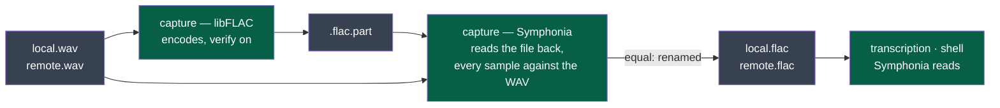

# ADR-0016 — FLAC written by libFLAC, the reference, and read by Symphonia

> The framework's words: `.nstack/handbook/glossary.md`.

- **Status**: Accepted — by the decider, 2026-11-07, in the session that wrote it: « ADR-0016 acceptée ». Its
  first version chose flacenc and claxon (#698); rewritten the same day, before the acceptance, on the
  decider's word « étudie les solutions du marché (gratuit) pour trancher » (#699)
- **Date**: 2026-11-07
- **Decision makers**: the decider, `@napkinstack-admin`; proposed by an agent
- **Scope**: project — module `capture` writes, modules `transcription` and `shell` read; contract `session-audio/v3`
- **Reversibility**: easy — one function on each side, behind the contract's FLAC; any lossless FLAC library replaces it

---

**Legend** — green: Kitokey's programs and the library each calls · grey: the files of a meeting.

## Context

Cycle 09's D87 keeps a stopped meeting's tracks as FLAC (`contracts/session-audio/v3`): capture encodes,
decodes what it wrote and compares it with the WAV sample by sample before the WAV is removed; the
transcription and the shell read a FLAC as they read a WAV. Both sides are Rust programs built for Linux,
Windows and macOS. Building the package already asks for a C toolchain and `cmake` (whisper.cpp,
`modules/install/kitokey.spec`).

## Problem

Which library encodes FLAC in capture, and which decodes it in capture's check and in the readers?

## Constraints

- **Lossless, 24 bits, any rate and channel count** a source delivers (`session-audio/v2`, *A track*).
- **A licence GPL-3.0 can carry** (the repository's).
- **One code for the three systems** (ADR-0002): no part written for one system.
- **Free**: no paid codec, no system component a user must install.

---

## Prior art

**Dominant convention of the field:** [libFLAC](https://xiph.org/flac/), Xiph's reference implementation
of the format standardised as [RFC 9639](https://www.rfc-editor.org/rfc/rfc9639) (2024): the encoder of
`flac` itself and of most applications that write FLAC.

**References examined** — each measured on 2026-11-07 in a probe outside the repository, on a 3 s
note and on 5 minutes of speech with a room's noise floor, 24-bit stereo, 48 kHz (28,995,582 samples):

| Reference | What it does | Measured, or read | Applicable here? |
|---|---|---|---|
| [libFLAC](https://xiph.org/flac/) through [`libflac-sys`](https://crates.io/crates/libflac-sys) 0.3.4, BSD-3-Clause, built from its sources by `cmake` | The reference encoder; its *verify* mode decodes each frame as it encodes and compares | 22.2 % of the WAV; encoded, verified and read back twice in 0.62 s; read exactly by Symphonia and claxon; built in 6 s | **Yes — the encoder** |
| [Symphonia](https://crates.io/crates/symphonia-bundle-flac) 0.6.1, MPL-2.0, pure Rust, released 2026-08-13, maintained | A media framework's FLAC decoder | libFLAC's and ffmpeg's FLAC read exactly, every sample | **Yes — the decoder** |
| [`flacenc`](https://crates.io/crates/flacenc) 0.5.1, Apache-2.0, pure Rust, one maintainer | An encoder | 22.2 %, exact by ffmpeg and claxon, 0.26 s — but **its stream refused by Symphonia** (`UnexpectedEof` opening it) | No: a stream the maintained decoder cannot open |
| [`claxon`](https://crates.io/crates/claxon) 0.4.3, Apache-2.0, pure Rust, last release 2020-08-09 | A decoder | Every stream read exactly, 0.18 s for the 5 minutes | Second choice: unmaintained |
| ffmpeg, as a program | Encodes and decodes everything | 22.2 % | No: one more program shipped on three systems for one format |
| Windows Media Foundation's FLAC encoder (`CLSID_CMSFLACEncMFT`, Windows 10) | The system's codec | Undocumented by Microsoft ([a 2018 question](https://windows-hexerror.linestarve.com/q/so48930499-how-do-i-encode-raw-48khz32bits-pcm-to-flac-using-microsoft-media-foundation)) | No: undocumented, and Windows alone |
| macOS AudioToolbox (`kAudioFormatFLAC`, macOS 10.13) | The system's codec identifier | [Apple's page](https://developer.apple.com/documentation/coreaudiotypes/kaudioformatflac) lists it; no source found that it **encodes** | No: unproven, and macOS alone |
| Linux | No system FLAC API beyond libFLAC itself | — | — |

**Why the convention is not enough:** it is enough for writing. For reading, a pure-Rust decoder spares the
shell — which builds no C today — a C library, and Symphonia reads libFLAC's output exactly.

---

## Options considered

### Option 1 — libFLAC writes (verify on), Symphonia reads and re-reads
- Description: capture encodes with libFLAC, its verify mode on; reads the written `.flac.part` back with
  Symphonia and compares every sample with the WAV; transcription and the shell read with Symphonia.
- Advantages: the reference writes the files a meeting keeps forever; two independent decoders check them
  (libFLAC's own, then Symphonia from the file on disk); the readers stay pure Rust; both libraries maintained.
- Drawbacks: a C library built in capture, by the toolchain the package already asks.
- Cost of getting out: one function in capture, one in each reader, held by their tests.

### Option 2 — flacenc writes, claxon reads (this record's first version)
- Advantages: pure Rust everywhere.
- Drawbacks: one maintainer on the encoder, none on the decoder; the maintained decoder refuses the encoder's
  stream — a sign of a corner of the format the two read differently.

### Option 3 — libFLAC on both sides
- Advantages: one library.
- Drawbacks: a C build added to the shell and the transcription for reading only; the check would decode with
  the encoder's own library.

### Option 4 — each system's own codec
- Drawbacks: three codes, two of them undocumented or unproven; Linux has none.

### Option 5 — Do nothing
- The tracks stay WAV: D87 not delivered; a meeting keeps its whole weight.

---

## Decision

**Option 1.** The three encoders measured compress alike — 22.2 % of the WAV —, so the choice is not
size: it is who has written FLAC longest and whose files every reader opens. That is libFLAC, and its
verify mode already does half of capture's check. Symphonia reads it exactly, is maintained, and is
pure Rust, so the shell and the transcription add no C. Capture's re-reading of the file on disk with
Symphonia, against the WAV, turns any fault — the encoder's, the decoder's, the disk's — into a kept
WAV, never a lost sample (`contracts/recording/v1`, *The tracks final*).

---

## Success criterion

> We will consider this was the right call if **every meeting capture compresses in D87's e2e and on the
> bench is checked equal and read back equal by the transcription and the shell, on Linux, Windows and
> macOS builds**, observed before **2026-11-21**.

What we do if it is not: claxon in place of Symphonia on the side that fails (Option 2's decoder).

---

## Consequences

**Positive:** the reference writes what is kept; two decoders check it; the readers stay pure Rust.

**Negative and accepted debt:** capture builds a C library (6 s here), as the transcription builds
whisper.cpp. Symphonia's refusal of flacenc's stream is reported upstream.

**Impacts on other modules or contracts:** `capture` declares `libflac-sys` and Symphonia's FLAC crates;
`transcription` and `shell` declare Symphonia's — each in its manifest with this record and its exit strategy.

**Rule to automate:** each module's tests read a FLAC libFLAC wrote, 24 bits, and compare every sample.

---

## Rejected alternatives

- **flacenc with claxon** (this record's first version, #698): above, Option 2.
- **A lossy codec (Opus) for the tracks**: ADR-0004 keeps the audio as recorded; cycle 09's *Later* holds a
  compact copy of old meetings, after a bench.
