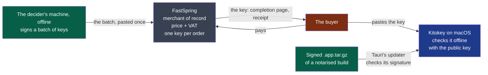

# ADR-0017 — macOS sold through a merchant of record, a signed key checked offline, Tauri's updater

> The framework's words: `.nstack/handbook/glossary.md`.

- **Status**: Proposed
- **Date**: 2026-11-20
- **Decision makers**: the decider, `@napkinstack-admin`; proposed by an agent (marc, session 2b57f890-8981-4ce3-92f0-1ca23ed36acf)
- **Scope**: project — the macOS build, sold; modules `shell` (the licence check, the updater) and `install` (the
  signed, notarised package). No build in cycle 11 (D107): cycle 12 builds what this decides.
- **Reversibility**: costly — the merchant holds the customers and their receipts; the licence key's format is in
  every key sold. The updater is easy to change before the first release that carries it, costly after.

---

## Context

[PDR-0001](../pdr/0001-wholeheard-open-on-linux-paid-on-macos-and-windows.md), decision 4: macOS and Windows are
sold once, €49 to €69, after a trial (14 days or 10 meetings), « with a licence key checked on the machine: no
account, nothing sent. A merchant of record takes the payment and the VAT. The builds are signed (Apple
notarisation…) and update themselves. » Windows goes through the Microsoft Store since
[PDR-0004](../pdr/0004-windows-through-the-microsoft-store.md), which sells, licenses and updates it. macOS has none
of the three: no merchant, no licence check, no updater, no signing (the gap list of 2026-11-18). Linux is free and
updated by its repositories.

Kitokey already verifies signatures with minisign — Ed25519 — on the list of models it offers
([ADR-0010](./0010-the-models-offered-are-a-list-kept-in-the-repository.md), `minisign-verify` in the shell). Kitokey
runs no server today.

What changed since PDR-0001: its prior art cites Meetily selling through Lemon Squeezy; **Lemon Squeezy « is no
longer accepting new sign-ups and will shut down on March 31, 2027 »** ([its pricing page](https://www.lemonsqueezy.com/pricing),
read 2026-11-20).

## Problem

Who sells Kitokey on macOS, how does the app know a licence is paid without sending anything, and how does a
notarised app update itself — without Kitokey running a server?

## Constraints

- PDR-0001: no account, nothing sent to check a licence; a one-time price; the VAT taken by a merchant of record.
- **No server of ours**: no secret held online, nothing to keep up, no one to wake when it falls. Kitokey runs none
  today, and cycle 11 keeps it so (« no secret embedded, no cloud of ours »).
- Apple: to ship outside the App Store, a `Developer ID Application` certificate, and « Notarization is required
  when using a Developer ID Application certificate » ([Tauri, macOS signing](https://v2.tauri.app/distribute/sign/macos/),
  updated 2026-05-17). The Apple Developer Program is « $99 annual membership »
  ([Apple](https://developer.apple.com/programs/)).
- The shell is Tauri 2 (ADR-0002); its team writes Rust, not Objective-C.

---

## Prior art

**Dominant convention of the field:** an indie Mac app sold outside the App Store goes through a merchant of record
that delivers a licence key with the order, the app checks the key against a public key, and updates with Sparkle
or its framework's updater, the update signed with Ed25519.

**References examined** (each page read 2026-11-20):

| Reference | Fee | Merchant of record, VAT | Licence keys |
|---|---|---|---|
| [FastSpring](https://fastspring.com/pricing/) | « revenue-sharing », « our fees vary depending on the transaction volume »: by quote, no figure published | « collect and remit sales taxes »; « Remit VAT/sales taxes on your behalf: Included » | Delivered with the order, from a **pre-defined list** the seller pastes (« If you have an existing list of license keys, paste them in the Pre-Defined List field »), a script, a remote server or CocoaFob; the key « can appear on the completion page, email receipt, or account management portal » ([licence key fulfilments](https://developer.fastspring.com/docs/license-key-fulfillments.md), updated 2026-01-21) |
| [Paddle Billing](https://www.paddle.com/pricing) | « 5% + 50¢ » « per Checkout transaction », « No monthly fees » | « Paddle as your Merchant of Record »; « We collect the correct rate of tax » | None: Classic handled them, but « New signups for Paddle Classic aren't allowed »; Billing: « Build your own workflows using transaction webhooks » ([Paddle's docs](https://developer.paddle.com/llms.txt)) — a server of ours |
| [Gumroad](https://gumroad.com/pricing) | « 10% + $0.50 » on direct sales | « Gumroad is your merchant of record »; « Since January 1, 2025, Gumroad handles ALL your tax obligations » | Not verified: its help page on licence keys did not load |
| [Lemon Squeezy](https://www.lemonsqueezy.com/pricing) | « 5% + 50¢ » | « Lemon Squeezy is your merchant of record » | A License API checked by `POST /v1/licenses/validate`, online ([License API](https://docs.lemonsqueezy.com/api/license-api)) — and it closes on 2027-03-31 |
| [Keygen](https://keygen.sh/docs/api/cryptography/) | Paid tiers ([pricing](https://keygen.sh/pricing/)) | Not a merchant | Licences signed with the account's key, « powerful options for offline license verification »; « your account ID and public key should be hard-coded into your application code » |
| [Tauri's updater](https://v2.tauri.app/plugin/updater/) (updated 2025-11-28) | — | — | Updates: `myapp.app.tar.gz` and its `.sig`; « Tauri's updater needs a signature… This cannot be disabled »; the public key in `tauri.conf.json` |
| [Sparkle 2](https://sparkle-project.org/documentation/) | — | — | Updates: « Sparkle's EdDSA (ed25519) signature », the key in `Info.plist`; « Notarize and code sign the application via Apple's Developer ID program » |

**Why the convention is not enough:** it is enough. Kitokey follows it, choosing among its parts.

---

## Options considered

The updater is the same in every option (Tauri's, below); the options differ in who issues the key.

### Option 1 — FastSpring delivers keys Kitokey signed beforehand

- **Description**:
  - The decider signs, on their own machine, a batch of keys — say 5,000 —, each a short payload signed with
    Kitokey's Ed25519 private key: a serial number, the major version it covers. The private key never leaves that
    machine, kept offline as ADR-0010's minisign key is.
  - The batch is pasted into FastSpring's pre-defined list. Each order takes one key; FastSpring shows it on the
    completion page and in its receipt.
  - The app checks a key with the public key built in: offline, no account, nothing sent.
- **Cost**: FastSpring's share, unknown until its quote. Operation: none running; a batch to refill before it runs
  out — minutes of the decider's, a few times a year at most.
- **Risk**: what FastSpring does with an empty list is not documented — an order without a key. Kept far from it by
  a batch large against sales, and its count watched in FastSpring's dashboard. A key, once sold, cannot be revoked
  except by a list of refused serials shipped in an update.
- **Cost of getting out**: another merchant that takes a list (or the same batch on a server, option 2): the keys
  sold stay valid, since they are ours.

### Option 2 — Paddle Billing and a function of ours that signs each key

- **Description**: Paddle sells; its `transaction.completed` webhook reaches a function of ours, which signs a key
  for that order and emails it.
- **Cost**: 5% + 50¢ — about €2.95 at €49, 6 %. Operation: the function's hosting, an email service, its secret, its
  logs, its availability, and someone to warn when it falls.
- **Risk**: the private key held online; a function down is a buyer who paid and has no key; a webhook missed is
  the same. It is Kitokey's first server.
- **Cost of getting out**: as option 1.

### Option 3 — A licence service (Keygen) beside a merchant

- **Description**: Keygen issues and signs the keys from the merchant's webhook; the app checks them offline.
- **Cost**: a third vendor's fee beside the merchant's; no server of ours.
- **Risk**: the signing key is Keygen's account's: leaving Keygen means new keys for every customer.

### Option 4 — Gumroad

- **Description**: Gumroad sells and takes the taxes; its own licence keys.
- **Cost**: 10% + $0.50 — about €5.40 at €49, 11 %, twice Paddle's.
- **Risk**: how its keys are made and checked was not read; not retained without it.

### Option 5 — Do nothing

- macOS stays unsold: PDR-0001's decision 4 unmet, and the Mac's users build it or go without.

---

## Decision

**Legend** — brown: the buyer · grey: the merchant · green: what Kitokey makes, offline or published as a static
file · blue: the app. No server of ours: the private key stays on the decider's machine, the update feed is a
static file beside the release.

**Option 1**: FastSpring delivers keys Kitokey signed beforehand; Tauri's updater.

- **No server of ours** settles it: option 2 is Kitokey's first server, a secret online, for each sale; option 1 runs
  nothing and keeps the private key offline. Option 3 holds no server either, but gives the signing key to a vendor
  and adds a fee. Option 4 costs twice as much, its keys unread.
- **The condition**: FastSpring's quote. If it is above Paddle's 5% + 50¢ at €49–69, the decider weighs that
  difference against running a server (option 2); this ADR recommends paying the difference.
- **The key is ours**, whatever the merchant: Ed25519 over a serial and a major version, checked offline with the
  public key built into the app — as Keygen recommends, and as Kitokey already checks its list of models. A key
  covers a major version: minor versions included, as PDR-0001 says. It is never sent anywhere.
- **The updater is Tauri's**: in the stack, Ed25519 signatures, the feed a static file. Sparkle is the Mac's own
  convention, but it is an Objective-C framework to embed beside Tauri for the same check.
- **The trial** stays the app's own, 14 days or 10 meetings (PDR-0001): the key ends it.

### What the Mac App Store would change — not decided here

PDR-0001 leaves the Mac App Store « Later, perhaps ». Its rules (App Review Guidelines 2.4.5, read 2026-11-20):

- « They must be appropriately sandboxed » — and whether Kitokey's capture of the system's sound works in the
  sandbox is **not established**: Apple's pages on the sandbox and ScreenCaptureKit did not say. A spike first.
- « They may not present a license screen at launch, require license keys, or implement their own copy protection »:
  the key above goes, the purchase becomes Apple's.
- « They must use the Mac App Store to distribute updates; other update mechanisms are not allowed »: the updater
  above goes.
- Apple takes « 15% on paid apps » under the [Small Business Program](https://developer.apple.com/app-store/small-business-program/)
  (proceeds under 1 million USD).

So the App Store is a second build, not a setting of this one: no key, no updater, a sandbox. It stays later.

---

## Success criterion

> We will consider this was the right call if **a buyer on macOS pays through FastSpring, receives a key from the
> pre-signed list and unlocks a notarised Kitokey offline, then receives an update through Tauri's updater — with no
> server of Kitokey's running —, on a build of cycle 12** before **2026-12-18**.

What we do if it is not: correct — if FastSpring refuses or its list fails, another merchant that takes a list; a
server (option 2) only on the decider's word, as a new record.

---

## Consequences

**Positive:**
- No account and nothing sent to check a licence, as PDR-0001 promises; no server of ours, no secret online.
- The key format is ours: a merchant can change without re-issuing a key.
- One signature algorithm, Ed25519, for the models' list, the licence and the updates.

**Negative and accepted debt:**
- A batch to refill before it runs out — the decider's, by hand. What an empty list does is not documented.
- A key copied is a key copied, and a key sold cannot be revoked but by a list of refused serials in an update. The
  convention accepts it; so does PDR-0001 (« no account, nothing sent »).
- FastSpring's fee is unknown until its quote.

**Impacts on other modules or contracts:** `shell` — the licence check and the updater (cycle 12); `install` — the
macOS package signed with Developer ID and notarised, an `.app.tar.gz` and its signature published beside it, and the
tool that signs a batch of keys offline.

**Rule to automate:** a test of the shell that a key altered by one character is refused and that the public key
built in is the batch's; and a check that no secret key is in the repository — cycle 12, with the build.

---

## Rejected alternatives

- **Paddle Billing with a function of ours** (option 2): Kitokey's first server, its private key online, for each
  sale — kept only as the fallback the decider may choose against FastSpring's quote.
- **Lemon Squeezy**: it closes on 2027-03-31, and its licence check is a call to its server.
- **Paddle Classic's licence keys**: closed to new sellers.
- **An online activation** (Lemon Squeezy's, Keygen's online mode): the app would send something to check a
  licence, which PDR-0001 refuses.
- **The Mac App Store now**: a second build, without a key or an updater, in a sandbox not yet known to let Kitokey
  record the system's sound.

---

## Not verified here

- FastSpring: its fee (by quote), what an empty pre-defined list does, any limit on its size.
- Gumroad's licence keys: its help page did not load.
- Paddle Billing's whole API reference: no licence feature was found in the pages read.
- App Review Guideline 3.1.1, on in-app purchase, was not read verbatim; 2.4.5 was.
- Apple's notarisation page did not load; its requirement is quoted from Tauri's page.
