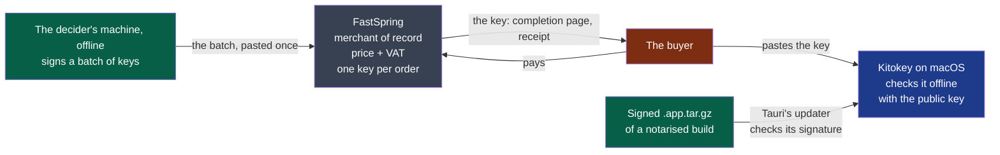

# ADR-0017 — macOS sold through a merchant of record, a signed key checked offline, Tauri's updater

> The framework's words: `.nstack/handbook/glossary.md`.

- **Status**: Accepted — by the decider, 2026-11-20 (« 1017 approuvé », in their conversation with the coordinator; their
  approval of #1017 on GitHub, again at efd2932 after main was merged into it). Amended 2026-11-20, on the decider's
  remark that Stripe was not compared: Stripe Managed Payments and Keygen added to the fallback, beside Paddle Billing
  and Keygen (option 2b); Stripe with Stripe Tax set aside (*Rejected alternatives*). FastSpring stays the decision.
  Reopened for study on 2026-11-21 at the decider's request: [docs/project/reviews/2026-11-21-payments-portfolio.md](../project/reviews/2026-11-21-payments-portfolio.md); the decision stands until the decider decides.
- **Date**: 2026-11-20
- **Decision makers**: the decider, `@napkinstack-admin`; proposed by an agent (marc, session 2b57f890-8981-4ce3-92f0-1ca23ed36acf)
- **Scope**: project — the macOS build, sold; modules `shell` (the licence check, the updater) and `install` (the
  signed, notarised package). No build in cycle 11 (D107): cycle 12 builds what this decides.
- **Reversibility**: costly — the merchant holds the customers and their receipts; the licence key's format is in
  every key sold. The updater is easy to change before the first release that carries it, costly after.

---

## Context

[PDR-0001](../pdr/0001-wholeheard-open-on-linux-paid-on-macos-and-windows.md), decision 4: macOS and Windows are
sold once, €49 to €69, after a trial (14 days or 10 meetings), « with a licence key checked on the machine: no
account, nothing sent. A merchant of record takes the payment and the VAT. The builds are signed (Apple
notarisation…) and update themselves. » Windows goes through the Microsoft Store since
[PDR-0004](../pdr/0004-windows-through-the-microsoft-store.md), which sells, licenses and updates it. macOS has none
of the three: no merchant, no licence check, no updater, no signing (the gap list of 2026-11-18). Linux is free and
updated by its repositories.

Kitokey already verifies signatures with minisign — Ed25519 — on the list of models it offers
([ADR-0010](./0010-the-models-offered-are-a-list-kept-in-the-repository.md), `minisign-verify` in the shell). Kitokey
runs no server today.

What changed since PDR-0001: its prior art cites Meetily selling through Lemon Squeezy; **Lemon Squeezy « is no
longer accepting new sign-ups and will shut down on March 31, 2027 »** ([its pricing page](https://www.lemonsqueezy.com/pricing),
read 2026-11-20).

## Problem

Who sells Kitokey on macOS, how does the app know a licence is paid without sending anything, and how does a
notarised app update itself — without Kitokey running a server?

## Constraints

- PDR-0001: no account, nothing sent to check a licence; a one-time price; the VAT taken by a merchant of record.
- **No server of ours**: no secret held online, nothing to keep up, no one to wake when it falls. Kitokey runs none
  today, and cycle 11 keeps it so (« no secret embedded, no cloud of ours »).
- Apple: to ship outside the App Store, a `Developer ID Application` certificate, and « Notarization is required
  when using a Developer ID Application certificate » ([Tauri, macOS signing](https://v2.tauri.app/distribute/sign/macos/),
  updated 2026-05-17). The Apple Developer Program is « $99 annual membership »
  ([Apple](https://developer.apple.com/programs/)).
- The shell is Tauri 2 (ADR-0002); its team writes Rust, not Objective-C.

---

## Prior art

**Dominant convention of the field:** an indie Mac app sold outside the App Store goes through a merchant of record
that delivers a licence key with the order, the app checks the key against a public key, and updates with Sparkle
or its framework's updater, the update signed with Ed25519.

**References examined** (each page read 2026-11-20):

| Reference | Fee | Merchant of record, VAT | Licence keys |
|---|---|---|---|
| [FastSpring](https://fastspring.com/pricing/) | « revenue-sharing », « our fees vary depending on the transaction volume »: by quote, no figure published | « collect and remit sales taxes »; « Remit VAT/sales taxes on your behalf: Included » | Delivered with the order, from a **pre-defined list** the seller pastes (« If you have an existing list of license keys, paste them in the Pre-Defined List field »), a script, a remote server or CocoaFob; the key « can appear on the completion page, email receipt, or account management portal » ([licence key fulfilments](https://developer.fastspring.com/docs/license-key-fulfillments.md), updated 2026-01-21) |
| [Paddle Billing](https://www.paddle.com/pricing) | « 5% + 50¢ » « per Checkout transaction », « No monthly fees » | « Paddle as your Merchant of Record »; « We collect the correct rate of tax » | None: Classic handled them, but « New signups for Paddle Classic aren't allowed »; Billing: « Build your own workflows using transaction webhooks » ([Paddle's docs](https://developer.paddle.com/llms.txt)) — a server of ours |
| [Gumroad](https://gumroad.com/pricing) | « 10% + $0.50 » on direct sales | « Gumroad is your merchant of record »; « Since January 1, 2025, Gumroad handles ALL your tax obligations » | Not verified: its help page on licence keys did not load |
| [Lemon Squeezy](https://www.lemonsqueezy.com/pricing) | « 5% + 50¢ » | « Lemon Squeezy is your merchant of record » | A License API checked by `POST /v1/licenses/validate`, online ([License API](https://docs.lemonsqueezy.com/api/license-api)) — and it closes on 2027-03-31 |
| [Polar](https://polar.sh/resources/pricing) | « 5% + 50¢ » (free plan), « +1.5% for international cards » | « Polar is the Merchant of Record » | Checked online: « validate the users license key via the `/v1/customer-portal/license-keys/validate` endpoint » ([licence keys](https://polar.sh/docs/features/benefits/license-keys)); no signed key found |
| [Dodo Payments](https://dodopayments.com/pricing) | « 4% + 40c per domestic US transaction », « International payments… add +1.5% » | « a **Merchant of Record** » ([docs](https://docs.dodopayments.com/)) | Its own keys checked online (« The activate, deactivate, and validate license endpoints are public »); **keys the seller generates may be delivered** ([manual fulfilment](https://docs.dodopayments.com/developer-resources/manual-license-key-fulfillment.md)) |
| [Creem](https://www.creem.io/pricing) | « 3.9 percent plus 40 US cents » | « We are the legal seller of record » ([docs](https://docs.creem.io/)) | « Generate and deliver software license keys automatically on purchase »; no page on checking them found; « the API key must stay on your backend » |
| [Stripe Managed Payments](https://docs.stripe.com/payments/managed-payments) (pages served in French) | « 3,5 % » « par transaction Managed Payments réussie, en plus des frais de paiement » — on top of the card fee: « 1,5 % + 0,25 € » for standard EEA cards, « 3,15 % + 0,25 € » for international ones ([pricing](https://stripe.com/pricing)) | « Marchand officiel: Stripe »; it « enregistre et dépose les déclarations fiscales auprès des autorités fiscales locales » in « plus de 80 pays » ([tax compliance](https://docs.stripe.com/payments/managed-payments/tax-compliance.md)); France among the seller's countries, access « sur la base d'un examen d'éligibilité »; « Logiciels » eligible, « Downloadable Software - personal use » among its tax codes ([eligibility](https://docs.stripe.com/payments/managed-payments/eligibility.md)) | None found: no page on keys or on delivering a digital good |
| [Stripe with Stripe Tax](https://docs.stripe.com/tax/filing.md) | The card fee alone, and Stripe Tax's | Not a merchant: « Vous devez déclarer et verser les taxes que vous collectez pour chaque juridiction » ; Stripe files « aux États-Unis » and « certaines immatriculations en Irlande et au Canada »; its one OSS: « hors Union en Irlande »; the Union's VAT returns through partners (Marosa, Taxually), each priced on its own | None |
| [Keygen](https://keygen.sh/docs/api/cryptography/) | « We will never take a percentage of revenue »; its tiers' prices did not load ([pricing](https://keygen.sh/pricing/)) | Not a merchant | Licences signed with the account's key, « powerful options for offline license verification »; « your account ID and public key should be hard-coded into your application code ». With Paddle: « allowing Paddle to communicate with Keygen using webhooks » ([Keygen + Paddle](https://keygen.sh/integrate/paddle/)), Billing or Classic not said. With Stripe: « letting Stripe communicate with Keygen over webhooks », its reference an example application ([Keygen + Stripe](https://keygen.sh/integrate/stripe/)); « Sign license keys with your account's Ed25519 signing key », usable « in offline or air-gapped environments »; free tier « up to 100 active licensed users », no share of revenue ([pricing](https://keygen.sh/pricing/), the paid tiers' prices did not load) |
| [Tauri's updater](https://v2.tauri.app/plugin/updater/) (updated 2025-11-28) | — | — | Updates: `myapp.app.tar.gz` and its `.sig`; « Tauri's updater needs a signature… This cannot be disabled »; the public key in `tauri.conf.json` |
| [Sparkle 2](https://sparkle-project.org/documentation/) | — | — | Updates: « Sparkle's EdDSA (ed25519) signature », the key in `Info.plist`; « Notarize and code sign the application via Apple's Developer ID program » |

**Why the convention is not enough:** it is enough. Kitokey follows it, choosing among its parts.

---

## Options considered

The updater is the same in every option (Tauri's, below); the options differ in who issues the key.

### Option 1 — FastSpring delivers keys Kitokey signed beforehand

- **Description**:
  - The decider signs, on their own machine, a batch of 10,000 keys, each a short payload signed with
    Kitokey's Ed25519 private key: a serial number, the major version it covers. The private key never leaves that
    machine, kept offline as ADR-0010's minisign key is.
  - The payload is `{id, edition, max_version}` — a serial, the edition, the last major version it opens — and
    nothing personal: no name, no email, no order.
  - The batch is pasted into FastSpring's pre-defined list. Each order takes one key; FastSpring shows it on the
    completion page and in its receipt.
  - The app checks a key with the public key built in: offline, no account, nothing sent.
- **Cost**: FastSpring's share, unknown until its quote. Operation: none running; a batch to refill before it runs
  out — minutes of the decider's, a few times a year at most.
- **Risk**: what FastSpring does with an empty list is not documented, nor any stock alert — an order without a
  key. Kept far from it by 10,000 keys loaded, their count read each month, and a batch added under 20 %. A key, once sold, cannot be revoked
  except by a list of refused serials shipped in an update.
- **Cost of getting out**: another merchant that takes a list (or the same batch on a server, option 2): the keys
  sold stay valid, since they are ours.

### Option 2 — Paddle Billing and Keygen Cloud (the fallback)

- **Description**: Paddle sells and takes the VAT; Keygen issues each key on Paddle's webhook and signs it with
  Ed25519; the app checks it offline, built with both public keys — Kitokey's, for the keys of option 1, and
  Keygen's account's.
- **Cost**: 5% + 50¢ — about €2.95 at €49, 6 % —, and Keygen's tier, whose price did not load.
- **Risk**: honestly, a webhook or a connector between Paddle and Keygen to set up and keep — Keygen's page says
  Paddle « communicate[s] with Keygen using webhooks », not whether for Billing; the signing key is Keygen's
  account's: leaving it means new keys for its customers. No server of ours if the connector is Keygen's.
- **Cost of getting out**: back to option 1's keys, which the app still checks.

### Option 2b — Stripe Managed Payments and Keygen Cloud (added 2026-11-20)

- **Description**: as option 2, Stripe in Paddle's place: Stripe is the merchant and files the taxes; Keygen issues
  each key on Stripe's webhook, signed with Ed25519, checked offline.
- **Cost**: 3.5 % on top of the card's fee — at €49 on a standard EEA card, about €2.70, 5.5 %, under Paddle's
  €2.95; on an international card about €3.51, 7.2 %, over it. Keygen's tier on top.
- **Risk**: access is Stripe's to grant, after an eligibility review; the buyer sees « Link » as the merchant
  (« Le client voit Link comme le marchand officiel », [how it works](https://docs.stripe.com/payments/managed-payments/how-it-works)).
  **The same relay as option 2**: Keygen's Stripe integration is a webhook and an example application to run — a
  server, ours unless a connector (Keygen's Zapier route, not read) carries it.
- **Cost of getting out**: back to option 1's keys, which the app still checks.

### Option 3 — Dodo Payments delivering the same pre-signed keys

- **Description**: Dodo sells and takes the taxes, and delivers keys the seller generated (*manual fulfilment*):
  option 1's batch, checked offline the same way; Dodo's own online check left unused.
- **Cost**: 4% + 40¢, and +1.5 % outside the US: for a buyer in Europe, about €3.05 at €49, 6.2 % — Paddle's level.
- **Risk**: how its manual fulfilment hands one key per order, and what it does once they run out, were not read.
- **Cost of getting out**: as option 1.

### Option 4 — A licence service (Keygen) beside a merchant

- **Description**: Keygen issues and signs the keys from the merchant's webhook; the app checks them offline.
- **Cost**: a third vendor's fee beside the merchant's; no server of ours.
- **Risk**: the signing key is Keygen's account's: leaving Keygen means new keys for every customer.

### Option 5 — Gumroad

- **Description**: Gumroad sells and takes the taxes; its own licence keys.
- **Cost**: 10% + $0.50 — about €5.40 at €49, 11 %, twice Paddle's.
- **Polar, Creem**: merchants of record whose keys are checked online, or not shown to be checked offline: set aside with Lemon Squeezy's.
- **Risk**: how its keys are made and checked was not read; not retained without it.

### Option 6 — Do nothing

- macOS stays unsold: PDR-0001's decision 4 unmet, and the Mac's users build it or go without.

---

## Decision

**Legend** — brown: the buyer · grey: the merchant · green: what Kitokey makes, offline or published as a static
file · blue: the app. No server of ours: the private key stays on the decider's machine, the update feed is a
static file beside the release.

**Option 1**: FastSpring delivers keys Kitokey signed beforehand; Tauri's updater.

- **Four requirements**: a merchant of record; a key signed with Ed25519 and checked offline; no server of ours;
  no secret online. FastSpring's pre-defined list holds all four; so may Dodo's manual fulfilment (option 3), not
  yet read whole. Paddle Billing has no keys of its own; Polar, Lemon Squeezy and, as far as read, Creem check
  theirs online; Gumroad costs twice as much; Keygen is not a merchant.
- **The condition: FastSpring's written quote.** Its rate is not published — a figure attributed to a third party,
  5.9 % + $0.95, was not found and stays unconfirmed. Signing with FastSpring waits for its quote in writing.
- **The fallback is option 2 or 2b**: Keygen Cloud issuing the keys behind Paddle Billing or Stripe Managed
  Payments — the cheaper for the buyers of the day (Stripe on European cards, Paddle on international ones), and
  Stripe only once its review grants access. Either needs a relay from the merchant's webhook to Keygen that is
  not a server of ours, or a new record. Option 3, Dodo, is to read
  further: if its manual fulfilment holds a list as FastSpring's does, it is an alternative at Paddle's price.
- **The key is ours**, whatever the merchant: Ed25519 over `{id, edition, max_version}`, nothing personal, checked offline with the
  public key built into the app — as Keygen recommends, and as Kitokey already checks its list of models. A key
  covers a major version: minor versions included, as PDR-0001 says. It is never sent anywhere.
- **The updater is Tauri's**: in the stack, Ed25519 signatures, the feed a static file. Sparkle is the Mac's own
  convention, but it is an Objective-C framework to embed beside Tauri for the same check.
- **The trial** stays the app's own, as PDR-0001 says it: « 14 days or 10 meetings, whichever comes last ». The key
  ends it.

### Conditions before it goes on sale

Read with lina's review (#1017, at d39c681). Not code of cycle 11: what cycle 12 holds before the first sale.

1. **An empty list.** 10,000 keys loaded; their count read each month; a batch added under 20 %. What FastSpring
   does with an empty list is tried in its test mode, and a stock alert asked of it: none is documented.
2. **A key lost.** How a buyer finds their key again — FastSpring's account portal, its receipt sent again — is
   checked with FastSpring: its page does not say.
3. **The key's form.** Pasted, never typed: whitespace and line breaks tolerated, an alphabet without look-alikes
   (base32, no 0/O, 1/I/l). A `kitokey://` link that fills it in is noted, not verified.
4. **What a key covers**, said before the purchase on the checkout page: how many Macs, and which major version.

### What the Mac App Store would change — not decided here

PDR-0001 leaves the Mac App Store « Later, perhaps ». Its rules (App Review Guidelines 2.4.5, read 2026-11-20):

- « They must be appropriately sandboxed » — and whether Kitokey's capture of the system's sound works in the
  sandbox is **not established**: Apple's pages on the sandbox and ScreenCaptureKit did not say. A spike first.
- « They may not present a license screen at launch, require license keys, or implement their own copy protection »:
  the key above goes, the purchase becomes Apple's.
- « They must use the Mac App Store to distribute updates; other update mechanisms are not allowed »: the updater
  above goes.
- Apple takes « 15% on paid apps » under the [Small Business Program](https://developer.apple.com/app-store/small-business-program/)
  (proceeds under 1 million USD).

So the App Store is a second build, not a setting of this one: no key, no updater, a sandbox. It stays later.

---

## Success criterion

> We will consider this was the right call if **a buyer on macOS pays through FastSpring, receives a key from the
> pre-signed list and unlocks a notarised Kitokey offline, then receives an update through Tauri's updater — with no
> server of Kitokey's running —, on a build of cycle 12** before **2026-12-18**.

What we do if it is not: correct — if FastSpring's quote or its list fails, option 3 (Dodo) if it holds a list,
else option 2 or 2b (Keygen Cloud behind Paddle Billing or Stripe Managed Payments); never a server of ours but on the decider's word, as a new record.

---

## Consequences

**Positive:**
- No account and nothing sent to check a licence, as PDR-0001 promises; no server of ours, no secret online.
- The key format is ours: a merchant can change without re-issuing a key.
- One signature algorithm, Ed25519, for the models' list, the licence and the updates.

**Negative and accepted debt:**
- A batch to refill before it runs out — the decider's, by hand. What an empty list does is not documented.
- A key copied is a key copied, and a key sold cannot be revoked but by a list of refused serials in an update. The
  convention accepts it; so does PDR-0001 (« no account, nothing sent »).
- FastSpring's fee is unknown until its quote.

**Impacts on other modules or contracts:** `shell` — the licence check and the updater (cycle 12), the updater never started from a package: Windows' package is the Store's to update (D102, 2026-11-20 — no Store policy names a self-update; 10.2.2 refuses « any form of dynamic inclusion of code » that changes the product, and the package's files are not Kitokey's to rewrite); `install` — the
macOS package signed with Developer ID and notarised, an `.app.tar.gz` and its signature published beside it, and the
tool that signs a batch of keys offline.

**Rule to automate:** a test of the shell that a key altered by one character is refused and that the public key
built in is the batch's; and a check that no secret key is in the repository — cycle 12, with the build.

---

## Rejected alternatives

- **Paddle Billing with a function of ours**: Kitokey's first server, its private key online, for each sale. The
  fallback is Keygen's instead (option 2).
- **Polar, Creem**: their keys checked online, or not shown checked offline.
- **Stripe with Stripe Tax, without Managed Payments**: Kitokey would be the seller, registered and filing in each
  jurisdiction; Stripe files in the United States and for some registrations in Ireland and Canada, its only OSS
  « hors Union »: the Union's OSS return would be ours or a partner's, paid apart. PDR-0001 asks a merchant of record.
- **Lemon Squeezy**: it closes on 2027-03-31, and its licence check is a call to its server.
- **Paddle Classic's licence keys**: closed to new sellers.
- **An online activation** (Lemon Squeezy's, Keygen's online mode): the app would send something to check a
  licence, which PDR-0001 refuses.
- **The Mac App Store now**: a second build, without a key or an updater, in a sandbox not yet known to let Kitokey
  record the system's sound.

---

## Not verified here

- FastSpring: its fee (by quote; « 5.9 % + $0.95 », said of a third party, not found), what an empty pre-defined list does, any limit on its size.
- Dodo: how its manual fulfilment hands out a seller's keys. Keygen: its tiers' prices, and whether its Paddle connector is for Billing.
- Creem: no page on checking its keys was found.
- Gumroad's licence keys: its help page did not load.
- Paddle Billing's whole API reference: no licence feature was found in the pages read.
- Stripe Managed Payments: the card fee for a US card (« 6.4 % + $0.30 », said by third parties, was not read on
  Stripe's page); whether a buyer's invoice names Kitokey or « Link »; how long its eligibility review takes.
- Keygen: whether a connector (its Zapier route) relays Stripe's or Paddle's webhook without a server of ours.
- App Review Guideline 3.1.1, on in-app purchase, was not read verbatim; 2.4.5 was.
- Apple's notarisation page did not load; its requirement is quoted from Tauri's page.
