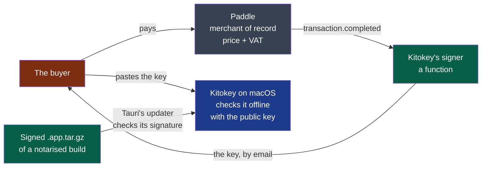

# ADR-0017 — macOS sold through a merchant of record, a signed key checked offline, Tauri's updater

> The framework's words: `.nstack/handbook/glossary.md`.

- **Status**: Proposed
- **Date**: 2026-11-20
- **Decision makers**: the decider, `@napkinstack-admin`; proposed by an agent (marc, session 2b57f890-8981-4ce3-92f0-1ca23ed36acf)
- **Scope**: project — the macOS build, sold; modules `shell` (the licence check, the updater) and `install` (the
  signed, notarised package). No build in cycle 11 (D107): cycle 12 builds what this decides.
- **Reversibility**: costly — the merchant holds the customers and their receipts; the licence key's format is in
  every key sold. The updater is easy to change before the first release that carries it, costly after.

---

## Context

[PDR-0001](../pdr/0001-wholeheard-open-on-linux-paid-on-macos-and-windows.md), decision 4: macOS and Windows are
sold once, €49 to €69, after a trial (14 days or 10 meetings), « with a licence key checked on the machine: no
account, nothing sent. A merchant of record takes the payment and the VAT. The builds are signed (Apple
notarisation…) and update themselves. » Windows goes through the Microsoft Store since
[PDR-0004](../pdr/0004-windows-through-the-microsoft-store.md), which sells, licenses and updates it. macOS has none
of the three: no merchant, no licence check, no updater, no signing (the gap list of 2026-11-18). Linux is free and
updated by its repositories.

Kitokey already verifies signatures with minisign — Ed25519 — on the list of models it offers
([ADR-0010](./0010-the-models-offered-are-a-list-kept-in-the-repository.md), `minisign-verify` in the shell).

What changed since PDR-0001: its prior art cites Meetily selling through Lemon Squeezy; **Lemon Squeezy « is no
longer accepting new sign-ups and will shut down on March 31, 2027 »** ([its pricing page](https://www.lemonsqueezy.com/pricing),
read 2026-11-20).

## Problem

Who sells Kitokey on macOS, how does the app know a licence is paid without sending anything, and how does a
notarised app update itself?

## Constraints

- PDR-0001: no account, nothing sent to check a licence; a one-time price; the VAT taken by a merchant of record.
- PDR-0001's out of scope: « a server of ours that a user's machine must reach to work ». A server the *merchant*
  reaches, never the user's machine, stays within it.
- Apple: to ship outside the App Store, a `Developer ID Application` certificate, and « Notarization is required
  when using a Developer ID Application certificate » ([Tauri, macOS signing](https://v2.tauri.app/distribute/sign/macos/),
  updated 2026-05-17). The Apple Developer Program is « $99 annual membership »
  ([Apple](https://developer.apple.com/programs/)).
- The shell is Tauri 2 (ADR-0002); its team writes Rust, not Objective-C.

---

## Prior art

**Dominant convention of the field:** an indie Mac app sold outside the App Store goes through a merchant of record
(Paddle, FastSpring), gets a licence key by email, checks it in the app against a public key, and updates with
Sparkle or its framework's updater, the update signed with Ed25519.

**References examined** (each page read 2026-11-20):

| Reference | What it does | Applicable here? |
|---|---|---|
| [Paddle Billing](https://www.paddle.com/pricing) | Merchant of record, « 5% + 50¢ » « per Checkout transaction », « No monthly fees »; « We collect the correct rate of tax, track the filing deadlines ». Licence keys: Paddle Classic handled them, but « New signups for Paddle Classic aren't allowed », and Billing says « Build your own workflows using transaction webhooks » ([Paddle's docs](https://developer.paddle.com/llms.txt)) | Yes, the keys ours |
| [FastSpring](https://fastspring.com/pricing/) | Merchant of record, « collect and remit sales taxes »; fee « on a revenue-sharing model », by quote, no figure published. Delivers a licence key with the order, from a list, a script, a remote server or CocoaFob ([licence key fulfilments](https://developer.fastspring.com/docs/license-key-fulfillments.md), updated 2026-01-21) | Yes, its fee unknown |
| [Lemon Squeezy](https://www.lemonsqueezy.com/pricing) | Merchant of record, « 5% + 50¢ »; a License API to « activate, validate or deactivate », by `POST /v1/licenses/validate` to its server ([License API](https://docs.lemonsqueezy.com/api/license-api)) | **No**: closing 2027-03-31, no new sign-ups; its check is online |
| [Keygen](https://keygen.sh/docs/api/cryptography/) | Licences signed with the account's key « providing powerful options for offline license verification »; « your account ID and public key should be hard-coded into your application code »; offline licences on every paid tier ([pricing](https://keygen.sh/pricing/)) | The format, yes; the service, not needed |
| [Tauri's updater](https://v2.tauri.app/plugin/updater/) (updated 2025-11-28) | Downloads `myapp.app.tar.gz` and checks `myapp.app.tar.gz.sig`: « Tauri's updater needs a signature… This cannot be disabled »; the public key in `tauri.conf.json` | Yes |
| [Sparkle 2](https://sparkle-project.org/documentation/) | The Mac's updater: « Sparkle's EdDSA (ed25519) signature », the public key in `Info.plist`; « Notarize and code sign the application via Apple's Developer ID program » | Convention, but an Objective-C framework beside Tauri |

**Why the convention is not enough:** it is enough. Kitokey follows it, choosing among its parts.

---

## Options considered

### Option 1 — Paddle Billing; a key Kitokey signs; Tauri's updater

- **Description**:
  - Paddle sells and takes the VAT. Its `transaction.completed` webhook reaches a small function of ours, which signs
    a key and emails it.
  - The key is a short payload — the order's number, the major version it covers, the day — signed with Kitokey's
    Ed25519 key, written in base32 for pasting. The app checks it with the public key built in: offline, no account.
  - Tauri's updater fetches a signed `.app.tar.gz` of a notarised build.
- **Advantages**: a published fee; one key format we own, whatever the merchant; Ed25519 as Kitokey already
  verifies it; an updater in the stack, in Rust.
- **Drawbacks**: we run a function and send an email for each sale — a server, reached by Paddle alone.
- **Cost of getting out**: another merchant calls the same function; keys sold stay valid, since they are ours.

### Option 2 — FastSpring; the same key, delivered by FastSpring; Tauri's updater

- **Description**: FastSpring sells, takes the VAT, and delivers the key with its order email, from a generator it
  calls (a remote server request to the same function), so no email of ours. The rest as option 1.
- **Advantages**: no email to send; licence keys a native part of the merchant.
- **Drawbacks**: its fee is unknown until a quote; a remote generator is still a function of ours.
- **Cost of getting out**: as option 1.

### Option 3 — A licence service (Keygen) beside the merchant

- **Description**: Keygen issues and signs the keys from the merchant's webhook; the app checks them offline.
- **Advantages**: no function of ours.
- **Drawbacks**: a third vendor and its fee for what one function does; its Tauri engine on paid tiers only.
- **Cost of getting out**: its keys are signed with its account's key: leaving means new keys for every customer.

### Option 4 — Do nothing

- macOS stays unsold: PDR-0001's decision 4 unmet, and the Mac's users build it or go without.

---

## Decision

**Legend** — brown: the buyer · grey: the merchant · green: what Kitokey runs or publishes · blue: the app. The
app reaches no server to check a licence: only the update feed, as every app that updates itself does.

**Option 1**: Paddle Billing, a key Kitokey signs, Tauri's updater.

- **The merchant**: Paddle, because its fee is published and it is the convention's largest. FastSpring is the
  alternative: if its quote is lower than 5% + 50¢ at €49–69, option 2 takes its place, and nothing else changes.
  Lemon Squeezy is out: it closes.
- **The key is ours**, whatever the merchant: an Ed25519 signature over a short payload, checked offline with the
  public key built into the app — as Keygen recommends, and as Kitokey already checks its list of models. A key
  covers a major version: minor versions included, as PDR-0001 says. It is never sent anywhere.
- **The updater is Tauri's**: in the stack, Ed25519 signatures, the feed a static file. Sparkle is the Mac's own
  convention, but it is an Objective-C framework to embed beside Tauri for the same check.
- **The trial** stays the app's own, 14 days or 10 meetings (PDR-0001): the key ends it.

### What the Mac App Store would change — not decided here

PDR-0001 leaves the Mac App Store « Later, perhaps ». Its rules (App Review Guidelines 2.4.5, read 2026-11-20):

- « They must be appropriately sandboxed » — and whether Kitokey's capture of the system's sound works in the
  sandbox is **not established**: Apple's pages on the sandbox and ScreenCaptureKit did not say. A spike first.
- « They may not present a license screen at launch, require license keys, or implement their own copy protection »:
  the key above goes, the purchase becomes Apple's.
- « They must use the Mac App Store to distribute updates; other update mechanisms are not allowed »: the updater
  above goes.
- Apple takes « 15% on paid apps » under the [Small Business Program](https://developer.apple.com/app-store/small-business-program/)
  (proceeds under 1 million USD), against 5% + 50¢ here.

So the App Store is a second build, not a setting of this one: no key, no updater, a sandbox. It stays later.

---

## Success criterion

> We will consider this was the right call if **a buyer on macOS pays, receives a key and unlocks a notarised
> Kitokey offline, then receives an update through Tauri's updater, on a build of cycle 12** before **2026-12-18**.

What we do if it is not: correct — the merchant's part changes to option 2 without touching the key or the updater.

---

## Consequences

**Positive:**
- No account and nothing sent to check a licence, as PDR-0001 promises.
- The key format is ours: a merchant can change without re-issuing a key.
- One signature algorithm, Ed25519, for the models' list, the licence and the updates.

**Negative and accepted debt:**
- A function of ours to run for each sale, and an email to send (option 1). It holds the signing key: kept as the
  minisign key of ADR-0010 is, never in the repository.
- A key copied is a key copied: offline, nothing stops a key shared. The convention accepts it; so does PDR-0001
  (« no account, nothing sent »).
- 5% + 50¢: about 6 % at €49, as a percentage of a small price.

**Impacts on other modules or contracts:** `shell` — the licence check and the updater (cycle 12); `install` — the
macOS package signed with Developer ID and notarised, an `.app.tar.gz` and its signature published beside it.

**Rule to automate:** a test of the shell that a key altered by one character is refused, and that the public key
built in is the one the signer's matches — cycle 12, with the build.

---

## Rejected alternatives

- **Lemon Squeezy**: it closes on 2027-03-31, and its licence check is a call to its server.
- **Paddle Classic's licence keys**: closed to new sellers.
- **An online activation** (Lemon Squeezy's, Keygen's online mode): the app would send something to check a
  licence, which PDR-0001 refuses.
- **The Mac App Store now**: a second build, without a key or an updater, in a sandbox not yet known to let Kitokey
  record the system's sound.

---

## Not verified here

- Paddle Billing's API reference was not read whole: no licence endpoint was found in the pages read.
- FastSpring's fee: by quote only.
- App Review Guideline 3.1.1, on in-app purchase, was not read verbatim; 2.4.5 was.
- Apple's notarisation page did not load; its requirement is quoted from Tauri's page.
