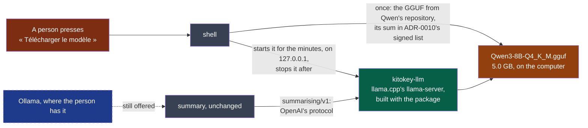

# ADR-0020 — The minutes on the computer by llama.cpp's server, built with the package, not by an Ollama to install

> The framework's words: `.nstack/handbook/glossary.md`.

- **Status**: Accepted by the decider on 2026-11-26 (option 1, relayed by the coordinator). Proposed by marc (session
  faac4c8b-75c7-4ae9-810f-7cbe35c1f1b9) the same day, at the decider's request relayed by the coordinator (#1259)
- **Date**: 2026-11-26
- **Decision makers**: the decider, `@napkinstack-admin`
- **Scope**: modules `install`, `shell`; ADR-0010's list; no contract
- **Reversibility**: easy — Ollama stays offered, and `summary` speaks to either through the same protocol

---

**Legend** — red: a person's gesture · grey: modules as they are · amber: a file on the computer · green: what this ADR
adds · dashed blue: what stays offered.

## Context

The minutes written on the computer need Ollama today, installed by the person: the shell asks it for its models
(`/api/tags`), fetches `qwen3:8b` through it (`/api/pull`, `providers.rs`), and `summary` sends it the request. On
2026-11-26 the decider asked that the private minutes work without installing Ollama by hand, and that two ways be
studied: the engine in Kitokey, or Kitokey installing and running Ollama.

## Problem

A person who installs Kitokey has its transcript on the computer at once (ADR-0003: whisper.cpp in the package, its
model fetched in one click), but not its minutes: a second program, from elsewhere, installed by hand. Which engine
writes the minutes on the computer, and how does it get there?

## Constraints

- `summary` speaks to any provider of OpenAI's protocol (`summarising/v1`: `--provider <address>`); Ollama is a special
  case only for its window (`provider.rs`).
- The rpm is built in Copr from source, with no network (D78); Fedora's guidelines forbid prebuilt binaries [16].
- Windows goes through the Microsoft Store (PDR-0004); macOS is signed by Developer ID (ADR-0017).
- What leaves the computer: nothing by default (`docs/privacy.md`); the model is fetched once, as whisper's is.

## Prior art

**Dominant convention of the field:** a desktop app that offers local inference without asking the person to install
an engine embeds **llama.cpp** — Jan in a worker process, updated with the app, Vulkan on Linux and Windows, Metal on
macOS [J]; GPT4All as libraries, Vulkan [G]; AnythingLLM Desktop moved from an embedded Ollama to a built-in llama.cpp
engine [A]. Managing Ollama is the less common way (Msty, which ships it renamed and updates it [M]); LM Studio
downloads its runtimes apart [L]; MacWhisper embeds none and talks to Ollama or LM Studio [W].

**In this repository:** `transcription` already embeds the same family — whisper.cpp, on ggml as llama.cpp is — built
from vendored sources with Vulkan, Copr included (`kitokey.spec`: `cmake vulkan-headers vulkan-loader-devel glslc`), its
model fetched on first start from a signed list (ADR-0010).

**Measured, 2026-11-26** (one laptop: Ryzen AI 7 PRO 350, Radeon 860M, Fedora 45; `kitokey-summary` of main b66cadd on
an invented meeting of 148 turns; one run of each, read from the engines' own logs):

| | Ollama 0.40.16, Vulkan | llama-server b12774, Vulkan |
|---|---|---|
| How it runs | **starts llama.cpp's `llama-server` itself**, on the same GGUF | `llama-server` |
| The request read, 12,031 tokens | 194 tokens/s | 178 tokens/s |
| The answer written | 7.7 tokens/s | 9.0 tokens/s |
| Graphics memory | 9,967 MiB: model 4,643, KV cache (36,864 tokens) 5,184, compute 140 | not logged; to measure |
| Minutes written | no: the answer ran to its 16,384 tokens (`answer.cut_short`) | no: `answer.not_minutes` twice (#1221) |

Ollama **is** llama.cpp's server under its own: the same engine, the same pace within 15 %. Neither run wrote minutes:
#1221 — the model's answer, not the engine's — strikes both.

**Sizes** (2026-11-26): Ollama v0.40.18's Linux archive 1.65 GB, its Windows zip 1.72 GB, macOS 189 MB [6]; llama.cpp
b12774's `llama-server` with its libraries, Ubuntu Vulkan x64 37.2 MB, Windows Vulkan x64 39.2 MB, macOS arm64 (Metal)
16.9 MB [3].

**Licences:** llama.cpp MIT [1]; Ollama MIT [6]; Qwen3-8B and its GGUF Apache-2.0, not gated [9]; GGUF, a spec under
MIT [10]. Fedora packages `llama-cpp`, Vulkan off [4].

## Options considered

### Option 1 — llama.cpp's server, built with the package, started by the shell

`llama-server`, pinned to one llama.cpp release, built with the package as `kitokey-llm`: on Linux from source with
`GGML_VULKAN=ON`, as whisper.cpp is (the release's tarball a second source of the SRPM); on macOS with Metal; on Windows
from source where the runner has the Vulkan SDK, else llama.cpp's own Windows Vulkan build, its sum pinned. The shell
starts it on 127.0.0.1 for the time of the minutes and stops it; `summary` speaks to it as to any provider; the model is
fetched once from Qwen's repository through ADR-0010's list.
- **For**: the engine Ollama runs, without its 1.65 GB; no contract changes; built in Copr from source; nothing installed
  beside Kitokey; Metal on macOS where transcription has none today.
- **Against**: a fast upstream (508 builds in 30 days [3]) to pin and bump; `llama-server`'s flags to keep in step
  (`--jinja`, `--reasoning-format`); the shell runs one more program.

### Option 1' — llama.cpp linked into `summary`

The Rust binding `llama-cpp-2` (MIT OR Apache-2.0, sources vendored, features `vulkan` and `metal` [5]).
- **For**: one program, no port.
- **Against**: `summarising/v1` changes (`--provider` an address becomes a model's path), an expand/contract for no gain to
  the person; the binding lags llama.cpp.

### Option 2 — Kitokey installs and runs Ollama

The shell downloads Ollama's official archive, unpacks it, starts `ollama serve`, updates it, pulls the model.
- **For**: the shell's code for Ollama stays.
- **Against**: 1.65 GB (Linux) or 1.72 GB (Windows) to fetch and keep, besides the model; a layout Kitokey does not
  control (`.tgz` became `.tar.zst` [6]); a second Ollama beside the person's own on port 11434; nothing Copr can build;
  the Store's 10.2.3, « do not offer to install secondary software not developed by the publisher » [11].

## Decision

**Option 1.** llama.cpp's `llama-server`, pinned, built with each package as `kitokey-llm`, started by the shell on
127.0.0.1 for the minutes, the model `Qwen3-8B-Q4_K_M.gguf` fetched once through ADR-0010's signed list. Ollama stays
offered to the person who has it. No contract changes.

Plan, each a pull request of one module:
1. **summary — #1221 first**, whichever engine: the minutes asked in a constrained format (`response_format`, which both
   Ollama and `llama-server` serve [2]), so that an answer without the minutes' sections is not written.
2. **install**: `kitokey-llm` built in the four packages, its notices (D102), the rpm's growth measured.
3. **ADR-0010's list**: the GGUF's address, size and sum.
4. **shell**: « Télécharger le modèle » with no Ollama; `kitokey-llm` started, checked, stopped; Ollama still detected.
5. **install's bench**: the minutes measured with `kitokey-llm`, their time and graphics memory in `modules/install`.

## Success criterion

By **2026-12-31**, on the laptop above with **no Ollama installed**: the rpm from Copr installs; « Télécharger le modèle »,
then a meeting of 30 minutes, gives its minutes in **9 minutes or less** (Ollama: about 8, measured 2026-11-25), the
engine's graphics memory **11 GB or less** (Ollama: 9,967 MiB), the rpm grown by **25 MB or less**; the same gesture works
in the .deb on Ubuntu 24.04 and Debian 13. Windows and macOS measured, not bound, by the same date. Missed, this ADR is
read again, Option 2 included.

## Consequences

**Positive:** the minutes on the computer with nothing to install by hand; the engine Ollama runs, a thirtieth of its
size; one way to fetch a model for the transcript and the minutes (ADR-0010); Metal on macOS.

**Negative and accepted debt:** a second C++ engine to build per format; llama.cpp to pin and bump on purpose, the minutes
bench read at each bump; the Store's acceptance of a helper listening on 127.0.0.1, not found written either way (to
read at the first submission); the graphics memory of `kitokey-llm`, not measured yet.

**Impacts on other modules or contracts:** `summary`, none (its Ollama route stays for Ollama); `shell` starts a program
and fetches a model; `install` builds one more; no contract changes.

**Rule to automate:** `install`'s tests hold that each package carries `kitokey-llm` saying its pinned tag; the shell's
e2e runs the minutes with a small GGUF on the processor.

## Rejected alternatives

Option 1' and Option 2, for the reasons above. Fedora's own `llama-cpp` package: Vulkan off [4], and its version follows
Fedora's, not ours.

## Sources (read 2026-11-26)

[J] https://docs.jan.ai/desktop/local-engine/llama-cpp · [A] https://docs.anythingllm.com/setup/llm-configuration/local/built-in ·
[G] https://blog.nomic.ai/posts/gpt4all-gpu-inference-with-vulkan · [L] https://www.lmstudio.ai/docs/cli/runtime/runtime ·
[M] https://docs.msty.app/how-to-guides/get-the-latest-version-of-local-ai-service ·
[W] https://macwhisper.helpscoutdocs.com/article/40-macwhisper-whisper-transcription-difference ·
[1] https://github.com/ggml-org/llama.cpp/blob/master/LICENSE ·
[2] https://github.com/ggml-org/llama.cpp/blob/master/tools/server/README.md ·
[3] https://github.com/ggml-org/llama.cpp/releases/tag/b12774 · [4] https://packages.fedoraproject.org/pkgs/llama-cpp/llama-cpp/,
https://src.fedoraproject.org/rpms/llama-cpp/raw/rawhide/f/llama-cpp.spec ·
[5] https://crates.io/crates/llama-cpp-sys-2 · [6] https://github.com/ollama/ollama/releases/tag/v0.40.18 ·
[9] https://huggingface.co/Qwen/Qwen3-8B-GGUF · [10] https://github.com/ggml-org/ggml/blob/master/docs/gguf.md ·
[11] https://learn.microsoft.com/en-us/windows/apps/publish/store-policies ·
[16] https://docs.fedoraproject.org/en-US/packaging-guidelines/what-can-be-packaged/
