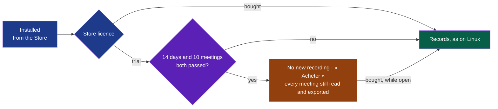

# PDR-0005 — On Windows, the trial ends without locking the meetings: the Store's unlimited trial, limited by Wholeheard

> The framework's words: `.nstack/handbook/glossary.md`.

- **Status**: Accepted — by the decider, 2026-11-03, in the session that proposed it, with cycle 08:
  « 08 accepté, défauts du cadreur ». Proposed by the framer of cycle 08 that day.
- **Date**: 2026-11-03
- **Decision makers**: the decider, `@napkinstack-admin`
- **Modules affected**: `shell` (it starts a recording); `install` (the trial is set in Partner Center, not in
  the package).
- **Amends**: [PDR-0004](./0004-windows-through-the-microsoft-store.md), its decision 1: "on Windows,
  PDR-0001's "14 days or 10 meetings" becomes **15 days**". PDR-0004 is not rewritten.

> The PDR describes **what the product must do and why**, never its implementation.

---

**Legend** — blue: what the Store says · violet: the rule Wholeheard applies · green: it records · amber: the
trial over, nothing locked.

## User problem

PDR-0001 promises that a trial which ends "never locks the meetings already made". PDR-0004 then chose the
Store's **time-limited** trial of 15 days. Microsoft's page on trials says what happens when such a trial has
expired before the application starts: "your app won't launch. Instead, users see a dialog box that gives them
the option to purchase your app from the Store"
([*Implement a trial version of your app*](https://learn.microsoft.com/en-us/windows/uwp/monetize/implement-a-trial-version-of-your-app),
read 2026-11-03). A Windows user whose trial ended would lose access to their meetings in Wholeheard, the
exact case PDR-0001 rules out. The sentence is on a page written for UWP; that it holds for a full-trust
package like Wholeheard's is an assumption, not verified. The decision holds either way: an unlimited trial
never blocks the launch. PDR-0004 also gave up PDR-0001's "or 10 meetings": someone who records once a
week would see the trial end after two meetings.

## Goal

On Windows, a user who did not buy Wholeheard keeps reading and exporting every meeting they made, and their
trial lasts as long as PDR-0001 says: 14 days or 10 meetings, whichever comes last.

## Out of scope

- A trial on macOS: the Mac cycle's, with its licence key (PDR-0001).
- A trial outside the Store. The forge's zip and the package signed for a run stay trial builds for the
  colleagues. They are not published and they limit nothing.
- Making the trial impossible to work around. The code is GPL-3.0: anyone may build it. The Store sells the
  build Microsoft signs, hosts and updates.

---

## Prior art

| Product / reference | Solution chosen | What we keep from it |
|---|---|---|
| Microsoft Store, [*Set app pricing and availability*](https://learn.microsoft.com/en-us/windows/apps/publish/publish-your-app/msix/price-and-availability) (read 2026-11-03) | Two trials: time-limited, 1, 7, 15 or 30 days; or **Unlimited**, "make sure to add code to exclude or limit features in the trial version" | The unlimited trial: the Store hands out the trial and the purchase, and the application decides what the trial allows |
| Microsoft, *Implement a trial version of your app* | `StoreContext.GetAppLicenseAsync`, `StoreAppLicense.IsTrial`, `IsActive`; `OfflineLicensesChanged` when a purchase is made while the application runs. "For most non-gaming apps, setting an expiration date works well" | Reading the licence, and following a purchase made while the application is open |
| Meetily Pro (PDR-0001's table) | A 14-day trial, then payment | The length |

**The convention the user already knows:** a trial that ends, then a button to buy. What they made during the
trial stays theirs.

**Why depart from it:** the Store's time-limited trial is the convention, and it is refused here because it
locks the meetings, which PDR-0001 forbids.

---

## Options considered

| Option | What the user experiences | Cost | Chosen? |
|---|---|---|---|
| Do nothing: the time-limited trial of 15 days (PDR-0004) | After 15 days without buying, Wholeheard no longer opens; their meetings are files in `Documents\Wholeheard`, but not readable in the application | 0 | |
| Time-limited of 30 days | The same lock, later | 0 | |
| **Unlimited trial, limited by Wholeheard: 14 days and 10 meetings both passed** | Records freely during the trial. Once it is over, no new recording, a button to buy, every meeting still read and exported | The rule, a licence read on Windows, one sentence and one button | ✓ |
| No trial, paid at once | Pays before trying | 0 | |

## Decision

On Windows, Wholeheard is offered in the Store with an **unlimited** trial. Wholeheard itself counts the trial,
as PDR-0001 says: it counts from the day Wholeheard first started on a trial licence, that day kept in a
file of the folder of meetings, and it is over once **14 days have passed since that day and 10 meetings made
since are there**, whichever comes last. Meetings copied from elsewhere — from Linux, or synced from another
computer — count for nothing. After that, the user cannot start a new recording, and the window says so with
a button to buy in the Store. Everything already made can still be read, played, corrected and exported.
A purchase takes effect without restarting.

The count is read from `Documents\Wholeheard`, which survives the package's removal
(`modules/install/windows/certification.md`): reinstalling does not start a new trial in the default folder.
A user who deletes meetings or that file, or moves the folder of meetings — a setting, removed with the
package —, gets more trial; that is accepted, see *Out of scope*.

---

## Expected behaviour

**Nominal journey:** installed from the Store, Wholeheard records like a bought copy. Settings say how much of
the trial is left, in days and in meetings.

**Edge cases and degraded states:**
- A recording in progress when the limit is reached is never cut. The trial is judged when a recording starts.
- The licence cannot be read (no network the first time, or an error from the Store), or is not active:
  Wholeheard records. It
  never refuses a recording on a doubt, and it says the error once in the log.
- Not installed from the Store (the zip, the package signed for a run), and on Linux: nothing is limited.

**Acceptance criteria:**

- [ ] Given Wholeheard from the Store on a trial licence, fewer than 10 meetings made since its first start
      on that licence, or fewer than 14 days since then, when the user starts a recording, then it records as a bought copy does
- [ ] Given the trial over, when the user starts a recording from the window, the tray or a call's offer, then
      nothing is recorded, the window says why in one sentence and offers « Acheter », and every meeting can
      still be read, played and exported (PDR-0001)
- [ ] Given a purchase made while Wholeheard is open, when it completes, then the next recording starts,
      without restarting

---

## Success criterion

> We will consider this was the right call if, **by 2027-06-30**, Partner Center shows at least one purchase
> made after the trial ended, and no review or support message says the meetings were locked.

How it is observed: Partner Center's acquisitions report, the Store's reviews, the project's issues.

If the criterion is not met: the trial's length and the price are adjusted first (PDR-0001).

---

## Removal condition

> Withdrawn if the Store's certification refuses an unlimited trial limited this way, or if the Store adds a
> time-limited trial that leaves the application open once it ends.

---

## Impacts

- **Existing users**: none; nothing is sold yet.
- **Modules and contracts**: `shell` reads the Store's licence on Windows and judges the trial before a
  recording starts. No contract changes: `recording/v1` is not started when the trial is over.
- **Support and documentation**: `docs/store/listing.md` says how the trial works, as Microsoft asks ("Be sure
  to explain how your app will behave during and after the free trial period").
- **Data**: nothing new is collected or sent. The trial is counted from the meetings on the machine.
- **The decider**: in Partner Center, *Free trial* set to **Unlimited**.
