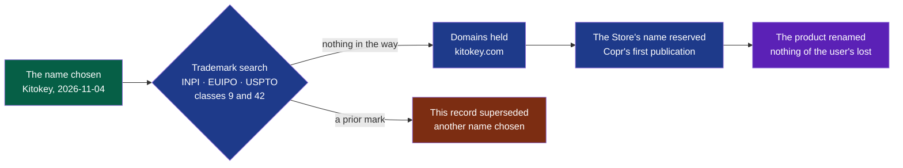

# PDR-0006 — The product is named Kitokey: one name said the same in French and in English

> The framework's words: `.nstack/handbook/glossary.md`.

- **Status**: Accepted — by the decider, 2026-11-04, in the session that studied the name:
  « mon preferé: kitokey », then « ok, écris le PDR pour kitokey ». Effective the same day: the trademark
  search done, on the decider's word « Déjà fait », which covered the search alone (said 2026-11-07).
  kitokey.com bought on 2026-11-07 (RDAP: registered 07:39 UTC); kitokey.app not bought, the decider's
  word the same day « .com seul », to limit what is paid. The rename is cycle 07's D86.
- **Date**: 2026-11-04
- **Decision makers**: the decider, `@napkinstack-admin`
- **Modules affected**: all — the name. `install` (packages, the Store's listing), `shell` (what the user
  held under the old name, carried over).
- **Supersedes**: [PDR-0001](./0001-wholeheard-open-on-linux-paid-on-macos-and-windows.md), its decision 1,
  the name only: the promise, the licence and the prices stand. PDR-0001 is not rewritten.

> The PDR describes **what the product must do and why**, never its implementation.

---

**Legend** — green: decided · blue: the decider's gestures, in this order · violet: the agents' work, a
deliverable of a cycle · red: the way out if the search finds a prior mark.

## User problem

A name is what a user says to a colleague, types in a store and finds again in their system's menu. The
decider wanted a new name before the first publication — cycle 08 named two to choose from, onote and
beebrief (2026-11-03) — and found the current one hard to say: « "heard" pas naturel de prononcer en fr »
(2026-11-04). The product speaks French and English; a name its French and its English users say differently
travels badly by word of mouth. A *WHOLEHEART* mark was also
filed in class 9 in September 2025 ([WHOLEHEART 99408727](https://markinton.com/trademark/wholeheart-99408727),
read 2026-11-04), one letter from ours.

## Goal

The product carries one name, said the same way in French and in English, free as a domain, on the forge and
as a mark, before the Microsoft Store's reservation and Copr's first publication.

## Out of scope

- The promise, the licence and the prices: PDR-0001's, unchanged. The French and English tagline stays.
- A logo, a mascot drawn: the name allows one; drawing it is the decider's, later.
- How the product is renamed — programs, packages, application id, folders: the deliverable's, as D28 did for
  Summit → Wholeheard.
- The trademark search and buying the domains: the decider's (*Impacts*).

---

## Prior art

| Product / reference | Solution chosen | What we keep from it |
|---|---|---|
| Granola, Otter, Fathom, Fireflies — the field's leaders | A short evocative word that is not the category's ("meeting", "notes") | A name that evokes, not one that describes |
| Minutz, Minutes.io, Minutes (iOS) | The category's word, respelled ([Minutz on G2](https://www.g2.com/sellers/minutz), read 2026-11-04) | A warning: such names are taken, and hard to tell apart |
| Voicefox, Ownvox, EchoFox, BeltoVox | Suffixes *-fox*, *-vox* in voice and transcription tools ([Voicefox](https://alternativeto.net/software/voicefox/about), [Ownvox](https://alternativeto.net/software/ownvox/about/), read 2026-11-04) | A warning: those suffixes are crowded in our field |
| Summit → Wholeheard, D28 (cycle 03, 2026-10-20) | Renamed before any publication; settings, meetings, model and keys carried over, never asked again | The way to rename: once, early, nothing of the user's lost |

**The convention the user already knows:** one short name, the same on the package, in the store, in the
menu and on the website.

---

## Options considered

Each checked 2026-11-04: domains at their registries (Verisign for `.com`, Google for `.app`, Identity
Digital for `.io`), the forge, the stores, a web search for products and marks.

| Option | What the user experiences | Cost | Chosen? |
|---|---|---|---|
| Do nothing: Wholeheard | A name two of three users say with difficulty; a *WHOLEHEART* mark one letter away | 0 | |
| onote | Read as OneNote, in Microsoft's own Store; onote.com taken | A rename | |
| beebrief | Close to Bee, Amazon's wearable that summarises conversations ([Bloomberg Law](https://news.bloomberglaw.com/private-equity/amazon-buys-bee-maker-of-50-wearable-ai-personal-assistant)); beebrief.com and .app taken | A rename | |
| snapkeys, keypoint, mello, flexmeet | Each the name of an existing company or app, or read as a video-call tool | A rename | |
| foxheard, keyheard | Free everywhere, but "heard" is what the decider finds hard to say in French | A rename | |
| **Kitokey** | One name, "kee-toh-kee" in both languages; free everywhere | A rename | ✓ |

## Decision

**The product is named Kitokey.** *kit*, the young of a fox or a beaver — a small, discreet animal that works
for the user —, and *key*, the key moments the minutes lead with: the decisions and the actions. In one
sentence: the little fox that keeps the key moments.

It is written **Kitokey** where a name is shown, **kitokey** where a system wants lower case. It is said
the same in French and in English.

On 2026-11-04, `kitokey` was free as `.com`, `.app`, `.io`, `.net`, `.org`, `.dev`, `.ai`, `.fr`, `.eu` and
`.co`, on GitHub, PyPI, crates.io and npm; no product was found under it. The nearest marks found are
[KITRO](https://markinton.com/trademark/kitro-79397541) (classes 9 and 42, registered 2025) and
[KITTO](https://markinton.com/trademark/kitto-99268417) (dead). This is a web search, not the registries': the
decision takes effect once the decider's search finds nothing in the way.

---

## Expected behaviour

**Nominal journey:** a user of Wholeheard installs Kitokey's package. It takes the place of Wholeheard's, and
Kitokey starts with their settings, their meetings where they are, the model not fetched again and their keys
kept, as D28 did for Summit.

**Edge cases and degraded states:**
- A carrying over cut halfway — the machine stopped, a folder read-only — resumes at the next start, and never
  loses a meeting (D28's lesson).
- A user who chose a folder of meetings of their own keeps it, never moved.

**Acceptance criteria:**

- [ ] Given Wholeheard installed and used — settings, meetings, the Whisper model, keys in the keyring —, when
      the user installs Kitokey's package, then it replaces Wholeheard's, and Kitokey starts with the same
      settings, the same meetings where they were, the model not fetched again and the keys kept
- [ ] Given the repository, when it is read, then the product, its programs, its packages, its application id
      and its folders are named Kitokey; Wholeheard and Summit are named only where history is told
- [ ] Given the Microsoft Store and Copr, when the product is first published there, then it is under Kitokey

---

## Success criterion

> We will consider this was the right call if, **by 2026-12-31**, the decider's trademark search found no
> prior mark in the way, kitokey.com is held for the project, and the Store's name is
> reserved as Kitokey; and if, **by 2027-06-30**, no opposition to the name has been received and no
> tester or user has asked how to say it.

How it is observed: the decider's word on the search and the domains; Partner Center; the project's issues
and the testers' word.

If the criterion is not met: a prior mark or an opposition supersedes this record with another name, chosen
the same way, before anything is published under Kitokey.

<!-- Read at each cycle's closure that names it, or that reaches a date of this criterion. -->

---

## Removal condition

> This record is superseded if **the trademark search, an opposition or a store's review finds the name in the
> way of a prior right**.

---

## Impacts

- **Existing users**: the three users keep their meetings, settings, model and keys through the rename, as
  through D28. They are told the new name with the package that brings it.
- **Modules and contracts**: every module renamed; contracts keep their versions, as in D28.
- **The decider**, in this order, before the Store's reservation and Copr's first publication:
  1. the trademark search on « KITOKEY », classes 9 and 42: [INPI](https://data.inpi.fr/),
     [EUIPO](https://euipo.europa.eu/eSearch/), [USPTO](https://tmsearch.uspto.gov/);
  2. kitokey.com bought (kitokey.app left out, 2026-11-07);
  3. the organisation `kitokey` taken on GitHub, the repository renamed when the deliverable lands.
- **The cycles**: the rename is a deliverable of a cycle, framed by the decider's word; it carries this
  record's acceptance criteria. Cycle 08's *Later* names this record in place of "onote or beebrief".
- **Support and documentation**: the README, the charter's title, `docs/store/listing.md` and the site say
  Kitokey once the deliverable lands, never before.
- **Data**: unchanged — nothing leaves the machine.
