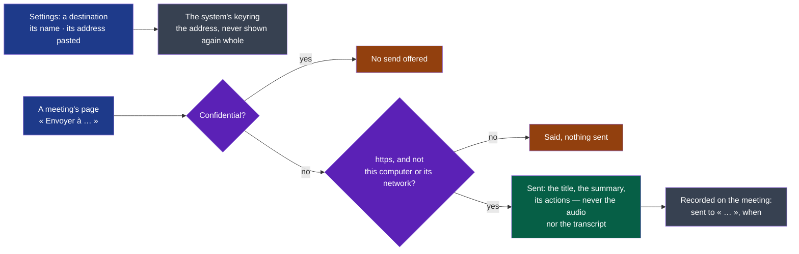

# PDR-0007 — A summary leaves for a channel on the user's gesture, each time; a confidential meeting never does

> The framework's words: `.nstack/handbook/glossary.md`.

- **Status**: Accepted — the decider, 2026-11-20, in their working session with the coordinator: « PDR
  acceptée, ok Slack dans D110 ». Proposed by sam, author of D110 (cycle 11), the same day. Slack's incoming
  webhook is thereby in D110's second criterion (cycle 11's file, its dated note).
- **Amended, 2026-11-23**: a fourth kind, Notion (*Decision*, point 8), for cycle 11's D116, which the decider
  entered that day. Proposed by sam in the pull request that frames D116; the decider's approval of that pull
  request accepts it, the forge recording its day. Everything else in this PDR is unchanged and applies to it.
- **Date**: 2026-11-20
- **Decision makers**: the decider, `@napkinstack-admin`
- **Modules affected**: `export` (what a summary becomes when it is sent, D108's Markdown); `shell` (the
  page's gesture, the destinations in Settings, their addresses in the system's keyring); `send` (the program
  that sends, `posting/v1`).

> The PDR describes **what the product must do and why**, never its implementation.

---

**Legend** — blue: what the user does · violet: the rules Kitokey applies · grey: what Kitokey keeps · green:
what leaves the computer · amber: nothing leaves.

## User problem

A team lead records the weekly meeting with Kitokey, and the summary is good. Then they open it, select it,
copy it and paste it into the team's Discord or chat, each week. Some of them also run a Zapier or n8n flow
that reads a webhook. Today the summary stays in Kitokey (cycle 11's *Goal*): every share is that manual copy,
and Markdown pasted into chat breaks (D109's clipboard answers the paste, not the channel).

Until now, a meeting left the computer only for a model, and only to a host the user named and agreed to
(ADR-0013, D43). Sending a summary to a channel would be the first time it leaves by the user's gesture, for
people. The charter's one promise is at stake: *a recording or a transcript leaves the machine without the
user choosing it* is its first risk, and the project's security rule 1 says « nothing leaves the machine unless
the user chose it ». A webhook's address is itself a secret: whoever holds it posts to the channel.

## Goal

A user sends a meeting's summary to a channel they set up, with one gesture, knowing what leaves and where.
A meeting said confidential cannot be sent.

## Out of scope

- **Sending each new summary by itself** (Fireflies' and Granola's automatic posting). This cycle sends on a
  gesture only; automatic sending is reconsidered at this PDR's criterion date (*Removal condition*).
- **Slack's, Notion's and Google Drive's APIs**: they need OAuth, and most need a secret or a backend of ours
  (cycle 11's *Out of scope* and *Later*, cycle 12). Slack is reached here by its incoming webhook, which needs
  neither.
- **Teams as a destination of its own**: its Workflows webhooks expect Adaptive Cards. It is reached through the
  generic webhook until cycle 12.
- **Sending the audio or the transcript**: the summary, its title and its actions only.
- **A share link**: it needs a cloud of ours.
- **Taking back a summary sent**: once in a channel, it is the channel's. Kitokey says so before the first send.

---

## Prior art

The market leaders were read on 2026-11-20 through search results and the vendors' own pages. A claim marked
*(snippet only)* was not read on a primary page and stays an assumption.

| Product / reference | Solution chosen | What we keep from it |
|---|---|---|
| **Fireflies** ([Slack integration](https://fireflies.ai/product/slack-integration)) | After every meeting, notes go automatically to a chosen Slack channel, private group or person. The user can also send one meeting by hand from its page. Other destinations go through Zapier. *(Snippet only for the manual path.)* | A destination is chosen once and named; a meeting can be sent from its page. Automatic posting is the market's default, and it is left out here. |
| **Granola** ([Slack docs](https://docs.granola.ai/help-center/sharing/integrations/slack)) | Automatic posting is set **per folder**: only notes added afterwards are posted, never earlier ones. A single note can be sent by its Slack button. Nothing posts before the notes are « enhanced », that is, summarised. | Sending is tied to a finished summary, never the raw notes. An automatic rule never reaches back to meetings made before it. |
| **Otter** ([its Slack app, 2023](https://otter.ai/blog/from-video-meeting-to-slack-otter-app-for-slack-uses-ai-to-bridge-the-work-communications-gap)) | Meeting notes, summary and action items are shared to Slack channels automatically; action items go to their assignees. *(The 2023 launch post; today's plans not read.)* | The actions travel with the summary. |
| **Discord's webhooks** ([Execute Webhook](https://discord.com/developers/docs/resources/webhook)) | A channel's URL, no OAuth and no secret of the app. `content` up to 2000 characters; files as multipart, by default up to 20 MiB each (changelog: 10 → 20 MiB). | The second destination, within these limits: a short message, the summary attached as a Markdown file. |
| **Slack's incoming webhooks** ([Sending messages using incoming webhooks](https://docs.slack.dev/messaging/sending-messages-using-incoming-webhooks/)) | A URL the person creates in their own workspace, through a Slack app: no OAuth, and no secret of Kitokey's. It takes a POST of JSON with a `text` field, in mrkdwn, Slack's own syntax and not Markdown ([Formatting message text](https://docs.slack.dev/messaging/formatting-message-text/)). | The third destination. Slack is the one channel that Fireflies, Granola and Otter all name. The only cost is converting Markdown to mrkdwn. |
| **Zapier's, Make's and n8n's « catch hook »** (the Zapier templates read above) | Any app that POSTs JSON to a URL feeds the user's own flows: Slack, Notion, a CRM. | The first destination is a generic webhook: one JSON object that every one of them reads. |

**The convention the user already knows:**
- A destination is set up once, by pasting a webhook URL or connecting an account, and named.
- Then a meeting is sent from its page with a button that names the destination.
- The leaders then make sending automatic.

**Why depart from it** (automatic posting): for one cycle, and for a reason the user feels. Kitokey's promise
is that nothing leaves without the user's choice. Its first channel sends each summary on a gesture, so the
user sees what leaves before anything leaves on its own. The cost is one click per meeting.

---

## Options considered

| Option | What the user experiences | Cost | Chosen? |
|---|---|---|---|
| Do nothing | A copy and a paste each time; Markdown breaks in chat | 0 | No: the cycle's goal |
| **A gesture each time**, a generic webhook, Discord's and Slack's | « Envoyer à #équipe » on the page; what leaves said once, before the first send | D110 as written, plus Slack's message: Markdown to mrkdwn | **Yes** |
| The same, Slack through Zapier, Make or n8n only | The same, after setting up a third-party account, often paid, which reads the summary | D110 as written | No: a third party between the meeting and the channel goes against Kitokey's promise |
| A gesture, or « each new summary » set once per destination | As above, plus a switch per destination that sends every new summary | The same, plus: a rule that runs without a gesture, its first run, what it skips, the confidential meeting made after the rule | Later: reconsidered at the criterion's date |
| OAuth destinations (Slack, Notion) | A button that connects an account | A client secret or a backend of ours | No: cycle 12, after a spike each |

## Decision

1. **Three kinds of destination**: a webhook (any `https:` URL), a Discord channel's webhook, and a Slack
   channel's incoming webhook. The user
   pastes the address in Settings and gives the destination a name, such as « #équipe ». The address is kept
   in the system's keyring, as a service's key is (ADR-0013). It is never written in the settings file or in
   a log (ADR-0007), and once saved it is never shown whole again.
2. **On the user's gesture, each time, for every destination.** A meeting's page offers « Envoyer à « #équipe » »
   once its summary exists. Nothing is sent by itself, for any destination, in this cycle.
3. **What leaves**: the meeting's title, its summary in Markdown (D108's), and its actions. Never the audio
   and never the transcript. Before a destination's first send, the page says once what leaves and where it
   goes: the destination's name, never its address.
4. **A meeting said confidential (D60) is never sent.** The page offers no send for it. If a meeting is
   marked confidential after it was sent, the switch says where its summary already went, as it already says
   for the sound and the transcript (« Already sent earlier: … »).
5. **Each send is recorded on the meeting**: to which destination (by its name) and when. That record is what
   point 4 reads.
6. **An address Kitokey refuses before anything is sent**: one that is not `https:`, or whose host is this
   computer or its local network. The address is external input, and so is the server's answer: only its
   outcome is read, never shown raw.
7. **Discord**: a short message with the title and the summary's first lines, within 2000 characters, and
   the whole summary attached as a `.md` file, within the default 20 MiB per file. The generic webhook
   receives one JSON object: the title, the summary in Markdown, and the actions. **Slack** receives one
   message: the title and the summary converted to mrkdwn, within Slack's documented limits, cited in the
   pull request that sends it.
8. **Notion** (amendment of 2026-11-23, D116): a fourth kind, of another shape. The user creates an internal
   integration in their own Notion workspace, shares one database with it, and pastes its key and the
   database's link in Settings. The key is a secret, kept as point 1 keeps an address: in the keyring, never
   written elsewhere, never shown whole again. Each send creates one page in that database: the meeting's
   title, the summary as blocks, each action a to-do left unticked. No OAuth and no secret of Kitokey's:
   Notion's OAuth stays in cycle 12. Points 2 to 6 apply to it as they are written.

---

## Expected behaviour

**Nominal journey:**
1. In Settings, the user adds a destination: its kind, a name, and the pasted address. The address is checked
   and kept in the keyring.
2. On a meeting's page with a summary, the user presses « Envoyer à « #équipe » ».
3. The first time, the page says what leaves (the title, the summary, its actions) and where (« #équipe »), and
   that a summary sent cannot be taken back. Then it sends.
4. The page says it was sent, to « #équipe », and the meeting records it.

**Edge cases and degraded states:**
- A confidential meeting offers no send.
- An address that is not `https:`, or that points to this computer or its network, is refused in Settings
  with why, and nothing is saved.
- No network, the server refusing (an address deleted, a 401 or 404), too many sends (429), a summary too large
  for Discord: each said on the page with what to do. Nothing is sent twice by itself.
- The keyring refuses: said as for a service's key, with what to do.
- A meeting without a summary offers no send.

**Business rules:**
- The audio and the transcript never leave by this path.
- A destination's address is shown only as its host and the end of its path once saved, never whole.

**Permissions:** the user of the computer. There is no account and no server of ours.

**Acceptance criteria** (D110's, which this PDR frames):

- [x] Given this PDR, when the decider reads it, then their word and its day are written in it before any
  sending is merged.
- [ ] Given a webhook address pasted (a generic one, Discord's or Slack's), when the user sends a summary,
  then an address that is not `https:`, or that points to the local network, is said before anything is sent.
  - **Slack is an addition to D110's second criterion as cycle 11 wrote it**, which named the generic webhook
    and Discord's: accepted by the decider with this PDR, 2026-11-20 (« ok Slack dans D110 »).
  - The generic one receives the title, the summary in Markdown and its actions.
  - Discord's receives a short message with the summary attached as a Markdown file, within its documented
    limits.
  - Slack's receives the title and the summary in mrkdwn, within its documented limits.
  - A refusal or no network is said on the page with what to do.
  - A confidential meeting offers no send.
  - Held by the module's tests against a local server, and by the e2e.

---

## Success criterion

> We will consider this was the right call if, before **2027-01-31**:
> - the decider and the colleagues on trial send summaries to a channel they use;
> - no issue reports a summary sent without the user's gesture, or a confidential meeting sent;
> - no issue reports a webhook's address written outside the keyring.

How it is observed:
- the colleagues' answers on their trial issues (#482);
- the issues of the repository;
- the module's tests, which read the settings file and the logs for the address.

If the criterion is not met: adjust this PDR. If people ask for automatic sending, a new PDR reconsiders
« each new summary » set once per destination, as Granola does, per folder and never for earlier meetings.

## Removal condition

Superseded when a PDR allows sending without a gesture (the *Options considered*'s third row), or when an
OAuth destination is added (cycle 12).

## Impacts

- `shell`: Settings gains its destinations, the page its send gesture, and the confidential switch its record.
- `export`: D108's Markdown is what is sent.
- The charter's first risk is unchanged: what leaves is chosen by a gesture, each time.

<!-- Read on **2027-01-31**: met | missed | superseded -->
