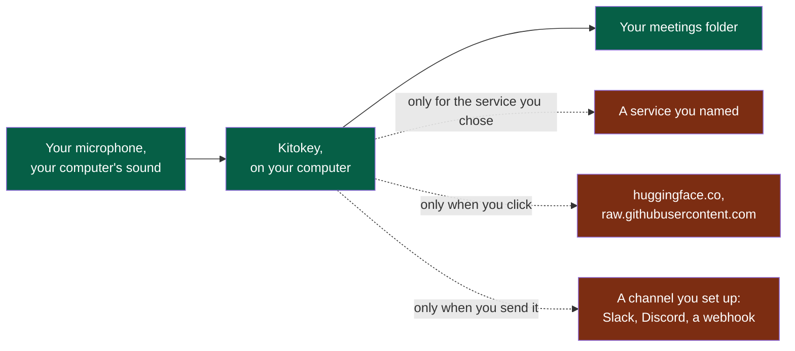

# Kitokey: privacy policy / politique de confidentialité

Last changed / dernière modification: 2026-11-28. Publisher / éditeur: c12c (NapkinStack).
[English](#english) · [Français](#français)

**Legend.** Green: your computer · red: outside it, reached only on your choice.

## English

**In one sentence.** Kitokey keeps your meetings on your computer; it has no account and no
server of ours, and it sends nothing anywhere unless you chose to.

### What it records and where it keeps it

| What | Where |
|---|---|
| The sound of a meeting: your microphone and what your computer plays, as two tracks | Your meetings folder: `Documents/Kitokey` unless you choose another; if you used Kitokey under its earlier name, Wholeheard, they stay in `Documents/Wholeheard` |
| Its transcript, its minutes, the context you wrote for it, its language, your corrections, the names you gave its speakers | The same folder, beside the sound |
| Your settings | Your user's configuration folder |
| The key of a service, if you gave one | Your system's keyring, under `com.napkinstack.Kitokey`: never in a file |
| The webhook address of a channel you set up to send summaries to | The same keyring, under the same name: never in a file, never shown again in full |
| Which summary you sent, to which channel's name, and when, never its address | `sends.json`, beside your settings |
| Each new summary, if you turned on « Export every summary », never a confidential meeting's | The folder you chose: if a service syncs or shares it, it goes where that folder goes |
| Downloaded speech models | Your user's data folder |
| Logs: steps, durations, hosts, models and failures, never a word of a meeting nor a key | Your user's state folder (on Windows, the application's data) |
| What the window's web engine keeps for itself: its cache and its own storage, with no meeting and no setting | On Linux, `~/.local/share/com.napkinstack.Kitokey` |

Nothing is recorded until you start a recording. Telling the other participants that you are
recording is yours to do: Kitokey shows them nothing. It reminds you, and you may turn the
reminder off.

### What leaves your computer, and to which host

By default, nothing of a meeting. Kitokey hears and writes on your computer. Something leaves
only when you do one of these:

| Your choice | What is sent | To |
|---|---|---|
| A service to transcribe | The meeting's sound, and its context and language | The service you chose: `openrouter.ai`, `api.openai.com` |
| A service to write the minutes | The transcript, the names you gave its speakers and the context | The service you chose: `openrouter.ai`, `api.openai.com`, `api.mistral.ai`, or the address you typed |
| Test the service chosen for the minutes (« Test », a click) | A short sentence, nothing from your meetings | That service |
| Download a speech model (a click) | A request for that file | `huggingface.co` |
| Read the list of models again (a click) | A request for that file | `raw.githubusercontent.com` |
| Download a model through Ollama (a click) | Ollama's own request | Ollama, a program of its own, from its registry |
| Send a summary to a channel (« Send… » on a meeting's page, then its name; before a first send to it, and every time for a confidential meeting, « Send » once more) | The meeting's title, its summary and its actions, never the sound, never the transcript | The webhook address you pasted for that channel in Settings: Slack, Discord, or another webhook |
| Add a date to Google Calendar (« Dates mentioned », a date ticked, then « Open in Google Calendar ») | The action's words and who, its date, the passage and the meeting's name, in the link | `calendar.google.com`, in your browser, under Google's own policy; never for a confidential meeting |

On Windows, Kitokey asks the Microsoft Store whether you bought it, each time you start a
recording: the Store answers, under Microsoft's own policy; nothing of a meeting goes with it.

The host is shown to you and agreed by you before a first sending. What a service does with what
it receives is under its own policy: read it before you choose it.

A meeting you say **confidential** is made on this computer alone, even when a service is chosen.

A summary goes to a channel only when you send it, once for each gesture. A confidential meeting's
goes only after you confirm it once more, every time: Kitokey asks before each of its sends, and
never remembers your answer. Kitokey sends no mail. Copying its minutes or its transcript puts them on your clipboard,
and they go where you paste them.

There is no telemetry, no analytics, no advertising, and we receive no data about you. Should
telemetry ever exist, it will be off until you turn it on, and will show what it sends and where.

### How to remove it all

- A meeting, or its sound alone: from its page, to your system's trash. You can have the sound
  go to the trash by itself after a number of days, in Settings.
- Everything: uninstall Kitokey, then delete your meetings folder and Kitokey's folders:
  - Linux: `~/.config/kitokey`, `~/.local/share/kitokey`, `~/.local/state/kitokey`,
    the window's web cache `~/.local/share/com.napkinstack.Kitokey`,
    and the start-at-login entry `~/.config/autostart/com.napkinstack.Kitokey.desktop`;
  - Windows, from the Store's package: removing it removes settings, models and logs; your
    meetings stay in `Documents\Kitokey` until you delete them;
  - macOS: `~/Library/Application Support/kitokey` and `~/Library/Logs/Kitokey`.
- A key you gave stays in your system's keyring until you delete it there (under
  `com.napkinstack.Kitokey`); revoke it also at the service that issued it.
- A channel's webhook address leaves the keyring when you remove that channel in Settings; delete the
  webhook also in the channel, so that no one holding its address can post there. A summary already
  sent stays in the channel: remove it there.
- A model downloaded through Ollama is kept by Ollama: remove it there (`ollama rm <model>`).

### This website

kitokey.com is served by Cloudflare Pages. To send you a page, Cloudflare receives your IP address and the page
you ask for, as any web host does ([Cloudflare's privacy policy](https://www.cloudflare.com/privacypolicy/)). The
site sets no cookie, runs no tracker and no analytics, and loads nothing from another domain.

If you ask to be told when Kitokey is out, we keep your e-mail address for that alone: one message at the release,
then we delete it. You confirm it first, by a link we send you; until then it joins no list. The site passes it to
Brevo (Sendinblue SAS, France), which keeps it in the European Union and sends these two messages on our behalf,
under a data processing agreement. The basis is your consent (GDPR art. 6(1)(a)): you may withdraw it at any time
by the link in each message or by writing to support@kitokey.com, and ask to see, correct or delete it.

### Contact

Questions, or a request about your data: [support@kitokey.com](mailto:support@kitokey.com), or
[Kitokey's support page](support.md).
Changes to this policy are in this file's history.

## Français

**En une phrase.** Kitokey garde vos réunions sur votre ordinateur ; il n'a ni compte ni serveur
à nous, et il n'envoie rien nulle part sauf si vous l'avez choisi.

### Ce qu'il enregistre et où il le garde

| Quoi | Où |
|---|---|
| Le son d'une réunion : votre micro et ce que votre ordinateur joue, en deux pistes | Votre dossier de réunions : `Documents/Kitokey`, sauf si vous en choisissez un autre ; si vous utilisiez Kitokey sous son ancien nom, Wholeheard, elles restent dans `Documents/Wholeheard` |
| Sa transcription, son compte rendu, le contexte que vous avez écrit, sa langue, vos corrections, les noms que vous avez donnés aux intervenants | Le même dossier, à côté du son |
| Vos réglages | Le dossier de configuration de votre utilisateur |
| La clé d'un service, si vous en avez donné une | Le trousseau de votre système, sous `com.napkinstack.Kitokey` : jamais dans un fichier |
| L'adresse de webhook d'un canal où vous envoyez des comptes rendus | Le même trousseau, sous le même nom : jamais dans un fichier, jamais réaffichée en entier |
| Quel compte rendu vous avez envoyé, vers quel nom de canal, et quand, jamais son adresse | `sends.json`, à côté de vos réglages |
| Chaque nouveau compte rendu, si vous avez activé « Exporter chaque compte rendu », jamais celui d'une réunion confidentielle | Le dossier que vous avez choisi : si un service le synchronise ou le partage, il va là où va ce dossier |
| Les modèles de parole téléchargés | Le dossier de données de votre utilisateur |
| Les journaux : étapes, durées, hôtes, modèles et échecs, jamais un mot d'une réunion ni une clé | Le dossier d'état de votre utilisateur (sous Windows, les données de l'application) |
| Ce que le moteur web de la fenêtre garde pour lui : son cache et son propre stockage, sans réunion ni réglage | Sous Linux, `~/.local/share/com.napkinstack.Kitokey` |

Rien n'est enregistré tant que vous ne lancez pas un enregistrement. Prévenir les autres
participants que vous enregistrez vous revient : Kitokey ne leur montre rien. Il vous le
rappelle, et vous pouvez couper ce rappel.

### Ce qui quitte votre ordinateur, et vers quel hôte

Par défaut, rien d'une réunion. Kitokey écoute et écrit sur votre ordinateur. Quelque chose ne
part que si vous faites l'un de ces choix :

| Votre choix | Ce qui est envoyé | Vers |
|---|---|---|
| Un service pour transcrire | Le son de la réunion, son contexte et sa langue | Le service choisi : `openrouter.ai`, `api.openai.com` |
| Un service pour écrire le compte rendu | La transcription, les noms que vous avez donnés aux intervenants et le contexte | Le service choisi : `openrouter.ai`, `api.openai.com`, `api.mistral.ai`, ou l'adresse saisie |
| Tester le service choisi pour le compte rendu (« Tester », un clic) | Une courte phrase, rien de vos réunions | Ce service |
| Télécharger un modèle de parole (un clic) | La demande de ce fichier | `huggingface.co` |
| Relire la liste des modèles (un clic) | La demande de ce fichier | `raw.githubusercontent.com` |
| Télécharger un modèle par Ollama (un clic) | La demande d'Ollama elle-même | Ollama, un programme à part, depuis son registre |
| Envoyer un compte rendu vers un canal (« Envoyer… » sur la page d'une réunion, puis son nom ; avant un premier envoi vers lui, et à chaque fois pour une réunion confidentielle, « Envoyer » une fois de plus) | Le titre de la réunion, son compte rendu et ses actions, jamais le son, jamais la transcription | L'adresse de webhook collée pour ce canal dans les Réglages : Slack, Discord ou un autre webhook |
| Ajouter une date à Google Agenda (« Dates mentionnées », une date cochée, puis « Ouvrir dans Google Agenda ») | Les mots de l'action et le « qui », sa date, le passage et le nom de la réunion, dans le lien | `calendar.google.com`, dans votre navigateur, sous la politique de Google ; jamais pour une réunion confidentielle |

Sous Windows, Kitokey demande au Microsoft Store si vous l'avez acheté, à chaque enregistrement
lancé : le Store répond, selon la politique de Microsoft ; rien d'une réunion ne part avec.

L'hôte vous est montré et vous l'acceptez avant un premier envoi. Ce qu'un service fait de ce qu'il
reçoit relève de sa propre politique : lisez-la avant de le choisir.

Une réunion dite **confidentielle** est traitée sur cet ordinateur seulement, même si un service est
choisi.

Un compte rendu ne part vers un canal que lorsque vous l'envoyez, une fois par geste. Celui d'une
réunion confidentielle ne part qu'après une confirmation de plus, à chaque fois : Kitokey la demande
avant chacun de ses envois, et ne retient jamais votre réponse. Kitokey n'envoie aucun courriel. Copier son compte rendu ou sa
transcription les met dans votre presse-papiers, et ils vont là où vous les collez.

Il n'y a ni télémétrie, ni mesure d'audience, ni publicité, et nous ne recevons aucune donnée sur
vous. Si une télémétrie existait un jour, elle resterait coupée tant que vous ne l'activez pas, et
montrerait ce qu'elle envoie et où.

### Comment tout supprimer

- Une réunion, ou son son seul : depuis sa page, vers la corbeille de votre système. Dans les
  Réglages, le son peut partir à la corbeille de lui-même après un nombre de jours.
- Tout : désinstallez Kitokey, puis supprimez votre dossier de réunions et les dossiers de
  Kitokey :
  - Linux : `~/.config/kitokey`, `~/.local/share/kitokey`, `~/.local/state/kitokey`,
    le cache web de la fenêtre `~/.local/share/com.napkinstack.Kitokey`,
    et l'entrée de démarrage à l'ouverture de session `~/.config/autostart/com.napkinstack.Kitokey.desktop` ;
  - Windows, depuis le paquet du Store : le retirer retire réglages, modèles et journaux ; vos
    réunions restent dans `Documents\Kitokey` jusqu'à ce que vous les supprimiez ;
  - macOS : `~/Library/Application Support/kitokey` et `~/Library/Logs/Kitokey`.
- Une clé donnée reste dans le trousseau de votre système jusqu'à ce que vous l'y supprimiez
  (sous `com.napkinstack.Kitokey`) ; révoquez-la aussi auprès du service qui l'a émise.
- L'adresse de webhook d'un canal quitte le trousseau quand vous retirez ce canal dans les Réglages ;
  supprimez aussi le webhook dans le canal, pour que personne ne puisse y poster avec son adresse. Un
  compte rendu déjà envoyé reste dans le canal : retirez-le là.
- Un modèle téléchargé par Ollama est gardé par Ollama : retirez-le là (`ollama rm <modèle>`).

### Ce site

kitokey.com est servi par Cloudflare Pages. Pour vous envoyer une page, Cloudflare reçoit votre adresse IP et la
page demandée, comme tout hébergeur web ([politique de confidentialité de Cloudflare](https://www.cloudflare.com/privacypolicy/)).
Le site ne dépose aucun cookie, n'utilise aucun traceur ni outil de mesure d'audience, et ne charge rien depuis un
autre domaine.

Si vous demandez à être prévenu de la sortie de Kitokey, nous gardons votre adresse e-mail pour cela seul : un
message à la sortie, puis nous l'effaçons. Vous la confirmez d'abord, par un lien que nous vous envoyons ; jusque-là,
elle n'entre dans aucune liste. Le site la transmet à Brevo (Sendinblue SAS, France), qui la conserve dans
l'Union européenne et envoie ces deux messages pour nous, sous un contrat de sous-traitance. La base en est votre
consentement (RGPD art. 6.1.a) : vous pouvez le retirer à tout moment par le lien de chaque message ou en écrivant à
support@kitokey.com, et demander à la voir, la corriger ou l'effacer.

### Contact

Questions, ou une demande sur vos données : [support@kitokey.com](mailto:support@kitokey.com), ou
[la page d'assistance de Kitokey](support.md#français). Les
changements de cette politique sont dans l'historique de ce fichier.
