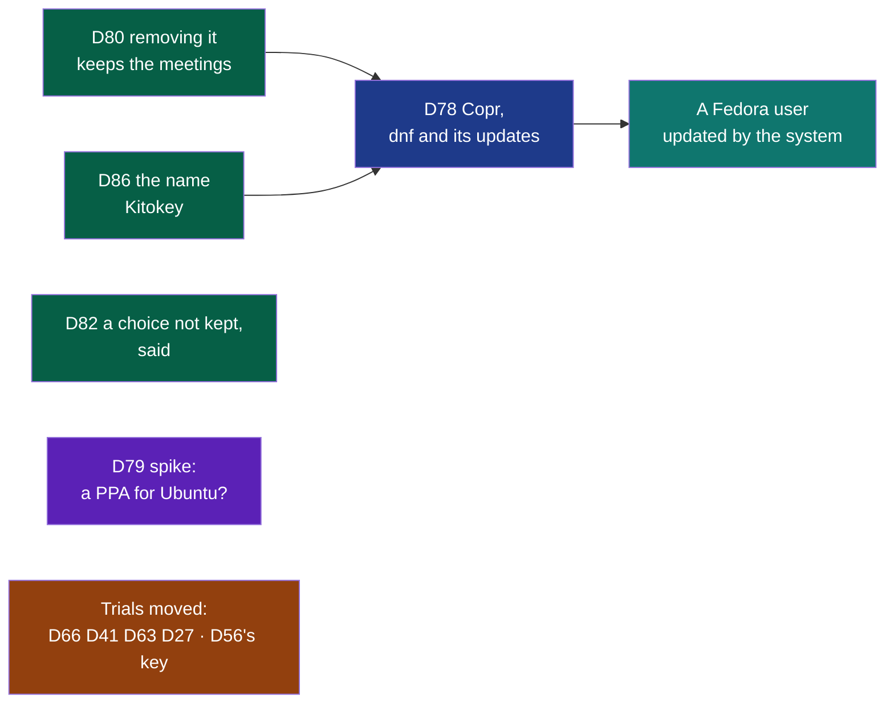
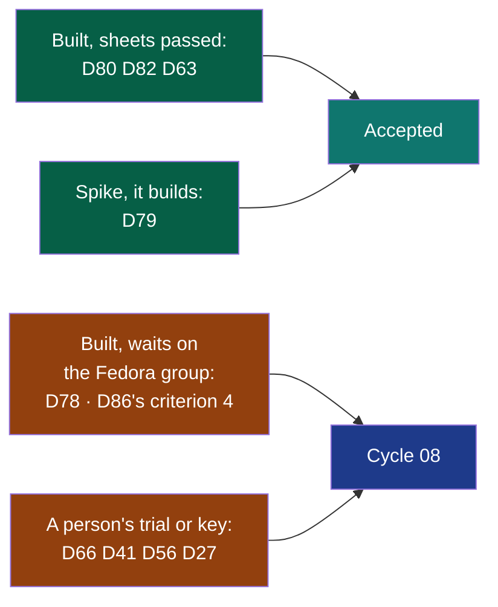

# Cycle 07 — Wholeheard from the system's updater, on Linux

> The framework's words: `.nstack/handbook/glossary.md`.

> **Accepted by the decider on 2026-11-03**, closing cycle 06, on their word that day in the session
> that proposed it: « 07 accepté, défauts du cadreur ». Each open question below is settled by its
> default, the decider amending any at will; the dates are that day's, the appetite two weeks.

## Goal

[PDR-0001](../../pdr/0001-wholeheard-open-on-linux-paid-on-macos-and-windows.md) §3 makes Linux free, through
Copr and a PPA, updated by the system. No rival has that on Fedora ([the market read on 2026-10-26](../reviews/2026-10-26-market.md), row 4).
Today a person installs Wholeheard from a file an agent built, and nothing brings them the next version.
The repository is public and `capture` is `critical` (D55): what [PDR-0002](../../pdr/0002-the-repository-opened-the-pace-kept.md)
asks before a first build reaches people outside is done. On 2026-10-31 the decider asked for one cycle per
system: Linux first, then Windows, then macOS. This is Linux's.

**Legend** — green: built by agents alone · blue: needs the decider's Copr project once · violet: a spike ·
amber: moved, a person's trial or key left · teal: the outcome.

## Deliverables

**Cut first** if the breaker nears: D79, then D82. Never D80: Copr does not publish a package whose
removal is untested. Never D86 while D78 publishes: nothing is published under the name PDR-0006 replaced.

### Moved from cycle 06

D66, D56, D41, D63 and D27. Their criteria are copied as they stand. Their state and pull requests are in
[cycle 06's closure](06-the-minutes-you-can-check.md#closure), and their sections are in cycles 04 to 06.
*What needs a person* below gives each its gesture. D27 is no longer tied to a named colleague: anyone with
an Ubuntu 24.04 machine can take it with `nstack claim D27`, for one short real session.

### D80

- `modules/install/AGENTS.md` already says nothing is installed outside `/usr`. This deliverable proves it
  after the package is removed. [`docs/privacy.md`](../../privacy.md) (#624) names what stays in the user's home:
  the start-at-login entry, the meetings, the settings, and Ollama's models.
- In throwaway containers, as the module's e2e already runs. Nothing is installed on the workstation.

### D86

**Added on the decider's word, 2026-11-04**, in the session that wrote
[PDR-0006](../../pdr/0006-the-product-is-named-kitokey.md): « cadre le livrable de renommage en kitokey », in
this cycle, before D78 (« Cycle 07, avant D78 »). The trademark search done and the domains bought, the same
day: « Déjà fait ». The end date does not move.

- **Prior Art Gate.** D28 renamed Summit to Wholeheard on 2026-10-20 ([cycle 03](03-the-window.md#d28)): one
  pull request per program, the shell's carrying over, the package taking the old one's place, the
  contracts' prose and the repository's pages, each verified by another session. Its lessons stand: a step
  of the carrying over does what is left of it at every start; a settings file with no line end stays
  readable. The keys already move from `dev.summit.Summit` (`modules/shell/src/keys.rs`): Wholeheard's
  become one more name to read from.
- **Before D78 publishes**, so that the first users of Copr install Kitokey and never change repository.
- **The pull requests in flight** (D80, D27, D56, D41, D66, D63) are not waited for: each takes the default
  branch in before its own merge and settles its conflicts, as any pull request does (kernel §2, step 10).
- The repository's name on GitHub is the decider's gesture, once D86 is merged (*What needs a person*).

### D82

- Named by #623's verifier: no check holds `choosePick`'s rollback when the settings cannot be written.

### D78

- **Prior Art Gate.** [Copr](https://docs.copr.fedorainfracloud.org/user_documentation.html) builds from an
  uploaded source package or from a repository's spec, and copr-cli reads an API token from a file. Builds
  run without internet access unless the project turns it on
  ([Copr's project guide](https://www.mintlify.com/fedora-copr/copr/user-guide/creating-projects), a mirror,
  not the official page). Access stays off here, so the crates are vendored in the source package, the usual
  way to build Rust offline.
- Today's `wholeheard.spec` packs programs built beforehand and says `License: LicenseRef-Proprietary`. A
  Copr build compiles them from source, and the licence is the repository's, GPL-3.0 (PDR-0002).
- The token is a secret of the forge. Setting it is the decider's: GitHub's settings are theirs.

### D79

- [Launchpad's builders have no outbound network](https://answers.launchpad.net/launchpad/+question/691015):
  everything needed is in the source package or a build dependency. Whether Ubuntu 24.04's archive rustc
  builds the four programs is unknown, hence a spike. It is answered in a container before anyone opens a
  Launchpad account.

## What needs a person

| Deliverable | Who | The literal gesture |
|---|---|---|
| D86 | The decider | Done on 2026-11-04: the repository is `NapkinStack/kitokey`, GitHub redirecting the old address |
| D78 | The decider | Done on 2026-11-04: a Copr token in the forge's secret `COPR_CONFIG`. Left: a Fedora group `napkinstack`, asked on [Fedora's infrastructure tickets](https://forge.fedoraproject.org/infra/tickets/issues), so that the install command names no person; once made, activated in Copr (*My Groups*) and its project `kitokey` created there; the project under the decider's own account deleted from its *Settings*. Then a tag `v<version>` on `main`, given by the decider's word |
| D66, trial | The decider | As cycle 06 says, on the build of this cycle's first tag: AirPods, a WhatsApp Web call, five starts and stops, the answers on [#494](https://github.com/NapkinStack/wholeheard/issues/494) |
| ADR-0015 | The decider | After that trial, say « ADR-0015 acceptée », or what falls |
| D41 | The decider | [#449](https://github.com/NapkinStack/wholeheard/issues/449): a call on the earbuds, the default on the speaker |
| D63 | The decider | [#463](https://github.com/NapkinStack/wholeheard/issues/463): a real service heard, with their key |
| D56 | The decider | In a terminal of your own, never through an agent: `sudo dnf install minisign`, then, at the root of a checkout of `main`, `mkdir -m 700 -p ~/.minisign` and `minisign -G -p kitokey-models.pub -s ~/.minisign/kitokey-models.key` (named after D86): a passphrase kept in your password manager, the `.key` file copied offline, never `-W`, which keeps it without a passphrase. Give an agent `kitokey-models.pub` alone. Sign when asked: `minisign -Sm modules/shell/registry/models.json -s ~/.minisign/kitokey-models.key`, and give an agent `models.json.minisig`: it commits it |
| D27 | Anyone on Ubuntu 24.04 | `nstack claim D27`, then [#255](https://github.com/NapkinStack/wholeheard/issues/255): `sudo apt install ./wholeheard_<version>_amd64.deb`, one real call of five minutes, the answer there |

## Dependency with a date

- **An agent remakes the builds from `main` and updates #255, #449, #463 and #494** within 48 hours of the
  acceptance, the files with them. Cycle 06 missed it.
- **The decider's Copr project and its token**: 5 days after the acceptance, so that D78 is tried before the
  end. Missed, D78 is delivered up to its second criterion and publishing waits.

## Out of scope

- A PPA built and published: D79 asks first whether it can be.
- Flathub, Snap, AUR: Flathub does not sell (PDR-0004), and nobody asked for the others.
- Windows and macOS: their cycles come next.
- Signing the packages with a key of the project's own: Copr signs with its own.

## Later

- **Cycle 08, Windows**: D53, D54, D57, D58 on Windows, D77's kit on a person's Windows, the Store's account.
- **Cycle 09, macOS**: D38, D39, D42, D58 on a Mac, ADR-0012's reading, notarisation.
- A PPA: D79 says it can be built, offline, with the archive's toolchain; for the next Linux framing. Debian once a channel exists (PDR-0001).
- Tests in `summary`, `transcription`, `platform` and `contracts` that still name a later version's number
  get `vnext`: one pull request each, out of cycle.
- The window's AA scenario, failed twice in a whole e2e and never alone.
- Every item of cycle 06's *Later*, unchanged.

## Open questions

**Blocking:** none. Each has a default the deliverable is built with.

**Not blocking**, each *(framer, to confirm)*:

- **The appetite**: two weeks. Default: two, never stretched.
- **Which Fedora releases**: those Copr still supports at the tag. Default: 43 and 44, x86_64; aarch64 only
  if it costs nothing more.
- **The first Copr build's version**: the `0.2.x` already in the packages. Default: kept; 1.0.0 stays for the
  Store's first submission.
- **D27 without a named colleague**: default, anyone may take it; not taken by the end, it goes to *Later*.

## Closure

**Closed on 2026-11-05, shipped, on the decider's word that day:** « continu tout ce que tu peux faire en
autonomie pour avancer, deplace les tache dans les cycle suivant si besoin ». Every deliverable an agent could
finish is built and verified. What is left waits on a person: the Fedora group that D78's first
publication needs, and the trials. D63, D80 and D82 are accepted from their records by
`nstack deliver --write-states`. D79 is re-framed `module: null` on the same word, as NapkinStack 0.26.0
asks of a spike whose product is a record, and accepted from its line. The six others move to
[cycle 08](08-wholeheard-ready-for-the-microsoft-store.md), their criteria as they stand. 4 of 10 accepted.

**Legend** — green: built and verified · amber: a person's gesture left · teal: accepted · blue: the next cycle.

**State, by what is true on `main` 4376bbe.** Only what was not proven is listed: each pull request's
sheet holds the rest.

| Deliverable | Pull requests | Not proven |
|---|---|---|
| D80 removal keeps the meetings | #656 | A real recording in the container; a key given, then the package removed: no keyring daemon there |
| D82 a choice not kept, said | #633 | — |
| D63 a service that hears | #463 | — |
| D79 a PPA for Ubuntu | [#129](https://github.com/NapkinStack/kitokey/issues/129#issuecomment-6602852530) | It builds offline with noble's rustc 1.91, above the threshold: a PPA goes to the next Linux framing. Launchpad's builders themselves, untried |
| D86 Kitokey | #648 to #654, #663 to #666 | Criterion 4, `dnf copr enable …/kitokey`: waits on D78's first publication |
| D78 Copr | #657 to #659, #661, #662 | Its criteria 3 and 4: the Fedora group `napkinstack`, asked of Fedora's infrastructure, not yet made; then the tag |
| D66, D41, D56, D27 | Cycles 04 to 06; #643, #644, #540 open | A person's trial or key, unchanged |

**The goal.** Removing Kitokey keeps the meetings (D80), and the package Copr will build is ready from source
at a tag (D78). **Not reached**: no Fedora user installs it from Copr yet, because the group that keeps the
install command free of a person's name does not exist yet.

**Success criteria**: none moved.

**Dependency with a date**: the builds were remade and #255, #449, #463 and #494 updated on 2026-11-03. The
decider's Copr token came on 2026-11-04, and the Fedora group is still asked.

**Documents brought current:** the repository's pages and the product's name (#654, #666); `docs/privacy.md`,
what Kitokey leaves on Linux (#656); the install module's README and AGENTS (#656, #662).
