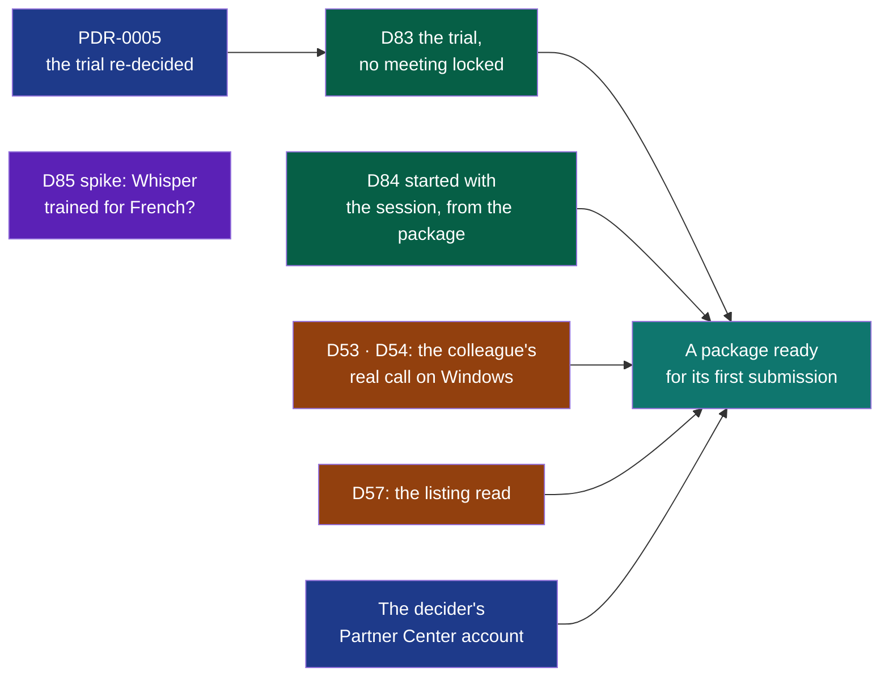

# Cycle 08 — Wholeheard ready for the Microsoft Store

> The framework's words: `.nstack/handbook/glossary.md`.

> **Accepted by the decider on 2026-11-03**, on their word that day in the session that proposed it: « 08
> accepté, défauts du cadreur ». Each open question below is settled by its default, and PDR-0005 is accepted
> with it. Started at [cycle 07's closure](07-wholeheard-from-the-systems-updater.md#closure), on
> 2026-11-05, which moved six deliverables here.
>
> Proposed by the framer on 2026-11-03, on the decider's word « cadre le cycle 08 ». On 2026-10-31 the
> decider asked for one cycle per system: Linux first (cycle 07), then Windows, then macOS. This is Windows'.

## Goal

[PDR-0004](../../pdr/0004-windows-through-the-microsoft-store.md) sells Wholeheard on Windows through the
Microsoft Store. The package exists, and the certification kit passes it, with one optional test failed
(D54, D77; `modules/install/windows/certification.md`). Three things stand between it and a first
submission. First, the trial PDR-0004 chose would lock the meetings once over, so the Store's trial is
re-decided, in [PDR-0005](../../pdr/0005-on-windows-the-trial-ends-without-locking-the-meetings.md), and
built. Second, on Windows, today's « Démarrer avec la session » switch writes a Linux entry that Windows
never reads. Third, nobody has yet recorded a real call from the package.

**Legend** — blue: the decider's word or account · green: built by agents alone · violet: a spike · amber: a
person's trial or reading · teal: the outcome.

## Deliverables

**Cut first** if the breaker nears: D85, then D84. D83 is never cut while PDR-0005 stands: without it, the
Store's trial cannot be set at all.

### Moved from cycle 06

D53, D54 and D57. Their criteria are copied as they stand. Their state and pull requests are in
[cycle 06's closure](06-the-minutes-you-can-check.md#closure); their sections are in cycles 04 to 06. D58 is
not moved: its criteria hold on the three systems, so it is accepted in the Mac cycle. Its Windows part — the
first run's assistant opening once — is asked on #482 with D53's. D57's privacy page was brought current by
#624; what is left of it is the decider's reading of the listing.

### Moved from cycle 07

D78, D86, D66, D56, D41 and D27, at cycle 07's closure, on the decider's word of 2026-11-05. Their criteria
are copied as they stand, their sections are in [cycle 07](07-wholeheard-from-the-systems-updater.md), and
*What needs a person* below gives each its gesture. D78's and D86's code is merged: what is left is the
Fedora group `napkinstack-labs`, then a tag, then the first publication, which holds D78's criteria 3 and 4 and
D86's criterion 4. The end date does not move for them.

### D83

- **Its decision**: [PDR-0005](../../pdr/0005-on-windows-the-trial-ends-without-locking-the-meetings.md),
  proposed with this cycle. Refused, D83 is dropped. Partner Center then gets PDR-0004's 15-day trial, with
  no code, and its lock is written in the listing.
- **Prior Art Gate.** Microsoft's own way:
  - `StoreContext.GetAppLicenseAsync` reads the licence, and `StoreAppLicense.IsTrial` and `IsActive` say
    what it is;
  - `OfflineLicensesChanged` follows a purchase made while the application is open;
  - `RequestPurchaseAsync` buys;
  - a desktop application **must** give the `StoreContext` its window (`IInitializeWithWindow`), or it "will return inaccurate data or errors" ([*In-app purchases and trials*](https://learn.microsoft.com/en-us/windows/uwp/monetize/in-app-purchases-and-trials)): Wholeheard gives it its main window, hidden or not, before any reading or purchase, since a recording may start from the tray (D17);
  - `RequestPurchaseAsync` is reported never to start in some desktop applications (Microsoft Q&A 24011), hence the Store's page as the fallback.

  Source: [*Implement a trial version of your app*](https://learn.microsoft.com/en-us/windows/uwp/monetize/implement-a-trial-version-of-your-app),
  read 2026-11-03.
- The trial is counted from the folder of meetings, which survives the package's removal. No date is kept in
  the package's own data, which Windows removes with it.
- A new dependency, if the Store's API needs one, is declared in the shell's manifest with its exit
  (`security.md`).
- The shell's words for the trial are in this deliverable's pull requests. The listing's lines go in their
  own pull request, with no module; `trial.ps1`'s lines in an `install` pull request of their own.
- [Store Policies](https://learn.microsoft.com/en-us/windows/apps/publish/store-policies) §10.8.4 asks a
  product to say the terms of its trial, and to warn in advance if it restricts the user's content: the
  listing says it; nothing the user made is restricted.
- The Store's real trial is seen only once Wholeheard is published, even hidden (*In-app purchases and
  trials*, *Testing*): after D54's submission, likely after this cycle's end — *Dependency with a date*.

### D84

- **Prior Art Gate.** A packaged desktop application declares a `windows.startupTask` in its manifest and
  reads and changes it through `StartupTask`. "If the task was disabled by the user using Task Manager, this
  method will not override their choice" ([`StartupTask`](https://learn.microsoft.com/en-us/uwp/api/windows.applicationmodel.startuptask),
  read 2026-11-03). Windows' Startup settings are then the setting, as the autostart folder is on Linux (D32).
- The manifest's extension belongs to `install`, with `Enabled="true"`: Windows turns it on at the first
  start, as D32 writes Linux's entry once. It goes in a pull request of its own, as does `trial.ps1`'s reading;
  the shell reads and changes the task.
- Whether the startup task inherits the application's `uap10:Parameters="--window"` is not documented: the
  colleague's sign-in on #482 is what shows it, and D17 asks for the tray alone.
- The same defect exists on macOS, where the entry is written under `Application Support`: it belongs to the
  Mac cycle.

### D85

- [The market read of 2026-11-03](../reviews/2026-11-03-market.md), row 3:
  - the model is a drop-in for whisper.cpp, under the MIT licence;
  - it claims fewer hallucinations, the defect the decider's real call showed;
  - no new engine is needed.
- As D76 did: no tuning, the model's defaults as they are (the decider, 2026-10-17). Nothing of the call is
  sent or published. Nothing enters the shipped program; offering the model is an ADR's.
- D76's 98.3 % of words wrong looks like an input that is not the product's. That input is diffed first,
  because a spike whose input is not the product's measures nothing.

## What needs a person

| Deliverable | Who | The literal gesture |
|---|---|---|
| PDR-0005 | The decider | Read [PDR-0005](../../pdr/0005-on-windows-the-trial-ends-without-locking-the-meetings.md) and say « PDR-0005 acceptée », or what changes |
| D57 | The decider | Read [`docs/store/listing.md`](../../store/listing.md) once D83's lines are in it; say « l'annonce ne promet rien de faux », or which line does |
| D54, submission | The decider | In [Partner Center](https://partner.microsoft.com/dashboard), with a company's account: reserve the product's name and give an agent the identity Partner Center shows. Set *Free trial* to **Unlimited** (PDR-0005). Read the Store's licence terms beside GPL-3.0, answer the age questionnaire, and submit the package an agent built from that identity |
| D53, D54 on Windows | The colleague on Windows 11 | [#482](https://github.com/NapkinStack/wholeheard/issues/482), updated first by an agent with the run's link, as cycle 06 says: the package signed for the run; the first run's assistant opens once (D58); a real call of five minutes; then sign out and in again: Wholeheard in the notification area, no window (D84). Answered there |
| D78, D86 | The decider | Once Fedora's infrastructure has made the group `napkinstack-labs`: activate it in [Copr](https://copr.fedorainfracloud.org) (*My Groups*), create its project `kitokey`, delete the project under your own account from its *Settings*. Then say it: an agent checks the project answers, tags `v<version>` on `main` on your word, and watches the publication |
| D66, trial | The decider | As cycle 06 says, on a build of `main`: AirPods, a WhatsApp Web call, five starts and stops, the answers on [#494](https://github.com/NapkinStack/kitokey/issues/494); then « ADR-0015 acceptée », or what falls |
| D41 | The decider | [#449](https://github.com/NapkinStack/kitokey/issues/449): a call on the earbuds, the default on the speaker |
| D56 | The decider | As [cycle 07](07-wholeheard-from-the-systems-updater.md#what-needs-a-person) says, in a terminal of your own, never through an agent: a minisign key, its `.pub` alone given to an agent |
| D27 | Anyone on Ubuntu 24.04 | `nstack claim D27`, then [#255](https://github.com/NapkinStack/kitokey/issues/255): the `.deb` of a build of `main`, one real call of five minutes, the answer there |

## Dependency with a date

- **An agent remakes the Windows builds from `main` and updates #482 within 48 hours of the acceptance**,
  and again whenever an artifact is about to expire. This was missed in cycles 06 and 07.
- **The decider's Partner Center account**, a company's: asked for within 5 days of the acceptance. Missed,
  D54 is delivered up to its package and the submission waits.
- **The colleague's call on #482**: 10 days after the acceptance. Missed, D53 and D54 stay `deferred`, and D84's
  first criterion waits.
- **The Store's real trial**: seen once the first submission is published, even hidden — the decider installs
  Wholeheard from the Store, sees the trial, buys. 2026-12-15 *(framer's, no source)*; missed, PDR-0005's
  criteria are read at the cycle that follows.

## Out of scope

- macOS: cycle 09, with D38, D39, D42 and D58.
- A signed zip, winget, or a download outside the Store: the Store signs (PDR-0004).
- Making the trial impossible to work around: the code is GPL-3.0 (PDR-0005).
- The price's figure: the decider's, in Partner Center.

## Later

- **Cycle 09, the finish before publishing**: proposed on 2026-11-06 ([its page](09-kitokey-finished-before-it-is-published.md)), from the decider's feedback that day.
- **Cycle 10, macOS**: D38, D39, D42, D58 on a Mac, ADR-0012's reading, notarisation. Also the start with the
  session on macOS, today written where macOS never reads it (D84's note), and Foresight read again (the market
  review of 2026-11-03, row 6).
- **The name**: Kitokey, chosen by the decider on 2026-11-04 ([PDR-0006](../../pdr/0006-the-product-is-named-kitokey.md)).
  The decider's trademark search and domains come before the Store's reservation and Copr's first publication.
- Everything in cycle 07's *Later*, unchanged, and the market review's rows 1, 2, 4, 5, 7 and 8.

## Open questions

**Blocking:** none. Each has a default the deliverable is built with.

**Not blocking**, each *(framer, to confirm)*:

- **The appetite**: two weeks. Default: two, never stretched.
- **PDR-0005**: default, accepted with the cycle. Refused, D83 is dropped (*D83* above).
- **The version submitted**: the Store refuses a version whose first part is 0. Default: 1.0.0 for the
  first submission only, as cycle 07 left it.
- **D85's second measure**: re-measuring D76 only if the inputs differ; dropped first if the breaker nears.
- **D85 in a cycle for Windows**: a spike with no system, so agents work while the cycle waits on people.
  Default: kept, and cut first.

## Closure

<Written at the end.>

**Documents brought current:** <at the closure>
