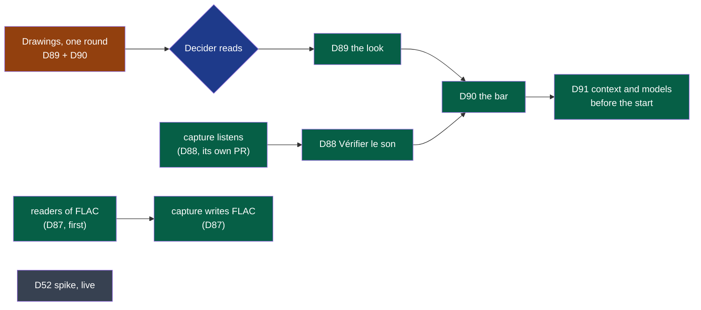

# Cycle 09 — Kitokey finished before it is published

> The framework's words: `.nstack/handbook/glossary.md`.

> **Accepted by the decider on 2026-11-07**, on their word that day in the session that published Kitokey on
> Copr: « je te laisse le poste libre 1h, avance en autonomie le projet, mets a jour au fur et a mesure. nous
> avions mis en place un plan a afaire avant la publication, enchaine ». Each open question below is settled by
> its default. Started at [cycle 08's closure](08-wholeheard-ready-for-the-microsoft-store.md#closure), the
> same day, which moved eleven deliverables here.
>
> **Proposed by the framer on 2026-11-06**, on the decider's word that day — « analyse le marché, les forces,
> les faiblesses, les tendances pour avoir le meilleur produit et cadre le cycle » —, after their feedback of
> the same day, given from the package installed on their Fedora (*Goal* below). Its source is
> [the review of 2026-11-06](../reviews/2026-11-06-market.md), by an independent session. It stays
> `proposed` until the decider accepts it: one accepted cycle at a time, cycle 08 running. It takes the place
> cycle 08's *Later* gave macOS, which becomes cycle 10.

## Goal

The decider's feedback of 2026-11-06, in their words, the source of every deliverable:

| # | The decider said | What was there | Here |
|---|---|---|---|
| 1 | « gérer une identité graphique propre … les boutons comme "Démarrer un enregistrement" sont trop grands … des icônes adaptées » | Five Lucide icons and a checked contrast (cycle 06, D69); no mark, no rule of size | D89 |
| 2 | « les sons d'origine sont volumineux, à gérer avant de commencer à publier … compressé sans perdre en qualité » | 2.07 GB an hour as written, about 1.0 as FLAC (cycle 02, D9); compressing deferred by every cycle since | D87 |
| 3 | « la fenêtre compacte est trop intrusive, trop grande (le last meeting n'a pas trop d'intérêt) … juste une "barre" avec l'essentiel » | The small window, 380 × 400 (D34, D35), filled since by D49, D50, D59, D60, D74 | D90 |
| 4 | « pouvoir tester les sources micro et l'audio avant de lancer un enregistrement » | Meters while recording only (D22, D49) | D88 |
| 5 | « le "contexte", ce serait utile de pouvoir le noter avant de lancer l'enregistrement » | D59's field, while recording and after | D91 |
| 6 | « la transcription "live" lorsque c'est possible » | Their idea of 2026-10-26; D52 framed in cycle 05, moved to *Later* twice, never run | D52 |
| 7 | « une config "default" mais choisir les modèles de chaque étape pour chaque réunion (un bouton "avancé") » | Asked on 2026-10-27 (D60) and 2026-10-29 (D65); answered then: no page of settings per meeting; *Refaire…* changes the model after | D91 |

**Why now.** Each is seen from the first day by whoever installs Kitokey: a meeting of an hour that takes two
gigabytes, a meeting lost because a side was never heard — the botless recorder's own failure, which nobody
checks before the call ([review §1](../reviews/2026-11-06-market.md)) —, a window that takes a corner of the
screen during the call. Copr and the Store publish to people who never met the decider: it comes before.

**Legend** — orange: drawn first · blue: the decider's reading · green: built, arrows the order · grey: a
spike, alone, cut first.

## Deliverables

### D87

- ADR-0004's plan since cycle 02: the tracks written as delivered while recording — a growing WAV stays
  readable if anything stops —, compressed without loss once stopped. FLAC is the field's convention for
  lossless audio; nobody else read keeps a lossless master ([review §3](../reviews/2026-11-06-market.md)):
  it is what lets a meeting be heard again and made again, the promise Granola's deleted audio cannot keep.
- Lossy (Opus) is not this deliverable: the decider asked for no loss, ADR-0004 refuses it at capture, and no
  study of Whisper on Opus in French meetings was found. Its bench and a compact copy of old meetings are
  *Later*.
- The order is a contract's — `session-audio/v3`, as `v2`'s page says a compressed track would be, and `recording/v1`'s page for the event that says the tracks are final: the readers first — transcription, the shell (playback, waveform), export,
  the bench —, then capture. The encoder is a new dependency: `security.md`, its exit strategy written.
  FLAC plays in WebKitGTK and WebView2; WKWebView is cycle 10's to check *(review, unverified)*.

### D88

- The one check no rival does: whether the call's sound is captured before the call
  ([review §1](../reviews/2026-11-06-market.md)). Zoom, Meet and Teams test the microphone inside a window
  the user opened; the convention kept here: the microphone opened only while the panel shows — GNOME's and
  macOS's indicator then light for a reason the user just gave —, never a meter at rest, never at each start.
- ADR-0015 opens the microphone passively so that a recording never switches a headset's profile: a passive stream on a source no call runs hears nothing, so a test before the call must open it. The departure is limited to the panel, the user's gesture, before a call; it is written in ADR-0015 before it is built.
- capture's command to listen is an addition to `recording/v1`'s page, in capture's own pull request; the
  shell's in its own. The test sound is never played while an application holds a microphone: on
  loudspeakers it would reach the call.
- The first run's assistant (D58) may offer it; whether it does is the drawing's.

### D89

- No agency, no custom font, no component library: the system's font, Lucide alone, one accent, a 4 px grid,
  a monogram drawn once in SVG ([review §6](../reviews/2026-11-06-market.md)). What users of the leaders
  complain about is intrusion, rarely looks: playful by motion on a change of state, never by sound.
- One round of drawings with D90, in a folder of its own, frozen; the decider reads it before either is
  built (*Dependency with a date*). The author draws; the decider's word is the bar.
- The trademark search for Kitokey (cycle 08's *Later*) comes before the mark is published.

### D90

- It replaces the small window (D34, D35) while recording and at rest. The leaders converge on one live sign,
  one way back, a drag, and a way to hide it; what users resent is a bar that comes back once hidden (Zoom) or
  cannot be turned off (Teams) ([review §2](../reviews/2026-11-06-market.md)).
- GNOME under Wayland lets no application keep itself above or place itself ([tauri #3117](https://github.com/tauri-apps/tauri/issues/3117)):
  there the tray's icon is the always-visible sign where the AppIndicator extension gives a tray (cycle 03: a Fedora without it has none), GNOME's microphone indicator otherwise, and no extension or XWayland is used to force it.
- Today's `always_on_top` while recording (`modules/shell/src/main.rs`) has no effect there; the drawing says
  what the bar is on each system.

### D91

- The decider's question asked a third time: answered now with one closed disclosure, not a page of settings.
  The review advises no choice at the start ([§5](../reviews/2026-11-06-market.md)); the departure is the
  decider's, three times: the disclosure is in the opened bar, never on the start button, and the same one is
  in *Refaire…*.
- The context typed before the start is D59's field moved earlier: its rules unchanged.

### D52

- Framed in cycle 05 (#461), moved to *Later* twice; its section there holds its reasons. Kyutai's
  `stt-1b-en_fr`, the one open streaming model found that hears French ([review §4](../reviews/2026-11-06-market.md)),
  added as a second candidate. The market's design leader moved live AI aside (Granola); the decider's idea is
  measured before anything is built.
- A measure whose product is a record, outside the shipped program: `module: null`, held by a line of the transcription's log issue (#129). Its program is kept outside the repository, or merged without carrying the deliverable.
- On devices made for the run, while the decider is not on a call. **Cut first** when the breaker nears.

### Moved from cycle 08

D84, D85, D54, D57, D53, D86, D78, D66, D56, D41 and D27, at cycle 08's closure, on the decider's word of
2026-11-07. Their criteria are copied as they stand, their sections are in
[cycle 08](08-wholeheard-ready-for-the-microsoft-store.md) and the cycles before it, and *What needs a person*
below gives each its gesture. D78's criterion 4 is held by the next tag, which carries D87; D86's criterion 1 by
the decider's word on the rpm installed over Wholeheard, given on 2026-11-08. They do not count against the appetite: the cut order
below is unchanged, and the end date does not move for them.

| Deliverable | What holds it, made before this cycle or by its release |
|---|---|
| D78 | #657, #658, #659, #661, #662 (cycle 07: each program's `--version`, the source package and `copr.yml`), #686 (the group's project). Criterion 4, `dnf upgrade` from 0.2.0: the tag v0.2.1's run [42417841678](https://github.com/NapkinStack/kitokey/actions/runs/42417841678) — « upgraded with dnf, kitokey 0.2.0 to 0.2.1 », « the meetings and the settings stay as they were » —, its version set by #711 |
| D86 | Criterion 1: the decider's word, 2026-11-08, in the working session, on the rpm installed over Wholeheard on 2026-11-06 — « oui, mes réunions s'affichent » —, after an agent read on their disk the settings, the meetings, the model and the key file under Kitokey's names. Criterion 2: #648, #649, #650, #651, #652, #653, #654, #663, #664, #665, #666. Criterion 3: #651, #654. Criterion 4: #652, #686 |

## What needs a person

| Deliverable | Who | The literal gesture |
|---|---|---|
| PDR-0005 | The decider | Read [PDR-0005](../../pdr/0005-on-windows-the-trial-ends-without-locking-the-meetings.md) and say « PDR-0005 acceptée », or what changes |
| D57 | The decider | Read [`docs/store/listing.md`](../../store/listing.md); say « l'annonce ne promet rien de faux », or which line does |
| D54, submission | The decider | In [Partner Center](https://partner.microsoft.com/dashboard), with a company's account: reserve the product's name and give an agent the identity Partner Center shows. Set *Free trial* to **Unlimited** (PDR-0005). Read the Store's licence terms beside GPL-3.0, answer the age questionnaire, and submit the package an agent built from that identity |
| D53, D54 on Windows, D84 | The colleague on Windows 11 | [#482](https://github.com/NapkinStack/wholeheard/issues/482), updated first by an agent with the run's link: the package signed for the run; a real call of five minutes; then sign out and in again: Kitokey in the notification area, no window. Answered there |
| D66, trial | The decider | On a build of `main`: AirPods, a WhatsApp Web call, five starts and stops, the answers on [#494](https://github.com/NapkinStack/kitokey/issues/494); then « ADR-0015 acceptée », or what falls |
| D41 | The decider | [#449](https://github.com/NapkinStack/kitokey/issues/449): a call on the earbuds, the default on the speaker |
| D56 | The decider | As [cycle 07](07-wholeheard-from-the-systems-updater.md#what-needs-a-person) says, in a terminal of your own, never through an agent: a minisign key, its `.pub` alone given to an agent |
| D27 | Anyone on Ubuntu 24.04 | `nstack claim D27`, then [#255](https://github.com/NapkinStack/kitokey/issues/255): the `.deb` of a build of `main`, one real call of five minutes, the answer there |
| D89, D90 | The decider | First round [read on 2026-11-08](../drawings/d89-d90-kitokey-look-and-bar/README.md#what-the-decider-answers): second round [read the same day](../drawings/d89-d90-mark-and-bar-buttons/README.md#what-the-decider-answers): third round [read the same day](../drawings/d89-d90-mark-k-and-i/README.md#what-the-decider-answers): the mark [accepted in the sixth](../drawings/d89-d90-mark-k-stem/README.md#what-the-decider-answers), the name [in the seventh](../drawings/d89-d90-name-kitokey/README.md#what-the-decider-answers), the tray's icon on its tile, red while recording (« ok C », 2026-11-08, in the working session): done |
| D88 | The decider | Before a real call, on the AirPods: Kitokey → the bar → « Vérifier le son »; say in the acceptance issue whether both sides moved |

## Dependency with a date

- **The decider's reading of D89–D90's drawings**, within two working days of their pull request. Missed,
  D87, D88 and D52 go on; D89, D90 and D91's bar wait.

- **Moved from cycle 08**: an agent remakes the Windows builds from `main` and updates #482 within 48 hours
  of this acceptance — missed in cycles 06 to 08; the decider's Partner Center account, a company's, asked
  within 5 days. Missed, D53, D54 and D84's first criterion stay where they are.

## Out of scope

- Lossy audio at capture; a format picker; 16-bit tracks to save room (D1's weak voice).
- A meter or a microphone open at rest; a test at each start; Zoom's record-and-replay.
- The live preview built — D52 measures it; a live AI panel over other applications.
- A model picker on the start button; a router choosing models by itself; meeting types.
- A GNOME Shell extension, or XWayland, to keep the bar above.
- A component library, a custom font, a mascot, a theme picker.
- macOS: a later cycle's ([cycle 10's *Later*](10-kitokey-ready-when-you-come-back.md#later), framed 2026-11-13).

## Later

- **macOS**: D38, D39, D42, D58 on a Mac, ADR-0012's reading, notarisation, FLAC in WKWebView —
  everything cycle 08's *Later* gave cycle 09; moved to [cycle 10's *Later*](10-kitokey-ready-when-you-come-back.md#later)
  when cycle 10 was framed on the copy and UX review, 2026-11-13.
- **Opus for old meetings**: a bench first — the trial meeting through today's engine from FLAC and from Opus
  32 and 48 kbit/s —, then, only if it holds and the decider amends ADR-0004, a compact copy after N days
  (about 43 MB an hour) ([review §3](../reviews/2026-11-06-market.md)).
- Meetings recorded before D87 compressed from « Faire de la place ».
- **FLAC written while recording**, in place of a WAV compressed at the stop: only if users' feedback says
  the room a recording takes while it runs matters — about 1 GB an hour a track in 24-bit stereo. A new
  version of `session-audio` and its ADR first: a WAV is readable while written and whole to its last frame
  after a crash, which `session-audio/v2` promises. The decider, 2026-11-07: « on y reviendra si le besoin
  de place remonte par les retours utilisateur ».
- The live preview built, on D52's record and its ADR.
- Meeting types, each with its context and its models (market review of 2026-10-26, 8).
- Everything in cycle 08's *Later*, unchanged.

## Open questions

**Blocking:** none. Each has a default the deliverable is built with.

**Not blocking**, each *(framer, to confirm)*:

- **The appetite**: two weeks. Default: two, never stretched; cut in this order when the breaker nears: D52, D91 whole, then D89's third criterion (the packages' icons).
- **The start**: settled — cycle 08 closed early on 2026-11-07 and moved its eleven deliverables here.
- **Copr's first tag**: settled by its default — `v0.2.0` published on 2026-11-07 without waiting for D87,
  which ships in the next tag.
- **D91 against the review**: a choice before the start is the decider's word against the review's advice.
  Default: built, behind the closed disclosure.

## Closure

**Closed on 2026-11-13, early, shipped, on the decider's word that day:** « on enchaine des que possible ».
[Cycle 10](10-kitokey-ready-when-you-come-back.md), accepted the same day, starts at this closure. One
accepted cycle at a time, so this one closes first, a week before its end. D78, D86, D87, D88 and D91 are
accepted from their records by `nstack deliver --write-states`. As cycle 10 says, the twelve others are
deferred to this cycle's *Later*, never moved there. Their gestures for a person are carried into cycle 10's
*What needs a person*. 5 of 17 accepted.

**D88, the decider's answer** (criterion 4), in the working session on 2026-11-13: « ma dernier reunion été
vraie et faite avec les airpods, le son et le micro sont bon » and « oui, les deux jauges bougeaient ».

**Merged, not delivered.** The criteria are read at `main` 958404b. Each one waits for its holder's
`nstack deliver`, or for the next framing.

| Deliverable | Criterion | Holds? | Pull requests |
|---|---|---|---|
| D89 the look | 1 the drawings read | Yes, the mark and the name accepted in rounds 6 and 7 | #712, #720 to #726 |
| | 2 Lucide, sizes, one accent, contrast in both themes | Yes, by the look's tests (`tests/look.rs`) | #730, #731, #732, #733, #737 |
| | 3 icons from one SVG, the tray's two states | Yes. The README's line on GNOME's microphone indicator is not found | #727, #729 |
| | 4 screenshots in both themes at 1920 and 420 px | Made; not checked in a sheet beside the boards | #738 |
| D90 the bar | 1 the drawings read | Yes | #712, #720 to #726 |
| | 2 recording and opened | Merged; read from the pull requests, not run again here | #740, #743, #752, #765, #768 |
| | 3 above the other windows on Windows and macOS; on GNOME an ordinary window | Not proven on Windows or macOS | #744 |
| | 4 hidden, never back by itself; the shortcut stops | Yes | #744 |
| D84 the startup task | 1 started at sign-in, listed by Windows | No: a person on Windows 11 (#795) | — |
| | 2 Settings show and change the task's state | Yes in unit tests; on Windows, a person's | #790 |
| | 3 the zip offers no switch, no `autostart` file; Linux unchanged | Yes in unit tests | #790 |
| | 4 each state mapped; `trial.ps1` records it | First half yes; second half open | #790; #788 and #791 open |

**Deferred with a reason, one line each:**

- D41, D66 (trial), PDR-0005, D57, D53, D54 and D84 on Windows, D56, D27: a person's trial, key or reading.
  Each gesture is unchanged, in cycle 10's *What needs a person*.
- D89 and D90: the decider's acceptance of the drawings is done. What is left is the table above.
- D52 and D85: agents' spikes, not started; D52 is cut first, as the cut order says.

**Out-of-cycle pull requests** #786, #787, #788, #791, #792, #793, #794, #796, #798 and #800 are unaffected:
none carries a deliverable of this cycle's, and each goes on as it is.

**The goal.** Partly reached: a meeting is kept as FLAC (D87), both sources are tried before a recording (D88),
and the context and models are chosen before it (D91). The look and the bar (D89, D90) are merged, but not
every criterion is proven.

**Success criteria**: none moved.

**Documents brought current:** none by this closure. Cycle 10's front matter: `accepted`, starting today.
