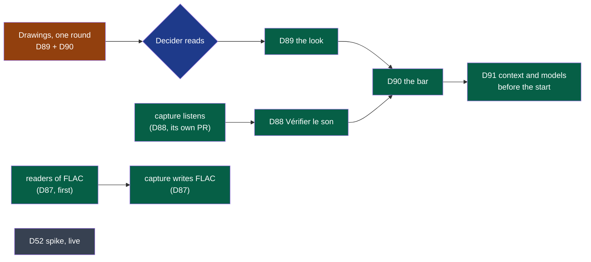

# Cycle 09 — Kitokey finished before it is published

> The framework's words: `.nstack/handbook/glossary.md`.

> **Proposed by the framer on 2026-11-06**, on the decider's word that day — « analyse le marché, les forces,
> les faiblesses, les tendances pour avoir le meilleur produit et cadre le cycle » —, after their feedback of
> the same day, given from the package installed on their Fedora (*Goal* below). Its source is
> [the review of 2026-11-06](../reviews/2026-11-06-market.md), by an independent session. It stays
> `proposed` until the decider accepts it: one accepted cycle at a time, cycle 08 running. It takes the place
> cycle 08's *Later* gave macOS, which becomes cycle 10.

## Goal

The decider's feedback of 2026-11-06, in their words, the source of every deliverable:

| # | The decider said | What was there | Here |
|---|---|---|---|
| 1 | « gérer une identité graphique propre … les boutons comme "Démarrer un enregistrement" sont trop grands … des icônes adaptées » | Five Lucide icons and a checked contrast (cycle 06, D69); no mark, no rule of size | D89 |
| 2 | « les sons d'origine sont volumineux, à gérer avant de commencer à publier … compressé sans perdre en qualité » | 2.07 GB an hour as written, about 1.0 as FLAC (cycle 02, D9); compressing deferred by every cycle since | D87 |
| 3 | « la fenêtre compacte est trop intrusive, trop grande (le last meeting n'a pas trop d'intérêt) … juste une "barre" avec l'essentiel » | The small window, 380 × 400 (D34, D35), filled since by D49, D50, D59, D60, D74 | D90 |
| 4 | « pouvoir tester les sources micro et l'audio avant de lancer un enregistrement » | Meters while recording only (D22, D49) | D88 |
| 5 | « le "contexte", ce serait utile de pouvoir le noter avant de lancer l'enregistrement » | D59's field, while recording and after | D91 |
| 6 | « la transcription "live" lorsque c'est possible » | Their idea of 2026-10-26; D52 framed in cycle 05, moved to *Later* twice, never run | D52 |
| 7 | « une config "default" mais choisir les modèles de chaque étape pour chaque réunion (un bouton "avancé") » | Asked on 2026-10-27 (D60) and 2026-10-29 (D65); answered then: no page of settings per meeting; *Refaire…* changes the model after | D91 |

**Why now.** Each is seen from the first day by whoever installs Kitokey: a meeting of an hour that takes two
gigabytes, a meeting lost because a side was never heard — the botless recorder's own failure, which nobody
checks before the call ([review §1](../reviews/2026-11-06-market.md)) —, a window that takes a corner of the
screen during the call. Copr and the Store publish to people who never met the decider: it comes before.

**Legend** — orange: drawn first · blue: the decider's reading · green: built, arrows the order · grey: a
spike, alone, cut first.

## Deliverables

### D87

- ADR-0004's plan since cycle 02: the tracks written as delivered while recording — a growing WAV stays
  readable if anything stops —, compressed without loss once stopped. FLAC is the field's convention for
  lossless audio; nobody else read keeps a lossless master ([review §3](../reviews/2026-11-06-market.md)):
  it is what lets a meeting be heard again and made again, the promise Granola's deleted audio cannot keep.
- Lossy (Opus) is not this deliverable: the decider asked for no loss, ADR-0004 refuses it at capture, and no
  study of Whisper on Opus in French meetings was found. Its bench and a compact copy of old meetings are
  *Later*.
- The order is a contract's: the readers first — transcription, the shell (playback, waveform), export,
  the bench —, then capture. The encoder is a new dependency: `security.md`, its exit strategy written.
  FLAC plays in WebKitGTK and WebView2; WKWebView is cycle 10's to check *(review, unverified)*.

### D88

- The one check no rival does: whether the call's sound is captured before the call
  ([review §1](../reviews/2026-11-06-market.md)). Zoom, Meet and Teams test the microphone inside a window
  the user opened; the convention kept here: the microphone opened only while the panel shows — GNOME's and
  macOS's indicator then light for a reason the user just gave —, never a meter at rest, never at each start.
- capture's command to listen is an addition to `recording/v1`'s page, in capture's own pull request; the
  shell's in its own. The test sound is never played while an application holds a microphone: on
  loudspeakers it would reach the call.
- The first run's assistant (D58) may offer it; whether it does is the drawing's.

### D89

- No agency, no custom font, no component library: the system's font, Lucide alone, one accent, a 4 px grid,
  a monogram drawn once in SVG ([review §6](../reviews/2026-11-06-market.md)). What users of the leaders
  complain about is intrusion, rarely looks: playful by motion on a change of state, never by sound.
- One round of drawings with D90, in a folder of its own, frozen; the decider reads it before either is
  built (*Dependency with a date*). The author draws; the decider's word is the bar.
- The trademark search for Kitokey (cycle 08's *Later*) comes before the mark is published.

### D90

- It replaces the small window (D34, D35) while recording and at rest. The leaders converge on one live sign,
  one way back, a drag, and a way to hide it; what users resent is a bar that comes back once hidden (Zoom) or
  cannot be turned off (Teams) ([review §2](../reviews/2026-11-06-market.md)).
- GNOME under Wayland lets no application keep itself above or place itself ([tauri #3117](https://github.com/tauri-apps/tauri/issues/3117)):
  there the tray's icon is the always-visible sign, and no extension or XWayland is used to force it.
- Today's `always_on_top` while recording (`modules/shell/src/main.rs`) has no effect there; the drawing says
  what the bar is on each system.

### D91

- The decider's question asked a third time: answered now with one closed disclosure, not a page of settings.
  The review advises no choice at the start ([§5](../reviews/2026-11-06-market.md)); the departure is the
  decider's, three times: the disclosure is in the opened bar, never on the start button, and the same one is
  in *Refaire…*.
- The context typed before the start is D59's field moved earlier: its rules unchanged.

### D52

- Framed in cycle 05 (#461), moved to *Later* twice; its section there holds its reasons. Kyutai's
  `stt-1b-en_fr`, the one open streaming model found that hears French ([review §4](../reviews/2026-11-06-market.md)),
  added as a second candidate. The market's design leader moved live AI aside (Granola); the decider's idea is
  measured before anything is built.
- On devices made for the run, while the decider is not on a call. **Cut first** when the breaker nears.

## What needs a person

| Deliverable | Who | The literal gesture |
|---|---|---|
| The cycle | The decider | Read this page and say « 09 accepté » — or what changes; it is accepted once cycle 08 is closed |
| D89, D90 | The decider | Open the round's boards (`docs/project/drawings/d89-…/README.md`, linked in the pull request) and answer on it: accepted, or what to change |
| D88 | The decider | Before a real call, on the AirPods: Kitokey → the bar → « Vérifier le son »; say in the acceptance issue whether both sides moved |
| D89 | The decider | The trademark search for « Kitokey » before the mark is published (cycle 08's *Later*) |

## Dependency with a date

- **The decider's reading of D89–D90's drawings**, within two working days of their pull request. Missed,
  D87, D88 and D52 go on; D89, D90 and D91's bar wait.

## Out of scope

- Lossy audio at capture; a format picker; 16-bit tracks to save room (D1's weak voice).
- A meter or a microphone open at rest; a test at each start; Zoom's record-and-replay.
- The live preview built — D52 measures it; a live AI panel over other applications.
- A model picker on the start button; a router choosing models by itself; meeting types.
- A GNOME Shell extension, or XWayland, to keep the bar above.
- A component library, a custom font, a mascot, a theme picker.
- macOS: cycle 10.

## Later

- **Cycle 10, macOS**: D38, D39, D42, D58 on a Mac, ADR-0012's reading, notarisation, FLAC in WKWebView —
  everything cycle 08's *Later* gave cycle 09.
- **Opus for old meetings**: a bench first — the trial meeting through today's engine from FLAC and from Opus
  32 and 48 kbit/s —, then, only if it holds and the decider amends ADR-0004, a compact copy after N days
  (about 43 MB an hour) ([review §3](../reviews/2026-11-06-market.md)).
- Meetings recorded before D87 compressed from « Faire de la place ».
- The live preview built, on D52's record and its ADR.
- Meeting types, each with its context and its models (market review of 2026-10-26, 8).
- Everything in cycle 08's *Later*, unchanged.

## Open questions

**Blocking:** none. Each has a default the deliverable is built with.

**Not blocking**, each *(framer, to confirm)*:

- **The appetite**: two weeks. Default: two, never stretched; D52 cut first, then D91's models.
- **The start**: cycle 08's end, 2026-11-19. Default: earlier if cycle 08 closes earlier — its remaining
  deliverables wait on people (the Store, the colleague on Windows) and may move to a later cycle.
- **Copr's first tag** (`v0.2.0`, waiting on the Copr group): the decider said compressing comes « avant de
  commencer à publier ». Default: the tag does not wait — the first users of Copr are the three of the
  charter, a meeting kept as WAV is read after D87 as before, and D87 ships in the next tag.
- **D91 against the review**: a choice before the start is the decider's word against the review's advice.
  Default: built, behind the closed disclosure.

## Closure

