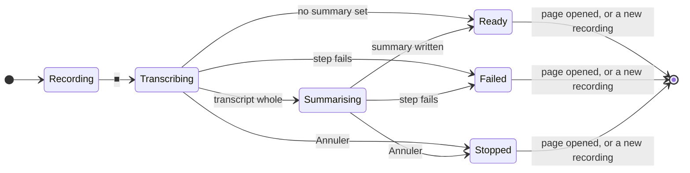
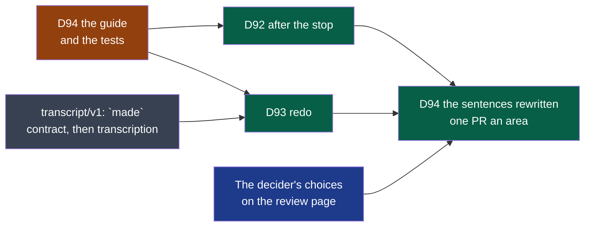

# Cycle 10 — Kitokey ready when you come back

> The framework's words: `.nstack/handbook/glossary.md`.

> **Amended on the decider's word of 2026-11-13**, after they recorded a meeting with Kitokey: « je viens
> d'enregistrer une reunion, avant de refaire je ne peux pas choisir un model dans la fenetre de la reunon pour
> cette meme reuinon (pas dans les reglage globale), j'aimerai pouvoir choisir dans le fenetre aussi meme avant
> de devoir "refaire" pour la transcription et pour le resumé de la meme maniere. autre point: on lance la
> transcription/resumé une fois en cours on ne peut pas les arreté, ex d'un cas d'utilisation: je choisit dans
> la fenetre de reu un model pour transcrire/résumé, je lance et je m'appercoit que je me suis trompé de model,
> je ne peux pas interrompre pour changer de model et relancer. » It adds D93's criterion 5 and D92's
> criterion 4; the appetite is unchanged, the cut order below says what goes first.
>
> **Accepted by the decider on 2026-11-13**, on their word that day in the working session: « cycle 10
> accepté ». The two defaults below — « vous » and « summary » — are confirmed with it, and each open question
> is settled by its default. It starts at cycle 09's closure.
>
> **Proposed by the framer on 2026-11-13**, on the decider's word that day — « on cadre et on ouvre tout en
> issue (toujours expert sans over-ingé) » —, after they accepted D91 the same day. Its sources are the UX
> audit of Kitokey 0.2.5 and the review of its sentences, both of 2026-11-13, filed as issues #769 to #783,
> and [the market scan of 2026-11-13](../reviews/2026-11-13-market.md). It stays `proposed` while cycle 09
> runs — one accepted cycle at a time — and gains `accepted_on` on the decider's word; it starts at cycle
> 09's closure. It takes the place cycle 09's *Later* gave macOS, which moves to this cycle's *Later*.

## Goal

The audit's verdict: above the market on the promise — local by default and said so, models per meeting,
times that lead to the audio —, and two holes users meet every day. **After ■**, for one to two minutes
(1.3 s to the transcript, 113 s to the summary with `qwen3:8b`, measured on 0.2.4, #769), nothing says
where the meeting is or when it will be ready. **Redo** is one word for four gestures, one of which starts
everything in one press, and the version it replaces goes to the trash with no date and no way back (#779,
the decider on 0.2.5). Under both, the words: English behind French, both describing the program rather
than what happens to the user, and one English technical sentence inside a French notification (#783).

**Legend** — each state is what the bar at rest says of the last meeting (D92); a state left by the page
opened or a new recording is no longer said. One notification on reaching *Ready* or *Failed*, only when
no window of Kitokey has the focus.

### Prior art

Read in [the market scan of 2026-11-13](../reviews/2026-11-13-market.md) (§1 products, §2 guidelines):

| Question | The convention | What is taken here |
|---|---|---|
| A local job of two minutes | GNOME HIG: past about 30 s, an inline bar with what is left and Cancel, stages folded in one bar; Apple HIG: never stalled, never moving back, Cancel | D92's page: one bar, « environ N min », « Annuler » |
| Telling it is ready | GNOME HIG: a notification for an event while the user is in another application, never the only place the state is said | D92: one notification, without focus only; the bar and the page say the same |
| A summary made again | Fireflies, Fathom, Zoom, Granola, Jamie regenerate in place on an explicit gesture; Zoom offers to revert to the previous one, Fathom to the default *(third-party for Zoom)*; Otter overwriting edits is the anti-pattern *(third-party)* | D93: a start button that names what it makes, one version back, corrections kept |
| When a version was made | No leader documents a « generated at » time nor a history of versions: a documentation gap, not a confirmed absence | D93: a date beside the model, modest; no history beyond one |
| Sentences in two languages | gettext and Fluent are the field's formats; the review weighed them: with two languages held by the team, `words.rs`' exhaustive structs make a missing translation a compile error, which neither does | D94 keeps `words.rs`, with gettext's and Fluent's translator comments as `///` |
| A product's voice | GNOME HIG *Writing style* ([guidelines](https://developer.gnome.org/hig/guidelines/writing-style.html)), Mailchimp *Voice and tone* ([styleguide](https://styleguide.mailchimp.com/voice-and-tone/)), Google's *Writing helpful error messages* ([course](https://developers.google.com/tech-writing/error-messages)) — cited by the copy review, not read again by the framer | D94's guide; French software for work addresses the user as « vous » (Apple, Google, Microsoft, Zoom, Notion — the review's observation, not checked screen by screen) |

**Two defaults the decider confirms by accepting this cycle** *(framer, to confirm)*: the user is addressed
as « vous » throughout — already so, now held by a test —, and English says « summary » where it says
« minutes » today, in the interface only (*D94* below). Each answers a question of the review; neither is
built if the decider says otherwise when accepting.

## Deliverables

**Legend** — orange: merged first · green: built, arrows the order · grey: a contract addition, in the
contract's and the producer's own pull requests · blue: the decider's gesture.

### D92

- #769. The bar at rest gains one line under its row; no window opens by itself (the shell's first
  invariant). The leaders' « seconds » (Fireflies' quick summary, Fathom's « the moment it ends ») do not hold
  for a local model: the estimate is this machine's own last measure, said « environ », never a number made up.
- Where the last speeds are kept is the author's choice, in the shell's own state; nothing of a meeting in it.
- Cancel ends a step's program as the shell already does when it quits; a transcript cancelled half-way is
  what `transcript/v1` calls not finished, and Refaire makes it again.
- Criterion 4, on the decider's word of 2026-11-13: one « Annuler » for every making the page starts, so that a
  wrong model is corrected at once. A summary cancelled leaves none, or the one before; nothing half-written.

### D93

- #779 and its clarification, #771, #772, #777. The words of each button are D94's guide's; this deliverable
  holds the behaviour.
- Criterion 5, on the decider's word of 2026-11-13: the model chosen where it is shown, as MacWhisper exposes its
  models ([scan §1](../reviews/2026-11-13-market.md)). It reuses D91's choice — the same list, the same
  `models.json`, the same rule for a confidential meeting —, moved out of « Avancé » onto the page; the redo
  panel's « Avancé » reads the same choice. No contract changes.
- **The contract**: an optional field on an object `transcript/v1` leaves open, as `track` (#118) and
  `edited` (ADR-0014) were added — no new version; the comparator judges it (`contracts/AGENTS.md`). Three
  pull requests, in this order: the contract's page and schema, transcription writing it, the shell reading
  it. Transcripts made before show their model alone; nothing is written into them.
- **Going back** is in at the decider's « si le coût reste raisonnable »: today a redo already sets the
  previous version aside and sends it to the trash once the new one is whole (`modules/shell/src/main.rs`,
  `retranscribe` and the summary's redo); keeping it, one, is the smaller change. Its name and that no step
  reads it are one line on `transcript/v1`'s and `minutes/v3`'s pages, prose, no schema. Swapping a
  transcript back does not make its summary again: each says its own date and model, which is what tells
  them apart.

### D94

- The copy review of 2026-11-13: 571 sentences, each with its context, its current version and Claude's
  rewrite following the guide; Mistral's and Gemini's columns are optional and were empty that day. Its
  recommendation is followed: `words.rs` stays the one source; the shell's tests grow (47 today) rather than
  a new tool; Fluent only at a third language or a translator who does not write Rust (*Later*).
- **The order** (diagram above): the guide and the tests first, so that D92's and D93's new sentences are
  written to them; then the rewrite, one pull request an area — the list and the bar, a meeting's page,
  Settings, the notifications — each changing words only (`rules/always.md`, rule 2).
- « Summary » is the interface's English word only: `minutes.md`, the `minutes` contracts, the code's names
  and the charter's vocabulary keep « minutes ».
- `settings.rs`' sentences to the user move into `words.rs`, where the module's `AGENTS.md` says every
  sentence lives.

## What needs a person

| Deliverable | Who | The literal gesture |
|---|---|---|
| D94 | The decider | Open the review page of 2026-11-13 from the link in D94's acceptance issue, opened by its author; tick the version you prefer line by line — the 20 of the diagnostic and every sentence on what leaves the machine at least —, press « Copier mes choix » and paste them in that issue. Untouched lines keep Claude's version |

## Dependency with a date

- **The decider's choices on the review page**, within three working days of the cycle's start. Missed,
  Claude's version is written; a later choice is a pull request of words only.

## Out of scope

- A history of versions beyond the one before; a diff between versions; a template switcher on the summary.
- A quick summary before the full one (Fireflies); a summary that runs while recording.
- Fluent, gettext, a third language, a translation platform.
- Renaming `minutes` in the files, the contracts or the code.
- Withdrawing a notification already sent; a notification per step.
- « Je vois que ça enregistre » and « Installé sans aide »: *Later*.

## Later

- **« Je vois que ça enregistre »**: a recording started from the window shows its duration, its levels and
  the reminder to tell participants (#780); a capture left running by a killed shell taken back at launch
  (#773); the bar while recording as its board (#774).
- **« Installé sans aide »**: the first launch says what « Plus tard » costs and offers Retry without Ollama
  (#781); Settings in three groups, plain words (#782); unreadable settings never make the meetings look lost
  (#770); the polish of the 0.2.4 pass (#775).
- A meeting named by its title, given or proposed by the summary (#504).
- **macOS**: D38, D39, D42, D58 on a Mac, ADR-0012's reading, notarisation, FLAC in WKWebView — moved from
  cycle 09's *Later*.
- Fluent in place of `words.rs` at a third language or a translator who does not write Rust (the copy
  review, 2026-11-13).
- Everything in cycle 09's *Later*, unchanged.

## Open questions

**Blocking:** none. Each has a default the deliverable is built with.

**Not blocking**, each *(framer, to confirm)*:

- **The appetite**: two weeks, as cycles 08 and 09, unchanged by the amendment of 2026-11-13. Its two
  criteria reuse what exists — D91's choice and `models.json`, the cancel D92 already builds —: about two
  days more, which two weeks hold only by cutting. Cut in this order when the breaker nears: D93's going back
  (criterion 3) — now the likeliest cut —, then D92's estimate — the step said, no number —, then D94's
  rewrite of Settings. The model chosen on the page (D93, criterion 5) and the cancel (D92, criterion 4) are
  never cut before them.
- **The start**: cycle 09's closure. Default: its end, 2026-11-21 — its remaining work is mostly people's
  trials, which keep their cycle. Closing cycle 09 earlier is the decider's choice at its closure; its open
  deliverables are then deferred to its *Later*, never moved here: this cycle holds three.
- **« vous » and « summary »**: the defaults above, confirmed by accepting the cycle.
- **#773** — a capture left running after a crash, nothing on screen to stop it: in *Later* by the decider's
  scope; the audit calls it blocking. If the decider judges it a defect in production, it is an out-of-cycle
  fix (`framing.md` §4), not a deliverable here.

## Closure

