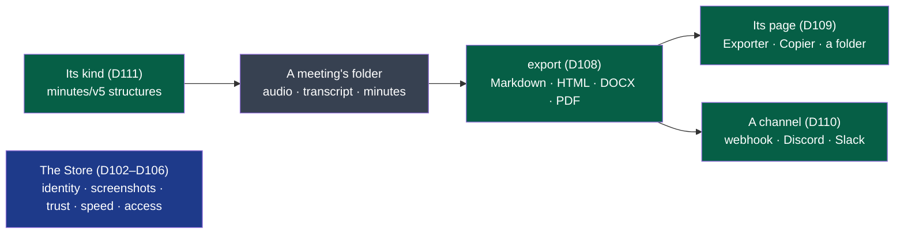

# Cycle 11 — Kitokey on sale, and out of the app

> The framework's words: `.nstack/handbook/glossary.md`.

> **D114 entered by the decider, 2026-11-23**, in their working session with the coordinator: the Store needs a
> public privacy policy, and kitokey.com is the product's shop window. Requirements: professional and modern,
> playful, no advertising, an animated landing, indexable by search engines. Hosting: Cloudflare Pages — the
> domain's registrar and DNS are Cloudflare already —, no server, no cost. The same day, the decider set its
> criticality to the lightest one, and kept the site closed to the public and unindexed until they validate it,
> with the simplest access control available. The end date does not move (`framing.md` §4); D114's cut comes
> first (*Deliverables*).

> **Started on 2026-11-20**, at cycle 10's closure, early, on the decider's word that day in their working
> session with the coordinator: « on termine le cycle en cours ». `start` and `end` move to that day, as this
> page said they would; the two dated dependencies below move with them.

> **Proposed by the framer on 2026-11-19, and accepted by the decider the same day**, in their working session
> with the coordinator: « ok cycle 11 des que possible, ou en parallele ». It stays `proposed` while cycle 10
> runs — one accepted cycle at a time (C5) — and carries `accepted_on`; it starts at cycle 10's closure. The
> coordinator proposes to close cycle 10 as soon as its open pull requests merge, as cycle 09 was closed early,
> which is what « dès que possible » asks: `start` and `end` then move to that day. Its sources: the decider's
> aim of 2026-11-18 — a paid release on the stores, stable, the best UX/UI of its kind, fast —, their word
> that day on export and meeting templates (« export local modifiable, pdf, vers un service en ligne (oauth)
> comme notion, discord, slack »), and the team's research of 2026-11-18 on templates, export, destinations
> and document generation, and on the shell's stability.
>
> **Amended the same day** after marc's framing review on its pull request (#977): the goal says *ready to
> be sold*, the submission a dependency with a date; the Store's updater, licence, privacy policy and
> downloads added; D104's and D111's criteria made meetable; D108's coupling with D111 written; the cut
> order starts with D111 whole.

> **D112 and D113 entered on the decider's word, 2026-11-20**, in their working session with the coordinator, at
> cycle 10's closure (#992): asked « Les restes de D93 et D94 au cycle 11 ? », they answered « ok c11 ». They are
> what cycle 10 left of D94 and D93 ([cycle 10's *Later*](10-kitokey-ready-when-you-come-back.md#later)); the
> end date does not move (`framing.md` §4).

> **D110's criterion 2 amended on the decider's word, 2026-11-20**, in their working session with the
> coordinator, on reading PDR-0007 (#1039): « PDR acceptée, ok Slack dans D110 ». Slack's incoming webhook joins
> the generic webhook and Discord's: a URL the user creates in their own workspace, no OAuth and no secret of
> Kitokey's; its message in mrkdwn ([PDR-0007](../../pdr/0007-a-summary-leaves-for-a-channel-on-a-gesture-never-a-confidential-one.md)).
> Slack's OAuth stays in *Later*.

> **D105's criterion 2 amended on the decider's word, 2026-11-20**, in their working session with the
> coordinator: « ok pour l'amendement de D105 ». « 1 s load » is no longer RAIL's: today it asks 5 s for a
> first load on a mid-range phone over slow 3G, and 2 s after ([web.dev/articles/rail](https://web.dev/articles/rail),
> read that day), neither a local desktop app's. The start is held against Apple's 400 ms to first frame
> ([WWDC 2019, session 423](https://developer.apple.com/videos/play/wwdc2019/423/)), a meeting's page against
> RAIL's 100 ms response; both stay targets until the baseline says where Kitokey is.

## Goal

Two things stand between Kitokey and its first buyer. **The Store**: the package still carries a placeholder
identity and Kitokey's own updater and trial, there are no screenshots and no privacy policy, an attest's e2e
fails for nothing about one time in six (17 %, measured by the team on 2026-11-18; the method is D104's), and
no number says whether Kitokey is fast. The submission itself follows the decider's reservation of the name and
Microsoft's review, outside the team: this cycle makes Kitokey ready for it (*Dependency with a date*). **What
a meeting is for**: today a summary stays in Kitokey — no export, no copy that pastes cleanly, no channel —,
and every summary has the same three sections whatever the meeting. The market answers both, and often
charges for them: downloads need Pro at Fireflies, tl;dv offers a copy button only, Meetily's export is Pro,
Bear's rich formats are Pro, Otter's Basic plan exports text only *(snippet only)* (sources below). Kitokey's
edge is that the meeting already is a folder of files: export is never paywalled.

**Legend** — grey: what exists · green: built this cycle, arrows what feeds what · blue: what the Store asks.

### Prior art

Read in the team's research of 2026-11-18 (primary pages fetched unless marked; « snippet only » claims are
assumptions until read):

| Question | The convention | What is taken here |
|---|---|---|
| Export formats | Copy summary and transcript; Markdown, PDF and DOCX files; speaker and time toggles; reveal in folder ([Fireflies](https://guide.fireflies.ai/articles/3319752033-how-to-download-transcripts-summaries-and-meeting-recordings-from-fireflies), [Anarlog](https://docs.anarlog.so/notes), [Meetily](https://meetily.ai/releases/pro/0.1.7)) | D108, D109 |
| Export gated | Downloads need Pro at Fireflies; tl;dv offers a copy button only; Granola one CSV of all notes a day by email; Meetily's export is Pro; Bear's HTML, DOCX and PDF are Pro; Otter's Basic plan exports TXT only *(snippet only)* ([tl;dv](https://intercom.help/tldv/en/articles/6122489-how-to-download-transcripts), [Granola](https://docs.granola.ai/help-center/sharing/exporting-notes.md), [Meetily](https://meetily.ai/releases/pro/0.1.7), [Bear](https://bear.app/faq/export-your-notes/), [Otter](https://help.otter.ai/hc/en-us/articles/360047733634-Export-conversations)) | Never gated, never rate-limited |
| Share without a cloud | A file anyone opens, a copy that pastes cleanly, pushes to services the user sets up, an automatic Markdown export to a folder ([MacWhisper's notes](https://macwhisper-site.vercel.app/release_notes.html), [Anarlog and Obsidian](https://anarlog.so/blog/obsidian-meeting-notes/)) | D109's copy and folder, D110's webhooks |
| A document's formats | CommonMark with front matter as the interchange format; docx-rs (MIT) for DOCX; typst as a library (Apache-2.0) for a tagged PDF (PDF/UA-1); no silent print-to-PDF in Tauri 2 ([wry #707](https://github.com/tauri-apps/wry/issues/707)) | D108, typst only if its size holds |
| Reaching a channel without a backend | Discord's OAuth needs a secret; a channel webhook does not ([Discord](https://docs.discord.com/developers/topics/oauth2)); Notion's REST OAuth needs a secret ([Notion](https://developers.notion.com/docs/authorization)); Slack's PKCE public client since 2026-03-30 ([Slack](https://docs.slack.dev/authentication/using-pkce/)) | D110: a webhook the user pastes; OAuth in *Later* |
| Templates | 5 to 12 built-ins by meeting type; a template is named sections with one instruction each; a picker on the summary, a change makes it again; Otter's switch loses what was there *(snippet only)* ([Jamie](https://docs.meetjamie.ai/getting-started/templates), [tl;dv](https://intercom.help/tldv/en/articles/9670088-meeting-templates), [Krisp](https://help.krisp.ai/hc/en-us/articles/26708055686044-Meeting-Notes-Templates)) | D111: six built-ins, the previous version kept |
| Small local models | The vendor's own tests: models under 7B miss action items ([Meetily](https://meetily.ai/blog/our-quest-for-meeting-summary-accuracy), a vendor source) | D111: few sections, a section may say nothing |

## Deliverables

Each deliverable's section holds what binds it. Proposed holders, by expertise — release and systems: marc;
QA: ines; UI and accessibility: lina; content and summary: sam.

| Id | Proposed holder |
|---|---|
| D102, D107, D108 | marc |
| D104, D105 | ines |
| D106, D109 | lina |
| D103, D110, D111, D112, D114 | sam |
| D113 | lina |

**The order**: D108's Markdown merges first, its model reading sections as a list; D109's export, D110 and
DOCX then consume it. `minutes/v5` (D111) merges as early as it can, and D108 is tested on it once it lands.
D105 measures in windows the coordinator plans with the queues empty, so that it neither measures their load
nor takes D104's machine.

**Cut first, in this order, when the breaker nears**: D114's animations and its Lighthouse threshold (its axe-core check kept), to cycle 12; then D113 whole, to cycle 12; then D111 whole, to cycle 12, if `minutes/v5` is not merged by
the cycle's fifth working day (2026-11-26); then D110's Discord (the generic webhook kept); then D109's folder export; then
D105's budgets (the baseline kept); then D112's English contractions (its comments kept). Never cut: D102, D104, D106, D108's Markdown, D109's export and copy, D114's privacy policy and its closed phase.
D108's DOCX goes with its PDF if the D108–D111 coupling lands late.

### D102

- PDR-0004 (Windows through the Store) and D54 of cycle 09, deferred at its closure: the MSIX is built, signed
  by a test certificate and installed in CI; only the identity is missing. It waits on the decider's
  reservation of the name (*Dependency with a date*); until then the build keeps failing on the placeholder,
  which is the oracle.
- Tauri emits EXE and MSI, not MSIX ([Tauri](https://v2.tauri.app/distribute/microsoft-store/)): the package is
  `install`'s own step, as it is today.
- **The updater and the licence**: a Store package is updated by the Store. No policy names a self-update for
  a non-game app — 10.2.5's « installed and updated only through the Store » is for games and Xbox —; 10.2.2
  refuses « any form of dynamic inclusion of code » that changes the product ([Microsoft Store Policies
  7.20](https://learn.microsoft.com/en-us/windows/apps/publish/store-policies), read 2026-11-20). There is no
  self-updater to switch off: cycle 07's is the system's (Copr, dnf), and the shell holds none; its rule is
  written for the one to come (#1052, ADR-0017 #1053).
- **The trial, decided** (the decider, 2026-11-20: « essai (a) »): the Store's trial cannot say PDR-0005's rule —
  Partner Center offers « Time-limited » « 1 day, 7 days, 15 days, or 30 days », or « Unlimited », and counts no
  meeting ([price and availability](https://learn.microsoft.com/en-us/windows/apps/publish/publish-your-app/msix/price-and-availability)).
  So the Store build keeps the app's own trial — 14 days or 10 meetings, whichever comes last, D83's counter —,
  the Store's trial set to « Unlimited », and the Store sells the licence, which D83 already reads
  (`StoreContext.GetAppLicenseAsync`). One rule of trial on every system; nothing to build for the licence.
- **The size** is recorded here because every later threshold reads it, D108's first.

### D103

- D57 of cycle 09: `docs/store/listing.md` is written in both languages; the decider's reading is still owed.
  The screenshots come from meetings the e2e makes, never from a real one (`rules/always.md`).
- An app that records the microphone needs a privacy policy linked from its listing. A buyer reads before
  paying that the summary needs Ollama, which Kitokey never installs, and that the transcription model is
  downloaded at first run.
- **Microsoft's page for Store screenshots, read on 2026-11-20** (ines, before D103's first pull request):
  [*App screenshots, images, and trailers for MSIX app*](https://learn.microsoft.com/en-us/windows/apps/publish/publish-your-app/msix/screenshots-and-images)
  — the MSIX page, Kitokey being an MSIX ([PDR-0004](../../pdr/0004-windows-through-the-microsoft-store.md)).
  Desktop « 1366 x 768 pixels or larger » (4K supported), a `.png` of at most 50 MB; one to ten, « at least four »
  suggested; a caption of at most 200 characters; images and captions uploaded for each listing language;
  « displayed in your listing in order »; no logo, icon or marketing message added.
- **Criterion 1 amended** (the decider, 2026-11-21 around 03:00, relayed by the coordinator), to the coordinator's
  proposal « D103 crit. 1: amend to 4 shots = meeting page, search in a meeting, list filtered by search, settings
  with models installed; live time/levels → product issue »: « ok pour 1 mais il faut "simuler" des "contenus" de
  réunion et autres textes parlant au public concerné, que ce soit réaliste et que les prospects puissent comprendre
  de manière intuitive en un coup d'œil, il faut que les captures soient pertinentes ». The bar while recording is
  no longer shot: the meeting's page shows neither the time nor the levels while it records; that is
  #1076, and its shot comes back with it.

### D104

- The stability report of 2026-11-18 (ines): 18 of 105 module-checks runs failed on a commit that passed on
  another run. Nearly every cause known is a fixed pause, or a read before the state it reads is there.
- **The method**: the coordinator keeps, since 2026-11-19, every attest's e2e as one file, never overwritten.
  A check's rate is its FAILs on commits where it passed on another run, nothing changed, over its runs. The
  count and its command go in the sheet, so that anyone can count it again. Attests run one at a time on one
  machine: at least 30 after the last fix, or all of them to the cycle's end, is what the cycle can hold.
- A check red in an attest is run again alone before anything is concluded, and that second run counts in the
  metric.

### D105

- Nothing measures speed today; the bench exists and nothing runs it (the gap list of 2026-11-18). Measured on
  Linux, where the team runs; Windows and macOS numbers wait on their machines (*Later*).
- RAIL's 100 ms and 1 s (web.dev's RAIL page) and Apple's 400 ms launch (WWDC 2019, « Optimizing App Launch »)
  are named as the review named them, not yet read by the framer: an *assumption* until D105 cites each page.
- A release build and ten runs on every pull request would take the attests' machine: the measure runs on the
  release pull request alone.

### D106

- #954 is one case found by eye; this deliverable makes the e2e find the others. axe-core finds part of the AA
  failures, not all *(its maker's own figure, an assumption until cited)*: hence the title says what is checked,
  not « meets WCAG 2.2 AA », and the criteria axe-core cannot judge are held by checks of their own.
- Buyers' organisations ask for accessibility — EN 301 549 in EU public procurement, Section 508 in the US
  *(framer's assumption, not read)*.
- What axe-core cannot judge on the list, a meeting's page, Settings and the bar, each held by a check of the shell's
  e2e (criterion 2):

  | WCAG 2.2 | What is checked | Held by |
  |---|---|---|
  | 2.4.7 Focus Visible (AA) | each Tab stop draws a ring, an outline or a shadow, that differs from the same element at rest | CE `keys_first_surfaces`, each language in each theme |
  | 2.4.11 Focus Not Obscured (Minimum) (AA) | no Tab or Shift+Tab stop is entirely hidden: a point of its box, in the window, has it (or its label) on top, read at each frame until it does, a second at most (WebKit scrolls to a text field after its focus) | CE |
  | 2.5.7 Dragging Movements (AA) | the shell has no drag (no `pointermove`, `drag*` or `mousemove` handler in `window.js`); the player seeks by one click on the drawing, and by its keys as a slider | `main()`: « a click on who spoke moves the playback there », « the arrows move the playback on the drawing, a slider » |
  | 2.5.8 Target Size (Minimum) (AA) | each target shown is 24 by 24 CSS px, or a 24 px circle centred on it cuts no other target nor another small target's circle; a target in a sentence (inline, in a block with text of its own) is exempt | CE: axe's `target-size` leaves such cases « incomplete » (s106cdT), so CE measures it |
  | 2.1.1 Keyboard (A) | every control shown, by a tag or a role that acts, is reached by Tab; in a roving group (WAI-ARIA APG: one member at tabindex 0, the others at -1, under one parent; or radios of one name), the others count once Tab reached its one stop and ArrowDown goes on to another. A control that acts by a click on an element of neither kind (a `div`) is not seen | CE, on a meeting that plays: its transcript's lines are such a group |

### D107

- PDR-0001: macOS paid, one-time, after a trial; the gap list: a merchant, Developer ID signing and
  notarisation, a licence check, an updater are all missing. The decision first, so that cycle 12 builds it.
  It needs no Apple account; the build does (*What needs a person*).

### D108

- The `export` module exists since ADR-0001 as `proposed`, its responsibility written: « Delivers the files of a
  session to where the user wants them ». This deliverable makes it `active`. ADR-0001 named it the first to
  rise in criticality when a destination needs it: D110 is that moment, settled there.
- One internal model of the summary, read from `minutes` and the transcript; every format writes from it. The
  spike's threshold, 15 MB, is the framer's proposal, read against the package measured in the same build *(framer, to confirm)*.
- **Its coupling with D111**: D111 changes `minutes` to named sections during the same cycle. The model reads
  sections as an ordered list from the start, v4's three mapped to it, so that v5 adds sections and breaks
  nothing.

### D109

- The page's controls follow D94's guide and its words. The clipboard's two types are the research's answer to
  pasted Markdown breaking in Slack ([its source](https://unmarkdown.com/blog/why-slack-formatting-breaks-when-you-paste-from-chatgpt), a vendor blog).
- It writes through D108 and offers only the formats D108 writes.

### D110

- **The PDR comes first**: it is the first time a meeting leaves the computer by a gesture of the user rather
  than for a model; the charter says nothing leaves without the user's choice. The address of a webhook is a
  secret: whoever holds it posts to the channel.
- `security.md` applies: the address is external input, the answer of the server too.
- It writes through D108's Markdown. The decider's word on the PDR is a dependency with a date below.

### D111

- The decider, 2026-11-18, in cycle 10's *Later*: « lui en proposer des classiques mais aussi lui permettre
  d'en créer d'autres, de les modifier, les supprimer ». The built-ins and the choice come first; creating,
  editing and deleting one's own is cycle 12's (*Later*). Proposed no-gos, from cycle 10: no editable system
  prompt, no choice by calendar, no sharing.
- **The spike's threshold** *(framer, to confirm)*: with the model named in the sheet — the default local
  summary model of Settings —, at least 4 of the 6 built-in structures yield every section either filled or said
  empty, over the team's sample of 3 meetings; below that, the structures that fail are cut and the result
  recorded — a refuted spike is a delivered one.
- **The spike, 2026-11-20** (`kitokey-team/logs/d111-spike*.jsonl`): `qwen3:8b`, the local model Settings
  recommends, on the bench's played meeting (`modules/platform/bench/meeting.txt`, French, synthesised voices),
  3 runs per structure, 92 to 361 s an answer. Asked the sections' order in words, as v4 is: 3 of 6 structures
  held every run — one-to-one, stand-up and interview each failed once, on form (no `## ` line twice, content
  written as a title once). Given the skeleton to copy — `# <the meeting's title>`, then `## <section n's title>`
  and `<section n's content>` line by line, each title « a few words naming the section, never its content »:
  **6 of 6, every run; the threshold is held**, and summary asks it so (#1042). A JSON answer by constrained
  decoding, the third variant, was not needed. Not met as written: one meeting played three times, not three
  meetings; and the spike's request lacked summary's paragraph on the recogniser's errors and its times per bullet.
- **The third spike, 2026-11-21** — what closes those two gaps.
  - **Setup.** `kitokey-summary` itself was built at 0d365b7 and run as the shell runs it, `--structure <name>`
    on `qwen3:8b` through Ollama's native route, so the request is the bytes `request_in` builds: rules, the
    recogniser's errors, the times, the skeleton.
  - **Sample.** Three meetings, two runs per structure, 36 runs:
    - a written stand-up;
    - a written client call;
    - the bench's meeting recognised by whisper.cpp large-v3-turbo-q8_0, taken as transcript/v1 with the
      recogniser's own errors.
  - **Judged on what the program writes** (its one asking again included), as the coordinator decided before
    the reading. The first answer's count is recorded beside it.
  - **Result:**
    - general, stand-up, client call and project review held every run;
    - one-to-one and interview held 5 of 6;
    - **4 of 6 structures, every run: the threshold is held.** The first answer's count is the same; nothing
      was asked again.
  - **The two failures** came on the recognised meeting: one-to-one run 1 (661 s) and interview run 2 (592 s).
    Neither was on form. Each time the program refused with « the provider on this computer cut its answer
    short »: Ollama said `done_reason: length` after the 4,096 tokens `num_predict` allows an answer, its
    thinking counted (`modules/summary/src/provider.rs`, `WINDOW`). At about 7 tokens a second, that is the
    590–660 s seen. The program wrote no incomplete minutes, as designed.
  - **Read:** the structures' form held on every answer that ended. The risk left is a thinking model's length
    on a longer, noisier transcript, which grows with an hour-long import. That is a follow-up issue, not
    D111's criterion.
  - **Evidence:** `kitokey-team/logs/d111-spike3.jsonl` (one line per run, the minutes or the refusal) and
    `logs/evening/d111-spike3.log` (the table). Spike 3 was run at 0d365b7; `git diff 0d365b7 300c7b5 --
    modules/summary` is empty, 300c7b5 being main 5553f42 merged in.
- **The contract**: three pull requests, in order — `minutes/v5`'s page and schema, summary writing it, the
  shell reading v4 and v5. v4 is never removed in this cycle.

### D112

- What cycle 10 left of D94, as its closure says: #988 and P8b-2 (the troubles, a step's failure), if they merge
  after this cycle's start; the comments of the page (P2) and of the notifications (P3), written by sam and kept
  locally on 2026-11-20, down to none without one; the English contractions (#989, #990). None changes a
  behaviour.
- The guide decides first (#990), then the sentences follow (#989), in one pull request after P3.
- Criteria 1 and 4 of cycle 10's D94 were held there (#811, #813) and are not repeated.

### D113

- What cycle 10 left of D93, its criteria taken as they were: the panel's line on what follows and that the
  current version stays (#779); a missing model or a folder not writable said in the panel (#771); the panel
  across the 840 px break (#777); going back to the previous version (criterion 3, cut first in cycle 10).
- Criteria 2 and 5 of cycle 10's D93 were held there (#809, #810, #879, #931) and are not repeated.
- Cut first in this cycle too: the Store and export come before it.

### D114

- **Why now**: Partner Center asks for the privacy policy's URL at submission ([Store Policies](https://learn.microsoft.com/en-us/windows/apps/publish/store-policies)
  10.5.1, read 2026-11-23). The submission does not wait on the site: `docs/store/listing.md` already links
  [`docs/privacy.md`](../../privacy.md) on GitHub, public since PDR-0002. Once the site opens, the listing's line
  points to `https://kitokey.com/<lang>/privacy/` instead, in the opening's pull request.
- **The module** `site`, `prototype`: it holds no key, places no order, moves no money and touches nobody's
  personal data — it collects nothing —, so `.nstack/handbook/05-workflow.md` §7 asks no more; the decider set
  the lightest criticality, 2026-11-23. At `prototype` no test sheet is owed: each criterion is held by the module's tests, and criterion 6's
  second half by the verifier's record of the first deployment. Its stack and its host: [ADR-0019](../../adr/0019-kitokey-com-a-static-site-built-by-astro-served-by-cloudflare-pages.md).
- **One source** for the policy: the site reads `docs/privacy.md` at build time and splits it at its two
  language headings; the site's own section is written there, in both languages, so the app's policy and the
  site's stay one text.
- **The screenshots** are D103's, made by the shell's e2e (`store_shots`): a script of `site` copies the eight
  files from a run's evidence folder given on its command line into the module, where they are committed —
  Cloudflare's build does not run the shell's e2e. A test checks there are four per language, named in
  `docs/store/listing.md`'s order. Astro writes them in smaller formats at build time.
- **The look** is the app's: its tokens (`modules/shell/ui/window.css`, `:root` and its dark theme) copied once
  into the module, the system's font stack, no web font fetched from elsewhere. The voice: `modules/shell/docs/voice.md`.
- **No third party, by construction**: no analytics, no font or script from a CDN, no embed. The browser refuses
  them too: `Content-Security-Policy: default-src 'self'` in `_headers`
  ([Cloudflare Pages, *Headers*](https://developers.cloudflare.com/pages/configuration/headers/), read 2026-11-23);
  Astro's styles written to files rather than inlined, so that the policy needs no `'unsafe-inline'`.
- **Referencing**: hreflang by `<link rel="alternate">` in each page and in the sitemap, each version naming
  itself and the other, with `x-default` ([Google, *Localized versions*](https://developers.google.com/search/docs/specialty/international/localized-versions));
  Astro's i18n routing and `@astrojs/sitemap`'s `i18n` option write both ([Astro, *Internationalization*](https://docs.astro.build/en/guides/internationalization/),
  [*@astrojs/sitemap*](https://docs.astro.build/en/guides/integrations-guide/sitemap/)). Google shows a
  `SoftwareApplication` rich result only with `offers.price` and one of `aggregateRating` or `review`
  ([Google, *Software app*](https://developers.google.com/search/docs/appearance/structured-data/software-app)):
  none is invented, so the JSON-LD is written for what it says, the rich result waits for real reviews.
- **Lighthouse** runs from `@lhci/cli` on the static build (`staticDistDir`, [Lighthouse CI, *Getting started*](https://github.com/GoogleChrome/lighthouse-ci/blob/main/docs/getting-started.md))
  with the workstation's Chromium. Its SEO category fails on a page that asks not to be indexed (its
  `is-crawlable` audit), so SEO is scored on the build without noindex, the one the opening merges.
- **Closed until validated**, with no more than the Pages project's own settings (the decider, 2026-11-23: the simplest access control
  available). Its *Enable access policy* protects preview deployments alone — "Note that this will only protect
  your preview deployments" —, and restricts them to the Cloudflare account's members
  ([Cloudflare Pages, *Preview deployments*](https://developers.cloudflare.com/pages/configuration/preview-deployments/),
  read 2026-11-23). So main is built as a preview — the production branch is `site-live`, which an agent creates
  first at a commit without `modules/site`, so that a production build has nothing to serve
  ([*Branch deployment controls*](https://developers.cloudflare.com/pages/configuration/branch-build-controls/)) —
  and the site is read at `main.<project>.pages.dev`, the alias of main's last deployment. No Zero Trust
  application, no list of addresses. Builds are limited to the site's paths, so that the team's other pushes
  spend none of the free plan's 500 builds a month ([*Build watch paths*](https://developers.cloudflare.com/pages/configuration/build-watch-paths/),
  [*Limits*](https://developers.cloudflare.com/pages/platform/limits/)).
- **Opening**: the decider's gestures, in *What needs a person*, then an agent's pull request removing noindex
  and pointing the listing to the site's policy.
- **Holder**: sam (content, web, UX). Cut first in this cycle: its animations and its Lighthouse threshold go to
  cycle 12 before anything else; its privacy page and its closed phase are never cut.

## What needs a person

| Deliverable | Who | The literal gesture |
|---|---|---|
| D102 | The decider | In [Partner Center](https://partner.microsoft.com/dashboard), with the company's account: reserve « Kitokey », then paste in D102's issue the three values *Product identity* shows — `Package/Identity/Name`, `Package/Identity/Publisher`, `Package/Properties/PublisherDisplayName`. Set *Free trial* to **Unlimited** (PDR-0005), answer the age-rating questionnaire |
| D102 | The decider | Say the price, between €49 and €69 (PDR-0001): « prix : 59 € », for instance |
| Submission | The decider | Once D102 and D103 are merged: in Partner Center, upload the package an agent built from the identity, fill the listing from `docs/store/listing.md` and its screenshots, and submit |
| D103 | The decider | Read [`docs/store/listing.md`](../../store/listing.md), its privacy policy and the screenshots linked from D103's pull request; say « l'annonce ne promet rien de faux », or which line does |
| D107 | The decider | Read the ADR from its pull request; say « ADR acceptée », or what changes. Then, for cycle 12, enrol in the [Apple Developer Program](https://developer.apple.com/programs/enroll/) as an organisation — it takes days — and say when it is done |
| D110 | The decider | Read the PDR from its pull request; say « PDR acceptée », or what changes |
| Cycle 09's D56 | The decider | As [cycle 07](07-wholeheard-from-the-systems-updater.md#what-needs-a-person) says, in a terminal of your own, never through an agent: a minisign key, its `.pub` alone given to an agent — or say « D56 reportée » |
| Cycle 09's D53, D84 | The colleague on Windows 11 | [#482](https://github.com/NapkinStack/kitokey/issues/482) and [#795](https://github.com/NapkinStack/kitokey/issues/795), updated first by an agent with the package's link: install it, record a real call of five minutes, then sign out and in again; answer there |
| D114, before the Pages project | An agent | Push the branch `site-live` at a commit of main from before the module's first pull request, so that it has no `modules/site` |
| D114, the Pages project | The decider | In the Cloudflare dashboard, in this order: **1.** *Workers & Pages* › *Create* › *Pages* › *Connect to Git*: the repository `NapkinStack/kitokey`; *Production branch* `site-live`; *Framework preset* Astro; *Build command* `npm run build`; *Build output directory* `dist`; *Root directory* `modules/site`; *Save and Deploy*. **2.** The project › *Settings* › *General* › *Enable access policy*. **3.** *Settings* › *Builds & deployments* › *Preview branch control* › *Custom branches*: include `main`, exclude `*`. **4.** *Settings* › *Build* › *Build watch paths*: include `modules/site/*`, `docs/privacy.md`. Then say in D114's issue the project's name |
| D114, validation | The decider | Signed in to Cloudflare, read `https://main.<project>.pages.dev/fr/` and `/en/`; say in D114's issue that the site is validated, or what changes |
| D114, opening | The decider | Once validated, in this order: *Settings* › *Builds & deployments* › *Configure Production deployments*: *Production branch* `main`; then *Custom domains* › *Set up a custom domain*: `kitokey.com`. Then an agent's pull request removes noindex and points the listing to the site's policy |
| D114 | The decider | When the Store gives Kitokey's page, its address in D114's issue; the price, as D102 asks |

## Dependency with a date

- **The name reserved in Partner Center, and its identity given**, by 2026-11-25, the cycle's fourth working
  day (2026-12-02 before cycle 10 closed early). Missed, D102's first criterion waits and is said at the closure; its second runs on the test identity.
- **The PDR of D110**, the decider's word within two working days of its pull request. Missed, D110's sending
  waits, said at the closure; the PDR stays.
- **The submission to the Store**, once D102 and D103 are merged and the decider has said the price: the
  decider submits in Partner Center (*What needs a person*), and Microsoft's review takes days. It closes no
  deliverable of this cycle; its answer is recorded at the closure.
- **The trial on a real Windows 11** (#482, #795; and #642, #749 once their fixes land): it waits on a person
  outside the team, so it is a dependency, not a deliverable (`framing.md` §2). Its date: the colleague's
  answer by 2026-12-02 (2026-12-09 before cycle 10 closed early); cycle 09's D53 and D84 stay deferred until then.

## Out of scope

- A share link: it needs a cloud of ours.
- A template marketplace, a team rules engine, a CRM push.
- A paywall on export or on templates.
- An editable system prompt.
- A secret embedded in the app: no OAuth client secret, no backend of ours.

## Later

- **Cycle 12 — « Kitokey can be bought on macOS, and sends where the team works »**: macOS signed, notarised,
  with its trial and licence, sold through D107's merchant; OAuth destinations — Slack (PKCE), Google Drive
  (`drive.file`), Notion — the charter's first destination — through its hosted MCP or a token the user pastes, its REST OAuth needing a secret — each after a spike; the template
  editor (create, duplicate, edit, delete; templates as files to import and export); bulk export; a local
  read-only MCP or CLI over the meetings' folders. They cost the user least to wait for: each has a manual way
  today (a copy, a file).
- Speed on Windows and macOS, measured on their machines.
- The Mac App Store's sandbox, a spike; an Intel build for macOS; opt-in crash reporting (PDR-0003).
- placeBack's fallback reduced to the direct predecessor (#972).
- Everything in cycle 10's *Later*, unchanged.

## Open questions

**Blocking:** none. Each has a default the deliverable is built with.

**Not blocking**, each *(framer, to confirm)*:

- **The appetite**: two weeks, as cycles 08 to 10. Eleven deliverables do not all fit whole; the cut order
  above says what goes first. Three weeks would keep D111 whole. Default, without a word: two weeks.
- **The PDF's size threshold**: 15 MB, D108's spike, read against D102's package size. A word changes it.
- ~~**The Store build's licence**: the convention is the Store's trial alone (PDR-0005's *Unlimited*), D83's
  own counter off in that build; the decider may keep D83's in it. Default: the Store's.~~ Settled by the
  decider, 2026-11-20 (« essai (a) »): D83's counter kept, the Store's trial « Unlimited » (D102's section).
- **The six built-in structures**: the market's common core; the decider may name others.
- **D114's host**: Cloudflare recommends Workers for new projects ("Cloudflare recommends using Cloudflare Workers
  for new projects", [Astro, *Deploy to Cloudflare*](https://docs.astro.build/en/guides/deploy/cloudflare/), read
  2026-11-23); the decider chose Pages, whose settings hold the closed phase in four clicks. The build is a static
  folder: it moves to Workers or anywhere unchanged (ADR-0019). Default: Pages.
- **D111's spike threshold**: 4 of the 6 structures, every section filled or said empty, over 3 meetings, with
  Settings' default local model (D111's section). A word changes it.

## Closure

