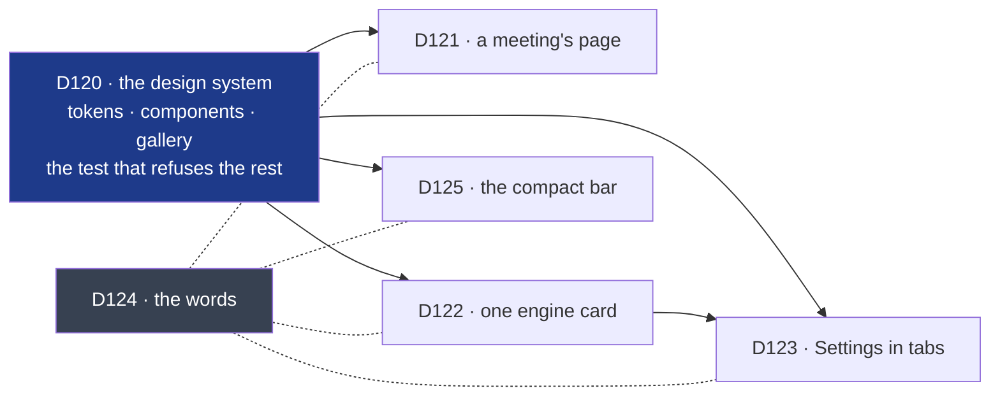

# Cycle 12 — Kitokey, simple and beautiful

> The framework's words: `.nstack/handbook/glossary.md`.

> Copied to `docs/project/cycles/NN-<slug>.md` at framing (`.nstack/playbooks/framing.md`). One accepted cycle at a
> time; no automatic extension.

## Goal

The decider said **go** on 2026-11-26 for a cycle « Kitokey simple et beau », design first: what exists is
recomposed before anything new is added. An independent audit of that day
(`kitokey-team/audit-2026-11-26/`: `ux-ia.md`, `design-system.md`, `benchmark.md`) found 15 looks of button,
17 font sizes, 23 spacings, green meaning four things, an engine chosen in four places with four vocabularies,
and internals — hosts, ports, paths, ids — in calls to action. The decider's choices of colour and words are
[PDR-0008](../../pdr/0008-kitokey-speaks-the-colours-and-words-users-already-know.md).

**Legend** — blue: first, the others read its tokens and components; arrows: what a deliverable waits on;
grey, dotted: the words, rewritten with each screen and checked across them.

**How the work moves**: screen by screen, each pull request within **800 lines**, each with its screenshots
before and after. The design system's test starts in « report » mode — a count it can only lower — and is
strict at the closure.

## Deliverables

### D120

The source is the audit's `design-system.md` §3 to §6, amended by PDR-0008: red is also the destructive
action's, with a confirmation (the audit had kept red for recording alone). The values the audit proposes —
the 7-step type scale, the 4 px grid, the six radii, the three elevations — are *(framer, to confirm)* in
D120's first pull request, with the gallery's shots; the roles are PDR-0008's. The blue and amber pair is said
colour-blind-safe by the audit without a primary source: D120's first pull request checks it with a simulator
of the three deficiencies and keeps the shots.

Order: (1) `tokens.css` and the old names kept as aliases — no visible change, the shots identical; (2) the
buttons and controls — 15 looks become the button's variants; (3) the gallery and the export. The screens are
D121 to D125's.

**Claude Design**: `scripts/design-export` writes the folder; publishing it as the « Design System » artifact
is a gesture (*What needs a person*). The code stays the source; the artifact is never edited.

### D121

The audit's `ux-ia.md` §3. The export to PDF and Markdown is `exporting/v1`'s, which the shell already consumes
(D109): no contract changes. « Partager » with no channel opens the same form Settings has, in a sheet.

### D122

The audit's `ux-ia.md` §2, *one model, two jobs*: « Écouter » turns the sound into text, « Rédiger » turns the
text into a summary; each done by a **moteur** (PDR-0008), on this computer or by a service. « Auto » follows
Granola, whose help tells its users to leave it on
([Granola](https://docs.granola.ai/help-center/getting-more-from-your-notes/understanding-model-selection-in-granola-chat)).
What « Auto » picks when nothing is ready is an open question.

### D123

The audit's `ux-ia.md` §2, its five tabs. D123's first pull request lists every setting of today with its tab.

### D124

The audit's `ux-ia.md` §4: its six rules and its ten sentences. Each screen's pull request rewrites its own
words; D124 holds the test across them, and closes once every surface's text passes.

### D125

The audit's `design-system.md` §4, *Compact bar*, and `ux-ia.md` §1: a recording offers no engine.

## What needs a person

| Deliverable | Who | The literal gesture |
|---|---|---|
| The cycle | The decider | Read this file and PDR-0008 from their pull request; say the appetite in weeks; approve the pull request, or say what changes |
| D120 | The decider | Read the gallery's shots from D120's pull request; say « charte ok », or what changes |
| D120 | An agent | Once D120 is merged: publish `design-system/` as the « Design System » artifact, updated in place at each release, its commit in its README |
| D121, D123 | The decider | Read the before and after shots of each screen's pull request; say « ok », or what changes |

## Out of scope

- New features: summary formats, importing a file, Outlook, speaker names by passage (#1230's S2 and S3) — *Later*.
- The site: it follows the app's tokens once D120 is merged, in a cycle of its own.
- Any brand beyond `ui/brands/BRANDS.md` (#1238).

## Later

- **Formats** (templates) of a summary — the audit's `ux-ia.md` §5 and `benchmark.md` §3; « format », never
  « modèle » (PDR-0008).
- **Importing an audio or video file** — `benchmark.md` §5.
- **Outlook** in « Agenda » — cycle 11's D115 made its link; its trial waits on a colleague.
- **Names by passage** — #1230's S2 (the contract step of `transcript/v1`) and S3 (a service's speakers).
- Auto-titles from the summary (#1240), « Dates mentionnées »'s count following the panel's day (marc, #1249).
- Illustrations of the empty states and the first run's aurora (`design-system.md` §5).

## Open questions

**Blocking:**

- **The appetite**: how many weeks does the decider want to spend? Proposed: three *(framer, to confirm)*.

**Not blocking:**

- What « Auto » picks when no engine is ready on the computer and none was chosen (D122): the first run's
  answer, or nothing until one is ready?
- The five tabs of Settings (D123): kept as the audit names them, or fewer?
- The display face of the audit (Bricolage Grotesque, OFL, the site's) for titles in the app (D120): yes or no?

## Closure

<Written at the end.>

**Documents brought current:** <at the closure>
