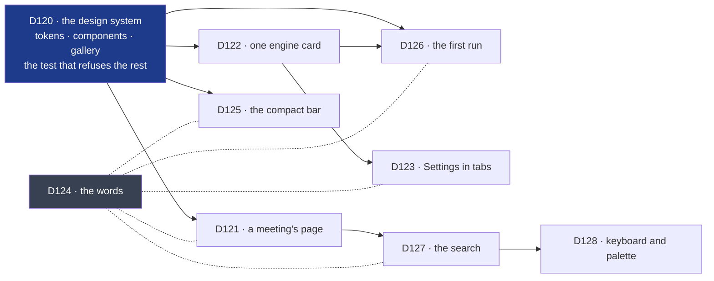

# Cycle 12 — Kitokey, simple and beautiful

> The framework's words: `.nstack/handbook/glossary.md`.

> Copied to `docs/project/cycles/NN-<slug>.md` at framing (`.nstack/playbooks/framing.md`). One accepted cycle at a
> time; no automatic extension.

## Goal

The decider said **go** on 2026-11-26 for a cycle « Kitokey simple et beau », design first: what exists is
recomposed before anything new is added. Two independent passes of that day, in
`kitokey-team/audit-2026-11-26/`, are its source: the first — `ux-ia.md`, `design-system.md`, `benchmark.md` —
found 15 looks of button, 17 font sizes, green meaning four things, an engine chosen in four places with four
vocabularies; the second — `screens-and-delight.md`, `messages.md` — found that the search finds titles only,
that the first meeting gets no summary without a click, that the private path needs a program installed by
hand, and that some sentences contradict the product. The decider's choices of colour and words are
[PDR-0008](../../pdr/0008-kitokey-speaks-the-colours-and-words-users-already-know.md).

**Legend** — blue: first, the others read its tokens and components; arrows: what a deliverable waits on;
grey, dotted: the words, rewritten with each screen and checked across them.

**One week, done well and fast** (the decider, 2026-11-26): only the backlog's P1 items are criteria; its P2
and P3 items are in *Later*. **D127, D128 and D130 are P2**: in the cycle, built only if the time remains once
D120 to D126 and D129 are merged, deferred at the closure otherwise — never stretching the end.

**Added by the decider, 2026-11-26** (relayed by the coordinator): the kept versions managed (D121, P1), and the
formats managed (D129, D130, P1). A format the user makes changes a contract — `summarising/v1` takes only its six
built-in structures (D111) — so it is two deliverables in two modules, the contract's expand step first, never in
one pull request (kernel §4). The decider keeps D125 (the compact bar) in the cycle, P1. To fit the week,
**D130 slips to P2** — D129, the contract's expand step, stays P1 so that the formats can be built as soon as
time allows, this cycle or the next —; D127 and D128 stay P2. *(framer, to confirm.)*

**How the work moves** — D120 first and blocking; then five in parallel; one pull request per screen, within
**800 lines**, with its screenshots before and after, attested right after its sheet is signed:

| Day | Stream | Who *(framer, proposed)* | Files mostly its own |
|---|---|---|---|
| 1–2 | **D120** — `tokens.css` with the old names as aliases (no visible change), then the button, banner, toast, dialog, option card, progress, engine card; the gallery; the test in report mode | lina | `ui/tokens.css`, `ui/components.css`, `ui/gallery.html`, `tests/look.rs` |
| 2–6 | **D121** — a meeting's page | lina | the page's part of `window.js`, `window.css`'s layout |
| 2–6 | **D126** — the first run, the example meeting, the default « rédiger » | ines | the first run's part of `window.js`, `settings.rs`, the clip under `ui/` |
| 2–5 | **D122** then **D123** — the engine card wired in Settings, the first run and « Refaire »; Settings in tabs | sam | Settings' part of `window.js`, `src/main.rs`'s offer of engines |
| 5–6 | **D125** — the compact bar, its engine choice gone with D122 | sam | the bar's part of `window.js` |
| 2–4 | **D124** — `docs/voice.md`, `src/words.rs`, `tests/words.rs` | marc | `words.rs`, `voice.md`, `tests/words.rs` |
| 4–6 | **D129** — `summarising/v1` expanded, the summary module writing a format it is given | marc | `contracts/summarising/`, `modules/summary/` |
| 6–7 | **D127**, **D128**, **D130** — only if the time remains, D130 first | the first stream done | `window.js`'s search, a palette file, Settings' formats in a file of its own |

New code of a screen goes in a file of its own under `ui/` where it can — the first run's, the palette's —, to
keep the streams off each other's lines in `window.js`. The verifiers rotate: no one verifies their own stream,
and a verifier signs the screen of a stream they do not touch that day.

**The critical path**: D120's tokens and components (two days) → D121, the largest screen (three to four days)
→ its attest and merge, serial on the shell → the closure on day 7. A second path: D122 → D123 → D125 for sam,
who holds three screens. **The risk of the week**: the shell's attests, serial on one machine, five screens
asking in the last two days; each is attested as soon as its sheet is signed. D130 waits on D129's merge. D120 slipping a day takes it from every
stream; its first pull request — the tokens alone, no visible change — merges first so that the others start.
The shell's attests run one at a time on the machine: each pull request is attested as soon as it is signed,
never batched at the end.

**The backlog of the second pass** (`screens-and-delight.md` §7, 24 items): its P1 items are the criteria
below; P2 and P3 are in *Later*, D127 and D128 aside.

## Deliverables

### D120

The source is `design-system.md` §3 to §6, amended by PDR-0008 — red is also the destructive action's, with a
confirmation —, and the component list of `screens-and-delight.md` §3: the 15 looks of button become one
button's variants; inline notes become the toast; the error lines become the banner, one slot per card and one
per page; the radio cards become the option card; the inline trash card becomes the dialog; plus the engine
card (D122's), the progress (two segments with an estimate and « Annuler »), and the empty state. The values —
type scale, 4 px grid, radii, elevations — are *(framer, to confirm)* in D120's first pull request with the
gallery's shots. The blue and amber pair is said colour-blind-safe by the audit without a primary source: D120's
first pull request checks it with a simulator of the three deficiencies and keeps the shots.

Order: (1) `tokens.css`, the old names kept as aliases — no visible change, the shots identical; (2) the
button, the banner, the toast, the dialog, the option card, the progress; (3) the gallery and the export.

**Claude Design**: `scripts/design-export` writes the folder; publishing it as the « Design System » artifact
is a gesture (*What needs a person*). The code stays the source; the artifact is never edited.

### D121

`ux-ia.md` §3, `screens-and-delight.md` §2 B (record, then summary, then share: three clicks) and §5 (density):
the default view is what one acts on, the rest one click away. The export is `exporting/v1`'s, which the shell
consumes already (D109): no contract changes. « Ajouter un canal » opens the same form as Settings, in a sheet.

### D122

`ux-ia.md` §2, *one model, two jobs*: transcribing turns the sound into text, writing turns the text into a
summary, each done by a **moteur** (PDR-0008), on this computer or online. « Auto » follows Granola, whose help
tells its users to leave it on
([Granola](https://docs.granola.ai/help-center/getting-more-from-your-notes/understanding-model-selection-in-granola-chat)).

### D123

`ux-ia.md` §2, its five tabs; `screens-and-delight.md` §5.4, three depths — the tab, « Avancé », the developer
mode (D29). D123's first pull request lists every setting of today with its tab.

### D124

`messages.md` throughout, and `ux-ia.md` §4. Each screen's pull request rewrites its own words; D124 holds
the voice guide, the tests across them, and the three contradictions, and closes once every surface's text
passes. Where a message should become UI (`messages.md` §6) — a badge, a progress, a lock pill —, the screen's
deliverable builds it.

### D125

`design-system.md` §4, *Compact bar*; `screens-and-delight.md` §5.7: a recording offers no engine and no
language.

### D126

`screens-and-delight.md` §2 A and fact 2: today's first run ends on an empty list, and the first meeting is
transcribed but not summarised. The example meeting follows Granola's demo note and Fathom's test call
(`benchmark.md` §1). Its clip is invented for Kitokey — two voices, French and English — with nothing of a real
meeting.

**À décider (the decider, by an ADR)**: how the summary is written on this computer without installing Ollama
by hand — (a) Kitokey bundles or installs the engine's runtime, llama.cpp embedded or Ollama managed by Kitokey
(MacWhisper's and LM Studio's convention); (b) the first run says plainly that the private summary needs Ollama
and about 5 Go, and offers the online path for the first try. Until the decider chooses, D126's first screen
says (b)'s sentence for the private path; nothing of (a) is built in this cycle without the ADR accepted.

### D127

`screens-and-delight.md` §2 C and fact 1: the search finds titles only, and untitled meetings are named by
their date, so it finds dates. The title from the summary is #1240's, moved here: it is what makes the list
readable.

### D128

`screens-and-delight.md` §4, *Shortcuts* and *Command palette*. The global shortcut, which the desktop grants, stays as it is.

## What needs a person

| Deliverable | Who | The literal gesture |
|---|---|---|
| The cycle | The decider | Read this file and PDR-0008 from their pull request; approve it, or say what changes |
| D126 | The decider | Read the ADR « a private summary without installing Ollama by hand » from its pull request; say (a) or (b), or what changes |
| D120 | The decider | Read the gallery's shots from D120's pull request; say « charte ok », or what changes |
| D120 | An agent | Once D120 is merged: publish `design-system/` as the « Design System » artifact, updated in place at each release, its commit in its README |
| D121, D123, D126 | The decider | Read the before and after shots of each screen's pull request; say « ok », or what changes |
| D126 | The decider | On the package an agent built, run the first run from a new account: say how long it took to the first summary, on the example |

## Out of scope

- New features beyond these: importing a file, Outlook, speaker names by passage — *Later*.
- The site: it follows the app's tokens once D120 is merged, in a cycle of its own.
- Any brand beyond `ui/brands/BRANDS.md` (#1238).

## Later

- **Importing an audio or video file**, « Nouveau ▾ » and a file dropped on the window — `benchmark.md` §5, backlog item 23.
- **Outlook** in « Agenda » — cycle 11's D115 made its link; its trial waits on a colleague.
- **Names by passage** — #1230's S2 (the contract step of `transcript/v1`) and S3 (a service's speakers).
- **Quiet sounds**, opt-in, for starting, stopping and ready — backlog item 22 (P3).
- **The P2 items of the backlog** (`screens-and-delight.md` §7): the empty states' illustrations and the micro-interactions (3, 4); empty sections of a summary hidden and the speaker said only when it changes (8) — #1234's « Rien de noté » stays until then —; the first summary's celebration (9); an estimate from the first meeting (11); the trial in the sidebar and « Acheter » when over (13); no button label over 28 characters (16).
- « Dates mentionnées »'s count following the panel's day (marc, #1249).
- The first run's aurora (`design-system.md` §5).

## Open questions

**Blocking:** none — the appetite is one week (the decider, 2026-11-26).

**À décider (by an ADR, before D126 builds the private path):**

- A private summary without installing Ollama by hand: (a) bundled or managed by Kitokey, or (b) said plainly (D126).

**Not blocking:**

- What « Auto » picks when no engine is ready on the computer (D122): the first run's answer, or nothing until one is ready?
- The five tabs of Settings (D123): kept as the audit names them, or fewer?
- The site's display face (Bricolage Grotesque, OFL) for titles in the app (D120): yes or no?
- A settings file of today that says « Transcrire » (D126): kept as the user's choice — the assumption here —, or moved to « rédiger »?

## Closure

<Written at the end.>

**Documents brought current:** <at the closure>
