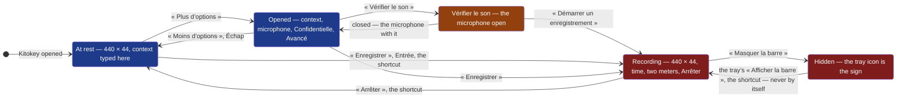

# D89 — D90: Kitokey's look and its minimal bar, drawn before they are built

**Drawn** 2026-11-07, first round · **Status**: drawn by D89's and D90's author, for the decider to read within two working days of its pull request ([cycle 09, *Dependency with a date*](../../cycles/09-kitokey-finished-before-it-is-published.md#dependency-with-a-date)); D88's panel and D91's context and models are drawn with them · **Frozen**: these drawings are not kept up to date. What the decider accepts becomes the criteria of the deliverables that build it; once built, the window, the bar and their screenshots are the truth. A new round is a new folder.

It replaces the small window of [D34](../d34-the-small-window-at-rest/README.md) and D11's sixth board, at rest and while recording; the window's layout stays [D61's](../d61-the-window-in-two-panes/README.md), only its sizes, icons and mark change.
The words are the product's, in French, where `modules/shell/src/words.rs` has them; the others are proposals, marked *nouveau* on the boards. The yellow notes, numbers and measures are the author's, for the decider — never part of the interface.

**Legend** — blue: nothing is recorded and no microphone is open · red: a recording runs · orange: no recording, the microphone open because the user asked to check it.

| # | Board | What the user sees, and can do |
|---|---|---|
| 1 | [The mark](1-mark-light.png) · [dark](1-mark-dark.png) | Kitokey's monogram, proposal A and one variant B, from 128 to 16 px, its construction on a 24 grid, the window's header at 20 px; the tray's icon at rest and while recording at 16, 22 and 24 px, on a dark and a light system bar. The mark alone: [`mark.svg`](mark.svg) |
| 2 | [The window, before and after](2-window-before-after-light.png) · [dark](2-window-before-after-dark.png) | Today's sidebar and meeting header at their size (40–44 px controls, a 28 px title) above the same at 32 px, Lucide icons of 16 px, one labelled action, the meeting's settings in one row; a tooltip shown |
| 3 | [Icons, sizes, colours](3-icons-sizes-colours-light.png) · [dark](3-icons-sizes-colours-dark.png) | Each icon: its Lucide name, its tooltip and accessible name in French and in English, where it is; the sizes (32, 28 in the bar, icons 16 and 20, a 4 px grid); one accent, red for recording alone, a border token `--edge` proposed |
| 4 | [A meeting's page](4-meeting-page-light.png) · [dark](4-meeting-page-dark.png) | The whole window after, 1212 × 760: the header's two icon buttons, the settings row, the audio, the minutes and the transcript with their icon actions and who made them |
| 5 | [The bar](5-bar-light.png) · [dark](5-bar-dark.png) | At rest: the mark as handle, the context of the next meeting, « Enregistrer », « Plus d’options », « Toute la fenêtre », « Masquer la barre ». Recording: the time, a 4 px meter for each side, « Arrêter ». A side silent for 2 min said in a grey line. The keyboard order of both; the room taken against the small window's |
| 6 | [The bar opened](6-bar-opened-light.png) · [dark](6-bar-opened-dark.png) | The context (D59's field, kept for the next meeting), the microphone, « Réunion confidentielle », « Vérifier le son », « Avancé » closed then open — the transcription's and the minutes' models, Settings' choice by default; the same opened while recording |
| 7 | [Vérifier le son](7-check-the-sound-light.png) · [dark](7-check-the-sound-dark.png) | Both sources' devices and meters, the Bluetooth sentence, « Jouer un son de test » and its two answers, a call already holding the microphone, « Démarrer un enregistrement » from there |
| 8 | [The bar on each system](8-bar-on-each-system-light.png) · [dark](8-bar-on-each-system-dark.png) | Windows, macOS, GNOME on Wayland with a tray and without: above or not, moved, reopened where, the sign while recording; GNOME's window menu; the tray's menu with « Afficher la barre » |

## What the decider answers

| Question | The author's proposal on the boards | The decider's answer |
|---|---|---|
| The mark | A — a « K » whose upper arm is the recording dot, on an accent tile; B as the one variant | owed |
| The tray while recording | The same mark, its dot larger and red; no blinking | owed |
| One labelled action per screen | The window: « Démarrer un enregistrement » (« Arrêter » while recording); the bar: « Enregistrer » / « Arrêter »; the check panel: « Démarrer un enregistrement » | owed |
| « Jouer un son de test » | Labelled, an exception to icon-only secondary actions (no icon says it alone) | owed |
| The bar's size | 440 × 44 CSS px at rest and recording, the same place; opened, 440 wide, as tall as it holds, nothing scrolling | owed |
| The bar's short word | « Enregistrer », the tooltip saying « Démarrer un enregistrement » and the shortcut | owed |
| The border token | `--edge` for fields, lists and switches (3:1); `--line` kept for dividers | owed |
| The meeting's own settings | One 32 px row: context, spoken language, « Confidentielle », instead of two cards | owed |
| « Petite fenêtre » | Becomes « La barre d’enregistrement », its icon in the sidebar's foot | owed |
| The shortcut's line under the button | Removed; in the tooltip and the empty state | owed |

## Contrast, both themes

Every pair the boards use, WCAG 2.2's ratio ([1.4.3](https://www.w3.org/WAI/WCAG22/Understanding/contrast-minimum.html), text 4.5:1; [1.4.11](https://www.w3.org/WAI/WCAG22/Understanding/non-text-contrast.html), controls and meters 3:1), computed from the sRGB values with WCAG's relative luminance formula on 2026-11-07.

| Pair | Use | Light | Dark | Needed |
|---|---|---|---|---|
| `--ink` on `--ground` / `--surface` / `--raised` | text | 16.27 / 17.93 / 15.83 | 15.72 / 14.11 / 12.22 | 4.5 |
| `--soft` on `--ground` / `--surface` / `--raised` | secondary text, icons | 6.91 / 7.61 / 6.72 | 8.33 / 7.47 / 6.48 | 4.5 |
| `--ink` / `--soft` on the selected row | list | 14.88 / 6.32 | 11.18 / 5.92 | 4.5 |
| `--accent` on `--surface` / `--ground` | links, focus ring, « Ici » | 6.55 / 5.94 | 7.46 / 8.31 | 4.5 |
| on-accent on `--accent` | the labelled primary | 6.55 | 7.46 | 4.5 |
| `--red` on `--surface`, on-accent on `--red` | « Arrêter », the live dot | 5.47 / 5.47 | 6.35 / 6.35 | 4.5 |
| `--ok` on `--surface` | « entendu », « À distance » | 5.43 | 8.76 | 4.5 |
| `--accent` / `--ok` fill on `--raised` track | meters | 5.78 / 4.79 | 6.47 / 7.59 | 3 |
| `--edge` on `--surface` / `--ground` / `--raised` | field borders, **proposed** `#808898` / `#737B8C` | 3.56 / 3.23 / 3.15 | 3.79 / 4.22 / 3.28 | 3 |
| `--line` on `--surface` | dividers only — fails as a control's border | 1.36 | 1.39 | 3 |
| White on the tile `#2253CF` | the mark | 6.55 | 6.55 | 3 |
| Tray red on the system's bar, whatever the app's theme | Light column: `#C2352D` on `#F3F3F3` / white; dark column: `#FF7A72` on black / `#202020` | 4.93 / 5.47 | 8.28 / 6.42 | 3 |

On-accent is `#FFFFFF` in light and `--surface` (`#1E2129`) in dark, as `.primary` draws it today. The selected row's ground is `#E3EAFB` / `#26324D`, D61's board's, close to window.css's `color-mix` of 13 % accent. `--line` is the one pair under its threshold, used only for dividers on the boards — today's fields, bordered with it, are not.

## Sources

- The leaders' compact controls and what users resent about them, the do-not-build list, the icon and density levers: [the market review of 2026-11-06](../../reviews/2026-11-06-market.md), §2, §6 and §9, and the sources it cites, read that day.
- GNOME on Wayland lets no application keep itself above or place itself: [tauri #3117](https://github.com/tauri-apps/tauri/issues/3117) and [GNOME Discourse](https://discourse.gnome.org/t/any-way-to-set-window-always-on-top-programmatically/31579), as the review cites them, read 2026-11-06.
- GNOME's microphone indicator lights whenever a stream records: [GNOME Shell MR 729](https://gitlab.gnome.org/GNOME/gnome-shell/-/merge_requests/729), and macOS's orange and purple dots: [Apple, Control Center](https://support.apple.com/en-au/guide/mac-help/mchl50f94f8f), as the review cites them, read 2026-11-06.
- Every control in a header bar has a tooltip: [GNOME HIG, header bars](https://developer.gnome.org/hig/patterns/containers/header-bars.html), as the review cites it, read 2026-11-06.
- The icons: Lucide 1.14.0's icon nodes, as `lucide-react` 1.14.0 ships them, ISC ([`modules/shell/ui/LUCIDE-LICENSE`](../../../../modules/shell/ui/LUCIDE-LICENSE)), copied inline into the board on 2026-11-07.
- **Not verified**: that Alt + Espace opens GNOME's window menu on Kitokey's bar drawn without the system's title bar, and that GNOME's French menu says « Toujours au premier plan »; that a passive stream lights GNOME's microphone indicator (cycle 09, D89, *to confirm*); whether GNOME's top bar can be light, which would ask the tray's dark glyph there.

[`board.html`](board.html) is the boards' source, with `ui/window.css`'s colours, both themes; the images are
rendered from it at 1280 px wide, each board alone (`?only=N`, `&dark` for the dark theme), by
`chromium-browser --headless --hide-scrollbars --window-size=1280,<the board's height> --screenshot`.
Everything is drawn at its size, unless a board's title says otherwise.
