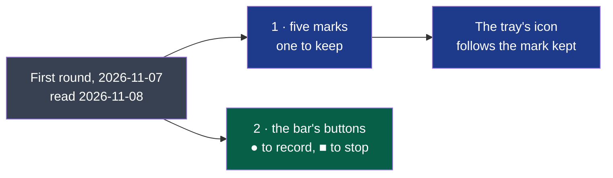

# D89 — D90, second round: Kitokey's mark and the bar's record and stop buttons

**Drawn** 2026-11-08, second round · **Status**: read by the decider on 2026-11-08 (answers below): the mark goes to a third round; drawn after the [first round's answers](../d89-d90-kitokey-look-and-bar/README.md#what-the-decider-answers) of 2026-11-08: « les visuels sont ok. le logo est a revoir », then « go » on the bar's buttons drawn as icons alone · **Frozen**: these drawings are not kept up to date. What the decider accepts becomes the criteria of D89 and D90; once built, the window, the bar and their screenshots are the truth. A new round is a new folder.

Everything else of the [first round](../d89-d90-kitokey-look-and-bar/README.md) stands as answered there; this round redraws only the two things the decider sent back.

**Legend** — grey: read and answered · blue: D89 · green: D90.

| # | Board | What the user sees |
|---|---|---|
| 1 | [Five marks](1-marks-light.png) · [dark](1-marks-dark.png) | C « La bulle », D « La clé sonore », E « Deux voix », G « Kito », H « L’onde » — each on the accent tile at 64, 32, 24 and 16 px, as the tray's icon at rest and while recording on a dark and a light system bar, and in the window's header at 20 px; then the five at 128 px |
| 2 | [The bar's buttons](2-bar-buttons-light.png) · [dark](2-bar-buttons-dark.png) | The bar at rest, hovered with its tooltip, recording, hovered, with the keyboard's focus, and the first round's beside it; the two buttons at 28 px and 3 ×; what each says in its tooltip, to a screen reader and to the keyboard |

The letters follow the first round's A and B; F was left out while drawing (a letter in a bubble, unreadable at 16 px).

## What the decider answers

The decider, 2026-11-08, in the working session: « pour le logo j'aime bien l'idée avec la lettre K mais juste modifier le logo en gardant le meme idée, peut être un "K" et un "i" avec le point du "i" comme un boutton "record", a voir comment harmonisé et associé les lettre k et i ou juste le K. vois les tendances des logo et l'identité graphique de kitokey pour refaire des propositions ».

| Question | The author's proposal on the boards | The decider's answer |
|---|---|---|
| The mark | C « La bulle » — the most legible, it says « conversation »; G « Kito » if Kitokey should first be friendly. D and H read less well at 16 px, H looks like many podcasts' « broadcast » icon | None of the five: back to the first round's « K », with a « K » and an « i » whose dot is a record button, or the « K » alone — a third round |
| The tray while recording | The mark's marked part turns red, its shape unchanged; no blinking | Follows the mark of the third round |
| The bar's buttons | ● a red-ringed round button holding the red dot, larger on hover; ■ a filled red rounded square holding a white square; the words in the tooltip and the accessible name | Not answered in this round; drawn again in the third, with the mark kept |
| The live dot | Beats gently while recording, unless the system asks for less motion; nothing else moves | Not answered in this round; drawn again in the third |

## Contrast, both themes

WCAG 2.2's 1.4.11 asks 3:1 of a control's shape. The values are the first round's, [computed there](../d89-d90-kitokey-look-and-bar/README.md#contrast-both-themes) on 2026-11-07.

| Pair | Use | Light | Dark | Needed |
|---|---|---|---|---|
| `--red` on `--surface` | ●'s ring and dot, ■'s fill | 5.47 | 6.35 | 3 |
| on-accent on `--red` | ■'s inner square (white in light, `#1E2129` in dark) | 5.47 | 6.35 | 3 |
| White on the tile `#2253CF` | each mark | 6.55 | 6.55 | 3 |

## Sources

- ● and ■ as the signs of recording and stopping, the dot and the square of tape recorders and of recording apps since (Apple's Voice Memos, OBS Studio): the author's knowledge, **not re-read** on 2026-11-08.
- The first round's sources stand for the colours, the icons (Lucide 1.14.0, ISC, [`modules/shell/ui/LUCIDE-LICENSE`](../../../../modules/shell/ui/LUCIDE-LICENSE)) and the bar.
- **Not verified**: that no registered mark resembles the one kept — the trademark search (cycle 08's *Later*) comes before the mark is published.

[`board.html`](board.html) is the boards' source; the images are rendered from it at 1280 px wide, each board alone
(`?only=N`, `&dark` for the dark theme), by `chromium-browser --headless --hide-scrollbars --window-size=1280,<the board's height> --screenshot`.
