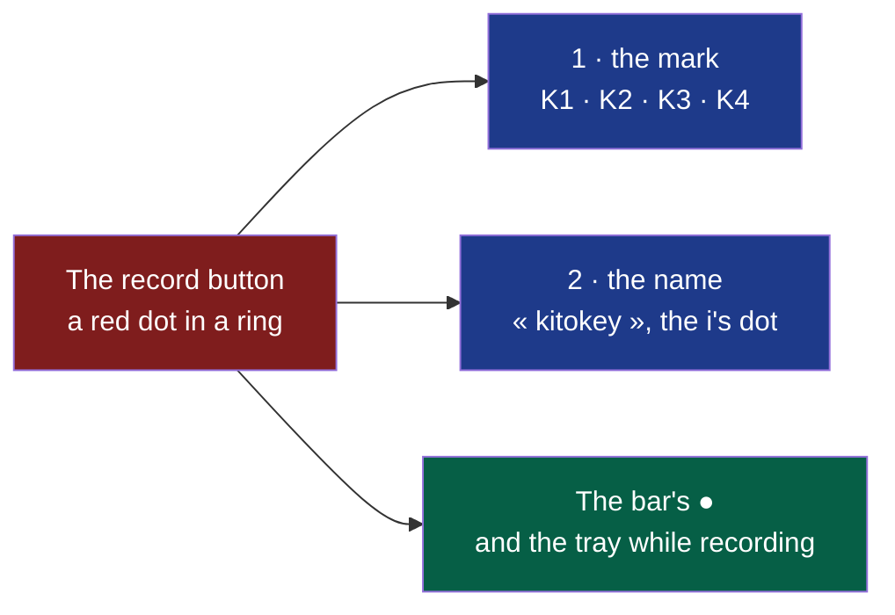

# D89 — D90, third round: the « K », the « i » and the record button

**Drawn** 2026-11-08, third round · **Status**: read by the decider on 2026-11-08 (answers below): K3 and the name kept, K3 to be made cleaner in a fourth round; drawn after the [second round's answers](../d89-d90-mark-and-bar-buttons/README.md#what-the-decider-answers) of 2026-11-08: back to the first round's « K », with a « K » and an « i » whose dot is a record button, or the « K » alone, after a look at the year's logo trends and Kitokey's identity · **Frozen**: these drawings are not kept up to date. What the decider accepts becomes the criteria of D89 and D90; once built, the window, the bar and their screenshots are the truth. A new round is a new folder.

The [first round](../d89-d90-kitokey-look-and-bar/README.md) stands as answered there; this round redraws the mark and shows the name beside it.

**Legend** — red: the one sign shared · blue: D89 · green: D90.

| # | Board | What the user sees |
|---|---|---|
| 1 | [Four marks](1-marks-light.png) · [dark](1-marks-dark.png) | K1 « Le K bouton », K2 « Ki », K3 « iK », K4 « Le K dans le bouton » — each on the accent tile from 96 to 16 px, as the tray's icon at rest and while recording on a dark and a light system bar, in the window's header at 20 px; their construction on a 24 grid |
| 2 | [The identity](2-identity-light.png) · [dark](2-identity-dark.png) | The name « kitokey » in lower case, its i's dot the record button, alone and beside the icon at three sizes, white on the accent; the bar at rest and recording with the mark as its handle; the same button in the name, the icon, the bar and the tray |

## What the trends say, and what is kept from them

| Trend, 2026 | Kept here |
|---|---|
| A brand is a system — the full logo, an icon, a monogram — rather than one drawing ([DesignRush](https://www.designrush.com/best-designs/logo/trends/types-of-logos), [Creative Bloq](https://www.creativebloq.com/design/logos-icons/these-logo-design-trends-will-define-2026)) | One sign, the record button, carried by the name, the icon, the bar's ● and the tray |
| A stylised monogram set in front of a wordmark often clashes with the other letters ([LogoLounge, 2026 report](https://www.logolounge.com/trend/2026-logo-trend-report), as quoted by the search's summary) | The icon's letters and the name's share their stroke's round ends and the same button; the name is never preceded by the monogram in one line, only placed beside the icon |
| macOS 26 puts every app icon in the same rounded square; one in another shape gets a grey box ([9to5Mac](https://9to5mac.com/2025/08/07/macos-26-icon-changes/), [Rogue Amoeba](https://weblog.rogueamoeba.com/2026/06/26/free-the-icons/)) | Every mark sits on the accent tile, a rounded square |

Read 2026-11-08 through a web search's summaries; the pages themselves **not opened**, and most are agencies' blogs with something to sell.

## What the decider answers

The decider, 2026-11-08, in the working session: « K3 et le nom ok mais il faut a mon avis revoir un peut le k3 pour qqchose d'un peut epuré, propre visurellement, le contour du bouton record est peut être en trop, le K semble un peut malformé, peut être que le bouton record doit être comme decoupé sur la barre du K a l'image du "i" dans le nom complet […] un peut comme si le record se deplacé. si le nom est complet sur le I et si le logo K sur le K. le record devient rouge quand l'enregitrement est en cours ».

| Question | The author's proposal on the boards | The decider's answer |
|---|---|---|
| The mark | K3 « iK » — the K's stem is an i under the record button: the most its own, the most playful; K1 if the K must read first | K3, made cleaner: no ring around the button, a better-formed K, the button cut from the K's stem as the i's dot is — a fourth round |
| The name | « kitokey » in lower case, the i's dot the record button, set in Montserrat 700 then outlined | Accepted: « kitokey », the i's dot the record button |
| The brand's red | Only the button: on the tile and in the name, #E5483D in a ring; the tray at rest in one colour, its dot red while recording; in the interface, red stays for recording alone | Changed: the button turns red only while a recording runs; at rest it has the mark's colour — drawn in the fourth round |
| The bar's buttons | ● and ■ as the second round drew them, the bar's handle the mark kept | Not answered; drawn again in the fourth round |

## Contrast, both themes

| Pair | Use | Ratio | Needed |
|---|---|---|---|
| White on the tile `#2253CF` | the mark's strokes and the button's ring | 6.55 | 3 |
| `#E5483D` on white | the button's dot inside its white ring | 3.94 — computed by the author on 2026-11-08 with WCAG's relative luminance | 3 |
| `--red` on `--surface` | the bar's ● and ■ | 5.47 light, 6.35 dark (first round) | 3 |

The red dot is never read against the blue: its white ring stands between them.

## Sources

- The trends: the pages in the table above, as summarised by a web search on 2026-11-08.
- The colours, the icons (Lucide 1.14.0, ISC, [`modules/shell/ui/LUCIDE-LICENSE`](../../../../modules/shell/ui/LUCIDE-LICENSE)) and the bar: the first and second rounds.
- Montserrat: SIL Open Font License, as installed on the author's workstation; the name kept is outlined into paths before publication.
- **Not verified**: that no registered mark resembles the one kept — the trademark search (cycle 08's *Later*) comes before the mark is published.

[`board.html`](board.html) is the boards' source; the images are rendered from it at 1280 px wide, each board alone
(`?only=N`, `&dark` for the dark theme), by `chromium-browser --headless --hide-scrollbars --window-size=1280,<the board's height> --screenshot`.
