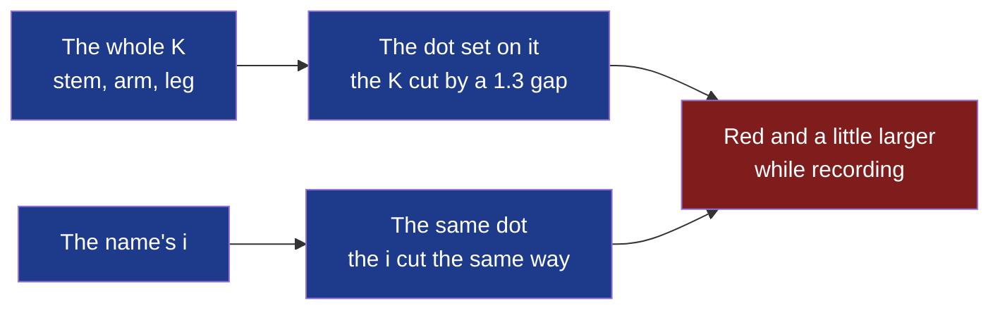

# D89 — D90, fifth round: the record dot set on the K, the letter cut around it

**Drawn** 2026-11-08, fifth round · **Status**: for the decider to read, after the [fourth round's answers](../d89-d90-mark-k-dot/README.md#what-the-decider-answers) of 2026-11-08: the round dot set on the whole K, the letter cut around it as the third round's name cut its i · **Frozen**: these drawings are not kept up to date. What the decider accepts becomes the criteria of D89 and D90; once built, the window, the bar and their screenshots are the truth. A new round is a new folder.

**Legend** — blue: the mark and the name at rest · red: while a recording runs. The app's icon (Store, dock, launcher) is a fixed image: always at rest.

| # | Board | What the user sees |
|---|---|---|
| 1 | [The dot on the K](1-mark-light.png) · [dark](1-mark-dark.png) | Four places for the dot — P1 on the stem, P2 at the heart, P3 at the arm's end, P4 at the leg's foot — each on the accent tile from 80 to 16 px, as the tray's icon at rest and while recording, and alone in the accent at rest and recording; P1's construction on a 24 grid |
| 2 | [The dot moves](2-the-dot-moves-light.png) · [dark](2-the-dot-moves-dark.png) | P1 beside the name, the same dot on its i, cut the same way; the name at rest, recording and on the accent; the window's header and the bar's handle at rest and recording |

## What the decider answers

| Question | The author's proposal on the boards | The decider's answer |
|---|---|---|
| The mark | P1 — the dot caps the stem where the name's i has its dot, the K cut around it; P3 if the dot must be seen first | owed |
| The name | « kitokey », the same dot on the i, cutting it the same way | owed |
| The dot while recording | Red and a little larger (radius 3.3 → 3.7, the cut following): shape and colour, never colour alone; in the tray, the bar's handle and the window's header; the app's icon always at rest | owed |
| Where the mark has no tile | The bar's handle and the window's header draw the mark alone, in the accent, so the red dot reads against the surface | owed |

## Contrast, both themes

The fourth round's, [computed there](../d89-d90-mark-k-dot/README.md#contrast-both-themes) on 2026-11-08: white on the tile 6.55; the accent on the surface 6.55 light, 7.46 dark; the red on the surface 5.47 light, 6.35 dark; the tray's red 4.93 on a light bar, 8.28 on black — each above the 3:1 WCAG 2.2 asks of a graphic that says a state. The cut is empty: it takes the ground's colour and asks no contrast of its own.

## Sources

- The rounds before: [first](../d89-d90-kitokey-look-and-bar/README.md), [second](../d89-d90-mark-and-bar-buttons/README.md), [third](../d89-d90-mark-k-and-i/README.md) — the trends read there —, [fourth](../d89-d90-mark-k-dot/README.md).
- Montserrat: SIL Open Font License, as installed on the author's workstation; the name kept is outlined before publication.
- Icons: Lucide 1.14.0, ISC ([`modules/shell/ui/LUCIDE-LICENSE`](../../../../modules/shell/ui/LUCIDE-LICENSE)).
- **Not verified**: that no registered mark resembles this one — the trademark search (cycle 08's *Later*) comes before the mark is published.

[`board.html`](board.html) is the boards' source; the images are rendered from it at 1280 px wide, each board alone
(`?only=N`, `&dark` for the dark theme), by `chromium-browser --headless --hide-scrollbars --window-size=1280,<the board's height> --screenshot`.
