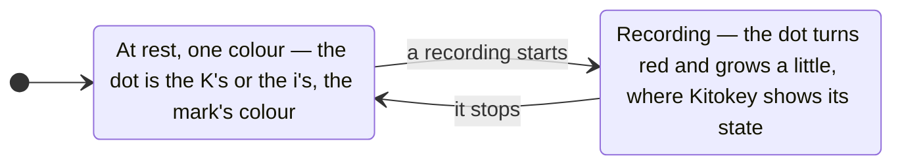

# D89 — D90, fourth round: K3 made cleaner, and the dot that moves

**Drawn** 2026-11-08, fourth round · **Status**: read by the decider on 2026-11-08 (answers below): the mark goes to a fifth round; drawn after the [third round's answers](../d89-d90-mark-k-and-i/README.md#what-the-decider-answers) of 2026-11-08: K3 and the name kept; K3 cleaner, without the button's ring, its dot cut from the stem as the name's i, red only while recording · **Frozen**: these drawings are not kept up to date. What the decider accepts becomes the criteria of D89 and D90; once built, the window, the bar and their screenshots are the truth. A new round is a new folder.

**Legend** — the two states of the one dot. The app's icon (Store, dock, launcher) is a fixed image: always at rest.

| # | Board | What the user sees |
|---|---|---|
| 1 | [The mark](1-mark-light.png) · [dark](1-mark-dark.png) | The cleaner K on the accent tile from 128 to 16 px, the third round's beside it; its construction on a 24 grid; the tray's icon at rest and while recording, on a dark and a light system bar |
| 2 | [The dot moves](2-the-dot-moves-light.png) · [dark](2-the-dot-moves-dark.png) | The mark's dot on the K, the name's on the i; the name at rest and recording; the window's header and the bar's handle at rest and recording |

## What the decider answers

The decider, 2026-11-08, in the working session: « pour le logo je me suis peut être mal exrimé, je vais reessayé, pour moi le "record" rond vient comme se positionné sur la lettre, comme sil la completé mais la lettre est "coupé" par le rond du record. comme le I de la version precedente, le i de kitokey etait bien, je voulais pareil le le logo K. reessaye ».

| Question | The author's proposal on the boards | The decider's answer |
|---|---|---|
| The mark | A short stem with the dot cut above it, as the name's i; the arm meets the stem, the leg leaves the arm; stroke 3.4, round ends; no ring | Not this one: the round dot set on the whole K, the letter cut around it as the third round's name cut its i — a fifth round |
| The dot while recording | Red and a little larger (radius 2.9 → 3.3): shape and colour, never colour alone; in the tray, the bar's handle and the window's header; the app's icon always at rest | Not answered; drawn again in the fifth round |
| Where the mark has no tile | The bar's handle and the window's header draw the mark alone, in the accent, so the red dot reads against the surface | Not answered; drawn again in the fifth round |
| The bar's live dot | Removed: the handle's red dot says a recording runs | Not answered; drawn again in the fifth round |

## Contrast, both themes

Computed by the author on 2026-11-08 with WCAG 2.2's relative luminance; 3:1 asked of a graphic that says a state ([1.4.11](https://www.w3.org/WAI/WCAG22/Understanding/non-text-contrast.html)).

| Pair | Use | Light | Dark | Needed |
|---|---|---|---|---|
| White on the tile `#2253CF` | the app's icon | 6.55 | 6.55 | 3 |
| `--accent` on `--surface` | the mark alone: handle, header | 6.55 | 7.46 | 3 |
| `--red` on `--surface` | the dot while recording: handle, header | 5.47 | 6.35 | 3 |
| Tray red on the system's bar | `#FF7A72` on black, `#C2352D` on `#F3F3F3` (first round) | 4.93 | 8.28 | 3 |
| `#FF7A72` on the tile `#2253CF` | **not used**: why the handle and the header have no tile | 2.58 | — | 3 |

## Sources

- The rounds before: [first](../d89-d90-kitokey-look-and-bar/README.md), [second](../d89-d90-mark-and-bar-buttons/README.md), [third](../d89-d90-mark-k-and-i/README.md) — the trends read there.
- Montserrat: SIL Open Font License, as installed on the author's workstation; the name kept is outlined before publication.
- Icons: Lucide 1.14.0, ISC ([`modules/shell/ui/LUCIDE-LICENSE`](../../../../modules/shell/ui/LUCIDE-LICENSE)).
- **Not verified**: that no registered mark resembles this one — the trademark search (cycle 08's *Later*) comes before the mark is published.

[`board.html`](board.html) is the boards' source; the images are rendered from it at 1280 px wide, each board alone
(`?only=N`, `&dark` for the dark theme), by `chromium-browser --headless --hide-scrollbars --window-size=1280,<the board's height> --screenshot`.
