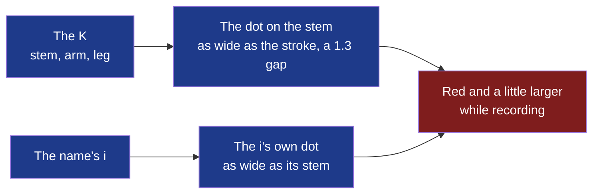

# D89 — D90, sixth round: the dot on the stem, as wide as the letter

**Drawn** 2026-11-08, sixth round · **Status**: read by the decider on 2026-11-08 (answers below): the mark accepted; the name's i drawn as the mark's stem in a seventh round; drawn after the [fifth round's answers](../d89-d90-mark-k-cut/README.md#what-the-decider-answers) of 2026-11-08: P1, the dot as wide as the letter, as if it continued the stem; the name's « t » not cut · **Frozen**: these drawings are not kept up to date. What the decider accepts becomes the criteria of D89 and D90; once built, the window, the bar and their screenshots are the truth. A new round is a new folder.

**Legend** — blue: the mark and the name at rest · red: while a recording runs. The app's icon (Store, dock, launcher) is a fixed image: always at rest.

| # | Board | What the user sees |
|---|---|---|
| 1 | [The mark](1-mark-light.png) · [dark](1-mark-dark.png) | P1 on the accent tile from 128 to 16 px, the fifth round's beside it; alone in the accent at rest and recording; its construction on a 24 grid at rest and recording; the tray's icon at rest and recording, on a dark and a light system bar |
| 2 | [The dot moves](2-the-dot-moves-light.png) · [dark](2-the-dot-moves-dark.png) | The mark beside the name, the same dot on its i; the name at rest, recording and on the accent; the window's header and the bar's handle at rest and recording |

## What the decider answers

The decider, 2026-11-08, in the working session: « ok, valide le logo, quand on a le nom "kitokey" on fait le "i" de la meme maniere avec le "record" qui coupe le i comme dans le logo ».

| Question | The author's proposal on the boards | The decider's answer |
|---|---|---|
| The mark | P1, the dot as wide as the stroke (radius 1.6), its top on the arm's top, a 1.3 gap above the stem | Accepted |
| The name | « kitokey », the i's own dot as wide as its stem, the same gap; the « t » untouched | Changed: the i drawn as the mark's stem, the record dot cutting it as in the mark — a seventh round |
| The dot while recording | Red and larger (radius 1.6 → 2.2, the gap following): at 16 px a dot as wide as the stroke is 2 px, too little for a red alone; shape and colour together. In the tray, the bar's handle and the window's header; the app's icon always at rest | Accepted |
| Where the mark has no tile | The bar's handle and the window's header draw the mark alone, in the accent | Accepted |

## Contrast, both themes

The fourth round's, [computed there](../d89-d90-mark-k-dot/README.md#contrast-both-themes) on 2026-11-08: white on the tile 6.55; the accent on the surface 6.55 light, 7.46 dark; the red on the surface 5.47 light, 6.35 dark; the tray's red 4.93 on a light bar, 8.28 on black — each above the 3:1 WCAG 2.2 asks of a graphic that says a state. The gap is empty: it takes the ground's colour and asks no contrast of its own.

## Sources

- The rounds before: [first](../d89-d90-kitokey-look-and-bar/README.md), [second](../d89-d90-mark-and-bar-buttons/README.md), [third](../d89-d90-mark-k-and-i/README.md) — the trends read there —, [fourth](../d89-d90-mark-k-dot/README.md), [fifth](../d89-d90-mark-k-cut/README.md).
- Montserrat: SIL Open Font License, as installed on the author's workstation; the name kept is outlined before publication.
- Icons: Lucide 1.14.0, ISC ([`modules/shell/ui/LUCIDE-LICENSE`](../../../../modules/shell/ui/LUCIDE-LICENSE)).
- **Not verified**: that no registered mark resembles this one — the trademark search (cycle 08's *Later*) comes before the mark is published.

[`board.html`](board.html) is the boards' source; the images are rendered from it at 1280 px wide, each board alone
(`?only=N`, `&dark` for the dark theme), by `chromium-browser --headless --hide-scrollbars --window-size=1280,<the board's height> --screenshot`.
