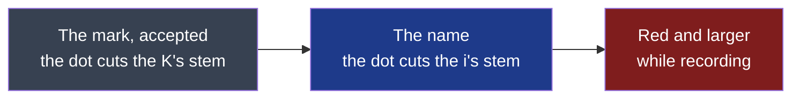

# D89 — D90, seventh round: the name, its i cut by the record dot

**Drawn** 2026-11-08, seventh round · **Status**: for the decider to read, after the [sixth round's answers](../d89-d90-mark-k-stem/README.md#what-the-decider-answers) of 2026-11-08: the mark accepted; « quand on a le nom "kitokey" on fait le "i" de la meme maniere avec le "record" qui coupe le i comme dans le logo » · **Frozen**: these drawings are not kept up to date. What the decider accepts becomes the criteria of D89 and D90; once built, the window, the bar and their screenshots are the truth. A new round is a new folder.

**Legend** — grey: accepted · blue: this round · red: while a recording runs.

| # | Board | What the user sees |
|---|---|---|
| 1 | [The name](1-name-light.png) · [dark](1-name-dark.png) | The accepted mark beside the name; the name at rest, recording and on the accent; the i drawn large on a grid; the name beside the icon at 48, 32 and 24 px |

## What the decider answers

| Question | The author's proposal on the board | The decider's answer |
|---|---|---|
| The name | « kitokey » in lower case, its i drawn as the mark's stem: the stem rises to the dot, as wide as the stroke, its top at the k's height, cut by an empty gap of 0.41 times the stroke, as in the mark; the « t » untouched | owed |
| The name while recording | Where the name shows a state (kitokey.com's animation, the installer's last screen), the dot turns red and grows by the mark's ratio (× 1.375) | owed |

## Sources

- The accepted mark: the [sixth round](../d89-d90-mark-k-stem/README.md); the rounds before it and their trends, linked there.
- Montserrat 700: SIL Open Font License, as installed on the author's workstation; the name kept is outlined into paths before publication, no font to install.
- **Not verified**: that no registered mark resembles the mark or the name — the trademark search (cycle 08's *Later*) comes before either is published.

[`board.html`](board.html) is the board's source; the images are rendered from it at 1280 px wide (`?only=1`, `&dark` for the dark theme), by `chromium-browser --headless --hide-scrollbars --window-size=1280,<the board's height> --screenshot`.
