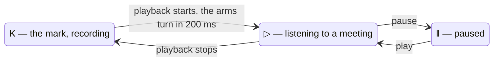

# D89, eighth round: the K that turns into « play »

**Drawn** 2026-11-08, eighth round · **Status**: read by the decider on 2026-11-08: « on garde la version precedente » — nothing of this round is kept; drawn from their idea, the same day: « le "K" en symetrie vertical represente le logo "play", est ce qu'on ne peut pas le decliner en logo ? jouer avec ? fait des proposition ». The [accepted mark](../d89-d90-mark-k-stem/README.md) and [name](../d89-d90-name-kitokey/README.md) do not change · **Frozen**: what the decider accepts becomes criteria of D89; once built, the window and its screenshots are the truth. A new round is a new folder.

**Legend** — the three states of one glyph: the stem and its dot stay, only the arms move.

| # | Board | What the user sees |
|---|---|---|
| 1 | [The K and play](1-k-play-light.png) · [dark](1-k-play-dark.png) | The K turning into ▷ in five frames; A, the family K · ▷ · ‖ at 64, 32 and 16 px; B, the strict mirror of the K beside Lucide's skip-forward; C, the meeting player's play and pause buttons; D, the tray's icon at rest and while listening |

## What the decider answers

The decider, 2026-11-08, in the working session: « on garde la version precedente ».

| Question | The author's proposal on the board | The decider's answer |
|---|---|---|
| The strict mirror (B) | Left out: mirrored, the K reads ▷| « next track », the players' convention, and no longer K | Not kept: the accepted mark stays |
| The family (A) | K to record (the mark), ▷ to listen, ‖ paused — the stem and its dot kept in all three | Not kept: the accepted mark stays |
| The motion | Playback starting turns the arms in 200 ms, K → ▷; they turn back when it stops; once per change, never looping; none when the system asks for less motion | Not kept: the accepted mark stays |
| Where it shows | The meeting player's play and pause buttons (still a triangle: nothing to learn), kitokey.com; the tray while listening, never red | Not kept: the accepted mark stays |

## Sources

- Play ▷, pause ‖ and skip-forward ▷| as players draw them: Lucide 1.14.0's `play`, `pause` and `skip-forward` (ISC, [`modules/shell/ui/LUCIDE-LICENSE`](../../../../modules/shell/ui/LUCIDE-LICENSE)), the window's icon set.
- The accepted mark: the [sixth round](../d89-d90-mark-k-stem/README.md).

[`board.html`](board.html) is the board's source; the images are rendered from it at 1280 px wide (`?only=1`, `&dark` for the dark theme), by `chromium-browser --headless --hide-scrollbars --window-size=1280,<the board's height> --screenshot`.
