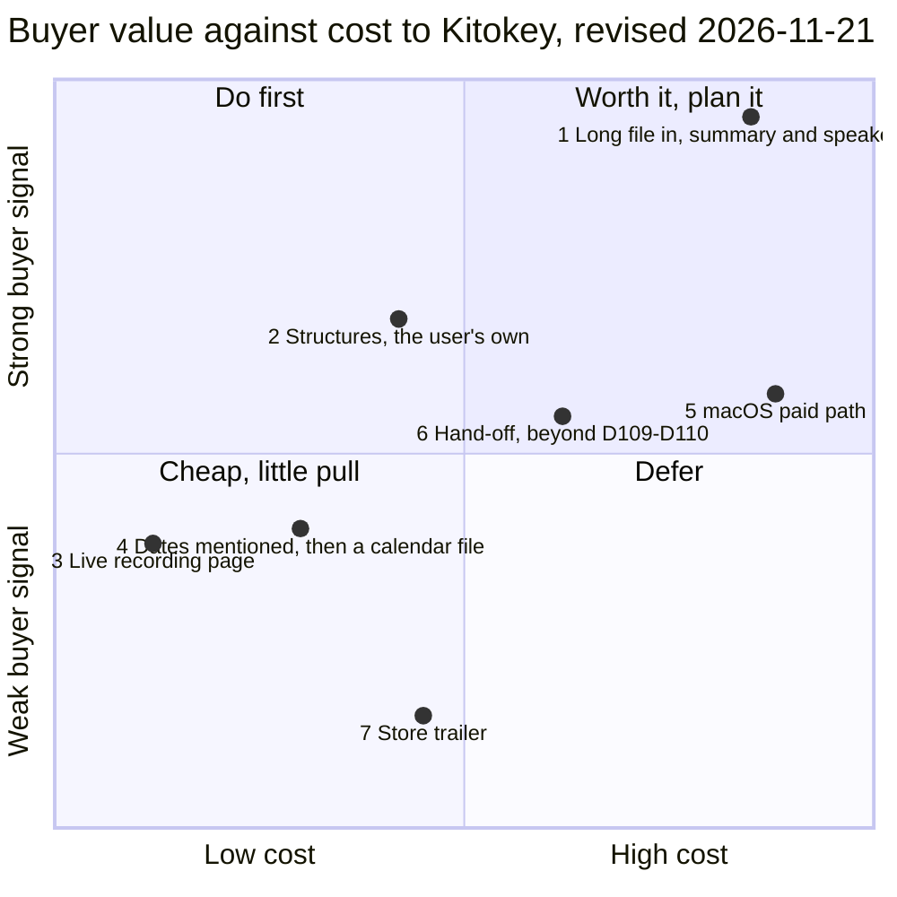
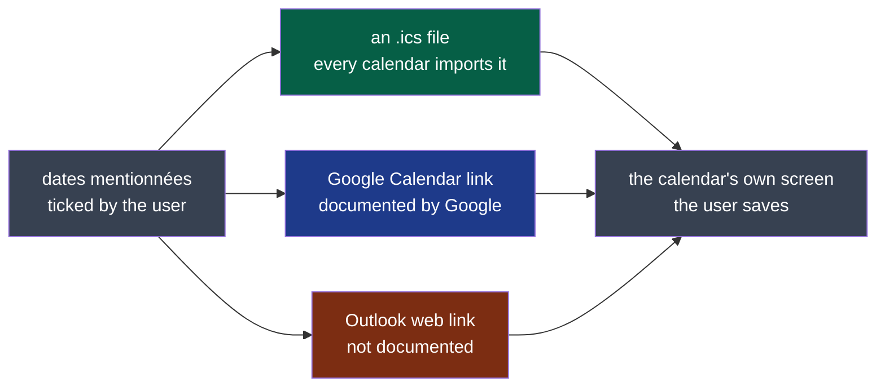

# Cycle 12's priorities — a discovery, 2026-11-21

> A discovery round (`.nstack/playbooks/discovery.md`) on one question: **which of seven candidates should
> cycle 12 build first, for a buyer?** Stages 1–4 by the framer; stage 5 is sam's, as the challenger; stage 6
> is the decider's. It builds on the market reviews of [2026-10-26](2026-10-26-market.md),
> [2026-10-30](2026-10-30-market.md), [2026-11-03](2026-11-03-market.md),
> [2026-11-06](2026-11-06-market.md) and [2026-11-13](2026-11-13-market.md), and repeats them only where
> something moved.

## The ranking, first

*Revised after the challenge (§5), 2026-11-21: the framer's answer is §6a. The first proposal put the live
recording page first and called sharing weak; both readings changed. Revised again on the decider's answers
of 2026-11-21 ~06h (§6c): import and voices are one axis, « a long file in, a pertinent summary and a
transcript with speakers out ». Candidate 8, dated items to a calendar, entered on the decider's word of
2026-11-21 ~06h40 (§2e); it ranks 4.*

**Legend** — x: the framer's cost estimate, read from the repository (S under two days, M one deliverable,
L more). y: the strength of the buyer signal found in §2 and §5: strong = a rival says in its own words it is
the most requested, or several vendors charge for it; weak = requests with no reactions, or a platform's own
data showing no lift. Quadrants are the framer's reading, not a measure.

| # | Candidate | Buyer signal (§2, §5) | Cost | Recommendation for cycle 12 |
|---|---|---|---|---|
| 1 | **A long file in, a pertinent summary and a transcript with speakers out**: import an audio **or video** file — the audio track read from the container — then voices, opt-in (spikes S2 and S1) | **Strong**, and now the three users' own: the decider, 2026-11-21 ~06h, « les 3 utilisateur utilise l'import dans leur cadre pro » (§6c). Market: Meetily's « most requested feature »; Fathom « on our product roadmap »; Otter caps it; voices the top request at Meetily, Granola, Notion | **L** — S2 with five real files first, MP4 and MOV among them (§5b); the session-audio contract's expand; S1 opening on the models' licences; the shell's gesture | **First**: what cycle 12 is built around, held by a criterion on a file of more than an hour (§6c) |
| 2 | **Structures**: the user's own, beyond D111's six, and the summary's language | Moderate–strong: Meetily #243 (11 👍), four vendors charge for custom templates | **M** — once D111 (#1041–#1043) is merged | **Third**: finish D111 in cycle 11; cycle 12 adds a structure the user writes |
| 3 | **Live time and levels on a meeting's page while it records** (#1076, #780) | Moderate, indirect — and mostly shipped: capture's silence notice after 10 s and the bar's meters, clock and silent status already exist (§5c) | **S** | **The cycle's small item**: the page made consistent with the bar, and the Store's recording screenshot back (#1073) |
| 4 | **Dates mentioned in a meeting**: each date the transcript says — a meeting planned, a deliverable due — listed with its absolute date, the **reference day** it was resolved against (shown and editable: an import has none by default) and its passage `[mm:ss]`, labelled « date mentionnée », never « échéance »; copied with the summary; an `.ics` later | **No market demand found**, and no rival does it: they read calendars to join meetings; follow-ups go to task trackers without documented due dates; writing an event is rare and always confirmed; no `.ics` export anywhere (§2e) — **I** more a choice the leaders made than a gap (§5e). Value rests on the persona, where a **wrong** date costs more than a missed one | **S** spike, then **S** the panel; the `.ics` writer **M**, later | **Spike in cycle 12**, after axis 1 says where an import's day comes from: threshold ≤ 1 wrong date in 50 proposed, apart from « not said »; then the panel, copied with the summary (#1025); then, for ticked dates, an `.ics` plus one-click links to Google Calendar and Outlook web, no OAuth (§6c, question 6) |
| 5 | **macOS paid path** (ADR-0017) | Moderate: one-time $49–99 is the niche's norm; no conversion data | **L** — four code deliverables, and the decider's gestures first (FastSpring's quote, KYC, Apple's $99 programme) | **In parallel, gated on the decider's gestures**: revenue, not pull |
| 6 | **Hand-off** beyond what cycle 11 ships (OAuth: Notion, Slack) | **Strong for cloud buyers** (Granola gates Notion and Zapier on Business), **untested for Kitokey's** (§5c); weak among local-tool users | Nothing to build first: D109's rich copy (#1025) and export, D110's webhooks already hand a summary over without a secret; **OAuth M–L**, with the secret problem | **No build in cycle 12**; a test instead — the Windows colleague pastes a copied summary into Teams, Outlook and OneNote |
| 7 | **Store trailer and hero art** | **Weak**: Microsoft's only figure is « up to 11 % » from 2018; Apple's own test showed no lift | **M** — the screencast spike in headless GNOME | **Last**, filmed after 1–3 land; a long file summarised with its speakers is the scene to film |

**What this changes in the coordinator's working hypothesis** (1 sharing, 2 structures, 3 import, 4 live
recording page): import and voices come first, as one axis; sharing needs no build in cycle 12 — the secret-free
hand-off a Windows buyer would use (rich copy, export, webhooks) ships in cycle 11, and what is left is to see
it paste well; the live recording page stays a small item; dates mentioned enter at 4, as a spike, then a panel copied with the summary; a calendar file waits for the three users' answer.

---

## 1. Intake

*Unconfirmed: the decider confirms or corrects this paragraph on the pull request.*

Kitokey is a desktop application that records a meeting on the user's own computer — microphone and system
sound, no bot, no account —, transcribes and summarises it with local models or a service the user names, and
hands the result over; free on Linux, sold once on macOS and Windows (charter; PDR-0001). Cycle 11 makes it
ready for the Microsoft Store and lets a meeting leave the app. **The question of this round**: of seven
candidates — sharing (D110), structures (D111), import a recording (S2), voices (S1), live time and levels on
the recording page, the macOS paid path, the Store trailer — which give a buyer the most reason to choose
Kitokey, for what they cost, so that the decider frames cycle 12 from a ranked list (plan item 4).

- **Language**: English, rule 1 of `docs/project/rules/always.md` (2026-10-12). Nothing to ask.
- **Asked of or promised to someone outside the team**: nothing by this round. ADR-0017 lists a written quote
  from FastSpring as the decider's first gesture; whether it was asked is not in the repository — open
  question 1.

**Open questions:**

1. Has FastSpring been asked for its quote, and when? It dates candidate 5.
2. Who is the buyer cycle 12 aims at: the charter's three users, or a stranger met on the Store? The ranking
   assumes the stranger (the Store is cycle 11's goal); the three users' own success criteria may weigh
   otherwise.

## 2. Research

Run on **2026-11-21** with the agent runtime's web search and page fetch — the tooling profile names no
research tool. Four searches ran in parallel; their raw notes are not kept in the repository, the sources
they cite are. **Limits**: Reddit, G2, Capterra and Medium refused automated reads; Reddit threads appear only
where a page that links them was read, marked *rival* or *secondary*. Hacker News was read through its
Algolia API. No product was installed or run.

**Markers.** *Vendor*: a company about itself. *Rival*: a competitor about another. *Secondary*: press, a
review site, a forum. *Search only*: seen in a search result, the page not opened. **F** a page states it ·
**I** the framer's inference · **U** uncertain.

### 2a. What moved since the review of 2026-11-13

| Earlier record | Now | Source |
|---|---|---|
| MacWhisper: meeting recording groups all other participants as one speaker (2026-11-13) | **F** v15.2 (2026-09-23) adds live meeting transcripts and Nemotron 3 diarization up to 8 speakers; 15.3 lets the user choose Nemotron or Pyannote; **15.11 warns during a recording when the microphone is disconnected, muted or silent** (first seen 2026-11-17). **Our record is out of date** | [9to5mac, 2026-09-23](https://9to5mac.com/2026/09/23/macwhisper-update-brings-real-time-meeting-transcripts-improved-speaker-recognition-more/) *secondary*; [release notes](https://macwhisper-site.vercel.app/release_notes.html) **U** *vendor (assumed)* |
| Notion AI Meeting Notes: Business and Enterprise only | **F** Still; and from **2026-12-01** meeting notes consume the monthly Standard credits, about 10 per hour of meeting (1,500 a month per seat). **F** It accepts uploaded audio (AAC, M4A, MP3, WAV) | [Notion help: credits](https://www.notion.com/help/standard-select-and-notion-credits-eligible-features), [AI meeting notes](https://www.notion.com/help/ai-meeting-notes) *vendor* |
| Otter: prices only | **F** Imports capped: **3 for the account's lifetime on Basic, 10 a month on Pro**; 30 min a conversation on Basic, 90 on Pro. **F** $320M of non-equity financing, 40M+ users claimed (2026-10-20) | [otter.ai/pricing](https://otter.ai/pricing) *vendor*; [SiliconANGLE, 2026-10-20](https://siliconangle.com/2026/10/20/otter-ai-raises-320m-in-funding-for-its-ai-meeting-assistant/) *secondary* |
| Fireflies: amounts only on rival pages | **F** Its own help gives them: Pro $10 annual / $18 monthly, Business $19 / $29. **F** The Free plan went from « unlimited » to « limited » AI summaries, 20 credits (observed 2026-10-05). **F** Its bot-free capture keeps no audio and has **no speaker labels** | [Fireflies guide, plans](https://guide.fireflies.ai/articles/3734844560-learn-about-the-fi) *vendor* **U** (the address as the search recorded it); [usagepricing, 2026-10-05](https://www.usagepricing.com/blueprint/activity/fireflies-ai-2026-10-05-free-plan-ai-credits) *secondary*; [Fireflies guide, desktop audio](https://guide.fireflies.ai/articles/9115463123-does-the-desktop-app-save-an-audio-recording) *vendor* |
| Fathom: acquired by Superhuman (2026-09-14) | **F** Prices unchanged; nothing said on the free plan or data. **F** It does « not support uploaded calls » — « on our product roadmap! ». **F** Bot-free on Windows is a « limited Microsoft Teams alpha » (2026-11-10). **F** iOS app (October) | [fathom.ai/pricing](https://www.fathom.ai/pricing), [help 6049729](https://help.fathom.video/en/articles/6049729), [help 11577345](https://help.fathom.video/en/articles/11577345) *vendor* |
| Not recorded | **F** Two new local, account-free, open-source rivals: **Yogurt** (MIT; Windows, macOS, Linux; Show HN 2026-11-11, 307 points, 118 comments) and **Minute** (a Show HN seen 2026-11-16, page not opened) | [HN 50454625](https://news.ycombinator.com/item?id=50454625) *secondary*; [HN 50513006](https://news.ycombinator.com/item?id=50513006) *secondary* |

### 2b. The seven products today

| Product | What it does | Price read 2026-11-21 | What its users complain about, most cited first | Where it goes | Source |
|---|---|---|---|---|---|
| **Granola** | Bot-free notepad merging the user's notes and a transcript; keeps no audio; macOS, Windows, iOS, Android, no Linux | Basic $0 (30 days of history) · Business $14 · Enterprise $35 a user a month; unchanged | Privacy and training on data (~8 sources, HN 2026-09 to 11); recording others without telling them (Trustpilot 2026-11-06; *Chamberlain v. Granola*, filed 2026-07-30, allegations); telling voices apart (rival count 8); the 30-day history wall (HN 2026-06-14); **no audio kept, no import: « no plans »** | Agents and context: MCP, « agent brief » (2026-11-11), Snapshots (2026-10-06) — not capture | [pricing](https://www.granola.ai/pricing), [feature requests](https://docs.granola.ai/help-center/feature-requests), [agent brief](https://www.granola.ai/blog/introducing-your-agent-brief) *vendor*; [Trustpilot](https://www.trustpilot.com/review/granola.ai), [HN 50464165](https://news.ycombinator.com/item?id=50464165) *secondary*; [MetaWhisp](https://metawhisp.com/blog/granola-reddit-reviews/) *rival* |
| **Otter** | Bot that joins, plus a bot-free desktop app (2025-10-07); agents by trade | Basic $0 · Pro $8.33 annual / $16.99 · Business $19.99 / $30; unchanged list prices | **Billing and cancellation** (~20: charged after cancelling, trial converted without notice, Trustpilot and App Store 2026-10 to 11); plan caps incl. imports (~9); **notes emailed to every attendee without consent** (~5); the bot inviting itself (~4); voices mixed up (~6) | Enterprise sales, 31 languages (2026-11-10), in-call coaching for all paid plans (2026-10-27) | [pricing](https://otter.ai/pricing), [languages](https://otter.ai/blog/otter-ai-announces-its-biggest-multilingual-leap-yet-27-new-languages-and-multilingual-capabilities) *vendor*; [Trustpilot 1–2★](https://www.trustpilot.com/review/otter.ai?stars=1&stars=2), App Store reviews *secondary* |
| **Fireflies** | Bot, or a bot-free desktop capture without audio or speakers | Pro $10 / $18 · Business $19 / $29 · Enterprise $39 annual | **Billing and cancellation** (~22, Trustpilot 2026-11-01, 2026-11-03); unwanted recap emails and auto-join (~8); recording fails or joins at random (~9); speaker attribution (~5); paywalling what was free (~4) | « AI teammate » Fred and a hardware device, Fly (2026-11-12, no price) | [Trustpilot 1–2★](https://www.trustpilot.com/review/fireflies.ai?stars=1&stars=2) *secondary*; Fireflies guide *vendor* |
| **Notion AI Meeting Notes** | A block in Notion; desktop captures system sound and microphone; uploads accepted | Business €19.50 a member a month (EUR-served page); metered by credits from 2026-12-01 | Speaker labels missing or wrong (rival count 24); the Business-only gate (rival count 20); transcription stopping mid-meeting; a call that « missed the other speaker entirely and gave no warning » | Agents triggered by a summary (2026-09-15); credits | [help](https://www.notion.com/help/ai-meeting-notes), [pricing](https://www.notion.com/pricing) *vendor*; [MetaWhisp](https://metawhisp.com/blog/notion-ai-meeting-notes-review/), [tl;dv](https://tldv.io/blog/notion-ai-meeting-notes-review/) *rival* |
| **tl;dv** | Bot for video; bot-free desktop is audio only; notes emailed after the call | Pro €18 annual / €29 · Business €29 / €39; unchanged | Notes not delivered and templates that do not apply (Trustpilot 2026-11-17); locked out of recordings for weeks (4, 2026-03 to 06); billing after cancelling; a « free » plan with a trial to claim. **F** A Firestore exposure of meeting metadata disclosed 2026-08-04 | No dated launch found since September | [Trustpilot](https://www.trustpilot.com/review/tldv.io) *secondary*; [tl;dv on the exposure](https://tldv.io/blog/our-thoughts-on-the-darkreading-com-article/) *vendor* |
| **Fathom** | Bot, or bot-free on Mac; free with unlimited recording | Free · Premium $16 / $20 · Team $15 / $19 · Business $25 / $34 · Enterprise $35 annual only | **No upload of a recording**, no phone calls (Product Hunt ~2026-04; iOS 2026-10-15); recording without the user knowing (Trustpilot 2025-12, 2026-02); summary formats too rigid (HN 2026-11-15); no bulk download | Admin controls, consent message enforced by admins (2026-09), iOS, points programme (2026-11) | [pricing](https://www.fathom.ai/pricing), [help 6049729](https://help.fathom.video/en/articles/6049729) *vendor*; [Product Hunt](https://www.producthunt.com/products/fathom/reviews), [Trustpilot 1–2★](https://www.trustpilot.com/review/fathom.video?stars=1&stars=2) *secondary* |
| **MacWhisper** | Local transcription on macOS: files, dictation, meetings with speakers since v15 | **€64 once** (Gumroad, lifetime updates); Mac App Store « Whisper Transcription »: Pro Lifetime $89.99–99.99, and subscriptions | Bugs and crash recovery (HN 2026-06, 07); speaker quality (App Store, before v15); **pricing confusing across two storefronts**, a trial that asks for a deferred subscription; slow development | A meeting recorder inside a transcription app: live meetings, diarization, warnings | [macwhisper.com](https://macwhisper.com) *vendor*; [App Store listing](https://apps.apple.com/us/app/whisper-transcription/id1668083311) *vendor*; [HN 48533220](https://news.ycombinator.com/item?id=48533220) *secondary* |

### 2c. Demand for each candidate

| Candidate | Evidence | Source | Reading |
|---|---|---|---|
| Import a recording | **F** Meetily 0.3.0 (2026-03-03): « The most requested feature on GitHub and Discord is here », free edition, MP3, WAV, M4A, OGG, FLAC, MKV, WebM, WMA; Pro 1.5.0 adds video (MP4). **F** Meetily #238: 9 👍. **F** Bluedot gates unlimited imports on Business, Superwhisper gates file transcription on Pro; Krisp: unlimited on all tiers | [Meetily 0.3.0](https://meetily.ai/releases/community/0.3.0), [Pro 1.5.0](https://meetily.ai/releases/pro/1.5.0) *vendor*; [#238](https://github.com/Zackriya-Solutions/meetily/issues/238) *secondary*; [Bluedot](https://www.bluedothq.com/pricing), [Superwhisper](https://superwhisper.com/docs/billing/plans.md), [Krisp](https://krisp.ai/pricing/) *vendor* | **Strong** |
| Voices | **F** Meetily (2026-09-09): « At the top of almost every list: speaker diarization »; #226: 15 👍, the most-reacted open feature request after Linux support (32 👍); #230: 18 comments. **F** Granola: speaker tags « one of our most-requested features ». **F** HN on Yogurt (2026-11-11): « I have what's been said, but not who said it ». **F** Paywalled at Meetily (Pro), Superwhisper (Pro), Anarlog (« better » in Pro) | [Meetily blog](https://meetily.ai/blog/why-we-chose-experience-over-features) *vendor*; [#226](https://github.com/Zackriya-Solutions/meetily/issues/226) *secondary*; [Granola FAQ](https://docs.granola.ai/help-center/feature-requests) *vendor*; [HN 50456344](https://news.ycombinator.com/item?id=50456344) *secondary* | **Strong** |
| Structures | **F** Meetily #243, configurable templates (mostly for the output language): 11 👍; #413, output language: 7. **F** Custom templates paid at Meetily, Anarlog, Jamie (1 / 3 / unlimited), Bluedot; built-in kinds are free nearly everywhere. **F** Granola cannot make another template the default | [#243](https://github.com/Zackriya-Solutions/meetily/issues/243) *secondary*; [Jamie](https://www.meetjamie.ai/pricing), [Granola FAQ](https://docs.granola.ai/help-center/feature-requests) *vendor* | **Moderate–strong**; the paid step is the user's own structure and the language |
| Live time and levels | **F** Meetily #254 (mic not recorded on macOS): 12 👍, 17 comments; #701 (Linux): system sound « silently missing… no error is shown anywhere ». **F** Granola's help is built around « If gray is missing, it isn't hearing the meeting app ». **F** MacWhisper 15.11 warns on a silent mic. **F** No request for a timer or meter as such was found | [#254](https://github.com/Zackriya-Solutions/meetily/issues/254), [#701](https://github.com/Zackriya-Solutions/meetily/issues/701) *secondary*; [Granola troubleshooting](https://docs.granola.ai/help-center/troubleshooting/transcription-issues) *vendor* | **Moderate, indirect**: little pull, a high cost when it is missing |
| macOS paid path | **F** One-time prices: MacWhisper €64; Talat $49 before 1.0, $99 at 1.0, also on Setapp from $9 a month. **F** Subscriptions coexist: Superwhisper $84.99 a year or $249.99 for life; Meetily $120 a year; Anarlog $140 a year. **U** Anarlog reportedly announced, then withdrew, a shutdown as « unprofitable » (rival, 2026-11-12; its README denies it) | [macwhisper.com](https://macwhisper.com) *vendor*; [TechCrunch, 2026-03-24](https://techcrunch.com/2026/03/24/talats-ai-meeting-notes-stay-on-your-machine-not-in-the-cloud/) *secondary*; [Setapp](https://setapp.com/apps/talat) *vendor*; [Voibe](https://www.getvoibe.com/resources/anarlog-alternatives/) *rival* | **Moderate**; no conversion data by price model was found |
| Sharing | **F** Meetily #595 (webhook): 0 reactions; OpenWhispr #2528 (copy button), #3277 (Notion, Obsidian): 0. **F** Every cloud rival ships Slack and Notion, often paid (Granola: Slack on Basic, Notion on Business). **F** Over-sharing is a complaint: Granola's public links (press, 2026-04-02), Otter's and Fireflies' recap emails | [#595](https://github.com/Zackriya-Solutions/meetily/issues/595), [#2528](https://github.com/OpenWhispr/openwhispr/issues/2528) *secondary*; [Granola sharing](https://docs.granola.ai/help-center/sharing/sharing-notes.md) *vendor* | **Weak** as local demand; parity for cloud |
| Store trailer | **F** Microsoft: a trailer shows at the top only with a 16:9 Super hero art; no conversion figure on that page; its blog said « up to 11% » more downloads **in 2018**. **F** Apple's own Product Page Optimization case: « The original product page without an app preview video outperformed the treatment » (iOS, not macOS) | [Microsoft Learn, updated 2026-08-24](https://learn.microsoft.com/en-us/windows/apps/publish/publish-your-app/msix/screenshots-and-images), [Windows blog, 2018-07-25](https://blogs.windows.com/windowsdeveloper/2018/07/25/top-4-ways-to-optimize-your-microsoft-store-listing/), [Apple PPO](https://developer.apple.com/app-store/product-page-optimization/) *vendor* | **Weak** |

### 2d. Where the market goes

- **F** The cloud side consolidates into suites and CRMs: Salesforce–Momentum (March), Aircall–Piper (June),
  Superhuman–Fathom (September); Otter raises $320M to double its enterprise business ([Gladia,
  2026-10-28](https://www.gladia.io/blog/ai-notetaker-market-funding-and-acquisitions) *secondary, a vendor of
  speech APIs*). **I** The leaders move up to agents and teams; the single user who wants a meeting on their
  machine is not where they go.
- **F** The leaders meter and gate: Notion's credits from 2026-12-01, Fireflies' free plan cut (2026-10-05),
  Otter's import caps, Granola's 30-day history. **F** Billing and cancellation is the first complaint at Otter
  and Fireflies (~20 sources each). **I** « Paid once, nothing capped » answers the field's loudest complaint.
- **F** The local side is crowded and free: Yogurt, Minute, Meetily Community, Google's Foresight (2026-10-08,
  Apple Silicon only) ([TechCrunch](https://techcrunch.com/2026/10/08/google-releases-a-new-local-first-granola-competitor/)
  *secondary*). **I** « Local » alone no longer sells; a local tool wins on reliability, voices, import and
  structures — the four that rivals charge for.
- **Legal and regulatory**: this round read no law. The recording-consent constraint is the charter's
  (art. 226-1 of the French Penal Code, read at Légifrance on 2026-10-12). The suits named here (*Chamberlain
  v. Granola*, *In re Otter.AI*, the BIPA claims against Fireflies) were read only in press and rival pages:
  **assumption** that a stored voiceprint carries a biometric risk, not read at a primary source.

### 2e. Dated items to a calendar — candidate 8

The decider, 2026-11-21 ~06h40, relayed verbatim by the coordinator: « suite a un résumé il peut y avoir des
choses prévue et daté, ex: une deuxieme reunion prévue, une livrable etc.. est ce qu'on a la possibilité des
"connecter" un agenda ou de reporté ce genre de chose a un agenda, local, cloud.. comment font les autres ?
over ingé ? pertinent ? » — then « oui, lance marc sur l'étude agenda ». Read 2026-11-21; help.otter.ai and
support.read.ai refused automated reads (their lines are *search only*).

| Who | Reads a calendar (to join, to name) | Writes an event from what was said | Tasks with a due date | Source |
|---|---|---|---|---|
| Granola | **F** « Granola reads from whichever provider you signed in with (Google Calendar or Outlook) » | Not found | **F** a blog says AI builds an item « with an owner, a deliverable, and a deadline », and « reviewing AI-extracted action items after each meeting is part of the workflow, not an optional step »; trackers via Zapier (Business) | [calendars](https://docs.granola.ai/help-center/getting-started/syncing-your-calendars), [action items](https://www.granola.ai/blog/meeting-action-items-ai-extraction) *vendor* |
| Otter | **F** to auto-join and auto-share | **F** on a voice request, a **pre-filled Google Calendar link**: « you will need to review and click 'Save' »; « Microsoft Outlook calendar is not supported at this time » | Not found | help centre *search only*; [Engadget, 2025-03-25](https://www.engadget.com/ai/otterais-meeting-agent-can-schedule-calls-and-write-emails-for-you-130048612.html) *secondary* **U** (address as the search recorded it) |
| Fireflies | **F** to find and join meetings | Not found | **F** « automatically create tasks from action items » in Asana; **due dates not mentioned** | [Asana guide](https://guide.fireflies.ai/articles/1901313269-how-to-integrate-asana-with-fireflies) *vendor* |
| Fathom | — | Not found | **F** « Action items assigned to you » synced to Asana; due dates not mentioned | [help 7639617](https://help.fathom.video/en/articles/7639617) *vendor* |
| Microsoft Teams, Facilitator | **I** native | **F** « help participants schedule necessary follow-up meetings » | **F** « Select 'Accept to sync' » to send tasks to Planner — confirmed by the user; due dates not mentioned | [Facilitator](https://support.microsoft.com/en-us/office/facilitator-in-microsoft-teams-meetings-37657f91-39b5-40eb-9421-45141e3ce9f6) *vendor* |
| Zoom AI Companion | **F** recommended | **F** on request: « when prompted by a user… find and schedule a time » | **F** « Action items from a meeting summary become tasks with owners and deadlines » (blog, 2026-07-30) | Zoom pages *search only* and blog *vendor* |
| Asana AI Meetings | **F** synced | Not found | **F** « You review each suggestion before it becomes a task » | [asana.com](https://asana.com/features/project-management/meetings) *vendor* |
| Notion, tl;dv, Read.ai, Jamie, Anarlog, OpenWhispr, Meetily | **F** read only, where at all (Meetily: « Coming Soon ») | Read.ai on request **U**; the others not found | To trackers or CRMs; due dates not documented | as in the research notes |

- **F** An `.ics` export from a summary: **found in none**. **I** Not a convention to follow, an open slot; the
  convention it borrows from — `.ics` by mail — is decades old.
- **F** Complaints: a deadline nobody had said, and « "maybe next quarter" » turned into a dated action
  ([Lilach Bullock](https://www.lilachbullock.com/ai-meeting-notetaker-problem/) *secondary*); advice to write
  « due date not specified » rather than guess ([GoTranscript, 2026-04-24](https://gotranscript.com/en/blog/red-flags-in-ai-summaries)
  *secondary*). No complaint found about events created by mistake — **I** few products create any.
- **F** Models get temporal arithmetic wrong: TimeBench reports « a significant performance gap between the
  state-of-the-art LLMs and humans » ([arXiv 2311.17667](https://arxiv.org/abs/2311.17667), ACL 2024); Test of
  Time says they « remain susceptible to errors » ([arXiv 2406.09170](https://arxiv.org/abs/2406.09170)). A 2025
  framework has the model write code that computes the date ([arXiv 2507.06450](https://arxiv.org/abs/2507.06450)).
  **Not found**: any measure of small local models on spoken French. **I** The model names the expression and
  its passage; code computes the date from the meeting's.
- **F** RFC 5545 (September 2009): an all-day event takes a `DATE` `DTSTART`, and `VTODO`'s `DUE` exists
  ([RFC 5545](https://www.rfc-editor.org/rfc/rfc5545.txt)); Google Calendar's import ignores `VTODO`s
  ([Google Groups](https://groups.google.com/g/tasks-backup/c/YVUSYThNtl8) *secondary*, old). **I** Deadlines as
  all-day `VEVENT`s, a stable `UID` each.
- **F** Opening the file: new Outlook for Windows does not import an `.ics` reliably on a double-click and
  cannot undo an import in bulk ([Microsoft Q&A](https://answers.microsoft.com/en-us/outlook_com/forum/all/how-do-you-import-ics-files-with-new-outlook/16db54b1-a3a8-44db-99b6-83683637b496)
  *secondary, search only*); macOS Calendar imports by « File > Import » ([Apple](https://support.apple.com/guide/calendar/import-or-export-calendars-icl1023/mac)
  *vendor*); on this Fedora 45, GNOME Calendar 51 opens `text/calendar` (read locally, 2026-11-21).
- **F** Connecting Google's calendar means OAuth with PKCE, scopes such as `calendar.events`, and Google's
  verification of sensitive scopes, « can take up to 10 days » ([Google](https://developers.google.com/identity/protocols/oauth2/production-readiness/sensitive-scope-verification)
  *vendor*), an unverified app being capped at 100 users (*search only*); Microsoft Graph's delegated
  `Calendars.ReadWrite` needs no admin consent ([Graph permissions](https://learn.microsoft.com/en-us/graph/permissions-reference)
  *vendor*). **I** An app registration per provider, tokens kept on the machine, a user's cloud account made a
  dependency: against the no-go on OAuth in cycle 12, and over-engineered for a gain no rival shows.

**Reading (I).** The coordinator's working hypothesis holds: dated items proposed from the summary, each with
its absolute date and its passage, ticked by the user, written as an `.ics`; no calendar connected. Kitokey
already has half of it: `minutes/v4`'s actions say **what — who — by when**, followed by the passage `[mm:ss]`
(`contracts/minutes/v4/README.md`); « by when » is the model's words, not a date. The risk is the date itself:
« jeudi » read against the wrong day is a deadline missed — hence a spike before any build, and the user's
tick before any file.

## 3. Define

- **Users.** The charter's three — the decider on Fedora, a colleague on Windows, one on macOS — and, from
  cycle 11, a stranger who finds Kitokey on the Microsoft Store. The stranger's needs below are **quoted from
  other products' users** (§2), never met: an assumption about Kitokey's buyer.
- **Their problem, in their words.** « tl;dv fails at the most basic thing I'm paying for » (Trustpilot,
  2026-11-17); « I was charged automatically when the free trial ran out » (Otter, 2026-11-05); « I have
  what's been said, but not who said it » (HN, 2026-11-11); system sound « silently missing… no error is shown
  anywhere in the UI » (Meetily #701, 2026-08-07); Granola: « we don't have plans to start supporting video or
  audio recordings ».
- **Constraints.** One builder with agents, no budget (charter); four agents and a coordinator; cycles of two
  weeks; nothing that leaves the computer without the user's gesture (PDR-0007); a key never supplied by
  Kitokey; the decider's gestures gate the macOS path (ADR-0017).
- **Success signals** *(proposed, for the decider to set)*: for 1, the Store's recording screenshot is back
  and no « was it recording? » report from the three users in the cycle after; for 2, the three users each
  import one file of their own and keep the result; for 3, a user renames estimated voices on an import rather
  than redoing it by hand; for 4, one of the three writes a structure of their own and uses it twice.

**Open questions:** 3. Do the three users import files today, and from what (a phone, a recorder, a call's
own recording)? It would test candidate 2 more cheaply than any spike.

## 4. Shape

**The value hypothesis.** A person who records meetings will choose Kitokey over a cloud note-taker when it
does on their own machine, for one price paid once, the three things the cloud leaders cap, refuse or charge
for — **taking a recording they already have, telling its voices apart, and showing while it records that both
sides are heard**. Proven wrong if, once import and the live page ship, none of the three users imports a file
of their own within the cycle after, or if the Store's trial-to-purchase rate does not differ from the
listing's before (the measure exists once D102 sells).

**Each candidate's hypothesis** — stated so that it can be refuted:

| # | Hypothesis | Refuted if |
|---|---|---|
| 1 | Seeing the time run and both levels on the meeting's page removes the doubt « is it recording? » | A user still reports a one-sided or empty recording they did not notice while it ran |
| 2 | A buyer brings files: an interview recorded on a phone, a call recorded by Teams or Zoom | No user imports a file in the cycle after it ships |
| 3 | Estimated voices, renamable, are worth more than none on an imported or room recording | Users turn it off, or rename every line by hand |
| 4 | A user writes the structure their own meeting needs once the six built-in ones are there | Nobody writes one; the built-in six suffice |
| 5 | One price on macOS, with a trial that asks for nothing, sells | No purchase in the weeks after the build ships, with the trial reached |
| 6 | Sharing beyond a webhook brings buyers | — not proposed for cycle 12 |
| 8 | A professional keeps the dates a meeting mentioned once Kitokey lists them with their reference day and passage, and finds few wrong | The user unticks or corrects most listed dates, or any ticked date is later found wrong |
| 7 | A trailer converts Store visitors | — measured only if Partner Center shows the listing's conversion before and after |

**A short press release** — *imagined*, dated at a placeholder launch, **2026-12-18**:

> **Kitokey now takes the recordings you already have.** Drop an interview from your phone or a call your
> video tool recorded onto Kitokey: it transcribes it on your computer, tells its voices apart if you ask, and
> writes the summary in the structure your meeting needs. While Kitokey records, the meeting's page shows the
> time and both sides' levels, so you know it hears the call. One price, paid once; nothing capped; nothing
> leaves your computer unless you send it. — « I had six interviews on my phone and no subscription left to
> transcribe them. » *(imagined quote)*

Whether it convinces the decider: to record at stage 6.

**No-gos** — all *proposed* by the framer; the charter's out-of-scope list stands:

- **No cap** on imports, meetings, minutes or history in a paid build — the rivals' caps are their users'
  complaint (§2b).
- **No summary sent to participants** by Kitokey, and no recap e-mail: the user's gesture only (PDR-0007).
- **No public link**, no hosted page of a meeting.
- **No voiceprint kept across meetings**: voices are estimated per meeting, labelled as estimated, renamed by
  the user; nothing identifies a person from one meeting to the next (§2d, assumption on biometric law).
- **No second storefront for macOS with its own price** (the Mac App Store beside a direct sale) before a
  PDR: MacWhisper's two prices are its users' complaint.
- **No trailer before the features it would show** are merged; no text or UI in the hero art (Microsoft's
  rule).
- **No OAuth sharing** (Notion, Slack) in cycle 12.
- **No calendar connected** — no Google or Microsoft sync, no calendar read or write in cycle 12 — and **nothing
  added to a calendar without the user's tick**; a date the transcript does not say stays « not said », never
  guessed (§2e).
- **A date is « mentionnée », never an « échéance »**: Kitokey proposes a date only as said — explicit, or a
  weekday or « dans N jours » resolved against the stated reference day —, always with its passage; it never
  applies a procedural rule. That French procedural deadlines follow rules of their own (art. 642 of the Code de
  procédure civile) is an **assumption, not read** at Légifrance (§5e).

## 5. Challenge

*sam, session wholeheard-sam-a2, 2026-11-21 — challenger; reads section 1 as written, unconfirmed. Sources
already in §2 are not repeated; the two read in this round are marked as §2 marks them.*

**In short.** Import at 2 and the no-gos hold. Two rankings do not hold as argued: **#1 is ranked by its cost,
not by a buyer's value** — most of the trust it claims already ships; and **sharing at 6 rests on a population
that is biased against sharing** and on the legend applied unevenly. Neither objection blocks a go; both change
what cycle 12 is built around.

### 5a. Pre-mortem — cycle 12 shipped as ranked; a year later Kitokey sells almost nothing on the Store

| Plausible reason | Risk |
|---|---|
| The first item was cheap, not wanted: the page now shows what the bar and the silence notice already showed, and no buyer noticed the difference | value |
| The Store's buyer is a Windows office worker whose notes must reach Teams, Outlook, OneNote or a CRM; Kitokey hands over a webhook and a folder, and they pick a cloud tool that does it in one click | value |
| Import shipped, but the files buyers bring are Teams' and Zoom's MP4 recordings and phone M4A/AAC; the decoder or the contract took one format at first, and the first import a stranger tried failed | feasibility |
| Voices needed a model whose licence, size or gated download did not fit a free Linux build and a paid Store build; it slipped a cycle, and import without voices disappointed on room recordings | feasibility, viability |
| Every success signal was read on three users who already knew the product; « imported one file » was true and said nothing about a stranger paying | value (test design) |
| Free local rivals (Meetily Community, Yogurt, Foresight) shipped import and voices first and for free; « paid once » competed with « free » rather than with « capped » | viability |

### 5b. The four risks — the riskiest assumption of each, and the cheapest test that refutes it

| Risk | Riskiest assumption | Cheapest test · how long · refuted if *(threshold proposed, the decider sets it)* |
|---|---|---|
| **Value** | The Store's buyer wants local capture more than a hand-off to where their work already is | Two lines on the Store listing's draft — one leading with « takes the recordings you have », one with « sends to Teams/Notion » — read by five people outside the team who use a note-taker at work; **one day**. Refuted if most choose hand-off first |
| **Usability** | A stranger can import a phone or Teams recording without help | Five real files (Teams MP4, Zoom M4A, iPhone voice memo, an Android recorder, a WAV) through spike S2's decoder before any UI; **half a day**. Refuted if two or more of the five fail to decode |
| **Feasibility** | A diarization model fits Kitokey's builds: its licence allows redistribution in a paid build, it runs on a laptop CPU in less time than the meeting, it needs no gated download | Spike S1's first hour: read each candidate's licence and download terms at the source, before any code. Refuted if no candidate is redistributable without a per-user acceptance |
| **Viability** | A buyer pays once for what free local rivals give — the ranking assumes caps are the competition | Price check on the three free local rivals' import and voices, at their pages, the day cycle 12 is framed. Refuted if all three give both free: then the paid reason must be reliability and structures, not import and voices |

### 5c. Counter-evidence and objections, by candidate

**#1, live time and levels on the page — value or cheapness?** Cheapness, as argued.

- **F** Kitokey already does what §2c credits MacWhisper 15.11 with. Capture announces a silent source after 10
  s (`modules/capture/src/main.rs:50`, `SILENT_AFTER`), and the shell turns it into a notice: « Aucun son de
  votre micro — Rien depuis 10 secondes. L'enregistrement continue. » (`modules/shell/src/words.rs:264-270`,
  both sides). The bar shows both meters and the time, and a silent status after two minutes
  (`words.rs:935-942`, D49, D90). The « silent one-sided recording » that the row says #1 prevents is
  prevented today by the notice, and seen in the bar.
- **I** What #1 adds is the same signal in a second place, the meeting's page, and the Store's screenshot
  (#1073). The screenshot is a listing asset, and §2c rates listing assets **weak** (the trailer). Yet #1 sits
  at 0.62 on the buyer axis, above structures' paid-step evidence.
- **Objection.** By the legend's own y-axis, #1 is moderate and indirect, and its argument is the S. Ranking it
  « first » turns a value-for-cost ratio into a value ranking. Keep it as the cycle's small item — it is a
  real inconsistency between page and bar, and the decider asked for live meters on 2026-11-06 (#1076) — but
  not as what cycle 12 is built around. If the trust gap is the point, the smaller test is: did any of the
  three users ever miss the notice? An answer of « no » leaves only the page's consistency.

**#6, sharing falling 1 → 6 — the right population?** No.

- **I** Every demand row for sharing reads issues of **open-source, local-first** tools (Meetily, OpenWhispr).
  Their users chose a tool that keeps everything on the machine, mostly free, many self-hosting. Low demand
  for sending notes out is what that selection predicts, so « 0 reactions » measures the population, not the
  buyer. §3 says the buyer cycle 12 aims at is the Store's stranger. That buyer is not in those trackers.
- **F** The legend's **strong** includes « several vendors charge for it ». §2c itself says Granola charges for
  Notion (Business). Granola's integrations page gates its native integrations **and** Zapier on Business,
  $14 a user a month ([Granola integrations guide](https://www.granola.ai/blog/granola-integrations-complete-guide-connecting-meeting-tools)
  *vendor*, search only). Its feature-request page lists automatic export to an integration as a request it
  is « regularly looking at » ([Granola FAQ](https://docs.granola.ai/help-center/feature-requests) *vendor*,
  already in §2). By the legend, sharing is strong for the cloud buyer and weak for the local user; the table
  reports only the second.
- **F** A vendor survey of 1,000 SaaS users: 87 % would adopt meeting AI if it came inside their current work
  tools ([Nylas](https://www.nylas.com/blog/state-of-meeting-recordings/) *vendor, a seller of integration
  APIs*, search only). This is weak alone, but it points the same way.
- **Objection.** The ranking conflates *demand* with *what to build*. Demand for hand-off is probably real for
  the Store's buyer (assumption, untested — see 5b *value*). OAuth is still right to defer, for reasons §2
  already gives better: the secret problem without a backend, and over-sharing as a top complaint. Keep the
  no-go « No OAuth sharing in cycle 12 ». Replace « weak » with « strong for cloud buyers, untested for ours ».
  And name the smallest hand-off a Windows buyer would use that needs no secret: a summary copied as rich
  text, ready to paste into Teams, Outlook or OneNote — a gesture, no key. Size it against #1, which it may
  beat on value for the same S.

**#2 import, #3 voices.** They hold, with two cautions:

- §2c takes Meetily's GitHub as strong for import and voices, but as a reason to rank sharing low. Its
  population is consistent across the three: the same skew applies to every row.
- §2c's « strong » for voices is mostly vendors' own words about their top request (Meetily, Granola). Kitokey
  already splits Me / Others by track, which §2c credits. The value of S1 therefore depends on import
  shipping first. The ranking says so; the cost line should too: S1 is L **plus** S2.

**#5 macOS** — no objection. It is gated on the decider's gestures and runs in parallel.
**#7 trailer** — no objection.

### 5d. Flaws in stages 1–4

1. **§1, open question 2 decides the ranking, and stages 3–4 answer it both ways.** « The ranking assumes the
   stranger » (§1). But every success signal in §3, and the refutation of the value hypothesis in §4 (« none of
   the three users imports a file »), is read on the charter's three users. A ranking built for the stranger
   and tested on three insiders cannot be refuted by its own test. Choose one before the decision, or give each
   signal a stranger-side reading. One such reading is already proposed in §4: the Store's trial-to-purchase
   rate, once D102 sells.
2. **The legend's y-axis is applied unevenly** (5c, #6): « several vendors charge for it » is counted for
   import, voices and structures, and not for sharing.
3. **§2c « Live time and levels »** omits Kitokey's own silence notice and bar status. They are the baseline
   against which #1's value must be read (5c, #1).
4. **§4's hypothesis 1**, « refuted if a user still reports a one-sided recording they did not notice », can
   hardly fail. The notice already exists, and three users over two weeks will rarely meet the case. Make it
   refutable: name the cases the notice misses and the page would catch, or drop the hypothesis to « page
   consistent with the bar ».
5. **§2d « Local alone no longer sells; a local tool wins on reliability, voices, import and structures — the
   four that rivals charge for »**. The rivals named just before (Yogurt, Meetily Community, Foresight) are
   free. Whether they charge for import and voices is the viability test of 5b. Until it is run, this is an
   inference (**I**), and the ranking leans on it.

**What would change the decision.** If the decider's buyer is the Store's stranger, two things follow: the
hand-off line of 5c (#6) is sized beside #1 before cycle 12 is framed, and the value test of 5b is run. If the
buyer is the three users, the ranking stands except #1's reason, which becomes « consistency with the bar ».

### 5e. Addendum — candidate 8, dated items to a calendar file (§2e, rank 4)

*sam, session wholeheard-sam-a2, 2026-11-21, on §2e and the ranking's row 4 at 8f8da3a.*

**In short.** The design §2e keeps is the right shape: the model names the expression and its passage, code
computes the date, « not said » is allowed, the user ticks each item, and no calendar is connected. Three
things are missing before it can rank above the small item:
- a threshold that counts **wrong dates** apart from missed ones;
- a stated meeting date for **imported** files, axis 1's own case;
- a test of new Outlook, the Windows buyer's calendar.

« Nobody does `.ics` » reads more as a signal than as a gap.

**Pre-mortem — shipped in cycle 12; a year later it is unticked, or worse**

| Plausible reason | Risk |
|---|---|
| A lawyer's « quinze jours pour conclure » became the meeting's date + 15. The procedural deadline ran by other rules: a deadline ending on a Saturday, Sunday or public holiday moves to the next working day, and some deadlines are excluded from that rule. The file held the wrong day, and Kitokey's « computed from the meeting's date » read as authority | value, viability |
| On an imported file, « jeudi prochain » was resolved against the import's day or the file's modification time, not the day it was said: every date was off by days or weeks | feasibility |
| « Jeudi » said on a Thursday; « fin du mois », « avant les vacances », « la semaine du 12 »: the model gave an expression, code had no rule for it, and it guessed rather than saying « not said » | feasibility |
| New Outlook on Windows did not open the file on a double-click; the colleague who imported five wrong events by hand could not remove them in bulk and stopped using it | usability |
| Re-exporting after a correction added a second event beside the first, because the stable `UID` did not update in the calendar that imported it | usability |
| Users already keep deadlines in a task tracker or the firm's case software; a calendar file was the wrong destination | value |

**The four risks**

| Risk | Riskiest assumption | Cheapest test · how long · refuted if *(threshold proposed, the decider sets it)* |
|---|---|---|
| **Value** | The three users would put a meeting's dates in a calendar, rather than in a tracker or case software | Ask each of the three where the last date set in a meeting went; **one message each**. Refuted if none of the three put it in a calendar |
| **Usability** | The `.ics` opens, imports and updates in the three users' calendars | One hand-written `.ics` holding two all-day `VEVENT`s, imported into new Outlook (the Windows colleague), macOS Calendar and GNOME Calendar. Then the same file with one date changed and the same `UID`, imported again; **an hour**. Refuted if new Outlook cannot import it, or if the second import duplicates rather than replaces in two of the three |
| **Feasibility** | A small local model, plus code, gives a wrong absolute date rarely enough to be shown | The spike §2e plans, with its count split three ways: **right**, **« not said »**, **wrong**. Its transcripts must include « jeudi » said on a Thursday, « dans quinze jours », « fin du mois », a date said with no year, and one **imported** file whose day of recording must come from somewhere stated. Refuted if more than **1 in 50** proposed dates is wrong. A missed date costs a tick; a wrong one costs a deadline |
| **Viability** | Kitokey can show a computed deadline to a lawyer without appearing to compute procedural deadlines | Read articles 640–642 of the French Code of civil procedure at Légifrance before the spike's transcripts are written; **half an hour**. Refuted if a deadline as a lawyer would say it in a meeting cannot be told apart from a plain calendar date, in which case only explicitly dated items are proposed |

**Counter-evidence and objections**

- **« Nobody does `.ics` » — a gap, or low demand?** Mostly low demand, or a risk the leaders chose not to
  take.
  - **F** The rivals in §2e already **hold calendar access**: Granola, Otter, Fireflies and Zoom read the
    user's calendar. Writing an event costs them little.
  - **F** None writes an event from a summary on its own. Otter needs a voice request and a « Save » click;
    Teams and Asana ask for the user's acceptance. Products that could do it cheaply chose not to, or chose a
    confirmed gesture.
  - **F** The complaints found are about **invented** deadlines (§2e, Lilach Bullock, GoTranscript), never
    about missing calendar entries.
  - **I** Demand exists for « what was decided, by when » in tasks with owners. A calendar file is one
    delivery among several, and the less used one.
  - **Objection.** The row's own words, « no market demand found », say a strength of 0.45 on the buyer axis
    rests on one persona. Rank it as a spike, as the row does, but put it below #3's S in cost-to-learn order,
    or beside it. Not as a market pull.
- **The lawyer persona and date arithmetic.**
  - **Assumption, not read at the primary source.** French procedural deadlines follow their own computation:
    a deadline ending on a Saturday, Sunday or public holiday moves to the next working day (art. 642 CPC,
    second paragraph). The Cour de cassation excluded the « péremption d'instance » from that extension
    (Civ. 2e, 2020-10-01, n° 19-17.797). Sources: [justice.fr](https://www.justice.fr/fiche/calcule-on-delai-procedure-civile)
    *government page, search only*; [Dalloz actualité](https://www.dalloz-actualite.fr/document/civ-2e-1er-oct-2020-f-pbi-n-19-17797)
    *secondary, search only*.
  - **I** A lawyer will hear « computed from the meeting's date » as a computed **deadline**. The design must
    not compute legal deadlines.
  - Proposed no-go: **Kitokey proposes a date only as said** — an explicit date, or a weekday or « dans N
    jours » resolved against the stated meeting day — **labelled « date mentioned », never « deadline »**,
    always with its passage. It never applies a procedural rule.
- **Imports and the meeting's date.**
  - **F** For a recording, Kitokey knows the day it started. For an import, it does not.
  - **I** The panel must show the reference day the dates were resolved against, editable before ticking.
    The spike must count an import's dates against that stated day.
  - This couples candidate 8 to axis 1: it cannot ship before import says where an imported meeting's day
    comes from.
- **New Outlook.**
  - §2e's Microsoft Q&A line is *search only*. The usability test above is the cheapest way to replace it
    with a fact, and the only one of the three calendars Kitokey's Store buyer is likeliest to use.
  - **I** If the second import duplicates, a correction flow built on « re-export » is a trap. The panel must
    then make the user correct **before** writing, and one file per item is safer than one file for all.
- **A smaller first step**, for the decider to weigh against the `.ics` writer's M. The panel alone, listing
  « dates mentioned » with the absolute date, the reference day and the passage, copied with the summary (the
  rich copy of #1025), needs no file format and no calendar test. The `.ics` comes when the three users say
  where dates go.

**Flaws in §2e and row 4**

1. **Row 4:** « Value rests on the persona: a missed deadline is serious for a lawyer — the decider's case ».
   The same seriousness makes a **wrong** date worse than none. The row weighs only the missed case.
2. **§2e, Reading (I):** « the risk is the date itself ». It names the risk, but no spike threshold separates
   wrong from not-said. Without one, a 90 % « hit rate » could hide one wrong deadline in ten.
3. **Hypothesis 8** (§4), « refuted if the user unticks or corrects most proposed dates ». A user who does not
   notice a wrong date neither unticks nor corrects it: the refutation misses the costly case. Add « or any
   ticked date is later found wrong ».
4. **No-go** « a date the transcript does not say stays « not said » ». Good, but « said » needs a reference
   day for any relative expression, and an import has none by default (see above).

## 6. Decision

*Prepared by the framer, 2026-11-21: §5 stands above unchanged; 6a answers it point by point, 6b gives the
riskiest assumptions and the value hypothesis, 6c what the decider is asked. The decision itself, its reasons
and its date are the decider's, in 6d.*

### 6a. The framer's answer to §5

| §5 point | Answer | Evidence | What changed |
|---|---|---|---|
| 5c #1 — ranked by its cost, not by a buyer's value | **Accepted** | **F** capture announces a silent source after 10 s (`modules/capture/src/main.rs:50`, `SILENT_AFTER`); the shell says « Aucun son de votre micro — Rien depuis 10 secondes. L'enregistrement continue. » and its English, for each side (`modules/shell/src/words.rs`, `Said::Silent`); the bar carries both meters, the clock and a silent status after two minutes (D49, D90). §2c's MacWhisper 15.11 does what Kitokey already does | Rank 1 → 4, « the cycle's small item »; its reason is the page's consistency with the bar and the Store's screenshot |
| 5c #6 — sharing read on a population biased against it; the legend applied unevenly | **Accepted** for the signal, **refuted** for the build | **F** Granola gates Notion and Zapier on Business (§2c; sam's integrations guide, *search only*): by the legend, strong for cloud buyers. **F** The secret-free hand-off sam proposes already ships: D109's « Copier le compte rendu » puts the summary on the clipboard as `text/html` and as Markdown together, the transcript with its speakers (#1025, merged 2026-11-20, 98ad394; held by the e2e reading the clipboard's two types); D109 exports and D110 sends to a webhook in cycle 11. **U** How that copy pastes into Teams, Outlook and OneNote was never tried | Signal « strong for cloud buyers, untested for ours »; still no build in cycle 12; a paste test on Windows instead (6c) |
| 5c #2–#3 — the same skew applies to every row | **Refuted** for import and voices | **F** Their strength does not rest on local trackers alone: a Fathom user asks for « easy audio uploads from calls » (Product Hunt, about 2026-04) and Fathom has it « on our product roadmap »; Otter gates imports by plan; Notion's users' first complaint is speaker labels (rival count 24), Otter's (~6) and Fireflies' (~5) next (§2b) — cloud users all | None for the ranks; the skew is said |
| 5c #3 — S1 costs L **plus** S2 | **Accepted** | S1's value is on one track of many voices: an import, a room | Cost line « L, plus import » |
| 5b value — the buyer wants hand-off more than local capture | **Accepted as a test** | Not run | Proposed to the decider (6c, 2) |
| 5b usability — five real files through S2's decoder | **Accepted** | — | It opens spike S2: a Teams MP4, a Zoom M4A, an iPhone voice memo, an Android recording, a WAV, half a day, before any interface; refuted at two failures of five |
| 5b feasibility — a redistributable diarization model | **Accepted** | The plan already gates S1 on « no licence that forbids sale » | S1's first hour reads each model's licence and download terms at their source |
| 5b viability — free local rivals give import and voices | **Partly run, here** | **F** Meetily Community gives import free (0.3.0, 2026-03-03); Meetily gives voices **in Pro only** (§2c). **U** Yogurt: users in its thread ask whether it diarizes; not settled. Foresight: not read | Import is not a paid reason against free local tools — only against the cloud's caps; voices still are. To finish at the framing |
| 5d.1 — ranked for the stranger, tested on three insiders | **Accepted** | — | Each signal gets a stranger's reading (6b); the buyer is the decider's choice (6c, 1) |
| 5d.2 — the legend applied unevenly | **Accepted** | as 5c #6 | Sharing's row rewritten |
| 5d.3 — §2c omits Kitokey's own silence notice | **Accepted** | as 5c #1 | Said in the ranking's row 4 |
| 5d.4 — hypothesis 1 can hardly fail | **Accepted** | — | Hypothesis 1 becomes « the page says what the bar says while it records »: refuted by any state the bar shows and the page does not |
| 5d.5 — §2d's « the four that rivals charge for » | **Accepted in part** | It is marked **I** in §2d; the viability row above shows import is free at Meetily Community | Read with this row: rivals charge for voices and custom structures; import only in the cloud |

Stages 1–4 are kept as written; the ranking at the top carries the changes.

### 6a, continued — the framer's answer to §5e (candidate 8)

| §5e point | Answer | What changed |
|---|---|---|
| Feasibility — a threshold for **wrong** dates apart from « not said » | **Adopted** | The spike counts right, « not said » and wrong apart; refuted above **1 wrong in 50 proposed**; its invented transcripts hold « jeudi » said on a Thursday, « dans quinze jours », « fin du mois », a date with no year, and one imported file |
| Imports and the reference day | **Adopted** | The reference day is shown and editable before any tick; the spike counts an import's dates against that stated day; candidate 8 waits for axis 1 to say where an imported meeting's day comes from |
| Usability — new Outlook, macOS Calendar, GNOME Calendar | **Adopted**, before any `.ics` writer | One hand-written `.ics` of two all-day `VEVENT`s imported in each, then the same file with one date changed and the same `UID`: replaced or duplicated? An hour; the Windows colleague for new Outlook. A duplicate in two of three means correcting **before** writing, one file per item |
| Viability — a computed date read as a legal deadline | **Adopted** as a no-go | « Date mentionnée », never « échéance »; no procedural rule applied; art. 642 CPC stays an assumption, not read |
| Value — where do the three users' dates go? | **Adopted**, to the decider | §6c, question 6 |
| « Nobody does `.ics` » — a signal, not a gap | **Accepted** | Row 4 says it; the rank stays 4, below the small item, as a spike, not a market pull |
| The smallest first step: the panel copied with the summary | **Adopted** | Row 4: spike, then the « dates mentionnées » panel copied with the summary (#1025); the `.ics` only after question 6 |
| Flaws 1–4 | **Accepted** | Row 4 weighs the wrong date; the threshold above; hypothesis 8 refuted also by any ticked date later found wrong; the no-go on « not said » reads against the stated reference day |

### 6b. The riskiest assumptions and the value hypothesis

**The value hypothesis, revised.** A person who records meetings will choose Kitokey over a cloud note-taker
when it does on their own machine, for one price paid once, what the cloud leaders cap or refuse — **taking a
recording they already have, and telling its voices apart**. Read on the three users: one of them imports a
file of their own and keeps the result, in the cycle after import ships. Read on the stranger: the Store's
trial-to-purchase rate, from Partner Center, once D102 sells, before and after import ships.

**The riskiest assumptions**, most decision-changing first:

1. The buyer cycle 12 aims at — the Store's stranger or the three users — wants local capture more than
   hand-off (5b value; 6c, 1–2).
2. The files buyers bring decode: Teams' and Zoom's MP4, phones' M4A and AAC (5b usability; S2's first half
   day).
3. A diarization model is redistributable in a paid build and runs under real time on a laptop (5b
   feasibility; S1's first hour).
4. A one-time price sells against free local rivals on voices and structures, import being free there (5b
   viability).

### 6c. What the decider is asked

1. ~~**Which buyer** does cycle 12 aim at: the Store's stranger, or the charter's three users?~~ Answered
   2026-11-21, below: the Store's stranger, a professional buyer.
2. ~~**Run sam's value test** before the framing?~~ Answered 2026-11-21, below: no.
3. ~~**The paste test** into Teams, Outlook and OneNote?~~ Answered 2026-11-21, below: yes, through their web
   clients on Fedora.
4. ~~Has FastSpring been asked for its quote, and when?~~ Answered 2026-11-21 ~06h, below.
5. ~~Do the three users import files today, and from what?~~ Answered 2026-11-21 ~06h, below.
6. ~~**Where do the three users put the dates a meeting set**~~ Answered 2026-11-21 ~10h35, below: several
   calendars, so several destinations, chosen by the market's shares rather than by the three users.

### 6c, answered — the decider, 2026-11-21 ~06h

Relayed verbatim by the coordinator from their working session with the decider; questions 1–3 are still with
the decider.

- **Question 5**, do the three users import files: « oui les 3 utilisateur utilise l'import dans leur cadre pro
  et c'est un besoin qu'ils ont qui leur ai tres utiles. exemple pour un avocat qui recoit énormémant de fichier
  video et audio qui souhaiterai avoir des résumé pertinent et transcription avec locuteur plutot que de regardé
  ou ecouter > 1h de media »
- **Question 4**, FastSpring: « encore, on le fera ensemble, non bloquant » — not asked yet, to be done with
  the decider; it blocks nothing in cycle 12's framing.

**What they change** (the framer's reading):

- **Import and voices are one axis**: a long file in — audio **or video**, the audio track read from the
  container (MP4, MOV, MKV, WebM among S2's base list) —, a pertinent summary and a transcript with speakers out.
  Voices without import pay little, Kitokey already splitting Me / Others by track; import without voices
  leaves an hour of « Others » unread. The ranking at the top merges them.
- **The need is the three users' own**, by the decider's word — what §3 lacked, and what 5d.1 asked: the
  three insiders and the stranger now read the same signal. The example is the decider's, not a user's own
  words: an **assumption** on the persona until one of them says it.
- **The persona**: a professional who receives hours of recordings that are not theirs to share — a lawyer's
  clients, a hearing, an interview —, for whom **nothing leaves this computer** is the decisive argument, not a
  preference: the cloud leaders' caps (§2a) and their training and consent suits (§2b) are what such a reader
  cannot accept. **I** It strengthens the no-gos on caps, public links and voiceprints; it adds one: **no
  real client file in a fixture, a test or a capture** — invented recordings only, as the project already
  holds for meetings.
- **A success criterion, measurable** *(proposed; the decider sets the thresholds)*: given a file of more than
  an hour — a video and an audio file, invented for the test, with three voices or more —, when it is imported
  on the weakest target CPU, then the transcript, with voices labelled as estimated and renamable, and the
  summary are written; the time from import to the summary is recorded, under **one hour for one hour of
  media** with the default local models (the plan's own gate: « RTF that does not block a 1-hour meeting on the
  weakest target CPU »), the transcription's and the voices' shares said apart; a renamed voice is renamed
  everywhere it appears, and the summary written again names it. Held by a test with the e2e's stand-in
  engines for the flow, and by a measured run on that CPU for the time.
- **The value hypothesis, sharpened**: a professional who receives long recordings chooses Kitokey when it
  turns an hour of someone else's audio or video into a summary and a transcript with speakers, on their own
  machine, without the file ever leaving it. Refuted if, once it ships, none of the three uses it on a file of
  their own in the cycle after, or if the time on the weakest target CPU exceeds the threshold the decider
  sets.

### 6c, answered — questions 1–3, the decider, 2026-11-21

Relayed verbatim by the coordinator from their working session with the decider. To the coordinator's
proposal « Q1 l'inconnu du Store (acheteur pro), Q2 pas de test à 5 personnes, Q3 test de collage
Teams/Outlook/OneNote », the decider answered « Q123 ok, pour teams on peut le faire sous fedora ? », then « je
te donnerai la main plus tard pour les tests dans chrome ».

- **Question 1**: the buyer cycle 12 aims at is **the Store's stranger, a professional**. Each signal is read on
  that buyer too: the Store's trial-to-purchase rate once D102 sells (§6b); the three users' use stays the
  earliest reading.
- **Question 2**: no five-person value test before the framing; the value assumption (6b, 1) is read on the
  Store once it sells.
- **Question 3**: the paste test is run in the web clients of Teams, Outlook and OneNote on Fedora, by the
  coordinator in the decider's Chrome when the decider hands it over — a summary copied by Kitokey (#1025),
  what holds of its headings and lists in each. Not yet run.
- **Question 6**: answered below.

### 6c, answered — question 6, the decider, 2026-11-21 ~10h35

Relayed verbatim by the coordinator: « ils ont des outils de calendrier différents donc comme pour les export
il faut prévoir plusieurs destinations. ces utilisateurs ne sont que des exemple donc on commence par ce qui ai
representé par le marché reel des utilisateurs d'outil calendrier ».

**Legend** — grey: what the user does · green: the universal destination · blue: a one-click link its
provider documents · red: a one-click link nobody documents. No account, no token: each path ends on the
provider's own screen, where the user saves.

**Who holds the calendars.** No independent measure of calendar applications' shares was found: the figures
in search results come from market-report sellers that disagree with one another (67 %, 72 %, 63 % for « the
big three »), and Gartner's and 6sense's pages refused automated reads. **I** A professional's calendar is
the one in their mail suite, so the suite is the proxy:

| Where | Microsoft 365 | Google Workspace | Others | Source |
|---|---|---|---|---|
| France, 9,046 company domains, first inbound mail server | 22.0 % | 13.7 % | ~64 %, European operators 49.9 % | [CipherCue, 2026-11-17](https://ciphercue.com/blog/europe-email-microsoft-google) *secondary*, MX observed 2026-04-29 → 11-16; « not a random sample »; MX « show where mail is delivered first, not where it is stored » |
| Europe, 80,361 company domains | 25.2 % | 12.6 % | 62 % neither | same |
| Enterprise productivity SaaS, worldwide | 77 % | — | — | Gartner, Aug. 2025 (document 6860166), *search only* |
| Consumers, Australia, mobile calendars used in 12 months | — | Google 25.1 % | Apple 25.4 % | [ECAL](https://ecal.com/70-percent-of-adults-rely-on-digital-calendar/) *vendor*, its own users, undated (**I** ~2018) |

- **I** For the Store's professional buyer in France: Microsoft first, Google second, then a long tail of
  operators (OVH, Orange, Infomaniak, on-premises Exchange…) whose calendars no link reaches. Apple Calendar
  matters on the Mac and the phone, not in a firm's suite.

**The one-click links, checked 2026-11-21.**

| Destination | Link | Documented? | Source |
|---|---|---|---|
| Google Calendar | `https://calendar.google.com/calendar/r/eventedit?action=TEMPLATE&text=…&dates=…&details=…` — all-day as `YYYYMMDD/YYYYMMDD`, the end the next day | **F** Yes, by Google: « you can provide a link with a pre-filled event for the user to add themselves »; the link « creates a distinct event on the user's calendar »; Otter uses it (§2e) | [Google Calendar API, inviting attendees](https://developers.google.com/workspace/calendar/api/concepts/inviting-attendees-to-events) *vendor*; all-day form [IDF docs, checked 2026-08-19](https://interactiondesignfoundation.github.io/add-event-to-calendar-docs/services/google.html) *secondary* |
| Outlook on the web, Microsoft 365 | `https://outlook.office.com/calendar/action/compose?rru=addevent&subject=…&startdt=…&enddt=…&allday=true` | **F** **No**: no Microsoft page found; users asked for one and got no staff answer; the earlier path `/calendar/0/deeplink/compose` stopped loading in May 2023, and its replacement was found by users; a black screen reported on mobile web | [Microsoft Community Hub, 2023-05-09 → 16](https://techcommunity.microsoft.com/discussions/outlookgeneral/httpsoutlook-office-comcalendar0deeplinkcompose---fails-to-load-and-redirect/3816442) *secondary*; [Microsoft Q&A, 2025-01-17](https://learn.microsoft.com/en-nz/answers/questions/2148634/deeplinking-to-outlook-calendar-compose-subscribe) *secondary* |
| Every calendar, Outlook's and Apple's included | an `.ics`, one all-day `VEVENT` per date, a stable `UID` | **F** RFC 5545 (§2e) | [RFC 5545](https://www.rfc-editor.org/rfc/rfc5545.txt) |

**Reading (I).** The smallest design that serves the most: the `.ics` for everyone, the Google link because
Google documents it, and the Outlook link — the largest professional destination — only as long as it is
checked by hand: it can break without notice, as it did in 2023, and new Outlook's own `.ics` import is
unreliable (§2e), so for Microsoft's users neither path is clean. Hence a check before shipping: the
coordinator opens both links and the `.ics` in the decider's Chrome (Google and Outlook web) and in GNOME
Calendar, the date pre-filled and the provider's « save » screen shown; the Outlook link is shipped only if it
does, with the `.ics` beside it, always.

### 6d. Decision

*Decided by the decider, 2026-11-21 ~07h, in the coordinator's session; proposed by the framer the same day.*

**Go** — cycle 12 is framed from this ranking, for the Store's professional buyer:

1. **A long file in, a pertinent summary and a transcript with speakers out**: import an audio or video file
   (spike S2 first, five real files), then voices, opt-in (spike S1 first, the models' licences); held by the
   criterion proposed on a file of more than an hour (§6c, answered).
2. **Structures**: the user's own, once D111 has merged in cycle 11.
3. **Live time and levels on a meeting's page while it records** (#1076): the cycle's small item.
4. **Dates mentioned**: a spike first — at most 1 wrong date in 50, apart from « not said », the reference day
   shown —; then the « dates mentionnées » panel copied with the summary, each date ticked by the user; then,
   for the ticked dates, several destinations by market share (§6c, question 6, the decider ~10h35): an
   `.ics` for every calendar, a Google Calendar link (documented by Google), an Outlook web link (not
   documented: shipped only once checked by hand, the `.ics` always beside it). No account, no token; each
   opens the provider's own « save » screen.
5. **The macOS paid path**, in parallel, gated on the decider's gestures (FastSpring's quote, « on le fera
   ensemble, non bloquant »).
6. **Hand-off**: no build; the paste test of question 3.
7. **The Store trailer and hero art**, last, filmed once 1–3 have landed.

The no-gos of §4 stand, with those §5 and §5e added.

**Why no objection blocks it.** §5 and §5e changed the ranking and its tests rather than the direction: the
live page became a small item (5c #1); hand-off's signal was re-read and its secret-free form found shipped
(5c #6); import and voices were merged on the decider's word (§6c); candidate 8 starts as a spike with a
threshold on wrong dates and a legal no-go (§5e). The riskiest assumptions (§6b) are each tested by the first
step of the item they bear on: S2's five files, S1's licences, the date spike, and the Store's own figures for
value.

**The decider's words**, 2026-11-21 ~07h, relayed verbatim by the coordinator (wholeheard-34), to the question
« Cycle 12 (#1079) : valides-tu cet ordre ? 1 Fichier long → compte rendu et transcription par locuteur … ·
2 Structures … · 3 Page d'enregistrement en direct (petit) · 4 Dates mentionnées : spike, puis panneau …, .ics
seulement après ta réponse sur où vont les dates · 5 macOS en parallèle · 6 Test de collage …, rien à
construire · 7 Vidéo du Store »: **« Go, ordre validé »**.
