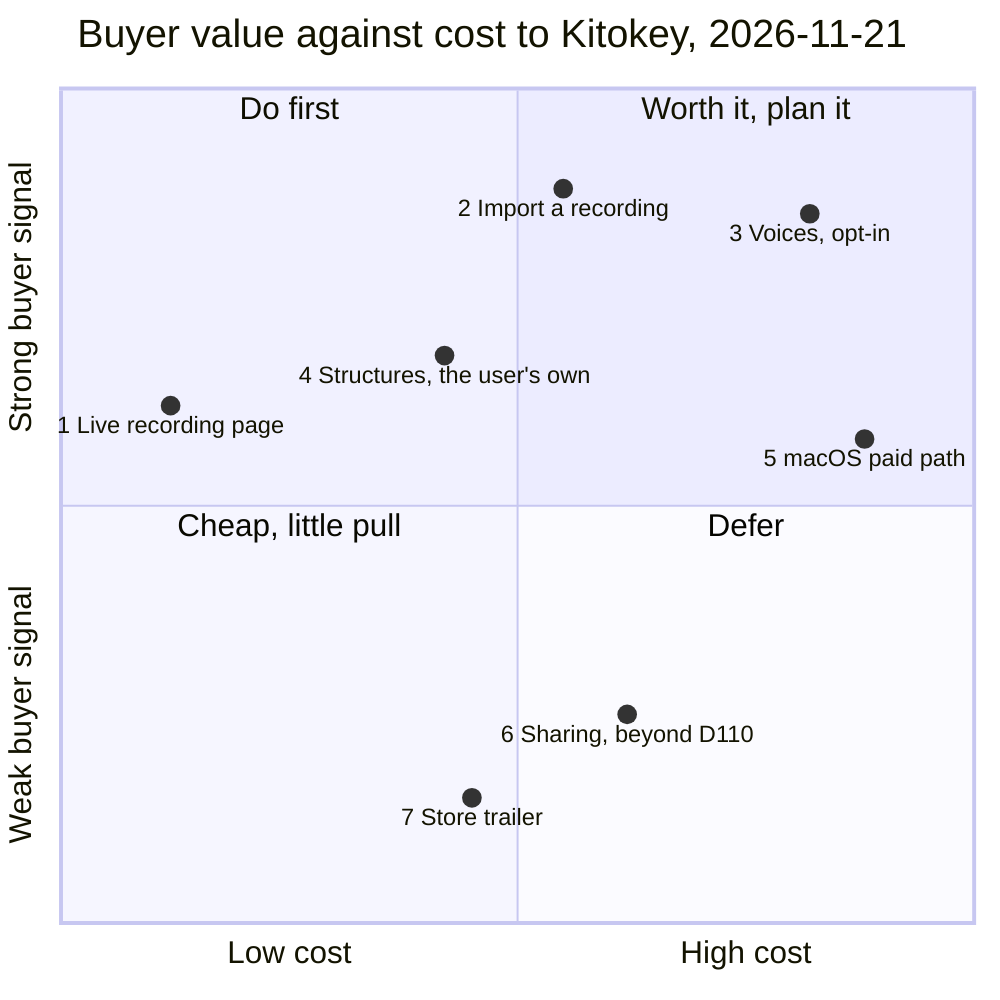

# Cycle 12's priorities — a discovery, 2026-11-21

> A discovery round (`.nstack/playbooks/discovery.md`) on one question: **which of seven candidates should
> cycle 12 build first, for a buyer?** Stages 1–4 by the framer; stage 5 is sam's, as the challenger; stage 6
> is the decider's. It builds on the market reviews of [2026-10-26](2026-10-26-market.md),
> [2026-10-30](2026-10-30-market.md), [2026-11-03](2026-11-03-market.md),
> [2026-11-06](2026-11-06-market.md) and [2026-11-13](2026-11-13-market.md), and repeats them only where
> something moved.

## The ranking, first

**Legend** — x: the framer's cost estimate, read from the repository (S under two days, M one deliverable,
L more). y: the strength of the buyer signal found in §2: strong = a rival says in its own words it is the
most requested, or several vendors charge for it; weak = requests with no reactions, or a platform's own data
showing no lift. Quadrants are the framer's reading, not a measure.

| # | Candidate | Buyer signal (§2) | Cost | Recommendation for cycle 12 |
|---|---|---|---|---|
| 1 | **Live time and levels on a meeting's page while it records** (#1076, #780) | Moderate, indirect: users never ask for a meter, they report the silent one-sided recording it prevents | **S** — the bar's meters and clock exist (`levels.rs`); the page does not read them | **First**: a trust fix, and it brings back the Store's recording screenshot (#1073) |
| 2 | **Import a recording** (spike S2) | **Strong**: Meetily's « most requested feature on GitHub and Discord »; Granola « no plans »; Fathom none; Otter caps it at 3 for life on Basic | **M–L** — spike S2 (symphonia), an expand of the session-audio contract, the shell's gesture | **Second**: the strongest differentiator against the cloud leaders, and already in the charter's vocabulary (« a recorded or imported conversation ») |
| 3 | **Tell voices apart**, opt-in (spike S1) | **Strong**: the top request at Meetily, Granola (vendor's words) and Notion (rival-curated); paywalled at Meetily, Superwhisper, Anarlog | **L** — spike S1, models and their licences, the `voice` field already in transcript/v1 | **Third, after import**: Kitokey already splits Me / Others by track; diarization pays where one track holds many voices — an import, a room |
| 4 | **Structures**: the user's own, beyond D111's six | Moderate–strong: Meetily #243 (11 👍), four vendors charge for custom templates | **M** — once D111 (#1041–#1043) is merged | **Fourth**: finish D111 in cycle 11; cycle 12 adds a structure the user writes, and the summary's language |
| 5 | **macOS paid path** (ADR-0017) | Moderate: one-time $49–99 is the niche's norm; no conversion data | **L** — four code deliverables, and the decider's gestures first (FastSpring's quote, KYC, Apple's $99 programme) | **In parallel, gated on the decider's gestures**: revenue, not pull; the code waits for the quote |
| 6 | **Sharing**, beyond D110's webhooks (OAuth: Notion, Slack) | **Weak** as demand from local-tool users (0 reactions on every request found); moderate as parity with the cloud | **M–L** for OAuth, with a secret problem (cycle 11, *Reaching a channel without a backend*) | **Finish D110 in cycle 11; nothing more in cycle 12** |
| 7 | **Store trailer and hero art** | **Weak**: Microsoft's only figure is « up to 11 % » from 2018; Apple's own test showed no lift | **M** — the screencast spike in headless GNOME | **Last**, as the plan already says: filmed after 1–3 land |

**What this changes in the coordinator's working hypothesis** (1 sharing, 2 structures, 3 import, 4 live
recording page): sharing falls to 6 — no buyer signal for it in local tools, and D110 already ships the
webhooks a local user asks for; the live recording page rises to 1 — cheapest, and it unblocks a Store asset;
import rises to 2.

---

## 1. Intake

*Unconfirmed: the decider confirms or corrects this paragraph on the pull request.*

Kitokey is a desktop application that records a meeting on the user's own computer — microphone and system
sound, no bot, no account —, transcribes and summarises it with local models or a service the user names, and
hands the result over; free on Linux, sold once on macOS and Windows (charter; PDR-0001). Cycle 11 makes it
ready for the Microsoft Store and lets a meeting leave the app. **The question of this round**: of seven
candidates — sharing (D110), structures (D111), import a recording (S2), voices (S1), live time and levels on
the recording page, the macOS paid path, the Store trailer — which give a buyer the most reason to choose
Kitokey, for what they cost, so that the decider frames cycle 12 from a ranked list (plan item 4).

- **Language**: English, rule 1 of `docs/project/rules/always.md` (2026-10-12). Nothing to ask.
- **Asked of or promised to someone outside the team**: nothing by this round. ADR-0017 lists a written quote
  from FastSpring as the decider's first gesture; whether it was asked is not in the repository — open
  question 1.

**Open questions:**

1. Has FastSpring been asked for its quote, and when? It dates candidate 5.
2. Who is the buyer cycle 12 aims at: the charter's three users, or a stranger met on the Store? The ranking
   assumes the stranger (the Store is cycle 11's goal); the three users' own success criteria may weigh
   otherwise.

## 2. Research

Run on **2026-11-21** with the agent runtime's web search and page fetch — the tooling profile names no
research tool. Four searches ran in parallel; their raw notes are not kept in the repository, the sources
they cite are. **Limits**: Reddit, G2, Capterra and Medium refused automated reads; Reddit threads appear only
where a page that links them was read, marked *rival* or *secondary*. Hacker News was read through its
Algolia API. No product was installed or run.

**Markers.** *Vendor*: a company about itself. *Rival*: a competitor about another. *Secondary*: press, a
review site, a forum. *Search only*: seen in a search result, the page not opened. **F** a page states it ·
**I** the framer's inference · **U** uncertain.

### 2a. What moved since the review of 2026-11-13

| Earlier record | Now | Source |
|---|---|---|
| MacWhisper: meeting recording groups all other participants as one speaker (2026-11-13) | **F** v15.2 (2026-09-23) adds live meeting transcripts and Nemotron 3 diarization up to 8 speakers; 15.3 lets the user choose Nemotron or Pyannote; **15.11 warns during a recording when the microphone is disconnected, muted or silent** (first seen 2026-11-17). **Our record is out of date** | [9to5mac, 2026-09-23](https://9to5mac.com/2026/09/23/macwhisper-update-brings-real-time-meeting-transcripts-improved-speaker-recognition-more/) *secondary*; [release notes](https://macwhisper-site.vercel.app/release_notes.html) **U** *vendor (assumed)* |
| Notion AI Meeting Notes: Business and Enterprise only | **F** Still; and from **2026-12-01** meeting notes consume the monthly Standard credits, about 10 per hour of meeting (1,500 a month per seat). **F** It accepts uploaded audio (AAC, M4A, MP3, WAV) | [Notion help: credits](https://www.notion.com/help/standard-select-and-notion-credits-eligible-features), [AI meeting notes](https://www.notion.com/help/ai-meeting-notes) *vendor* |
| Otter: prices only | **F** Imports capped: **3 for the account's lifetime on Basic, 10 a month on Pro**; 30 min a conversation on Basic, 90 on Pro. **F** $320M of non-equity financing, 40M+ users claimed (2026-10-20) | [otter.ai/pricing](https://otter.ai/pricing) *vendor*; [SiliconANGLE, 2026-10-20](https://siliconangle.com/2026/10/20/otter-ai-raises-320m-in-funding-for-its-ai-meeting-assistant/) *secondary* |
| Fireflies: amounts only on rival pages | **F** Its own help gives them: Pro $10 annual / $18 monthly, Business $19 / $29. **F** The Free plan went from « unlimited » to « limited » AI summaries, 20 credits (observed 2026-10-05). **F** Its bot-free capture keeps no audio and has **no speaker labels** | [Fireflies guide, plans](https://guide.fireflies.ai/articles/3734844560-learn-about-the-fi) *vendor* **U** (the address as the search recorded it); [usagepricing, 2026-10-05](https://www.usagepricing.com/blueprint/activity/fireflies-ai-2026-10-05-free-plan-ai-credits) *secondary*; [Fireflies guide, desktop audio](https://guide.fireflies.ai/articles/9115463123-does-the-desktop-app-save-an-audio-recording) *vendor* |
| Fathom: acquired by Superhuman (2026-09-14) | **F** Prices unchanged; nothing said on the free plan or data. **F** It does « not support uploaded calls » — « on our product roadmap! ». **F** Bot-free on Windows is a « limited Microsoft Teams alpha » (2026-11-10). **F** iOS app (October) | [fathom.ai/pricing](https://www.fathom.ai/pricing), [help 6049729](https://help.fathom.video/en/articles/6049729), [help 11577345](https://help.fathom.video/en/articles/11577345) *vendor* |
| Not recorded | **F** Two new local, account-free, open-source rivals: **Yogurt** (MIT; Windows, macOS, Linux; Show HN 2026-11-11, 307 points, 118 comments) and **Minute** (a Show HN seen 2026-11-16, page not opened) | [HN 50454625](https://news.ycombinator.com/item?id=50454625) *secondary*; [HN 50513006](https://news.ycombinator.com/item?id=50513006) *secondary* |

### 2b. The seven products today

| Product | What it does | Price read 2026-11-21 | What its users complain about, most cited first | Where it goes | Source |
|---|---|---|---|---|---|
| **Granola** | Bot-free notepad merging the user's notes and a transcript; keeps no audio; macOS, Windows, iOS, Android, no Linux | Basic $0 (30 days of history) · Business $14 · Enterprise $35 a user a month; unchanged | Privacy and training on data (~8 sources, HN 2026-09 to 11); recording others without telling them (Trustpilot 2026-11-06; *Chamberlain v. Granola*, filed 2026-07-30, allegations); telling voices apart (rival count 8); the 30-day history wall (HN 2026-06-14); **no audio kept, no import: « no plans »** | Agents and context: MCP, « agent brief » (2026-11-11), Snapshots (2026-10-06) — not capture | [pricing](https://www.granola.ai/pricing), [feature requests](https://docs.granola.ai/help-center/feature-requests), [agent brief](https://www.granola.ai/blog/introducing-your-agent-brief) *vendor*; [Trustpilot](https://www.trustpilot.com/review/granola.ai), [HN 50464165](https://news.ycombinator.com/item?id=50464165) *secondary*; [MetaWhisp](https://metawhisp.com/blog/granola-reddit-reviews/) *rival* |
| **Otter** | Bot that joins, plus a bot-free desktop app (2025-10-07); agents by trade | Basic $0 · Pro $8.33 annual / $16.99 · Business $19.99 / $30; unchanged list prices | **Billing and cancellation** (~20: charged after cancelling, trial converted without notice, Trustpilot and App Store 2026-10 to 11); plan caps incl. imports (~9); **notes emailed to every attendee without consent** (~5); the bot inviting itself (~4); voices mixed up (~6) | Enterprise sales, 31 languages (2026-11-10), in-call coaching for all paid plans (2026-10-27) | [pricing](https://otter.ai/pricing), [languages](https://otter.ai/blog/otter-ai-announces-its-biggest-multilingual-leap-yet-27-new-languages-and-multilingual-capabilities) *vendor*; [Trustpilot 1–2★](https://www.trustpilot.com/review/otter.ai?stars=1&stars=2), App Store reviews *secondary* |
| **Fireflies** | Bot, or a bot-free desktop capture without audio or speakers | Pro $10 / $18 · Business $19 / $29 · Enterprise $39 annual | **Billing and cancellation** (~22, Trustpilot 2026-11-01, 2026-11-03); unwanted recap emails and auto-join (~8); recording fails or joins at random (~9); speaker attribution (~5); paywalling what was free (~4) | « AI teammate » Fred and a hardware device, Fly (2026-11-12, no price) | [Trustpilot 1–2★](https://www.trustpilot.com/review/fireflies.ai?stars=1&stars=2) *secondary*; Fireflies guide *vendor* |
| **Notion AI Meeting Notes** | A block in Notion; desktop captures system sound and microphone; uploads accepted | Business €19.50 a member a month (EUR-served page); metered by credits from 2026-12-01 | Speaker labels missing or wrong (rival count 24); the Business-only gate (rival count 20); transcription stopping mid-meeting; a call that « missed the other speaker entirely and gave no warning » | Agents triggered by a summary (2026-09-15); credits | [help](https://www.notion.com/help/ai-meeting-notes), [pricing](https://www.notion.com/pricing) *vendor*; [MetaWhisp](https://metawhisp.com/blog/notion-ai-meeting-notes-review/), [tl;dv](https://tldv.io/blog/notion-ai-meeting-notes-review/) *rival* |
| **tl;dv** | Bot for video; bot-free desktop is audio only; notes emailed after the call | Pro €18 annual / €29 · Business €29 / €39; unchanged | Notes not delivered and templates that do not apply (Trustpilot 2026-11-17); locked out of recordings for weeks (4, 2026-03 to 06); billing after cancelling; a « free » plan with a trial to claim. **F** A Firestore exposure of meeting metadata disclosed 2026-08-04 | No dated launch found since September | [Trustpilot](https://www.trustpilot.com/review/tldv.io) *secondary*; [tl;dv on the exposure](https://tldv.io/blog/our-thoughts-on-the-darkreading-com-article/) *vendor* |
| **Fathom** | Bot, or bot-free on Mac; free with unlimited recording | Free · Premium $16 / $20 · Team $15 / $19 · Business $25 / $34 · Enterprise $35 annual only | **No upload of a recording**, no phone calls (Product Hunt ~2026-04; iOS 2026-10-15); recording without the user knowing (Trustpilot 2025-12, 2026-02); summary formats too rigid (HN 2026-11-15); no bulk download | Admin controls, consent message enforced by admins (2026-09), iOS, points programme (2026-11) | [pricing](https://www.fathom.ai/pricing), [help 6049729](https://help.fathom.video/en/articles/6049729) *vendor*; [Product Hunt](https://www.producthunt.com/products/fathom/reviews), [Trustpilot 1–2★](https://www.trustpilot.com/review/fathom.video?stars=1&stars=2) *secondary* |
| **MacWhisper** | Local transcription on macOS: files, dictation, meetings with speakers since v15 | **€64 once** (Gumroad, lifetime updates); Mac App Store « Whisper Transcription »: Pro Lifetime $89.99–99.99, and subscriptions | Bugs and crash recovery (HN 2026-06, 07); speaker quality (App Store, before v15); **pricing confusing across two storefronts**, a trial that asks for a deferred subscription; slow development | A meeting recorder inside a transcription app: live meetings, diarization, warnings | [macwhisper.com](https://macwhisper.com) *vendor*; [App Store listing](https://apps.apple.com/us/app/whisper-transcription/id1668083311) *vendor*; [HN 48533220](https://news.ycombinator.com/item?id=48533220) *secondary* |

### 2c. Demand for each candidate

| Candidate | Evidence | Source | Reading |
|---|---|---|---|
| Import a recording | **F** Meetily 0.3.0 (2026-03-03): « The most requested feature on GitHub and Discord is here », free edition, MP3, WAV, M4A, OGG, FLAC, MKV, WebM, WMA; Pro 1.5.0 adds video (MP4). **F** Meetily #238: 9 👍. **F** Bluedot gates unlimited imports on Business, Superwhisper gates file transcription on Pro; Krisp: unlimited on all tiers | [Meetily 0.3.0](https://meetily.ai/releases/community/0.3.0), [Pro 1.5.0](https://meetily.ai/releases/pro/1.5.0) *vendor*; [#238](https://github.com/Zackriya-Solutions/meetily/issues/238) *secondary*; [Bluedot](https://www.bluedothq.com/pricing), [Superwhisper](https://superwhisper.com/docs/billing/plans.md), [Krisp](https://krisp.ai/pricing/) *vendor* | **Strong** |
| Voices | **F** Meetily (2026-09-09): « At the top of almost every list: speaker diarization »; #226: 15 👍, the most-reacted open feature request after Linux support (32 👍); #230: 18 comments. **F** Granola: speaker tags « one of our most-requested features ». **F** HN on Yogurt (2026-11-11): « I have what's been said, but not who said it ». **F** Paywalled at Meetily (Pro), Superwhisper (Pro), Anarlog (« better » in Pro) | [Meetily blog](https://meetily.ai/blog/why-we-chose-experience-over-features) *vendor*; [#226](https://github.com/Zackriya-Solutions/meetily/issues/226) *secondary*; [Granola FAQ](https://docs.granola.ai/help-center/feature-requests) *vendor*; [HN 50456344](https://news.ycombinator.com/item?id=50456344) *secondary* | **Strong** |
| Structures | **F** Meetily #243, configurable templates (mostly for the output language): 11 👍; #413, output language: 7. **F** Custom templates paid at Meetily, Anarlog, Jamie (1 / 3 / unlimited), Bluedot; built-in kinds are free nearly everywhere. **F** Granola cannot make another template the default | [#243](https://github.com/Zackriya-Solutions/meetily/issues/243) *secondary*; [Jamie](https://www.meetjamie.ai/pricing), [Granola FAQ](https://docs.granola.ai/help-center/feature-requests) *vendor* | **Moderate–strong**; the paid step is the user's own structure and the language |
| Live time and levels | **F** Meetily #254 (mic not recorded on macOS): 12 👍, 17 comments; #701 (Linux): system sound « silently missing… no error is shown anywhere ». **F** Granola's help is built around « If gray is missing, it isn't hearing the meeting app ». **F** MacWhisper 15.11 warns on a silent mic. **F** No request for a timer or meter as such was found | [#254](https://github.com/Zackriya-Solutions/meetily/issues/254), [#701](https://github.com/Zackriya-Solutions/meetily/issues/701) *secondary*; [Granola troubleshooting](https://docs.granola.ai/help-center/troubleshooting/transcription-issues) *vendor* | **Moderate, indirect**: little pull, a high cost when it is missing |
| macOS paid path | **F** One-time prices: MacWhisper €64; Talat $49 before 1.0, $99 at 1.0, also on Setapp from $9 a month. **F** Subscriptions coexist: Superwhisper $84.99 a year or $249.99 for life; Meetily $120 a year; Anarlog $140 a year. **U** Anarlog reportedly announced, then withdrew, a shutdown as « unprofitable » (rival, 2026-11-12; its README denies it) | [macwhisper.com](https://macwhisper.com) *vendor*; [TechCrunch, 2026-03-24](https://techcrunch.com/2026/03/24/talats-ai-meeting-notes-stay-on-your-machine-not-in-the-cloud/) *secondary*; [Setapp](https://setapp.com/apps/talat) *vendor*; [Voibe](https://www.getvoibe.com/resources/anarlog-alternatives/) *rival* | **Moderate**; no conversion data by price model was found |
| Sharing | **F** Meetily #595 (webhook): 0 reactions; OpenWhispr #2528 (copy button), #3277 (Notion, Obsidian): 0. **F** Every cloud rival ships Slack and Notion, often paid (Granola: Slack on Basic, Notion on Business). **F** Over-sharing is a complaint: Granola's public links (press, 2026-04-02), Otter's and Fireflies' recap emails | [#595](https://github.com/Zackriya-Solutions/meetily/issues/595), [#2528](https://github.com/OpenWhispr/openwhispr/issues/2528) *secondary*; [Granola sharing](https://docs.granola.ai/help-center/sharing/sharing-notes.md) *vendor* | **Weak** as local demand; parity for cloud |
| Store trailer | **F** Microsoft: a trailer shows at the top only with a 16:9 Super hero art; no conversion figure on that page; its blog said « up to 11% » more downloads **in 2018**. **F** Apple's own Product Page Optimization case: « The original product page without an app preview video outperformed the treatment » (iOS, not macOS) | [Microsoft Learn, updated 2026-08-24](https://learn.microsoft.com/en-us/windows/apps/publish/publish-your-app/msix/screenshots-and-images), [Windows blog, 2018-07-25](https://blogs.windows.com/windowsdeveloper/2018/07/25/top-4-ways-to-optimize-your-microsoft-store-listing/), [Apple PPO](https://developer.apple.com/app-store/product-page-optimization/) *vendor* | **Weak** |

### 2d. Where the market goes

- **F** The cloud side consolidates into suites and CRMs: Salesforce–Momentum (March), Aircall–Piper (June),
  Superhuman–Fathom (September); Otter raises $320M to double its enterprise business ([Gladia,
  2026-10-28](https://www.gladia.io/blog/ai-notetaker-market-funding-and-acquisitions) *secondary, a vendor of
  speech APIs*). **I** The leaders move up to agents and teams; the single user who wants a meeting on their
  machine is not where they go.
- **F** The leaders meter and gate: Notion's credits from 2026-12-01, Fireflies' free plan cut (2026-10-05),
  Otter's import caps, Granola's 30-day history. **F** Billing and cancellation is the first complaint at Otter
  and Fireflies (~20 sources each). **I** « Paid once, nothing capped » answers the field's loudest complaint.
- **F** The local side is crowded and free: Yogurt, Minute, Meetily Community, Google's Foresight (2026-10-08,
  Apple Silicon only) ([TechCrunch](https://techcrunch.com/2026/10/08/google-releases-a-new-local-first-granola-competitor/)
  *secondary*). **I** « Local » alone no longer sells; a local tool wins on reliability, voices, import and
  structures — the four that rivals charge for.
- **Legal and regulatory**: this round read no law. The recording-consent constraint is the charter's
  (art. 226-1 of the French Penal Code, read at Légifrance on 2026-10-12). The suits named here (*Chamberlain
  v. Granola*, *In re Otter.AI*, the BIPA claims against Fireflies) were read only in press and rival pages:
  **assumption** that a stored voiceprint carries a biometric risk, not read at a primary source.

## 3. Define

- **Users.** The charter's three — the decider on Fedora, a colleague on Windows, one on macOS — and, from
  cycle 11, a stranger who finds Kitokey on the Microsoft Store. The stranger's needs below are **quoted from
  other products' users** (§2), never met: an assumption about Kitokey's buyer.
- **Their problem, in their words.** « tl;dv fails at the most basic thing I'm paying for » (Trustpilot,
  2026-11-17); « I was charged automatically when the free trial ran out » (Otter, 2026-11-05); « I have
  what's been said, but not who said it » (HN, 2026-11-11); system sound « silently missing… no error is shown
  anywhere in the UI » (Meetily #701, 2026-08-07); Granola: « we don't have plans to start supporting video or
  audio recordings ».
- **Constraints.** One builder with agents, no budget (charter); four agents and a coordinator; cycles of two
  weeks; nothing that leaves the computer without the user's gesture (PDR-0007); a key never supplied by
  Kitokey; the decider's gestures gate the macOS path (ADR-0017).
- **Success signals** *(proposed, for the decider to set)*: for 1, the Store's recording screenshot is back
  and no « was it recording? » report from the three users in the cycle after; for 2, the three users each
  import one file of their own and keep the result; for 3, a user renames estimated voices on an import rather
  than redoing it by hand; for 4, one of the three writes a structure of their own and uses it twice.

**Open questions:** 3. Do the three users import files today, and from what (a phone, a recorder, a call's
own recording)? It would test candidate 2 more cheaply than any spike.

## 4. Shape

**The value hypothesis.** A person who records meetings will choose Kitokey over a cloud note-taker when it
does on their own machine, for one price paid once, the three things the cloud leaders cap, refuse or charge
for — **taking a recording they already have, telling its voices apart, and showing while it records that both
sides are heard**. Proven wrong if, once import and the live page ship, none of the three users imports a file
of their own within the cycle after, or if the Store's trial-to-purchase rate does not differ from the
listing's before (the measure exists once D102 sells).

**Each candidate's hypothesis** — stated so that it can be refuted:

| # | Hypothesis | Refuted if |
|---|---|---|
| 1 | Seeing the time run and both levels on the meeting's page removes the doubt « is it recording? » | A user still reports a one-sided or empty recording they did not notice while it ran |
| 2 | A buyer brings files: an interview recorded on a phone, a call recorded by Teams or Zoom | No user imports a file in the cycle after it ships |
| 3 | Estimated voices, renamable, are worth more than none on an imported or room recording | Users turn it off, or rename every line by hand |
| 4 | A user writes the structure their own meeting needs once the six built-in ones are there | Nobody writes one; the built-in six suffice |
| 5 | One price on macOS, with a trial that asks for nothing, sells | No purchase in the weeks after the build ships, with the trial reached |
| 6 | Sharing beyond a webhook brings buyers | — not proposed for cycle 12 |
| 7 | A trailer converts Store visitors | — measured only if Partner Center shows the listing's conversion before and after |

**A short press release** — *imagined*, dated at a placeholder launch, **2026-12-18**:

> **Kitokey now takes the recordings you already have.** Drop an interview from your phone or a call your
> video tool recorded onto Kitokey: it transcribes it on your computer, tells its voices apart if you ask, and
> writes the summary in the structure your meeting needs. While Kitokey records, the meeting's page shows the
> time and both sides' levels, so you know it hears the call. One price, paid once; nothing capped; nothing
> leaves your computer unless you send it. — « I had six interviews on my phone and no subscription left to
> transcribe them. » *(imagined quote)*

Whether it convinces the decider: to record at stage 6.

**No-gos** — all *proposed* by the framer; the charter's out-of-scope list stands:

- **No cap** on imports, meetings, minutes or history in a paid build — the rivals' caps are their users'
  complaint (§2b).
- **No summary sent to participants** by Kitokey, and no recap e-mail: the user's gesture only (PDR-0007).
- **No public link**, no hosted page of a meeting.
- **No voiceprint kept across meetings**: voices are estimated per meeting, labelled as estimated, renamed by
  the user; nothing identifies a person from one meeting to the next (§2d, assumption on biometric law).
- **No second storefront for macOS with its own price** (the Mac App Store beside a direct sale) before a
  PDR: MacWhisper's two prices are its users' complaint.
- **No trailer before the features it would show** are merged; no text or UI in the hero art (Microsoft's
  rule).
- **No OAuth sharing** (Notion, Slack) in cycle 12.

## 5. Challenge

*sam, session wholeheard-sam-a2, 2026-11-21 — challenger; reads section 1 as written, unconfirmed. Sources
already in §2 are not repeated; the two read in this round are marked as §2 marks them.*

**In short.** Import at 2 and the no-gos hold. Two rankings do not hold as argued: **#1 is ranked by its cost,
not by a buyer's value** — most of the trust it claims already ships; and **sharing at 6 rests on a population
that is biased against sharing** and on the legend applied unevenly. Neither objection blocks a go; both change
what cycle 12 is built around.

### 5a. Pre-mortem — cycle 12 shipped as ranked; a year later Kitokey sells almost nothing on the Store

| Plausible reason | Risk |
|---|---|
| The first item was cheap, not wanted: the page now shows what the bar and the silence notice already showed, and no buyer noticed the difference | value |
| The Store's buyer is a Windows office worker whose notes must reach Teams, Outlook, OneNote or a CRM; Kitokey hands over a webhook and a folder, and they pick a cloud tool that does it in one click | value |
| Import shipped, but the files buyers bring are Teams' and Zoom's MP4 recordings and phone M4A/AAC; the decoder or the contract took one format at first, and the first import a stranger tried failed | feasibility |
| Voices needed a model whose licence, size or gated download did not fit a free Linux build and a paid Store build; it slipped a cycle, and import without voices disappointed on room recordings | feasibility, viability |
| Every success signal was read on three users who already knew the product; « imported one file » was true and said nothing about a stranger paying | value (test design) |
| Free local rivals (Meetily Community, Yogurt, Foresight) shipped import and voices first and for free; « paid once » competed with « free » rather than with « capped » | viability |

### 5b. The four risks — the riskiest assumption of each, and the cheapest test that refutes it

| Risk | Riskiest assumption | Cheapest test · how long · refuted if *(threshold proposed, the decider sets it)* |
|---|---|---|
| **Value** | The Store's buyer wants local capture more than a hand-off to where their work already is | Two lines on the Store listing's draft — one leading with « takes the recordings you have », one with « sends to Teams/Notion » — read by five people outside the team who use a note-taker at work; **one day**. Refuted if most choose hand-off first |
| **Usability** | A stranger can import a phone or Teams recording without help | Five real files (Teams MP4, Zoom M4A, iPhone voice memo, an Android recorder, a WAV) through spike S2's decoder before any UI; **half a day**. Refuted if two or more of the five fail to decode |
| **Feasibility** | A diarization model fits Kitokey's builds: its licence allows redistribution in a paid build, it runs on a laptop CPU in less time than the meeting, it needs no gated download | Spike S1's first hour: read each candidate's licence and download terms at the source, before any code. Refuted if no candidate is redistributable without a per-user acceptance |
| **Viability** | A buyer pays once for what free local rivals give — the ranking assumes caps are the competition | Price check on the three free local rivals' import and voices, at their pages, the day cycle 12 is framed. Refuted if all three give both free: then the paid reason must be reliability and structures, not import and voices |

### 5c. Counter-evidence and objections, by candidate

**#1, live time and levels on the page — value or cheapness?** Cheapness, as argued.

- **F** Kitokey already does what §2c credits MacWhisper 15.11 with. Capture announces a silent source after 10
  s (`modules/capture/src/main.rs:50`, `SILENT_AFTER`), and the shell turns it into a notice: « Aucun son de
  votre micro — Rien depuis 10 secondes. L'enregistrement continue. » (`modules/shell/src/words.rs:264-270`,
  both sides). The bar shows both meters and the time, and a silent status after two minutes
  (`words.rs:935-942`, D49, D90). The « silent one-sided recording » that the row says #1 prevents is
  prevented today by the notice, and seen in the bar.
- **I** What #1 adds is the same signal in a second place, the meeting's page, and the Store's screenshot
  (#1073). The screenshot is a listing asset, and §2c rates listing assets **weak** (the trailer). Yet #1 sits
  at 0.62 on the buyer axis, above structures' paid-step evidence.
- **Objection.** By the legend's own y-axis, #1 is moderate and indirect, and its argument is the S. Ranking it
  « first » turns a value-for-cost ratio into a value ranking. Keep it as the cycle's small item — it is a
  real inconsistency between page and bar, and the decider asked for live meters on 2026-11-06 (#1076) — but
  not as what cycle 12 is built around. If the trust gap is the point, the smaller test is: did any of the
  three users ever miss the notice? An answer of « no » leaves only the page's consistency.

**#6, sharing falling 1 → 6 — the right population?** No.

- **I** Every demand row for sharing reads issues of **open-source, local-first** tools (Meetily, OpenWhispr).
  Their users chose a tool that keeps everything on the machine, mostly free, many self-hosting. Low demand
  for sending notes out is what that selection predicts, so « 0 reactions » measures the population, not the
  buyer. §3 says the buyer cycle 12 aims at is the Store's stranger. That buyer is not in those trackers.
- **F** The legend's **strong** includes « several vendors charge for it ». §2c itself says Granola charges for
  Notion (Business). Granola's integrations page gates its native integrations **and** Zapier on Business,
  $14 a user a month ([Granola integrations guide](https://www.granola.ai/blog/granola-integrations-complete-guide-connecting-meeting-tools)
  *vendor*, search only). Its feature-request page lists automatic export to an integration as a request it
  is « regularly looking at » ([Granola FAQ](https://docs.granola.ai/help-center/feature-requests) *vendor*,
  already in §2). By the legend, sharing is strong for the cloud buyer and weak for the local user; the table
  reports only the second.
- **F** A vendor survey of 1,000 SaaS users: 87 % would adopt meeting AI if it came inside their current work
  tools ([Nylas](https://www.nylas.com/blog/state-of-meeting-recordings/) *vendor, a seller of integration
  APIs*, search only). This is weak alone, but it points the same way.
- **Objection.** The ranking conflates *demand* with *what to build*. Demand for hand-off is probably real for
  the Store's buyer (assumption, untested — see 5b *value*). OAuth is still right to defer, for reasons §2
  already gives better: the secret problem without a backend, and over-sharing as a top complaint. Keep the
  no-go « No OAuth sharing in cycle 12 ». Replace « weak » with « strong for cloud buyers, untested for ours ».
  And name the smallest hand-off a Windows buyer would use that needs no secret: a summary copied as rich
  text, ready to paste into Teams, Outlook or OneNote — a gesture, no key. Size it against #1, which it may
  beat on value for the same S.

**#2 import, #3 voices.** They hold, with two cautions:

- §2c takes Meetily's GitHub as strong for import and voices, but as a reason to rank sharing low. Its
  population is consistent across the three: the same skew applies to every row.
- §2c's « strong » for voices is mostly vendors' own words about their top request (Meetily, Granola). Kitokey
  already splits Me / Others by track, which §2c credits. The value of S1 therefore depends on import
  shipping first. The ranking says so; the cost line should too: S1 is L **plus** S2.

**#5 macOS** — no objection. It is gated on the decider's gestures and runs in parallel.
**#7 trailer** — no objection.

### 5d. Flaws in stages 1–4

1. **§1, open question 2 decides the ranking, and stages 3–4 answer it both ways.** « The ranking assumes the
   stranger » (§1). But every success signal in §3, and the refutation of the value hypothesis in §4 (« none of
   the three users imports a file »), is read on the charter's three users. A ranking built for the stranger
   and tested on three insiders cannot be refuted by its own test. Choose one before the decision, or give each
   signal a stranger-side reading. One such reading is already proposed in §4: the Store's trial-to-purchase
   rate, once D102 sells.
2. **The legend's y-axis is applied unevenly** (5c, #6): « several vendors charge for it » is counted for
   import, voices and structures, and not for sharing.
3. **§2c « Live time and levels »** omits Kitokey's own silence notice and bar status. They are the baseline
   against which #1's value must be read (5c, #1).
4. **§4's hypothesis 1**, « refuted if a user still reports a one-sided recording they did not notice », can
   hardly fail. The notice already exists, and three users over two weeks will rarely meet the case. Make it
   refutable: name the cases the notice misses and the page would catch, or drop the hypothesis to « page
   consistent with the bar ».
5. **§2d « Local alone no longer sells; a local tool wins on reliability, voices, import and structures — the
   four that rivals charge for »**. The rivals named just before (Yogurt, Meetily Community, Foresight) are
   free. Whether they charge for import and voices is the viability test of 5b. Until it is run, this is an
   inference (**I**), and the ranking leans on it.

**What would change the decision.** If the decider's buyer is the Store's stranger, two things follow: the
hand-off line of 5c (#6) is sized beside #1 before cycle 12 is framed, and the value test of 5b is run. If the
buyer is the three users, the ranking stands except #1's reason, which becomes « consistency with the bar ».

## 6. Decision

*The decider's: go, clarify or kill, with the reasons and the date.*
