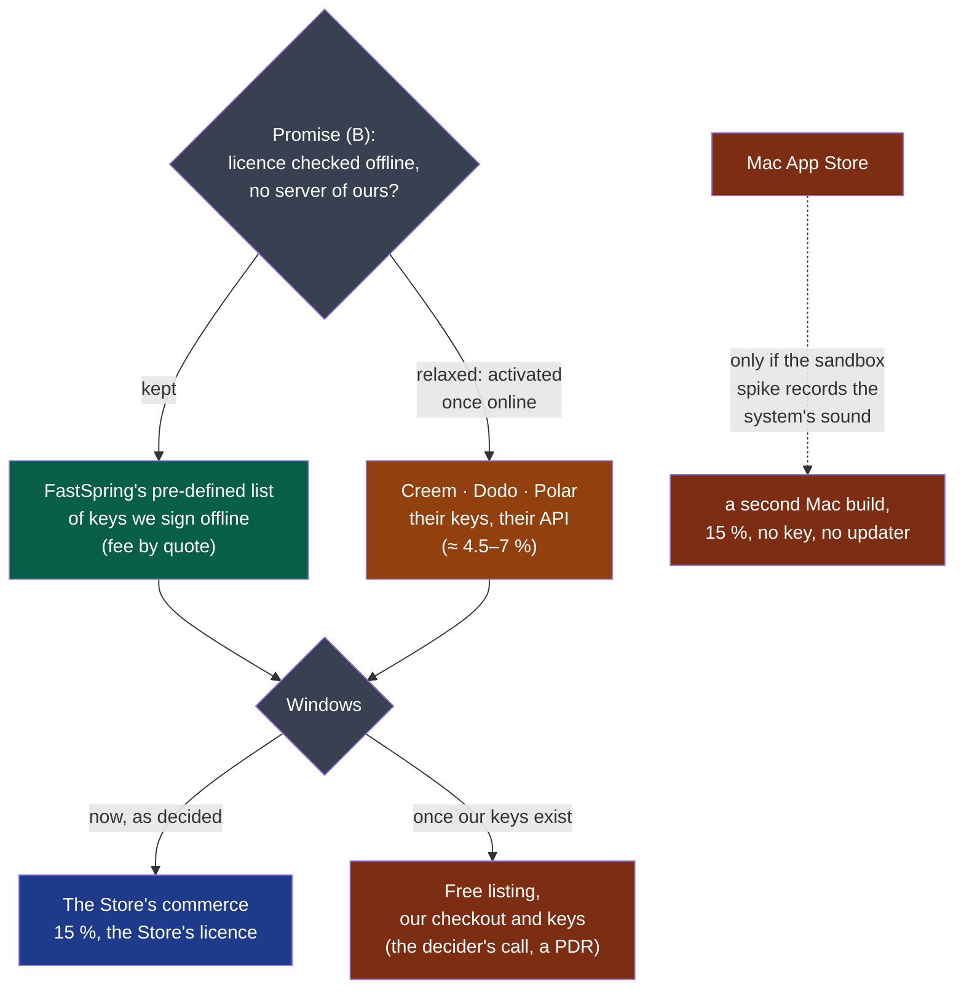

# Kitokey — payments for a portfolio of apps, 2026-11-21

Scope: who sells Kitokey and NapkinStack's next apps (c12c), on macOS and Windows, sold once for €49–69, and
what each choice costs a small company. The question is the decider's (2026-11-21 ~20h15): « kitokey est une
application parmi d'autres que napkinstack - c12c va sortir, il y a peut-être des coûts qui seront mutualisés
entre les apps… limiter les coûts au maximum… bien analyser avant de sélectionner le presta pour les clés et
paiements… réfléchir aussi en termes de visibilité marketing si le choix influe ». The decider's follow-up the
same evening (~20h25) asked whether « pas de compte, rien d'envoyé, aucun serveur à nous » is really a selling
point (§5).

[ADR-0017](../../adr/0017-macos-sold-through-a-merchant-of-record-a-signed-key-checked-offline-tauri-s-updater.md)
is **reopened for study on 2026-11-21, not changed**: its decision stands until the decider decides. This review
holds what the decision will read. It was written by marc (agent, session 55380109), challenged by ines (agent,
session 0b18e549; her section is reproduced unchanged at the end), and kept here at the decider's request so that
it can be resumed.

**Method and markers.** Every price and quote was fetched from its source on **2026-11-21** unless stated.
- *Assumption*: not read at a source.
- *NOT READ*: the page did not load or render.
- *Search result only*: seen in a search excerpt, the page itself not read.
- USD fees are converted at **$1 ≈ €0.94** (*assumption*).
- No product was bought, installed or run for this review.

**Legend**:
- grey: a question the decider answers;
- green: ADR-0017's decision, kept for the portfolio;
- amber: the option if promise (B) is relaxed;
- blue: what Windows does today;
- red: open, waiting on a test or a decision.

## In short

**Recommendation.** Keep ADR-0017's shape and widen it to the portfolio:
- one merchant account for every app;
- one key format of ours, Ed25519 signed offline, with a `product` field added;
- one Apple membership;
- each next app costs one product line at the merchant, one batch of keys and one public key.

**Which merchant.** Only FastSpring's pre-defined key list holds promise (B), « no account, licence checked
offline », without a server of ours. FastSpring still publishes no price.
- Dodo, the alternative ADR-0017 named, **falls under (B)**: its default keys are its own, checked online
  (`/licenses/validate`), as Creem's and Polar's are (corrected after ines' challenge).
- If FastSpring's written quote is not near Paddle's level (≈ 5.8 % at €59), the choice becomes the decider's
  product call:
  - relax (B) to « activated once online, then offline », which opens Creem (≈ 4.5 %), Dodo or Polar;
  - or keep (B) and pay for a relay.

**Marketing.** No channel that also sells fits Kitokey as it is:
- the Mac App Store needs a sandbox where recording the system's sound is unproven, a second build, and 15 %;
- Setapp forbids licence checks and an updater of one's own, and is Mac only;
- Gumroad Discover takes 30 %.

Visibility does not decide the merchant. A bundle across our apps does, a little: FastSpring documents bundles.

## 1. Per-sale cost at €59 (the PDR-0001 midpoint), read 2026-11-21

USD fees are taken at **$1 ≈ €0.94** (*assumption*, not read). VAT is excluded: each merchant of record collects
it on top.

| Seller | Fee as read | € per sale, EU card | € per sale, card outside the EU | Monthly | Source |
|---|---|---|---|---|---|
| FastSpring | « revenue-sharing », « fees vary depending on the transaction volume »; quote only | ? | ? | none quoted | [pricing](https://fastspring.com/pricing/) |
| Paddle Billing | « 5% + 50¢ per Checkout transaction » | 3.42 (5.8 %) | 3.42 | « No monthly fees » | [pricing](https://www.paddle.com/pricing) |
| Stripe Managed Payments | « 3,5 % » on top of the card fee: EEA « 1,5 % + 0,25 € », international « 3,15 % + 0,25 € », « + 2 % » with currency conversion | 3.20 (5.4 %) | 4.17 (7.1 %), +1.18 if converted | none | [pricing](https://stripe.com/pricing), [Managed Payments](https://docs.stripe.com/payments/managed-payments) |
| Creem | « 3.9%+40¢ », « No international card fees », « Monthly fees $0 » | 2.68 (4.5 %) | 2.68 | 0 | [pricing](https://www.creem.io/pricing) |
| Dodo | « 4% + 40c », « International… +1.5% »; payouts under $1,000: $5 | 2.74 (4.6 %) for US cards; European buyers count as international: 3.62 (6.1 %) | 3.62 | 0 | [pricing](https://dodopayments.com/pricing) |
| Polar Starter / Pro | « 5% + 50¢ » / « $20 /mo » « 3.8% + 40¢ »; « +1.5% for international cards (non-US) » | Starter 4.31 (7.3 %) · Pro 3.50 (5.9 %) | same | 0 / ≈ €19 | [pricing](https://polar.sh/resources/pricing) |
| Gumroad | « 10% + $0.50 »; Discover: « 30% » | 6.37 (10.8 %) · Discover 17.70 | same | 0 | [pricing](https://gumroad.com/pricing) |
| Mac App Store | « 15% on paid apps » (Small Business Program, under $1 M proceeds across all apps) | 8.85 | 8.85 | $99 a year | [SBP](https://developer.apple.com/app-store/small-business-program/), [programs](https://developer.apple.com/programs/) |
| Setapp | single-app « 25% on one-time sales »; membership: « 70% revenue share », « Revenue is shared based on app usage » | 14.75 single-app; membership not computable | same | — | [developers](https://setapp.com/developers), [overview](https://docs.setapp.com/docs/setapp-marketplace-overview) |
| Keygen, beside a merchant | « never take a percentage »; Dev tier free « up to 100 active licensed users »; paid tiers **NOT READ** (the slider did not render) | + its tier | | ? | [pricing](https://keygen.sh/pricing/) |
| Microsoft Store (Windows, already decided; Kitokey uses Microsoft's commerce, `StoreContext`, D83) | « pay a competitive fee of 15% for apps and 12% for games »; « keep 100% » with one's own commerce (read by ines; page 2023-12, updated 2024-07: to re-check in Partner Center; the App Developer Agreement PDF v8.11 did not decode) | 8.85 | 8.85 | free account ([ACC](https://learn.microsoft.com/en-us/windows/apps/publish/prepare-developer-account)) | [why the Store](https://learn.microsoft.com/en-us/windows/apps/publish/publish-your-app/why-distribute-through-store) |

Between the **direct merchants** the difference is **under €1 a sale**. The stores are another order: **every Windows
sale already costs €8.85** (15 %), the Mac App Store's figure, so the Mac App Store's 15 % is no worse than what
Kitokey pays first. At 1,000 sales
a year across the portfolio (*assumption*: an illustration, not a forecast), Creem against Paddle saves ≈ €740 a year.
That is less than any day of rework the wrong choice costs.

## 2. Fixed costs, and what one account can share across N apps

| Item | Shared across apps? | Cost | Evidence |
|---|---|---|---|
| Apple Developer Program | One membership per organisation; that it covers all its apps is the convention, but **not stated** on the pages read (*assumption*) | $99 a year | [programs](https://developer.apple.com/programs/) |
| Microsoft developer account | Yes (one publisher, several products) | free | [ACC](https://learn.microsoft.com/en-us/windows/apps/publish/prepare-developer-account) |
| Merchant account | Paddle: « sell multiple products »; the others: **not read** (*assumption*: one account, several products) | 0 a month everywhere, except Polar Pro | pages above |
| The DSA trader verification and the payout and tax profile, at each merchant and each store | Once per company per platform, not per app | the decider's time; « up to 48 hours » to validate (Marketplace page) | [DSA](https://learn.microsoft.com/en-us/windows/apps/publish/store-business-verification-reqs), [PAY](https://learn.microsoft.com/en-us/partner-center/account-settings/set-up-your-payout-account) |
| Our signing key, and the tool that signs a batch | Yes: one tool. One key per product, or one key and a `product` field (recommended: one key per product, so a leak costs one app) | 0 | ADR-0017 |
| A licence service (Keygen) | Yes | free up to 100 active users **in total**: too few past the first months | [pricing](https://keygen.sh/pricing/) |
| A relay from the merchant's webhook (Paddle, Stripe or Creem to Keygen or to our signer) | Yes, one for all apps | a server of ours: refused by the promise (§4) | ADR-0017 |

**Does the answer flip with N?**
- **N = 1**: the same answer. The key tool is a day's work either way.
- **N = 3**: the same answer; each next app costs no new account.
- **N = 5**: still the same. Polar Pro's €19 a month pays back against Starter from ≈ 23 sales a month across the
  portfolio, if one Polar organisation sells every product (*assumption*). Keygen's free tier is already exceeded.
- What flips the answer is **(B)**, not N.

## 3. Set-up effort

| | First app | Each next app |
|---|---|---|
| FastSpring + our keys (option 1) | account, DSA, payout and tax (the decider); written quote; the batch signer and the check in the shell (≈ 2–3 days, cycle 12); the checkout's text | a product, a batch pasted, a public key built in: ≈ ½ day |
| Paddle or Stripe + Keygen | the same accounts + Keygen + **a relay** that is not a server of ours, still unfound | a product, a Keygen policy |
| Creem or Polar (if (B) is relaxed) | the accounts; the shell calls their API once at activation and keeps the answer | a product; the same code with another product ID |
| Mac App Store | sandbox spike first (§3 below); a second build without key or updater; App Review | a second build per app |

## 4. Visibility: channels that also sell

| Channel | Discovery | Fits Kitokey today? | Evidence |
|---|---|---|---|
| Mac App Store | Apple's search and editorial — that it brings buyers is an **assumption**: no number read | **Not proven**: 2.4.5 (i) « must be appropriately sandboxed », (vi) no « license keys », (vii) updates only through the store. « To distribute a macOS app through the Mac App Store, you must enable the App Sandbox » ([App Sandbox](https://developer.apple.com/documentation/security/app-sandbox.md)). Its entitlements list `device.microphone` and none for the system's sound. Core Audio taps need `NSAudioCaptureUsageDescription` and a system prompt ([taps](https://developer.apple.com/documentation/coreaudio/capturing-system-audio-with-core-audio-taps.md): the sample page says macOS 26.0+, the `AudioHardwareTap` class 15.0+; ines recalls taps from 14.2, *assumption*: the first release is to re-read, it sets Kitokey's macOS floor). ScreenCaptureKit, the other path, needs `NSScreenCaptureUsageDescription` and screen-recording permission ([ScreenCaptureKit](https://developer.apple.com/documentation/screencapturekit.md)). **No Apple page says whether either works inside the sandbox**: a spike of both | [guidelines 2.4.5](https://developer.apple.com/app-store/review/guidelines/) |
| Setapp | a subscription's catalogue, paid by use | **No**: « Activation and licensing mechanisms », « Proprietary installer and update frameworks » not allowed; Windows « Not supported » | [preparing your app](https://docs.setapp.com/docs/preparing-your-application-for-setapp) |
| Gumroad Discover | Gumroad's marketplace | yes, at 30 % on what Discover brings; its keys are checked online (Gumroad's API page did not render: **NOT READ**) | [pricing](https://gumroad.com/pricing) |
| FastSpring, Paddle storefronts | none found (a channel's discovery is unmeasured everywhere: no number read for any): neither runs a marketplace on the pages read | — | pages above |
| Bundles across our apps | FastSpring: « package multiple products under a single SKU at a single price »; Paddle: « From bundles to seat-based plans » (no rules read) | yes, with option 1 | [FastSpring bundles](https://developer.fastspring.com/docs/create-product-bundles.md) |
| Microsoft Store | Windows' own store, already Kitokey's channel (PDR-0004) | yes | — |

## 5. The promise: what a buyer weighs (the decider's question, ~20h25)

### (A) « The meeting never leaves your computer »: the product's promise, not the payment's

The market divides on it, by their own pages (read 2026-11-21):

| Product | What it says |
|---|---|
| Granola | « doesn't invite a bot », but « Granola uses secure cloud processing », notes « stored in our US-hosted AWS » ([security](https://granola.ai/security)) |
| Otter | « without bots joining the call » on desktop, but AWS « for compute and data storage »; training on « de-identified audio recordings » ([privacy](https://otter.ai/privacy-policy), effective 2026-06-16) |
| Fireflies | a bot that « appears as a visible, named participant »; a bot-free desktop mode ([home](https://fireflies.ai/)) |
| Fathom | « Now available bot-free »; « hosted in the United States » (*summary of its page*) ([fathom.ai](https://fathom.ai/)) |
| MacWhisper | « Process sensitive content locally without data ever leaving your Mac », « No bots joining »; Pro « Pay Once, €64 » ([macwhisper.com](https://macwhisper.com/)) |
| Meetily | « 100% on your device. Audio and data never leave » ([meetily.ai](https://meetily.ai/)) |

**Evidence that organisations choose on it.** It is strong against **bots**, not proven for **local processing**.
- Virginia Tech, 2026-03-11: Otter.ai and Fireflies.ai « are not authorized for university use »
  ([notice](https://news.vt.edu/notices/it/2026/03/it-ai-meeting-assistants.html)).
- Waterloo: « Third‑party AI note‑taking bots are not permitted in UW-hosted meetings »
  ([guidelines](https://uwaterloo.ca/information-systems-technology/about/policies-standards-and-guidelines/artificial-intelligence-ai/meeting-bots-guidelines)).
- UW–Madison, 2024-11-14: « blocked several 3rd party AI bots » ([news](https://it.wisc.edu/news/uw-madison-blocks-3rd-party-ai-services-for-enhanced-security)).
- *Search results only, NOT READ*:
  - a class action against Otter (Brewer v. Otter.ai, N.D. Cal. 5:25-cv-06911, filed 2025-08-15, consolidated as
    *In re Otter.ai Privacy Litigation*): recording without all parties' consent, and training on the recordings;
  - further bans: Johns Hopkins, Santa Clara, Alvernia.
- **No CNIL, ICO or EDPB guidance specific to meeting transcription was found.**
- No buyer survey or review quote saying « I chose it because it runs locally » was read. That this wins sales is
  **an assumption**, which only the competitors' own positioning supports.

What follows: the bans hit a **bot joining the call**. Granola, Otter and Fathom now avoid that too, and still
process in the cloud. Kitokey's edge over them is (A) itself, the processing on the machine. MacWhisper and Meetily
make the same promise. The edge is real against the cloud tools and absent against those two.

### (B) « No account; licence checked offline »: a property of reliability more than an argument of sale

- **No evidence was found that a buyer chooses or rejects an app over how its licence is checked.**
- Failure stories of online checks were found:
  - Scrivener, 2019-09-02: « an issue with the server at Paddle, our licensing/activation service »; a user:
    « Better server redundancy is needed if licenses are going to be tied to their availability »
    ([forum](https://forum.literatureandlatte.com/t/seriously/46934)).
  - The Mac App Store, 2015-11-12: « A lapsed Apple digital certificate… prevented Mac users from running software
    they'd purchased » ([Computerworld](https://www.computerworld.com/article/3004824/lapsed-apple-certificate-triggers-massive-mac-app-fiasco.html)).
  - MacWhisper, 2025-07-15: « it might result in Whisper Transcription indicating that your license is not
    active… The recommended fix is to restart your laptop »
    ([docs](https://docs.macwhisper.com/article/25-pay-wall-error-resource-unavailable-at-url-please-try-again-later)).
- What follows: (B) protects against those failures, and it is coherent with (A): an app that says « nothing
  leaves » and calls home to check a licence invites the question. Its **weight in this market is not
  established**. It reads as a guarantee, not a reason to buy.

### If (B) is relaxed to « activated once online, then works offline »: the decider's product call, PDR-0001

| Opens | What it saves across the portfolio | What it costs |
|---|---|---|
| Dodo (4 % + 40¢, +1.5 % international) | its default keys, « generates and emails one key for each unit purchased », no backend | ≈ 6.1 % for a European buyer, behind Creem; checked online (`/licenses/validate`) ([license keys](https://docs.dodopayments.com/features/license-keys.md), read by ines) |
| Creem (3.9 % + 40¢, no international fee) | ≈ €0.70 a sale against Paddle; no batch to refill; no quote to negotiate | how Creem checks a key is **NOT READ** (its licence page 404); the key is theirs: leaving means new keys for every buyer; one call home per activation, said in the privacy policy |
| Polar | the same kind; « validate the users license key » via its API « for each session » is its recommendation, the cache is ours to write | dearer than Creem outside the US (+1.5 %); same lock-in |
| Paddle / Stripe + Keygen without our relay | Keygen « online » activation | still the relay, so no gain |
| The Mac App Store | nothing on (B): Apple holds the licence | the sandbox (§4) |

**The saving is small**: under €1 a sale, and no fixed cost. **The cost**: a sentence of the privacy policy and
the listing changes (« one call at activation »), a dependency on the merchant's server at every new install, and
an exit that re-issues keys. Our own keys keep the exit free.

## 6. Exit cost

| Choice | Leaving it means |
|---|---|
| Our keys sold through any merchant (option 1) | another merchant that takes a list, or our own relay: **keys already sold stay valid** |
| Keygen's keys | new keys for every customer (ADR-0017) |
| Creem, Polar or Gumroad keys | new keys for every customer; the app still checks their API until then |
| The Mac App Store | the buyers stay Apple's; nothing to carry over |
| Customer list and receipts | held by the merchant of record in every case; export not read for any (*assumption*: CSV) |

## 7. Windows through our own commerce, inside the Store package (the coordinator's question, ~21h50)

**What the sources say, read 2026-11-21:**
- Microsoft: non-game apps can « choose their own commerce platform and keep 100% of the revenue for non-gaming
  apps, or use Microsoft's commerce platform and pay a competitive fee of 12% for games and 15% for apps »
  ([why the Store](https://learn.microsoft.com/en-us/windows/apps/publish/publish-your-app/why-distribute-through-store),
  2023-12-13, updated 2024-07-23). The rule dates from 2021: « Starting July 28, app developers will also have an
  option to bring their own or a third party commerce platform in their apps … They can keep 100% of their revenue »
  ([Windows blog, 2021-06-24](https://blogs.windows.com/windowsexperience/2021/06/24/building-a-new-open-microsoft-store-on-windows-11/)).
- Store Policies v7.20:
  - **10.8.1**: « Non-game products made available on PC devices may either use a secure third-party purchase API or
    the Microsoft Store in-product purchase API for in-app purchases of digital items or services that are consumed or
    used within the product. »
  - **10.8.2**: « You must note the use of a secure third-party purchase API in Partner Center during the submission
    process »; card data « must meet the current PCI Data Security Standard (PCI DSS) ».
  - **10.8.4**: offers « clear … including the scope and terms of any trial experiences ».
  - **10.8.7**: not « priced irrationally high ».
  - §10.8 says **nothing on licence keys**, and nothing bars selling the app's licence outside the Store.
- Partner Center's product declaration « … make purchases, but does not use the Microsoft Store commerce system »
  exists. `docs/store/listing.md` leaves it **unchecked** today.
- **Not read anywhere**: whether a **paid** listing (base price > Free) may also sell through its own commerce. The
  pricing page only asks « Free or one of the available price tiers ». The conventional reading is a **Free** listing
  whose app sells its licence through our checkout (*assumption*). Confirm in Partner Center before relying on it.

**So: yes, as far as the policy text goes.** Kitokey on Windows could be listed Free, keep its own trial (D83), and
unlock with the same key, bought at the same merchant's checkout as on the Mac:
- the checkout opens in the browser, so the card data stays the merchant's and PCI DSS is the merchant's;
- the third-party purchase is declared in Partner Center (10.8.2).

**What it changes:**

| | Store's commerce (decided, PDR-0004, D102 crit. 2) | Our own commerce in the Store package |
|---|---|---|
| Cost a sale at €59 | €8.85 (15 %) | the merchant's: ≈ €2.7–3.4 (Creem to Paddle), FastSpring unknown |
| At 1,000 Windows sales a year (*assumption*) | €8,850 | ≈ €3,400, **≈ €5,450 saved** |
| Checkout | the Store's, one click for a signed-in Windows user | our merchant's page, in the browser: one more step (conversion cost **not measured**) |
| Licence | `StoreContext.GetAppLicenseAsync` (D83, built) | our Ed25519 key, the Mac's check (cycle 12): the shell's Windows path changes |
| Promise (B) | the Store answers, the device online or not (D83) | the key checked offline, the same on both systems |
| Updates | the Store | the Store, **unchanged** (no updater in the package, #1082) |
| Portfolio | one checkout per platform | **one checkout, one key format, one customer list for both** |
| Listing | a price shown in the Store | « Free », with « in-app purchases »: the trial and the price said in the description (10.8.4) |

**Break-even (ines)**: the saving is ≈ 10 % of the price, so our checkout pays only if the browser step loses
**fewer than ≈ 10 %** of the buyers the Store's one click would keep; not measured. **Feasibility (ines)**: a Free
listing makes `GetAppLicenseAsync` answer active for everyone, so D83's gate must move to our key, a criterion with
its test; `support.md`, the listing and the privacy policy name the Store's licence and refunds. **Usability**:
« Free » then a payment may draw « not free » reviews (*assumption*, to read in two such apps' reviews).

**It reverses part of a decision**: PDR-0004's « the Store sells, licenses and updates », and D102's second
criterion (« the Store selling the licence », the decider's « essai (a) », 2026-11-20). It is the decider's call, and
a new PDR, not this ADR's.

**Timing.** Our own commerce needs a merchant account that does not exist yet (FastSpring's quote, recommendation 3) and the key check that cycle 12 builds. Recommendation: **submit the first Store version as decided**
(the Store's commerce). Switch once the Mac's merchant and keys exist, if the decider wants it. A buyer who bought
through the Store keeps a Store licence the app must still honour, so the switch keeps both checks. That costs little:
D83's read stays.

## Recommendation

1. **Keep (A) against the cloud tools, and say what Kitokey has beyond it.** (A) separates Kitokey from Granola,
   Otter and Fathom, not from MacWhisper (€64, local) or Meetily (free, local). What Kitokey has more is **not
   established**: candidates are the minutes with actions by who and when (D46), the two tracks of a call, Windows
   through the Store. ines' value test, one line each against their pages, before the price is set.
2. **One merchant account for the portfolio, our own Ed25519 keys with a `product` field, one key per product.**
3. **FastSpring first, on its written quote.** Ask for multi-product, bundles, an alert before the list runs out,
   **what a buyer sees when it is empty**, and the fee at 1,000 and 5,000 sales a year. **The refill is the
   decider's**, who alone holds the private key offline (ADR-0017): 10,000 keys per product loaded, their count read
   each month by the release manager (marc), a batch signed and pasted below 20 %, as ADR-0017's conditions say.
4. **If the quote is above ≈ 6 %**: put to the decider (B) relaxed with Creem (or Dodo, dearer in Europe), against
   (B) kept at FastSpring's price.
5. **The Mac App Store**: a half-day spike, a sandboxed build recording another app's sound by **both** Core Audio
   taps and ScreenCaptureKit's audio, before it is dismissed or counted on. Its 15 % is Windows' already. Setapp: no.
6. **Windows**: submit with the Store's commerce now. Once the merchant and keys exist, put to the decider
   the Free listing with our checkout (§7): ≈ €5.45 saved a sale, one checkout for both systems, a step more for
   the buyer.

## What would change it

- FastSpring's quote above ≈ 6 %, or no multi-product: back to item 4.
- The spike proving taps work in the sandbox: the App Store becomes a second build worth its 15 % for visibility,
  and a reason to keep the key format product-agnostic.
- A source showing buyers reject online activation, or shrug at it: moves (B)'s weight either way.
- Creem's licence page, once read, showing an offline-verifiable signed key: Creem then holds (B) as FastSpring does,
  at 4.5 %.
- Keygen's paid tiers, once read: whether option 2 is affordable at N = 3.

## Not verified here

- FastSpring's fee, its empty-list behaviour and any multi-store support.
- The Microsoft Store's 15 % read on a 2023–2024 page, not in the current agreement.
- Keygen's paid tiers.
- How Creem and Gumroad check keys.
- Whether one Apple membership covers all apps (the convention, unread).
- The NPR report on Otter.
- The CNIL's position (none found).
- Any buyer evidence on (B).
- Exchange rate $1 ≈ €0.94.

## Open questions, to resume the decision

| # | Question | Who answers | What answers it |
|---|---|---|---|
| 1 | FastSpring's fee, multi-product, bundles, what a buyer sees when the key list is empty, a stock alert | FastSpring, asked by the decider | its written quote |
| 2 | Can a sandboxed Mac build record another app's sound, by Core Audio taps **or** ScreenCaptureKit's audio? From which macOS? | an agent on a Mac | a half-day spike, both paths |
| 3 | Can a **paid** Store listing also sell through our own commerce, or must it be Free? | the decider, in Partner Center | Partner Center's pricing and commerce options |
| 4 | What does Kitokey do that MacWhisper and Meetily don't, said from their own pages? | an agent | ines' value test (her section) |
| 5 | How many buyers does a browser checkout lose against the Store's one click? | — | not measurable before a sale; the break-even is ≈ 10 % (§7) |
| 6 | Keygen's paid tiers; how Creem and Gumroad check their keys | an agent | their pages, once they render |
| 7 | Does relaxing promise (B) cost sales? | — | no source found either way (§5) |

## Challenge — ines (session 0b18e549-3041-4f1e-8261-b732a38f32c3), 2026-11-21 ~21:30

Fresh read of marc's brief; prices re-read at their sources the same evening (a fetch agent, quotes kept).

### Facts re-read

| Claim in the brief | Re-read | Verdict |
|---|---|---|
| Paddle « 5% + 50¢ », no monthly fee | « 5% + 50¢ … per Checkout transaction », « No monthly fees » ([pricing](https://www.paddle.com/pricing)) | holds |
| Creem « 3.9%+40¢ », no international fee, $0 a month | the same words ([pricing](https://www.creem.io/pricing)); its docs say keys are « generate[d] and deliver[ed] automatically on purchase », and no page says how they are checked | holds; check method still NOT READ |
| Dodo « 4% + 40c », +1.5 % international | holds ([pricing](https://dodopayments.com/pricing)) | holds |
| **Dodo « falls »: its manual key fulfilment is a call from « your backend »** | « By default, Dodo Payments generates and emails one key for each unit purchased »; fulfilment « Automatic » by default; only the opt-in manual mode needs « a backend endpoint that can receive webhooks ». Its keys are checked by public online endpoints (`/licenses/activate`, `/licenses/validate`) ([license keys](https://docs.dodopayments.com/features/license-keys.md), [manual](https://docs.dodopayments.com/developer-resources/manual-license-key-fulfillment.md)) | **the reason is wrong.** Dodo falls under (B) for the same reason as Creem and Polar (its keys, checked online), not for a backend. Under (B) relaxed it is an option, dearer than Creem for European buyers (≈ 6.1 %) |
| Polar fees and +1.5 % non-US | holds ([pricing](https://polar.sh/resources/pricing)) | holds |
| FastSpring publishes no fee | « fees vary depending on the transaction volume … best discussed during a meeting with an Account Executive » ([pricing](https://fastspring.com/pricing)) | holds |
| Microsoft Store fee **NOT READ** | « pay a competitive fee of 15% for apps and 12% for games » on Microsoft's commerce; « keep 100% » with one's own ([why distribute through the Store](https://learn.microsoft.com/en-us/windows/apps/publish/publish-your-app/why-distribute-through-store); page dated 2023-12, updated 2024-07, to be re-checked in Partner Center) | **now read**; it changes §1 (below) |
| Arithmetic of §1 at €59 | Paddle 3.42, Creem 2.68, Dodo international 3.62, Polar Starter non-US 4.31, Stripe EEA 3.20; the saving of ≈ €740 at 1,000 sales | right |

### Pre-mortem: a year on, the portfolio's payment choice failed

| # | Plausible reason | Risk |
|---|---|---|
| 1 | FastSpring's quote came late, or high, and the Mac build waited weeks on a negotiation, while Windows already sold through the Store | feasibility |
| 2 | The pre-defined key list ran dry on a good day, and buyers paid without a key: the brief asks for an alert, but no one owns the refill | viability / usability |
| 3 | Kitokey priced at €59 against Meetily (« 100% on your device », free and open source) and MacWhisper (€64, local). Promise (A) was not a difference against them, and nothing else was said | value |
| 4 | The Mac App Store was dismissed for its 15 % and its sandbox, while Windows paid the same 15 % to Microsoft. The comparison was never made on equal terms, so the visibility the App Store brings was never weighed | value |
| 5 | The sandbox spike tested Core Audio taps alone, failed, and the App Store was closed. ScreenCaptureKit's audio capture, the other macOS path, was never tried | feasibility |

### Four risks: the riskiest assumption, the cheapest test

| Risk | Riskiest assumption | Cheapest test (threshold for the decider) |
|---|---|---|
| Value | (A) sells against local rivals (MacWhisper, Meetily), not only against cloud ones | List what Kitokey does that they don't (minutes with actions, two tracks, the Store), one line each, from their pages. **Refuted if** no line survives a reading of their pages |
| Usability | A buyer gets their key at once, every time | Ask FastSpring in the quote what a buyer sees when the list is empty. **Refuted if** the sale goes through with no key |
| Feasibility | The Mac App Store is closed to Kitokey's system-sound capture | The half-day spike, with **both** paths: Core Audio taps and ScreenCaptureKit's `capturesAudio`, each in a sandboxed build. **Refuted if** either records another app's sound under the sandbox |
| Viability | The merchant's per-sale fee is what decides | Put Windows' 15 % in the same table: at €59 it is €8.85 a sale, like the Mac App Store. **Refuted if** the ranking of the channels changes once Windows' real cost is in it |

### Objections to the brief, each with its place

1. **§5 and the recommendation, « Dodo falls »**: the reason given is wrong (above). Dodo's default keys need no backend. It falls under (B) like Creem, and under (B) relaxed it is a third option, behind Creem on price. The sentence and recommendation 4 should say so.
2. **§1's table, the Microsoft Store row**: now read, 15 % on Microsoft's commerce, which Kitokey uses (`StoreContext`, D83). Every Windows sale costs €8.85, the Mac App Store's figure. « The difference between the sellers is under €1 a sale » holds only for the direct merchants. The table should show Windows' real cost beside them, since that is where Kitokey sells first.
3. **§4, the Mac App Store « not proven »**: the spike must try ScreenCaptureKit's audio as well as Core Audio taps. That ScreenCaptureKit works in the sandbox is my **assumption**: Apple's pages did not render for my fetch either. Also « Core Audio taps … (macOS 26) »: taps arrived with macOS 14.2 (*assumption*, from memory, to re-read). The version matters for Kitokey's macOS floor.
4. **§5 (A), « real against the cloud tools and absent against those two »**: right, and it is the brief's sharpest finding. Then (A) cannot be the whole of the argument. The recommendation's first item should name what Kitokey has beyond MacWhisper and Meetily, or say that nothing is known yet.
5. **The recommendation, FastSpring's list**: name who refills the list and at what threshold, or the empty list is a sale with no key (pre-mortem 2).
6. **« Visibility » claims**: no number supports any channel's discovery. That is stated for FastSpring and Paddle, but the App Store's « search and editorial » is also an assumption, and should be marked as one.

### §7, our own commerce inside the Store package — ines, 2026-11-21 ~22:10

**The break-even, which is the decision's number.** At €59 the Store keeps €8.85, a direct merchant ≈ €2.7–3.4: our own
commerce gains ≈ €5.5–6.2 a sale, about **10 % of the price**. It pays only if the checkout in the browser loses
**fewer than ≈ 10 % of the buyers** the Store's one-click checkout would have made. That loss is the « conversion cost
not measured » of the table, and it decides the row « ≈ €5,450 saved »: at a 10 % loss the saving is zero, beyond it a
loss.

| Risk | Riskiest assumption | Cheapest test (threshold for the decider) |
|---|---|---|
| Value | Buyers on Windows complete a purchase outside the Store as readily as inside it | The private audience can't measure it (4 people). Read what is published: Microsoft's or a merchant's own figures on in-Store versus web checkout. None found tonight. **Refuted if** a source shows more than 10 % loss |
| Usability | A « Free » listing that stops recording after the trial reads as honest | Read the Store's reviews of two « Free with in-app purchase » productivity apps for « not free » complaints. **Refuted if** they are the common complaint, since a rating is the Store's visibility |
| Feasibility | The shell's Windows path changes « a little » | A Free listing makes `GetAppLicenseAsync` answer « active » for everyone, so D83's gate would read every install as bought. The trial and the unlock must move to our key, not just beside it, and buyers already on Store licences keep the old read. It is a criterion of its own, with its test |
| Viability | Nothing else moves | `docs/support.md` and the listing say refunds go « through Microsoft »: with our checkout they are the merchant's. The privacy policy names the Store's licence check, so it changes too. Product declaration 10.8.2 is to be checked. Three documents, one PR |

**Objection to §7's recommendation**: none to its timing (submit as decided, switch later). Its table should carry the
break-even line above. Without it, « ≈ €5,450 saved » reads as a gain, when it is a gain only below a loss nobody has
measured.
