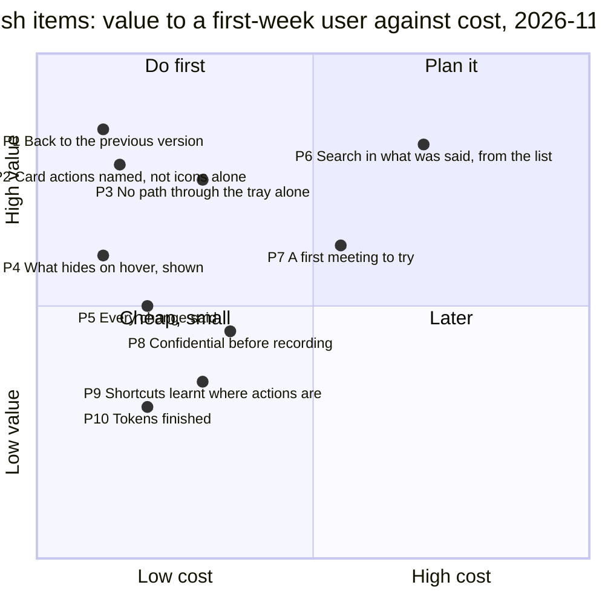

# UI polish: a discovery, 2026-11-21

> A discovery round (`.nstack/playbooks/discovery.md`) on one question: **what should be polished, in what order,
> so that Kitokey reads as easy, natural and modern, without hiding or removing anything?**
>
> - Stages 1–4 are the framer's.
> - Stage 5 is ines's, as challenger.
> - Stage 6 is the decider's.
>
> It builds on the UX audit of [2026-10-26](2026-10-26-ux.md) and on the design audit behind #1094 (option A,
> the decider's « A avant le Store », 2026-11-21 ~13h). It repeats them only where something moved.

## The ranking, first

**Legend**:
- x is the framer's cost estimate, read from the code: S is under a day, M one deliverable, L more.
- y is the framer's reading of the value, from the journeys counted in §2c and the findings of §2b. It is a
  judgement, not a measure; the users' test of §4d is what measures it.

| # | Item | Why (§) | Cost | Measurable criterion |
|---|---|---|---|---|
| P1 | **Go back to the previous version** of a summary or transcript after a redo | No in-app path today: the old file goes to the system trash (§2c, journey 8). #1065 and #1070 build it and wait for their verification | S (built, in review) | Revert reached in ≤ 2 clicks from the meeting's page (e2e) |
| P2 | **The card's two frequent actions named**: « Copier » and « Refaire… », a word beside the icon | Copy and redo are icon-only (§2b). « Share » is a top journey (§2c, journey 4). NN/g: single, frequent actions directly in the interface | S | On a meeting's page, every action used in journeys 2–4 carries visible text (e2e) |
| P3 | **Nothing reachable only through the tray**: « Quitter », and the bar brought back from the full window | « Quitter » and « Afficher la barre » exist in the tray alone (§2b). On Windows 11 a new app's tray icon is hidden in the overflow, and an update resets it (§2a, community sources) | S–M | Each tray action has an in-window path (e2e list against the tray's menu) |
| P4 | **What shows only on hover, shown at rest**: the line's pencil (35 % opacity), rename on the title, the full title, Confidentielle's meaning | GNOME HIG: hover is never the only way to reveal an action or essential information (§2a) | S | No `opacity` below 1 on a control at rest; no essential sentence held only in a `title` (`look.rs`, e2e) |
| P5 | **Every change said**, as Settings already do (« Enregistré », 1.5 s) | On a meeting's page, confidential, language, model and context change silently (§2b) | S | Each change on the page gets a status within 100 ms, `role=status` (e2e) |
| P6 | **Search in what was said, from the list**: titles and minutes, then transcripts | The list matches titles, dates and chips only; the minutes have no search (§2c, journey 3). Finding a past decision is one of the three tasks of §4d | M–L, a product decision | A word said in a meeting finds that meeting from the list (e2e), in ≤ 2 + k keystrokes |
| P7 | **A first meeting to try**: an example meeting in the empty list, removable, never sent anywhere | Granola greets a new user with a demo meeting (§2a). Kitokey's empty state explains, but offers nothing to look at (§2b) | M | The empty list shows one example meeting, marked as such, with its summary and transcript; deleting it leaves the empty state (e2e) |
| P8 | **Confidential set before recording**, in the bar at rest | Today it is only possible on the page, or in the bar while recording (§2c, journey 6) | S–M | The bar at rest offers the switch, and the next meeting starts confidential (e2e) |
| P9 | **Shortcuts learnt where the actions are**: shown beside them, and a « ? » sheet | Raycast and Linear show each action's shortcut beside it (§2a). Kitokey's ↑/↓, Space and the slider keys are found by no one (§2b) | S | Every keyboard-only gesture appears in the « ? » sheet (e2e reads the handlers' list) |
| P10 | **Tokens finished**: the type and radius scales #1094 started | 15 font sizes and 9 radii before #1094 (design audit) | S | At most 6 sizes and 4 radii in `window.css` (`look.rs`) |

**Kept as they are** (checked, nothing to do):
- **Motion**: every transition is 90–180 ms, and `prefers-reduced-motion` stops all of it. That is within NN/g's
  100–400 ms and Fluent's tokens (§2a, §2b).
- **Targets**: controls are 32 px, the bar's 24–28 px; WCAG 2.2 2.5.8 asks 24 px.
- **No right-click-only and no double-click-only action**: none in the code (§2b).

## 1. Intake

The decider's word, 2026-11-21 ~13h05, relayed by the coordinator:

> « On profite de l'audit design pour planifier et cadrer un "polish" l'interface doit être facile à utiliser et
> intuitive, ludique et épuré sans perde les fonctionnalités, pas de choses "cache" mais une utilisation
> naturelle et intuitive qui répond au critère du marché moderne. »

**Restated (unconfirmed).** For Kitokey's buyers, people in back-to-back calls on Windows and Linux, macOS
later: a polish of the whole window and bar. Every feature stays. Nothing is reachable only through a hidden
path. The page says plainly what it does and answers each gesture. « Ludique » and « épuré » are made
measurable (§3) rather than left as taste. It comes after design pass A (#1094), which lands before the Store.

- **Language**: the project writes in English; the product's sentences are French and English
  (`modules/shell/AGENTS.md`). No change.
- **Outside parties**: none. Nothing has been asked of or promised to anyone outside the team for this.

**Open question 1 (the decider):** is the restatement right, and is the bar part of it, or only the window?

## 2. Research

### 2a. What the field does (sources read 2026-11-21)

| Finding | What it changes here | Source |
|---|---|---|
| Granola: first run is download, sign in, calendar, permissions; then a **demo meeting** waits, replayable | A first meeting to look at is a convention of the field (P7) | [Granola help, first setup](https://docs.granola.ai/help-center/getting-started/setting-up-granola-for-the-first-time) (vendor) |
| Notion AI meeting notes: start from `/meet` or a sidebar tab; the summary is made on Stop; its citations jump to the transcript | Kitokey's `[mm:ss]` to the passage is already the convention | [Notion help](https://www.notion.com/help/ai-meeting-notes) (vendor) |
| Otter desktop: meeting detection with « Remind me to record » by default | Kitokey's call offer (Linux) is the same idea | [Otter blog, 2026-08-06](https://otter.ai/blog/never-miss-the-conversation-introducing-automatic-recording-in-otter-desktop) (vendor) |
| Fluent 2: « only one primary button »; minor actions outline, subtle or transparent | One primary per view (#1094, §3) | [Fluent 2, Button](https://fluent2.microsoft.design/components/web/react/core/button/usage) |
| GNOME HIG: one suggested or destructive button per view; « Pointer hover should not be relied upon for revealing actions or essential information » | P4, and one primary | [GNOME HIG, buttons](https://developer.gnome.org/hig/patterns/controls/buttons.html); [pointer and touch](https://developer.gnome.org/hig/guidelines/pointer-touch.html) |
| GNOME HIG: an empty state has a heading and guidance; toasts are for single events, dismissible, at most one relevant button | P5, P7 | [placeholders](https://developer.gnome.org/hig/patterns/feedback/placeholders.html); [toasts](https://developer.gnome.org/hig/patterns/feedback/toasts.html) |
| NN/g: don't hide frequent actions behind an extra click or a hover; icons visible without hover; single actions directly in the interface (2025-11-28) | P2, P4 | [NN/g, contextual menus](https://www.nngroup.com/articles/contextual-menus-guidelines/) |
| NN/g: empty states communicate status, teach, and give a direct path (2021-09-19) | P7 | [NN/g, empty states](https://www.nngroup.com/articles/empty-state-interface-design/) |
| NN/g: animations 100–400 ms, feedback about 100 ms, 500 ms « a drag » (2020-02-09) | Motion criterion; Kitokey already within it | [NN/g, animation duration](https://www.nngroup.com/articles/animation-duration/) |
| NN/g: beyond 2 disclosure levels usability drops (2006-12-03) | Criterion on « Avancé » inside « Plus d'options » (§2b) | [NN/g, progressive disclosure](https://www.nngroup.com/articles/progressive-disclosure/) |
| Microsoft Learn: a frequent command gets its own element; a context menu holds secondary ones (2026-10-13) | P2 | [Menus and context menus](https://learn.microsoft.com/en-us/windows/apps/design/controls/menus-and-context-menus) |
| Apple HIG: always a press state for a custom button | Done by #1094 for `.open` and icon buttons | [Apple HIG, buttons](https://developer.apple.com/design/human-interface-guidelines/buttons) |
| Raycast: each action shows its shortcut beside it, learnt over time; Linear: `?` lists shortcuts, Cmd+K | P9 | [Raycast manual, Action Panel](https://manual.raycast.com/action-panel); [Linear guide](https://linear.app/enablement/guides/navigating-linear) |
| Linear's 2024 redesign: « reduce visual noise … increase the hierarchy »; 3 theme inputs instead of 98 | « Épuré » as fewer, graded surfaces and a hierarchy, not fewer features | [Linear, redesign](https://linear.app/now/how-we-redesigned-the-linear-ui) (vendor) |
| WCAG 2.2: 1.4.3 text 4.5:1; 1.4.11 components and states 3:1; 2.4.7 focus visible; 2.4.11 focus not obscured; 2.5.8 targets 24 px | The accessibility floor (AA) | [WCAG 2.2](https://www.w3.org/TR/WCAG22/) |
| Windows 11: a new app's tray icon is hidden in the overflow by default, and an app update resets it | A tray-only path is a hidden path for a Store buyer (P3) | [Microsoft Q&A, moderator answer](https://learn.microsoft.com/en-us/answers/questions/5600219/other-system-tray-icons-constantly-having-to-activ) (community, not official documentation) |
| User complaints, rivals: Fireflies « interface is a bit busy », « clunky », wants « a more modern visual refresh »; Fathom's overlay « gets in the way », wants it « fully collapsible » | « Épuré » is a buying criterion; Kitokey's bar must stay small | [Capterra, Fireflies](https://www.capterra.com/p/197037/Fireflies/reviews/); [Capterra, Fathom](https://capterra.com/p/276054/Fathom/reviews/) (user-reported, search snippet only) |

**Not found:**
- a numeric cap on the visible controls per view, in any source;
- typography or spacing scales published by the rival products.

### 2b. Kitokey today: heuristic evaluation (Nielsen's 10, WCAG 2.2 AA, GNOME HIG, Fluent 2)

Read from the code and from the e2e's shots (`night-main`, 167 PNGs), 2026-11-21. Main at 056c3e3, #1094 not
merged.

| Heuristic | Finding | Evidence |
|---|---|---|
| 1 Visibility of system status | Good. Makings have a progress bar and « Annuler »; the tray's label changes; the bar shows levels. **Gap**: changes on a meeting's page are silent, while Settings say « Enregistré » (P5) | `window.js:470-495, 772-808` |
| 2 Match with the real world | Good, with one gap: « Le dernier Refaire a échoué » uses « Refaire » as a noun, the button's name used as a thing | shot `9-transcript-failed` |
| 3 User control and freedom | Escape cancels panels; making can be cancelled; delete goes to the trash. **Gap**: no way back after a finished redo (P1) | `words.rs` 2420, 2425 |
| 4 Consistency and standards | **Before #1094**, every secondary control was framed alike. **Gap**: the meeting's language reads « Celle des Réglages — détectée » on the page but « Détection automatique » in Settings (fixed by #1093). Durations are monospace in the free-space list and proportional in the sidebar | shots `3-free`, Store shots |
| 5 Error prevention | « Mettre à la corbeille » asks once on the page. Free-space acts without a question, but everything goes to the trash and the page says so | `window.js:4921-4932`, shot `3-free` |
| 6 Recognition rather than recall | **Gaps**: ↑/↓ between meetings, Space to play and the slider's keys are known only to who reads the code (P9). Rename on the title is signalled by a tooltip alone (P4) | `window.js:5536, 2327, 2310, 2586` |
| 7 Flexibility and efficiency | Global shortcut, the bar, a model per meeting, « Transcrire, puis rédiger » automatic. **Gap**: no search inside the words of all meetings (P6) | `window.js:1028-1042` |
| 8 Aesthetic and minimalist design | Cards and the summary's typography are calm. #1094 adds the hierarchy. The bar's « Plus d'options » holds « Avancé — modèles », a second level; it is NN/g's limit, not past it | shot `d90-opened-rest-fr-light` |
| 9 Help users recover from errors | Failures say the cause and give « Réessayer ». **Gap**: three notifications send the user to the tray (transcription failed, minutes failed without a cause, model required) | `words.rs` 3169-3171, 3276-3278, 3739-3742 |
| 10 Help and documentation | No help in the app. The empty state explains how to start and names the shortcut. The agreement page says exactly what leaves and where, which is the strongest page of the app | shots `d67-none-light`, `agreement` |

**Hidden paths** (the decider's « pas de choses cachées »):

| Path | Only through | Item |
|---|---|---|
| Quit Kitokey | the tray | P3 |
| Bring the bar back after « Masquer la barre » | the tray (or the full window's icon, if it is open) | P3 |
| Reopen the window once closed | the tray, or launching the app again | P3 |
| Previous and next meeting | ↑/↓ on a focused row | P9 |
| Play and pause from anywhere | Space | P9 |
| Correct a line | a pencil at 35 % until hovered or focused | P4 |
| Rename a meeting | a click on its title, said by a tooltip (also in « Plus d'actions ») | P4 |
| A long title, whole | its tooltip | P4 |
| What « Confidentielle » means (« Rien ne quitte cet ordinateur ») | its tooltip | P4 |
| Record the call that took the microphone | a notification, Linux only | P3, in its notification |

Icon-only controls, each named and with a tooltip:
- the sidebar's fold, free space, bar and settings;
- on a meeting's page: folder, trash, more actions, the two copies, the two redos;
- the bar's six controls.

The two copies and two redos are the frequent ones (P2).

### 2c. Journeys counted (clicks and keystrokes, from the code)

| # | Journey | Today | Note |
|---|---|---|---|
| 1 | First run → first meeting recorded | **4 clicks**: Suivant, Télécharger le modèle, Démarrer, Arrêter | 3 with « Passer », but the transcript then waits for a model |
| 2 | Meeting recorded → transcript → summary | **0** for the transcript (automatic), **1** for the summary (« Rédiger le compte rendu »), **0** if Settings say « Transcrire, puis rédiger » | +1 for the agreement with an online service |
| 3 | Find a past decision | **2 + k** from the list, but only on titles, dates and chips; inside a meeting, 1 + k on the transcript only; the summary has no search | P6 |
| 4 | Copy the summary to send it | **1** on the page, 2 from the list; « Copié » for 2 s | P2: the button is an icon |
| 5 | Change the summary's model | **4** in Settings; **3** on the meeting's own line | — |
| 6 | Mark a meeting confidential | **2** from the list; not before recording | P8 |
| 7 | Delete a meeting | **3** (row, trash, confirm) | — |
| 8 | Back to the previous version | **impossible in the app** | P1 |

### 2d. Status of the 2026-10-26 audit's major findings

| Finding (2026-10-26) | Status, 2026-11-21 |
|---|---|
| 1.1 No first-run moment | **Done**: the welcome opens on the first start and fetches the model |
| 3.1 Meetings have no title | **Done**: titles from the summary, rename on the page |
| 3.3 No feedback on « Démarrer » | Not re-checked here: a task for the challenge |
| 4.1 No way to take the minutes away | **Done**: copy as rich text and Markdown; export in #1045 |
| 4.2 Actions as plain bullets | **Done**: who, what, by when, in a table |
| 5.1 Raw English errors in French pages | Not re-checked here: a task for the challenge |

## 3. Define

- **Users**: the decider's three users, who record their own professional calls; buyers from the Store. Their
  words on the interface have not been collected yet, and §4d is how they will be. *Assumption*: what the
  decider reports of them.
- **Constraints**:
  - one module (`shell`) for most items, P6 excepted;
  - no feature removed;
  - WCAG 2.2 AA;
  - every item with an executable criterion (`look.rs`, e2e, before and after shots);
  - each lands after #1094.
- **« Épuré », made measurable**:
  - one primary action per view; a dialog counts as its own view (Fluent 2, GNOME);
  - secondary controls unframed (#1094);
  - no control below full opacity at rest;
  - at most 6 font sizes and 4 radii;
  - at most 2 disclosure levels.
  - *Proposed* (no source gives a number): the count of controls visible at rest on each of the four views
    never grows without the decider's word, read by the e2e and kept as a ratchet.
- **« Ludique », made measurable**:
  - every gesture answered within 100 ms (a press state, a status, a change);
  - every success said (« Copié », « Enregistré », a chip that turns);
  - transitions 90–200 ms, reduced motion honoured;
  - empty states that give something to do or to look at (P7).
  - *Not* sounds, confetti or mascots: proposed as a no-go (§4c).
- **Success signals**, after the polish:
  - the three users do the §4d tasks with no help, each task rated ≥ 6 of 7 on the single ease question;
  - no task needs a path of §2b's hidden list;
  - journeys 3, 4 and 8 within the counts of the ranking table.

**Open question 2 (the decider):** the numbers above — 100 ms, ≤ 6 sizes, ≥ 6/7 — are proposals. Keep them,
or set others?

## 4. Shape

### 4a. Value hypothesis

A user who opens Kitokey for the first time finds every action they need named on the screen, sees each one
answered at once, and gets back anything they changed. They therefore keep using it after the trial, rather
than returning to taking notes by hand.

It is proven wrong if the three users of §4d, after the polish, still need help on any of the five tasks, or
rate any of them below 6 of 7.

### 4b. Press release (imagined; launch day a placeholder)

> **Kitokey, polished.** *[Day of the release]*. Kitokey's window now names every action it offers, answers
> each gesture, and lets you go back to the summary you had before. Your first meeting can be an example to
> look around in. Nothing is hidden behind the tray, a hover or a shortcut you would have to guess.
> « I found my client's quote in ten seconds, and I copied the minutes into my email without looking for the
> button » — *an imagined user*.

Whether it convinces the decider: **to record at stage 6.**

### 4c. No-gos

- **No feature removed** (the decider).
- **No path only through the tray, a hover, a right-click or a shortcut.** A shortcut stays as an accelerator
  beside a visible control (the decider: « pas de choses cachées »).
- *Proposed*: no sound, confetti, mascot or streak. « Ludique » is a responsive page, not a game.
- *Proposed*: no framework or component library (the design audit's options B–E).
- *Proposed*: no new onboarding beyond P7's example meeting. The welcome stays four clicks.

### 4d. The users' 15-minute task test

**For the decider's three users, on the current app, then on the polish.**

**Setup**:
- Kitokey with the Store's six invented meetings loaded (`store_shots`' meetings); no real meeting, ever;
- the user's own computer if possible;
- the observer silent, except to read the tasks.

**Script**, the time each task takes in brackets:

1. *(1 min)* « Say aloud what you think this window is for. »
2. *(3 min)* « Record a one-minute conversation with me, then stop. »
3. *(3 min)* « Find what was decided about the quote with Atelier Lumen. »
4. *(2 min)* « Send the summary of that meeting to a colleague by email. » Paste it in their own mail client.
5. *(2 min)* « Make sure the review of the 19th never leaves this computer. »
6. *(2 min)* « Have the summary written again by another model, then go back to the first one. »
7. *(2 min)* « What would you change? » Their words, quoted as they say them.

**Recorded for each task**:
- done, done with help, or not done;
- the time;
- every hesitation over 5 s and where it happened;
- the path taken;
- the ease rating, 1–7 (the Single Ease Question).

**Output**: one table per user, their quotes, and the items of the ranking each finding moves.

## 5. Challenge

*To be written by ines, in her session; stages 1–4 are not rewritten.*

## 6. Decide

*The decider's.*

**Open questions, most decision-changing first:**
1. Is the restatement of §1 right, and is the bar included? (§1)
2. Are the proposed thresholds of §3 kept? (§3)
3. P6, search in what was said: in the polish, or in cycle 12's axis 1 (long file in)? It costs M–L. (§2c)
4. P7, the example meeting: shown to every new user, or only on the Store's build? (§2a)
