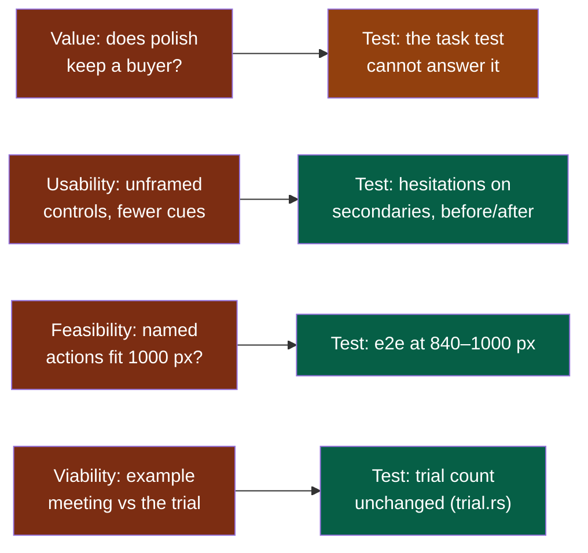

# UI polish: a discovery, 2026-11-21

> A discovery round (`.nstack/playbooks/discovery.md`) on one question: **what should be polished, in what order,
> so that Kitokey reads as easy, natural and modern, without hiding or removing anything?**
>
> - Stages 1–4 are the framer's.
> - Stage 5 is ines's, as challenger.
> - Stage 6 is the decider's.
>
> It builds on the UX audit of [2026-10-26](2026-10-26-ux.md) and on the design audit behind #1094 (option A,
> the decider's « A avant le Store », 2026-11-21 ~13h). It repeats them only where something moved.

## The ranking, first

*Revised after the challenge (§5), 2026-11-21. The framer's answers are in §6a. P1, P2, P3, P4 and P7 have
new criteria; §2b gains four hidden items; §3 measures « épuré » by affordance rather than by style; §4a splits
usability from retention; §4d asked for five users, new ones among them — the decider's answer 6 (§6c) brings it
back to their three users, through the decider.*

**Legend**:
- x is the framer's cost estimate, read from the code: S is under a day, M one deliverable, L more.
- y is the framer's reading of the value, from the journeys counted in §2c and the findings of §2b. It is a
  judgement, not a measure; the users' test of §4d is what measures it.

| # | Item | Why (§) | Cost | Measurable criterion |
|---|---|---|---|---|
| P1 | **Go back to the previous version** of a summary or transcript after a redo | No in-app path today: the old file goes to the system trash (§2c, journey 8). #1065 and #1070 build it and wait for their verification | S (built, **unverified**: #1065, #1070 open) | Revert reached in ≤ 2 clicks from the meeting's page (e2e); §4d task 6 runs only once both are merged |
| P2 | **Icons known to all, a word only where an icon is ambiguous** (*rewritten on the decider's word, §6c, ~14h20*): decided per control, in the table under the ranking | The card's frequent actions are icon-only (§2b). NN/g: few icons are universal, and an icon whose meaning is not certain needs a visible label; Fluent 2, Primer: an icon-only control's tooltip opens on hover **and** on keyboard focus | S–M (a tooltip shown on focus too; the labels of the « word » rows) | Each icon-only control has an accessible name and a tooltip that opens on hover and on keyboard focus within 300 ms, its shortcut in it when it has one; each « word » control shows its label at rest, at 840, 1000 and 1280 px, French and English, no header wrapping (e2e); none of the three users' §4d tasks needs a hover to find its control |
| P3 | **Nothing reachable only through the tray**: « Quitter », and the bar brought back from the full window | « Quitter » and « Afficher la barre » exist in the tray alone, and three notifications send the user there (§2b). On Windows 11 a new app's tray icon is hidden in the overflow, and an update resets it (§2a, community sources) | S–M | Each tray action has an in-window path (e2e list against the tray's menu), and no notification names the tray as the only way (a test reads `words.rs`) |
| P4 | **What shows only on hover, shown at rest**: the line's pencil (35 % opacity), rename on the title, the full title, Confidentielle's meaning, a row's marks, the bar's last line, a device's name | GNOME HIG: hover is never the only way to reveal an action or essential information (§2a) | S | No `opacity` below 1 on an **enabled** control at rest; no essential sentence or meaning held only in a `title` (`look.rs`, e2e) |
| P5 | **Every change said**, as Settings already do (« Enregistré », 1.5 s) | On a meeting's page, confidential, language, model and context change silently (§2b) | S | Each change on the page gets a status within 100 ms, `role=status` (e2e) |
| P6 | **Search in what was said, from the list**: titles and minutes, then transcripts | The list matches titles, dates and chips only; the minutes have no search (§2c, journey 3). Finding a past decision is one of the three tasks of §4d | M–L, a product decision | A word said in a meeting finds that meeting from the list (e2e), in ≤ 2 + k keystrokes |
| P7 | **A first meeting to try**: an example meeting in the empty list, removable, never sent anywhere | Granola greets a new user with a demo meeting (§2a). Kitokey's empty state explains, but offers nothing to look at (§2b) | M | The empty list shows one example meeting, marked as such, with its summary and transcript; deleting it leaves the empty state (e2e); the trial's count, the footer's « N réunions », the storage and the search never count it (a unit test on `trial.rs` and the footer) |
| P8 | **Confidential set before recording**, in the bar at rest | Today it is only possible on the page, or in the bar while recording (§2c, journey 6) | S–M | The bar at rest offers the switch, and the next meeting starts confidential (e2e) |
| P9 | **Shortcuts learnt where the actions are**: shown beside them, and a « ? » sheet | Raycast and Linear show each action's shortcut beside it (§2a). Kitokey's ↑/↓, Space and the slider keys are found by no one (§2b) | S | Every keyboard-only gesture appears in the « ? » sheet (e2e reads the handlers' list) |
| P10 | **Tokens finished**: the type and radius scales #1094 started | 15 font sizes and 9 radii before #1094 (design audit) | S | At most 6 sizes and 4 radii in `window.css` (`look.rs`) |

**P2, control by control** (*the decider, 2026-11-21 ~14h20*: an explicit name when needed, but the market favours
icons known to all). An icon stays where its meaning is shared across the platforms Kitokey runs on; a word goes
beside it where the same glyph means two things.

| Control | Glyph | Decision | Why |
|---|---|---|---|
| Copy (summary, transcript) | two sheets | **Icon**, tooltip « Copier le compte rendu » | The copy glyph is the platforms' own (Windows, GNOME, macOS) |
| Move to the trash | trash can | **Icon** | Shared everywhere |
| Open the folder | folder | **Icon** | Shared everywhere |
| More actions | ⋯ | **Icon** | Shared everywhere |
| Correct a line | pencil | **Icon**, shown at rest (P4) | Shared everywhere |
| Settings | gear | **Icon** | Shared everywhere |
| Record ●, stop ■, hide −, close × (the bar) | media and window glyphs | **Icon**, shortcut in the tooltip | Media and window conventions |
| Fold the sidebar | sidebar panel | **Icon**, « Ctrl+B » in the tooltip | Windows 11's and GNOME's own |
| **Refaire…** (summary, transcript) | circular arrow | **Word**: « Refaire… » beside the icon | The glyph reads « refresh » as much as « write again », and the two differ: one reloads, the other replaces a version |
| **Faire de la place** | hard drive | **Word**: the footer's label, or the icon with « Espace » | A drive says « storage », not « free some of it » |
| **Barre d'enregistrement** | small window | **Word**, or the tooltip made the control's visible label when the sidebar is wide | No shared glyph for « a floating recording bar » |

**Kept as they are** (checked, nothing to do):
- **Motion**: every transition is 90–180 ms, and `prefers-reduced-motion` stops all of it. That is within NN/g's
  100–400 ms and Fluent's tokens (§2a, §2b).
- **Targets**: controls are 32 px, the bar's 24–28 px; WCAG 2.2 2.5.8 asks 24 px.
- **No right-click-only and no double-click-only action**: none in the code (§2b).

## 1. Intake

The decider's word, 2026-11-21 ~13h05, relayed by the coordinator:

> « On profite de l'audit design pour planifier et cadrer un "polish" l'interface doit être facile à utiliser et
> intuitive, ludique et épuré sans perde les fonctionnalités, pas de choses "cache" mais une utilisation
> naturelle et intuitive qui répond au critère du marché moderne. »

**Restated (unconfirmed).** For Kitokey's buyers, people in back-to-back calls on Windows and Linux, macOS
later: a polish of the whole window and bar. Every feature stays. Nothing is reachable only through a hidden
path. The page says plainly what it does and answers each gesture. « Ludique » and « épuré » are made
measurable (§3) rather than left as taste. It comes after design pass A (#1094), which lands before the Store.

- **Language**: the project writes in English; the product's sentences are French and English
  (`modules/shell/AGENTS.md`). No change.
- **Outside parties**: none. Nothing has been asked of or promised to anyone outside the team for this.

**Open question 1 (the decider):** is the restatement right, and is the bar part of it, or only the window?

## 2. Research

### 2a. What the field does (sources read 2026-11-21)

| Finding | What it changes here | Source |
|---|---|---|
| Granola: first run is download, sign in, calendar, permissions; then a **demo meeting** waits, replayable | A first meeting to look at is a convention of the field (P7) | [Granola help, first setup](https://docs.granola.ai/help-center/getting-started/setting-up-granola-for-the-first-time) (vendor) |
| Notion AI meeting notes: start from `/meet` or a sidebar tab; the summary is made on Stop; its citations jump to the transcript | Kitokey's `[mm:ss]` to the passage is already the convention | [Notion help](https://www.notion.com/help/ai-meeting-notes) (vendor) |
| Otter desktop: meeting detection with « Remind me to record » by default | Kitokey's call offer (Linux) is the same idea | [Otter blog, 2026-08-06](https://otter.ai/blog/never-miss-the-conversation-introducing-automatic-recording-in-otter-desktop) (vendor) |
| Fluent 2: « only one primary button »; minor actions outline, subtle or transparent | One primary per view (#1094, §3) | [Fluent 2, Button](https://fluent2.microsoft.design/components/web/react/core/button/usage) |
| GNOME HIG: one suggested or destructive button per view; « Pointer hover should not be relied upon for revealing actions or essential information » | P4, and one primary | [GNOME HIG, buttons](https://developer.gnome.org/hig/patterns/controls/buttons.html); [pointer and touch](https://developer.gnome.org/hig/guidelines/pointer-touch.html) |
| GNOME HIG: an empty state has a heading and guidance; toasts are for single events, dismissible, at most one relevant button | P5, P7 | [placeholders](https://developer.gnome.org/hig/patterns/feedback/placeholders.html); [toasts](https://developer.gnome.org/hig/patterns/feedback/toasts.html) |
| NN/g: don't hide frequent actions behind an extra click or a hover; icons visible without hover; single actions directly in the interface (2025-11-28) | P2, P4 | [NN/g, contextual menus](https://www.nngroup.com/articles/contextual-menus-guidelines/) |
| NN/g: empty states communicate status, teach, and give a direct path (2021-09-19) | P7 | [NN/g, empty states](https://www.nngroup.com/articles/empty-state-interface-design/) |
| NN/g: animations 100–400 ms, feedback about 100 ms, 500 ms « a drag » (2020-02-09) | Motion criterion; Kitokey already within it | [NN/g, animation duration](https://www.nngroup.com/articles/animation-duration/) |
| NN/g: beyond 2 disclosure levels usability drops (2006-12-03) | Criterion on « Avancé » inside « Plus d'options » (§2b) | [NN/g, progressive disclosure](https://www.nngroup.com/articles/progressive-disclosure/) |
| NN/g: few icons are nearly universal (home, print, search); for most, a text label clarifies the meaning, and a label shown only on hover adds cost | P2's « word » rows, and the criterion that no task needs a hover | [NN/g, Icon usability](https://www.nngroup.com/articles/icon-usability/) (read in a search excerpt, 2026-11-21) |
| Fluent 2: a tooltip opens on hover **or focus** of its target; Primer: an icon button's tooltip shows its label on hover or keyboard focus | P2's tooltips open on keyboard focus too | [Fluent 2, Tooltip](https://fluent2.microsoft.design/components/web/react/tooltip/usage); [Primer, Tooltip](https://primer-docs-preview.github.com/product/components/tooltip/guidelines) (search excerpts) |
| Microsoft Learn: a frequent command gets its own element; a context menu holds secondary ones (2026-10-13) | P2 | [Menus and context menus](https://learn.microsoft.com/en-us/windows/apps/design/controls/menus-and-context-menus) |
| Apple HIG: always a press state for a custom button | Done by #1094 for `.open` and icon buttons | [Apple HIG, buttons](https://developer.apple.com/design/human-interface-guidelines/buttons) |
| Raycast: each action shows its shortcut beside it, learnt over time; Linear: `?` lists shortcuts, Cmd+K | P9 | [Raycast manual, Action Panel](https://manual.raycast.com/action-panel); [Linear guide](https://linear.app/enablement/guides/navigating-linear) |
| Linear's 2024 redesign: « reduce visual noise … increase the hierarchy »; 3 theme inputs instead of 98 | « Épuré » as fewer, graded surfaces and a hierarchy, not fewer features | [Linear, redesign](https://linear.app/now/how-we-redesigned-the-linear-ui) (vendor) |
| WCAG 2.2: 1.4.3 text 4.5:1; 1.4.11 components and states 3:1; 2.4.7 focus visible; 2.4.11 focus not obscured; 2.5.8 targets 24 px | The accessibility floor (AA) | [WCAG 2.2](https://www.w3.org/TR/WCAG22/) |
| Windows 11: a new app's tray icon is hidden in the overflow by default, and an app update resets it | A tray-only path is a hidden path for a Store buyer (P3). *Revised after §5*: a **strong assumption**, « not read » at a primary source; no Microsoft documentation page found | [Microsoft Q&A, moderator answer](https://learn.microsoft.com/en-us/answers/questions/5600219/other-system-tray-icons-constantly-having-to-activ) (community, not official documentation) |
| User complaints, rivals: Fireflies « interface is a bit busy », « clunky », wants « a more modern visual refresh »; Fathom's overlay « gets in the way », wants it « fully collapsible » | « Épuré » is a buying criterion; Kitokey's bar must stay small | [Capterra, Fireflies](https://www.capterra.com/p/197037/Fireflies/reviews/); [Capterra, Fathom](https://capterra.com/p/276054/Fathom/reviews/) (user-reported, search snippet only) |

**Not found:**
- a numeric cap on the visible controls per view, in any source;
- typography or spacing scales published by the rival products.

### 2b. Kitokey today: heuristic evaluation (Nielsen's 10, WCAG 2.2 AA, GNOME HIG, Fluent 2)

Read from the code and from the e2e's shots (`night-main`, 167 PNGs), 2026-11-21. Main at 056c3e3, #1094 not
merged.

| Heuristic | Finding | Evidence |
|---|---|---|
| 1 Visibility of system status | Good. Makings have a progress bar and « Annuler »; the tray's label changes; the bar shows levels. **Gap**: changes on a meeting's page are silent, while Settings say « Enregistré » (P5) | `window.js:470-495, 772-808` |
| 2 Match with the real world | Good, with one gap: « Le dernier Refaire a échoué » uses « Refaire » as a noun, the button's name used as a thing | shot `9-transcript-failed` |
| 3 User control and freedom | Escape cancels panels; making can be cancelled; delete goes to the trash. **Gap**: no way back after a finished redo (P1) | `words.rs` 2420, 2425 |
| 4 Consistency and standards | **Before #1094**, every secondary control was framed alike. **Gap**: the meeting's language reads « Celle des Réglages — détectée » on the page but « Détection automatique » in Settings (fixed by #1093). Durations are monospace in the free-space list and proportional in the sidebar | shots `3-free`, Store shots |
| 5 Error prevention | « Mettre à la corbeille » asks once on the page. Free-space acts without a question, but everything goes to the trash and the page says so | `window.js:4921-4932`, shot `3-free` |
| 6 Recognition rather than recall | **Gaps**: ↑/↓ between meetings, Space to play and the slider's keys are known only to who reads the code (P9). Rename on the title is signalled by a tooltip alone (P4) | `window.js:5536, 2327, 2310, 2586` |
| 7 Flexibility and efficiency | Global shortcut, the bar, a model per meeting, « Transcrire, puis rédiger » automatic. **Gap**: no search inside the words of all meetings (P6) | `window.js:1028-1042` |
| 8 Aesthetic and minimalist design | Cards and the summary's typography are calm. #1094 adds the hierarchy. The bar's « Plus d'options » holds « Avancé — modèles », a second level; it is NN/g's limit, not past it | shot `d90-opened-rest-fr-light` |
| 9 Help users recover from errors | Failures say the cause and give « Réessayer ». **Gap**: three notifications send the user to the tray (transcription failed, minutes failed without a cause, model required) | `words.rs` 3169-3171, 3276-3278, 3739-3742 |
| 10 Help and documentation | No help in the app. The empty state explains how to start and names the shortcut. The agreement page says exactly what leaves and where, which is the strongest page of the app | shots `d67-none-light`, `agreement` |

**Hidden paths** (the decider's « pas de choses cachées »):

| Path | Only through | Item |
|---|---|---|
| Quit Kitokey | the tray | P3 |
| Bring the bar back after « Masquer la barre » | the tray (or the full window's icon, if it is open) | P3 |
| Reopen the window once closed | the tray, or launching the app again | P3 |
| Previous and next meeting | ↑/↓ on a focused row | P9 |
| Play and pause from anywhere | Space | P9 |
| Correct a line | a pencil at 35 % until hovered or focused | P4 |
| Rename a meeting | a click on its title, said by a tooltip (also in « Plus d'actions ») | P4 |
| A long title, whole | its tooltip | P4 |
| What « Confidentielle » means (« Rien ne quitte cet ordinateur ») | its tooltip | P4 |
| Record the call that took the microphone | a notification, Linux only | P3, in its notification |
| Retry a failed transcript or summary, fetch a missing model *(added after §5)* | three notifications that name the tray's menu (`words.rs` 3169-3171, 3276-3278, 3739-3742) | P3 |
| What a row's marks mean: transcript, summary, audio *(added after §5)* | their tooltip (`window.js:865`) | P4 |
| The bar's last line, whole, when cut *(added after §5)* | its tooltip (`window.js:4692`) | P4 |
| A device's whole name in Settings, when cut *(added after §5)* | its row's tooltip (`window.js:4816`) | P4 |

Icon-only controls, each named and with a tooltip:
- the sidebar's fold, free space, bar and settings;
- on a meeting's page: folder, trash, more actions, the two copies, the two redos;
- the bar's six controls.

The two copies and two redos are the frequent ones (P2).

### 2c. Journeys counted (clicks and keystrokes, from the code)

| # | Journey | Today | Note |
|---|---|---|---|
| 1 | First run → first meeting recorded | **4 clicks**: Suivant, Télécharger le modèle, Démarrer, Arrêter | 3 with « Passer », but the transcript then waits for a model |
| 2 | Meeting recorded → transcript → summary | **0** for the transcript (automatic), **1** for the summary (« Rédiger le compte rendu »), **0** if Settings say « Transcrire, puis rédiger » | +1 for the agreement with an online service |
| 3 | Find a past decision | **2 + k** from the list, but only on titles, dates and chips; inside a meeting, 1 + k on the transcript only; the summary has no search | P6 |
| 4 | Copy the summary to send it | **1** on the page, 2 from the list; « Copié » for 2 s | P2: an icon known to all, its tooltip on focus too |
| 5 | Change the summary's model | **4** in Settings; **3** on the meeting's own line | — |
| 6 | Mark a meeting confidential | **2** from the list; not before recording | P8 |
| 7 | Delete a meeting | **3** (row, trash, confirm) | — |
| 8 | Back to the previous version | **impossible in the app** | P1 |

### 2d. Status of the 2026-10-26 audit's major findings

| Finding (2026-10-26) | Status, 2026-11-21 |
|---|---|
| 1.1 No first-run moment | **Done**: the welcome opens on the first start and fetches the model |
| 3.1 Meetings have no title | **Done**: titles from the summary, rename on the page |
| 3.3 No feedback on « Démarrer » | Not re-checked here: a task for the challenge |
| 4.1 No way to take the minutes away | **Done**: copy as rich text and Markdown; export in #1045 |
| 4.2 Actions as plain bullets | **Done**: who, what, by when, in a table |
| 5.1 Raw English errors in French pages | **Done**, re-checked by the challenger (§5.4): a localized sentence, the raw detail only in developer mode |

## 3. Define

- **Users**: the decider's three users, who record their own professional calls; buyers from the Store, who have
  never seen Kitokey (*revised after §5*: the test needs both). Their
  words on the interface have not been collected yet, and §4d is how they will be. *Assumption*: what the
  decider reports of them.
- **Constraints**:
  - one module (`shell`) for most items, P6 excepted;
  - no feature removed;
  - WCAG 2.2 AA;
  - every item with an executable criterion (`look.rs`, e2e, before and after shots);
  - each lands after #1094.
- **« Épuré », made measurable**:
  - one primary action per view; a dialog counts as its own view (Fluent 2, GNOME);
  - every control keeps a visible affordance at rest — a fill, an edge or a chevron —, never text alone
    (*revised after §5*: NN/g found weak signifiers cost 22 % more time; unframing is one way to remove noise, not
    the criterion);
  - no enabled control below full opacity at rest;
  - at most 6 font sizes and 4 radii;
  - at most 2 disclosure levels.
  - *Proposed* (no source gives a number): the count of controls visible at rest on each of the four views
    never grows without the decider's word, read by the e2e and kept as a ratchet.
- **« Ludique », made measurable**:
  - every gesture answered within 100 ms (a press state, a status, a change);
  - every success said (« Copié », « Enregistré », a chip that turns);
  - transitions 90–200 ms, reduced motion honoured;
  - empty states that give something to do or to look at (P7).
  - *Not* sounds, confetti or mascots: proposed as a no-go (§4c).
- **Success signals**, after the polish:
  - the decider's three users do the §4d tasks with no help, as the decider relays them (§6c, answer 6); the
    **median** of each task's single ease rating is ≥ 5.5 (the field's average, MeasuringU), and no task's median
    falls after the polish (*revised after §5 and §6c*);
  - no hesitation over 5 s on a secondary control grows from before the polish to after it;
  - no task needs a path of §2b's hidden list;
  - journeys 3, 4 and 8 within the counts of the ranking table.

**Open question 2 (the decider):** the numbers above — 100 ms, ≤ 6 sizes, a median ≥ 5.5 — are proposals. Keep them,
or set others?

## 4. Shape

### 4a. Value hypothesis

*Split after §5 (flaw 4): the first half is what §4d can refute; the second needs the trial's end.*

**Usability.** A user who opens Kitokey for the first time finds every action they need named on the screen, sees
each one answered at once, and gets back anything they changed. It is proven wrong if the three users of §4d,
after the polish, need help on a task, or a task's median ease falls under 5.5 or below its value before.

**Retention.** Because of that, they keep Kitokey after the trial rather than returning to notes by hand. It is
proven wrong if, asked at the trial's end « What would make you keep Kitokey? », fewer than half of the three
users and the first Store buyers name anything of the polish, and more name transcription, summary or speed
(§5.2; the threshold is the decider's).

### 4b. Press release (imagined; launch day a placeholder)

> **Kitokey, polished.** *[Day of the release]*. Kitokey's window now names every action it offers, answers
> each gesture, and lets you go back to the summary you had before. Your first meeting can be an example to
> look around in. Nothing is hidden behind the tray, a hover or a shortcut you would have to guess.
> « I found my client's quote in ten seconds, and I copied the minutes into my email without looking for the
> button » — *an imagined user*.

Whether it convinces the decider: **to record at stage 6.**

### 4c. No-gos

- **No feature removed** (the decider).
- **No path only through the tray, a hover, a right-click or a shortcut.** A shortcut stays as an accelerator
  beside a visible control (the decider: « pas de choses cachées »).
- *Proposed*: no sound, confetti, mascot or streak. « Ludique » is a responsive page, not a game.
- *Proposed*: no framework or component library (the design audit's options B–E).
- *Proposed*: no new onboarding beyond P7's example meeting. The welcome stays four clicks.

### 4d. The users' 15-minute task test

*Revised after the decider's answer of 2026-11-21 ~14h (§6c, question 6).* The decider already works with their
three users, who send their feedback to the decider directly; the decider relays it. The test is therefore not a
session the team runs: it is **what the decider asks the three users**, on the current app and then on the polish,
and the decider relays the answers, quoted. Users new to Kitokey (§5.5.3) are not among them: see §6c.

**Setup**:
- Kitokey with the Store's six invented meetings loaded (`store_shots`' meetings); no real meeting, ever;
- the user's own computer if possible;
- the decider reads the tasks, one at a time, and does not help.

**Script**, the time each task takes in brackets:

1. *(1 min)* « Say aloud what you think this window is for. »
2. *(3 min)* « Record a one-minute conversation with me, then stop. »
3. *(2 min)* « Find what was decided about the quote with Atelier Lumen. »
4. *(2 min)* « Send the summary of that meeting to a colleague by email. » Paste it in their own mail client.
5. *(2 min)* « Make sure the review of the 19th never leaves this computer. »
6. *(2 min)* « Have the summary written again by another model, then go back to the first one. » Only once #1065
   and #1070 are merged.
7. *(2 min)* « Correct a word in one line of the transcript. » A secondary control: the hesitations before and
   after the polish are compared (§5.2).
8. *(1 min)* « What would you change? » Their words, quoted as they say them.

**Recorded for each task**:
- done, done with help, or not done;
- the time;
- every hesitation over 5 s and where it happened;
- the path taken;
- the ease rating, 1–7 (the Single Ease Question).

**Output**: the decider relays, for each user, the answers above and their words; the framer writes one table per
user and the items of the ranking each finding moves.

## 5. Challenge

*ines, session 0b18e549-3041-4f1e-8261-b732a38f32c3, challenger (content design and QA), 2026-11-21. She read the
idea (the decider's word, §1) and stages 1–4 at db9914ad, without rewriting them. Every code line was read at main
456e6fd. §1 is still unconfirmed (open question 1), so this challenges the framer's restatement.*

**Legend**: red is the riskiest assumption of each risk; green is a test that can refute it; amber is a test
that cannot refute what it is meant to.

### 5.1 Pre-mortem: a year on, the polish failed

| # | Plausible reason | Risk |
|---|---|---|
| 1 | Buyers on Windows lost Kitokey after an update: three notifications send them to a tray icon that Windows 11 hid again (§2b heuristic 9). The polish never moved them into the window | Usability |
| 2 | « Épuré » became « unframed ». Secondaries lost their clickability cues, and first-week users looked for « Refaire… » longer than before (counter-evidence 5.3) | Usability |
| 3 | The example meeting (P7) was counted by the trial, the storage footer or the search, and buyers read « 7 réunions » before recording one, or found the example among their own | Viability |
| 4 | The users' test showed « easy » because the three users already knew the app. Store buyers, who did not, never got that far | Value |
| 5 | Named actions (P2) crowded the transcript card's header beside the search field. At 1000 px the words wrapped or the field shrank, and the polish read busier than before | Feasibility |
| 6 | P1, the way back, stayed « S, built » in the ranking while #1065 and #1070 were still open. The polish shipped its promise (« go back to the first one », §4d task 6) before its feature | Feasibility |

### 5.2 The four risks: riskiest assumption, cheapest refuting test

| Risk | Riskiest assumption | Cheapest test (what, how long, what refutes it) |
|---|---|---|
| **Value** | A polished window keeps a user after the trial « rather than returning to taking notes by hand » (§4a) | §4d measures ease, not staying, so it cannot refute this. Cheapest: in the private audience (D103), at the trial's end, ask the three users and the first Store buyers one question: « What would make you keep Kitokey? ». It takes the 14 days of a trial. **Refuted if** fewer than half name anything of the polish's list, and more name transcription, summary quality or speed. Threshold for the decider |
| **Usability** | Unframed secondaries (#1094/#1095, §3 « secondary controls unframed ») are still seen as controls | Add to §4d one task that needs a secondary: « correct a line » or « mark it confidential ». Run it before and after #1095 on the same users, and count hesitations over 5 s on that control. 15 min a user. **Refuted if** the hesitations after are more than before |
| **Feasibility** | P2's words fit the card headers in both languages at the two-pane break (1000 px) and the one-pane break (840 px) | An e2e at 840, 1000 and 1280 px, French and English (the longest), on a meeting with a long title. Half a day. **Refuted if** a header wraps, or the search field goes under its minimum width. The criterion « carries visible text » (P2) does not catch this |
| **Viability** | P7's example meeting costs the buyer nothing: not a trial meeting, not a real one, not sent anywhere | `trial.rs:76` counts what `made()` wrote. Check that the example is never written there, never counted in the footer's « N réunions », and is found by search only as marked. A unit test, an hour. **Refuted if** any count moves when the example is present |

### 5.3 Counter-evidence

| Finding | What it contradicts | Source |
|---|---|---|
| NN/g eyetracking: pages with weak clickability signifiers took **22 % more time** and **25 % more fixations** to find a target. « Flat design isn't the enemy, weak signifiers are » | §3's « secondary controls unframed » as a measure of « épuré ». « Épuré » should be measured by noise removed, with every control's affordance kept | [NN/g, Flat UI elements attract less attention and cause uncertainty](https://www.nngroup.com/articles/flat-ui-less-attention-cause-uncertainty/) (read in a search excerpt and NN/g's own summary video page, 2026-11-21: *excerpt only*) |
| MeasuringU: the average SEQ across 400+ tasks is **about 5.5**; above 5.5 already reads « very easy » | §3's « each task rated ≥ 6 of 7 » for every user and every task. With n = 3, one rating of 5 fails the whole polish | [MeasuringU, the evolution of the SEQ](https://measuringu.com/evolution-of-seq) |
| Windows 11: icons of new or updated apps start hidden in the overflow; no official way to keep them shown across updates | Supports P3 and widens it (5.4, first row). The sources are community answers, no official Microsoft page found | [Microsoft Q&A](https://learn.microsoft.com/en-us/answers/questions/5600219/other-system-tray-icons-constantly-having-to-activ); [Tech Community](https://techcommunity.microsoft.com/discussions/windowsinsiderprogram/windows-11-occasionally-resets-some-tray-icons-to-be-hidden/3887241) (*community, not documentation*) |

Not found: a rival meeting recorder that failed on its interface's look. *Assumption*: products in this field are
chosen on transcription and summary quality first, and the polish protects the first week, not the sale.

### 5.4 « Nothing hidden », checked item by item (window.js and words.rs at 456e6fd)

| Path or information | Only through | Verdict | In the ranking? |
|---|---|---|---|
| Quit Kitokey | the tray: `words.quit` is used by the tray alone, never by `window.js` | Hidden — confirmed | P3 |
| Bring the bar back | the tray, or the window's icon when the window is open | Hidden on a closed window — confirmed | P3 |
| **Where a failed transcript or summary is retried** | three notifications name the tray's menu (§2b heuristic 9) | **Hidden on Windows 11**, where that icon may sit in the overflow | **Missing: P3's criterion lists tray *actions*, not the notifications that point to the tray** |
| **What a row's marks mean** (transcript, summary, audio) | their tooltip, `window.js:865` `mark.title = name` | Hidden: information carried by an icon and a hover only | **Missing from §2b's list; P4** |
| The record shortcut's keys | the record button's tooltip (`window.js:917`, `4155`) and the empty list's sentence | Shown once, then only on hover | P9 covers it |
| The bar's last line, whole | its tooltip (`window.js:4692`) | Hidden when cut | Missing; P4 |
| A device's whole name in Settings | its row's tooltip (`window.js:4816`) | Hidden when cut | Missing; P4 |
| A summary's moment `[mm:ss]` | a link, named by `aria-label` and `title` (`window.js:1835`) | Visible as text; it plays on a click. Not hidden | — |
| Correct a line | a pencil at 35 % at rest | Hidden — confirmed | P4 |
| Rename a meeting | a click on the title (tooltip), and « Plus d'actions » | Reachable in a menu; the title's click is an accelerator | P4 (only the tooltip) |
| Copy a diagnostic | « Plus d'actions » | One level, named. Not hidden | — |
| Fold the sidebar | a named icon, Ctrl+B in its tooltip | The accelerator is hidden, the action is not | P9 |
| Free space, settings | named icons with a tooltip | Not hidden (named for screen readers, icon-only) | P2's logic would apply; not ranked |
| A raw error in a French page (2026-10-26, finding 5.1) | `words::told` (`main.rs:276–284`) | **Done, re-checked**: commands say a localized sentence; the raw detail shows only with the developer mode on | §2d can mark it done |
| No feedback on « Démarrer » (2026-10-26, finding 3.3) | — | **Not re-checked**: it is a timing seen in a run, not in the code | Stays open |

### 5.5 Flaws in stages 1 to 4

1. **§3, line 194**: « secondary controls unframed (#1094) » measures « épuré » by a style, not by an outcome, and
   5.3's evidence says that style can cost time. Proposed: « épuré » keeps a visible affordance on every control,
   and the e2e counts controls at rest (the ratchet of line 198). Unframing is one way to get there, not the
   criterion.
2. **§3, line 207**: « each task rated ≥ 6 of 7 » for three users. That is stricter than the field's average
   (5.5), and too few users to tell a polish from noise. Proposed: the median of each task ≥ 5.5, with five users
   new to Kitokey (two of them from outside the decider's circle), as NN/g's small-sample test sizes it ([NN/g, test with 5 users](https://www.nngroup.com/articles/why-you-only-need-to-test-with-5-users/)). Before
   and after on the same tasks.
3. **§3, line 183 and §4d, line 246**: the three users have used Kitokey, so they cannot test a « first-week
   user », the ranking's own axis (line 27). At least one user new to the app is needed, or the test measures
   habit.
4. **§4a, lines 218–223**: the value hypothesis joins usability and retention. §4d can refute only the
   usability half. Proposed: split it, with retention tested as in 5.2.
5. **Ranking, line 53**: P1 is « S (built, in review) ». #1065 and #1070 are open and not yet verified (I am
   their verifier). « Built » should read « built, unverified », and §4d task 6 runs only after they merge.
6. **Ranking, line 55**: P3's criterion « each tray action has an in-window path » misses the notifications that
   send the user to the tray (5.4). Proposed: no notification names the tray as the only way.
7. **Ranking, line 56**: « no `opacity` below 1 on a control at rest » also catches a *disabled* control, which
   the platform conventions draw faded. Proposed: « … on an enabled control at rest ».
8. **Ranking, line 59**: P7 says nothing of the trial, the footer's count, the search or the storage. 5.2's
   viability row gives the test. It also needs a no-go: the example is never counted, never sent, and goes to
   the trash in one gesture like a meeting.
9. **§2a, line 110**: the Windows 11 claim rests on community answers. The playbook asks for the primary source:
   « not read » until a Microsoft documentation page says it. It still stands as a strong assumption, with 5.3's
   second community source.
10. **§2b, lines 135–148**: the hidden-paths table misses four items of 5.4 (a row's marks, the bar's last
    line, a device's name, the notifications that point to the tray).

### 5.6 What the challenger would keep

- P1, P3 and P4 first: each removes a path a Store buyer on Windows cannot find. P2 after 5.2's width test.
- P6 (search in what was said) is a product decision: it belongs with cycle 12's long-file axis, as open
  question 3 suggests.
- The proposed no-gos of §4c (no sound, no confetti, no framework) hold. Nothing found contradicts them.

## 6. Decide

### 6a. The framer's answers to §5 (lina, 2026-11-21)

§5 is kept unchanged above. Every flaw is taken; the revisions are marked in stages 1–4.

| §5 | Answer |
|---|---|
| 5.5.1 « Épuré » by a style | **Taken.** §3 now asks a visible affordance at rest on every control. For #1094/#1095 this holds: a secondary rests on `--raised`, a filled ground, never text alone; an icon button keeps its glyph; a page's model list keeps its chevron. The before/after shots of #1095 are judged against it, and §4d task 7 measures it |
| 5.5.2 ≥ 6 of 7 for three users | **Taken**: the median ≥ 5.5, before and after; five users asked, three kept by the decider's answer 6 (§6c) |
| 5.5.3 Users who know the app | **Taken**, then limited by the decider's answer 6 (§6c): the first Store buyers stand in for new users |
| 5.5.4 Usability and retention joined | **Taken**: §4a split; retention tested at the trial's end (5.2) |
| 5.5.5 P1 « built » | **Taken**: « built, unverified », and task 6 waits for #1065 and #1070 |
| 5.5.6 Notifications to the tray | **Taken**: in P3's criterion and §2b |
| 5.5.7 Disabled controls faded | **Taken**: « an enabled control » |
| 5.5.8 P7 and the trial | **Taken**: P7's criterion; and a no-go below |
| 5.5.9 Windows 11 claim | **Taken**: marked a strong assumption, not read at a primary source |
| 5.5.10 Four hidden items | **Taken**: added to §2b, under P3 and P4 |
| 5.1.5 Named actions crowd the header | **Taken**: P2's criterion measures 840, 1000, 1280 px in both languages; after the decider's word (§6c), only « Refaire… » carries a word in the card headers |
| 5.6 P1, P3, P4 first; P2 after its width test | **Taken** as the order of the first deliverables |

No-go added: *proposed*, the example meeting (P7) is never counted by the trial, the footer or the storage, never
sent anywhere, and goes to the trash in one gesture like any meeting.

### 6b. The open questions, as put to the decider

1. Is the restatement of §1 right, and is the bar included? (§1)
2. Are the proposed thresholds of §3 kept? (§3)
3. P6, search in what was said: in the polish, or in cycle 12's axis 1 (long file in)? It costs M–L. (§2c)
4. P7, the example meeting: shown to every new user, or only on the Store's build? (§2a)
5. Retention (§4a): ask the three users and the first Store buyers, at the trial's end, what would make them
   keep Kitokey — and set the threshold of §5.2.
6. Two users new to Kitokey for §4d: who recruits them, and by when?

### 6c. The answers (2026-11-21 ~14h, relayed by the coordinator)

| # | Answer | By |
|---|---|---|
| 1 | « Oui, fenêtre + barre » — §1's restatement is **confirmed**, the bar included | the decider, verbatim |
| 2 | §3's thresholds kept as proposed: 100 ms, at most 6 sizes and 4 radii, a median ease ≥ 5.5 | the coordinator, on the decider's delegation |
| 3 | « Dans le polish » — P6, search in what was said, is part of the polish | the decider, verbatim |
| 4 | « Tout nouvel utilisateur » — P7's example meeting is shown to every new user | the decider, verbatim |
| 5 | Retention asked at the trial's end, as proposed (§4a, §5.2) | the coordinator, on the decider's delegation |
| P2 | « Ok mon avis c'est bien d'avoir un nom explicite quand c'est nécessaire mais le marché favorise des icônes intuitives connues de tous plutôt que le texte. » — P2 **rewritten**: icons known to all stay, each with a tooltip on hover and focus; a word only where the icon is ambiguous, control by control (the table under the ranking) | the decider, verbatim, ~14h20 |
| 6 | « on travail deja avec eux c'est eux qui me font les retour directment, c'est des choses que je te transmet deja » — the three users' feedback comes through the decider (§4d revised) | the decider, verbatim |

**What follows from answer 6:**
- §5.5.3's point stands as a known limit: the three users know Kitokey, so §4d measures ease for people who
  already use it.
- The first-week view of a new user comes from the Store's first buyers. Their reviews, and the retention
  question of answer 5, are read as that signal.
- *Assumption*: that signal arrives within the trial's 14 days.

### 6d. The decision

**Go**, proposed for the decider's approval of this pull request, which records it (front matter). The polish
becomes cycle 12's « polish » deliverables, beside axis 1, in the ranking's order revised by §5.6:
- **first** P1 (once #1065 and #1070 are merged), P3 and P4;
- **then** P2, after its width test;
- **then** P5–P10, P6 included (answer 3).

Each deliverable comes with its criterion from the ranking table.

Why no objection of §5 blocks it:
- every flaw was taken into the criteria (§6a);
- the value risk is tested by answer 5;
- the usability risk by §4d task 7;
- the feasibility risk by P2's width test;
- the viability risk by P7's count test.
