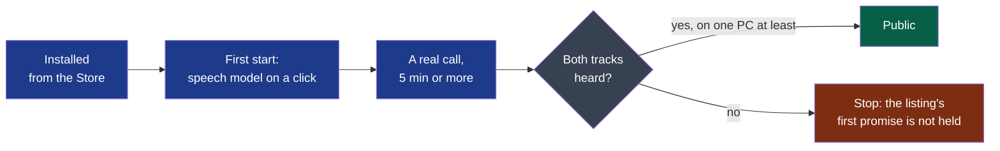

# Kitokey — the private audience's test, before the public release

The first submission goes to a **private audience** in the Store: the decider and the three users. The
coordinator decided on 2026-11-21 that Kitokey becomes public only once this test has passed on at least one
Windows PC (D103, [the listing](listing.md#partner-center--the-submissions-other-fields)). It holds what no
automated test holds:

- the computer's sound recorded on Windows during a real call: the listing's first promise (#482);
- the install from the real Store;
- the licence and the trial that the Store answers.

**Legend**: blue is a step of the test; grey is the question that decides; green is public visibility; red is a stop.

The steps are written in French, the testers' language. The words in « » are Kitokey's, exactly as they appear.

---

## Le test, pour la personne qui le fait

**Il vous faut** :
- un PC sous Windows 11 ou Windows 10 (version 2004 ou plus récente), en x64 ;
- le compte Microsoft *personnel* que vous avez donné pour l'audience privée ;
- un vrai appel d'au moins cinq minutes avec au moins une autre personne (Teams, Meet, Zoom…, dans son
  application ou dans un navigateur). Choisissez un appel sans rien de confidentiel : vous n'enverrez ni son
  son ni ses mots, mais vous allez les écouter.

Comptez environ trente minutes, plus le temps de l'appel.

Pour chaque étape, notez **oui** ou **non**, et ce qui vous a surpris.

1. **Installé depuis le Store.** Ouvrez le lien du Store reçu par courriel, connecté avec votre compte
   personnel, puis **Obtenir**. Attendu : Kitokey s'installe sans avertissement de Windows (pas de
   « Windows a protégé votre ordinateur »).
2. **Premier démarrage.** Lancez Kitokey depuis le menu Démarrer. Attendu : l'assistant s'ouvre une fois et
   vous pose ses questions. Acceptez le téléchargement du modèle de parole (874 Mo). Attendu : rien n'est
   téléchargé avant votre clic. Notez combien de temps il a pris.
3. **L'essai.** Ouvrez « Réglages ». Attendu : il reste 14 jours et 10 réunions. Notez aussi si « Lancer
   Kitokey à l'ouverture de session » est coché ou non.
4. **Le micro.** Cliquez sur « Démarrer un enregistrement », puis sur « Arrêter l'enregistrement » au bout de
   quelques secondes. Notez si Windows vous a demandé l'accès au micro, et ce qu'il a dit. Si l'enregistrement
   refuse de démarrer, allez dans Paramètres → Confidentialité et sécurité → Microphone : l'accès doit être
   permis aux applications de bureau.
5. **Le vrai appel.** Au début de l'appel, cliquez sur « Démarrer un enregistrement ». Parlez, laissez parler
   les autres, puis « Arrêter l'enregistrement » à la fin.
6. **Les deux pistes, l'étape qui décide.** Ouvrez la réunion. Dans la transcription :
   - cliquez sur une ligne marquée « Vous » au début, au milieu et à la fin : entendez-vous votre voix ?
   - faites de même avec « Les autres » : entendez-vous la voix des autres ?

   Notez pour chacune : la voix, le silence, ou rien à cliquer. Si la transcription n'a pas encore de
   lignes, attendez qu'elle soit faite.
7. **Le compte rendu.** Si Ollama est installé sur ce PC, le compte rendu s'écrit après la transcription.
   Sinon, la page dit qu'il attend Ollama : c'est le comportement attendu, notez-le.
8. **Un diagnostic.** Sur la page de la réunion, ouvrez « Plus d'actions », puis « Copier un diagnostic ».
   Collez-le dans votre réponse. Il ne contient aucun mot de la réunion.

**Ce que vous renvoyez**, par courriel à support@kitokey.com, objet « Test privé Kitokey » :
- votre PC (modèle) et la version de Windows (touche Windows, tapez `winver`) ;
- la version de Kitokey (Paramètres → Applications → Applications installées → Kitokey) ;
- l'application de l'appel ;
- vos réponses aux étapes 1 à 8, chacune oui ou non, et ce qui vous a surpris ;
- le diagnostic de l'étape 8.

**Jamais** le son de la réunion, ni ses mots, ni une capture où on les lit.

---

## Reading the answers (the coordinator)

| Answer | Then |
|---|---|
| Step 6: both voices heard at the start, middle and end, on at least one PC | The listing's first promise is held on Windows. Visibility goes **public**, and « What holds each promise » cites this test, the PC and the date |
| Step 6: one track silent, or missing | **Stop**: Kitokey stays private. An issue in `capture` carries the PC, Windows' version, the call's application and the diagnostic. The listing's first line changes, or waits for the fix |
| Step 1, 3 or 4 not as expected | An issue: the install (`install`) or the licence (`shell`). The public release waits for it if a buyer would hit it |
| Step 7: minutes waiting for Ollama | Expected: the listing says Ollama is not installed by Kitokey |

Nothing a tester sends is committed to this repository: their answers stay in the mailbox, and the issues
carry only what the table above names.
