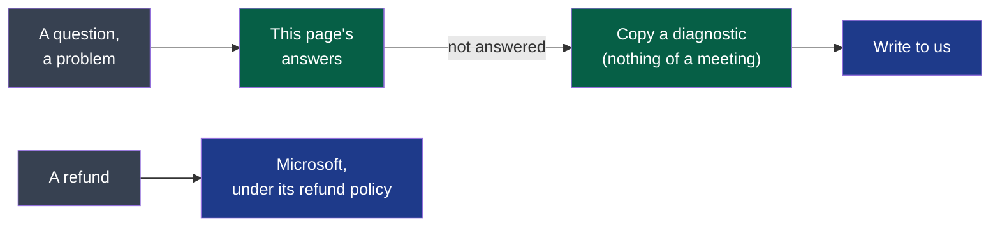

# Kitokey — support / assistance

Last changed / dernière modification: 2026-11-21. Publisher / éditeur: c12c (NapkinStack).
[English](#english) · [Français](#français)

**Legend** — grey: what you come with · green: what you do in Kitokey · blue: whom you write to.

## English

### Kitokey needs Ollama for its minutes — does it install it?

No. Kitokey never installs Ollama. Ollama is a free program of its own, at
[ollama.com](https://ollama.com). Without it, Kitokey still records and transcribes your meetings
on your computer, and their minutes wait: the window says so. Once Ollama runs, Settings offer
its model for the minutes, Qwen3 8b (about 5 GB), downloaded by Ollama on your click. You can
also choose a service you trust, with your own key.

### What does Kitokey download?

Only what you choose, on a click:

| What | Size | From |
|---|---|---|
| The speech model, Whisper large v3 turbo, which transcribes on your computer | 874 MB | `huggingface.co`, checked against the fingerprint its authors publish |
| The minutes' model, through Ollama | about 5 GB | Ollama's own registry |
| The list of models, read again | a small file | `raw.githubusercontent.com` |

The first start offers the speech model; nothing is downloaded before you choose it. Everything
that leaves your computer, and to which host, is in the [privacy policy](privacy.md).

### How does the free trial work?

Kitokey is free for 14 days and 10 meetings, whichever comes last. Settings show what is left.
Once the trial is over, you buy Kitokey in the Microsoft Store to record new meetings. Every
meeting you made stays yours: you can still read it, play it, correct it and copy its minutes.

### I bought Kitokey and it still says the trial is over

Kitokey asks the Microsoft Store for your licence each time you start a recording. Check that the
Store is signed in with the Microsoft account you bought Kitokey with, then start the recording
again.

### How do I get a refund?

Refunds are made by Microsoft, under its refund policy: ask them from your Microsoft account.
We cannot refund a purchase made in the Store.

### A summary says something wrong or inappropriate

Kitokey's minutes are written by an AI language model, and it can be wrong. Correct what you need in
your copy, and tell us at [support@kitokey.com](mailto:support@kitokey.com): say which model wrote it
(the meeting's page names it) and what was wrong, without the meeting's words if they are private. We
read every report.

### How do I report a problem?

1. On the meeting's page, open **More actions**, then **Copy a diagnostic**. It copies the steps
   Kitokey took for that meeting — never a word of the meeting, nor a key.
2. Write to us (below), say what you did and what you saw, and paste the diagnostic.

### Contact

- By email: [support@kitokey.com](mailto:support@kitokey.com). We answer as soon as we can;
  no delay is promised.
- An issue on [our repository](https://github.com/NapkinStack/kitokey/issues), if you have a
  GitHub account.

## Français

### Kitokey a besoin d'Ollama pour ses comptes rendus — l'installe-t-il ?

Non. Kitokey n'installe jamais Ollama. Ollama est un programme à part, gratuit, sur
[ollama.com](https://ollama.com). Sans lui, Kitokey enregistre et transcrit toujours vos réunions
sur votre ordinateur, et leur compte rendu attend : la fenêtre le dit. Dès qu'Ollama tourne, les
Réglages proposent son modèle pour le compte rendu, Qwen3 8b (environ 5 Go), téléchargé par Ollama
sur votre clic. Vous pouvez aussi choisir un service en qui vous avez confiance, avec votre propre
clé.

### Que télécharge Kitokey ?

Seulement ce que vous choisissez, sur un clic :

| Quoi | Taille | Depuis |
|---|---|---|
| Le modèle de parole, Whisper large v3 turbo, qui transcrit sur votre ordinateur | 874 Mo | `huggingface.co`, vérifié avec l'empreinte que publient ses auteurs |
| Le modèle du compte rendu, par Ollama | environ 5 Go | Le registre d'Ollama lui-même |
| La liste des modèles, relue | un petit fichier | `raw.githubusercontent.com` |

Le premier démarrage propose le modèle de parole ; rien n'est téléchargé avant que vous le
choisissiez. Tout ce qui quitte votre ordinateur, et vers quel hôte, est dans la
[politique de confidentialité](privacy.md).

### Comment marche l'essai gratuit ?

Kitokey est gratuit pendant 14 jours et 10 réunions, jusqu'à ce que les deux soient atteints. Les
Réglages indiquent ce qu'il en reste. Une fois l'essai terminé, vous achetez Kitokey dans le
Microsoft Store pour enregistrer de nouvelles réunions. Toutes vos réunions restent à vous : vous
pouvez toujours les lire, les écouter, les corriger et copier leur compte rendu.

### J'ai acheté Kitokey et il dit encore que l'essai est terminé

Kitokey demande votre licence au Microsoft Store à chaque enregistrement lancé. Vérifiez que le
Store est connecté avec le compte Microsoft qui a acheté Kitokey, puis relancez l'enregistrement.

### Comment être remboursé ?

Les remboursements passent par Microsoft, selon sa politique de remboursement : demandez-les depuis
votre compte Microsoft. Nous ne pouvons pas rembourser un achat fait dans le Store.

### Un compte rendu dit quelque chose de faux ou d'inapproprié

Le compte rendu de Kitokey est rédigé par un modèle de langage (IA), qui peut se tromper. Corrigez ce
qu'il faut dans votre copie, et dites-le-nous à [support@kitokey.com](mailto:support@kitokey.com) :
quel modèle l'a rédigé (la page de la réunion le nomme) et ce qui n'allait pas, sans les mots de la
réunion s'ils sont privés. Nous lisons chaque signalement.

### Comment signaler un problème ?

1. Sur la page de la réunion, ouvrez **Plus d'actions**, puis **Copier un diagnostic**. Il copie
   les étapes de Kitokey pour cette réunion — jamais un mot de la réunion, ni une clé.
2. Écrivez-nous (ci-dessous), dites ce que vous avez fait et ce que vous avez vu, et collez le
   diagnostic.

### Contact

- Par courriel : [support@kitokey.com](mailto:support@kitokey.com). Nous répondons dès que possible ;
  aucun délai n'est promis.
- Une issue sur [notre dépôt](https://github.com/NapkinStack/kitokey/issues), si vous avez un
  compte GitHub.
