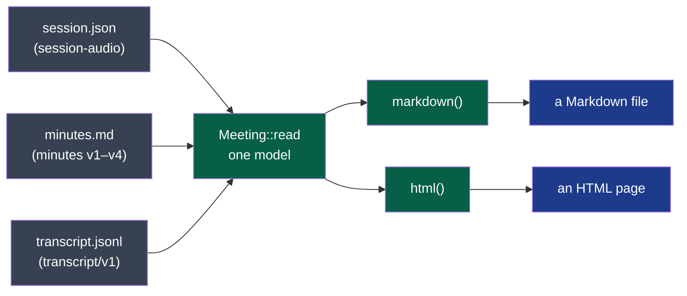

# export

Delivers the files of a session to where the user wants them.

- **Owner**: NapkinStack/maintainers
- **Criticality**: standard
- **Manifest**: [MANIFEST.yaml](./MANIFEST.yaml)

**Legend** — grey: a meeting's files and the contract each follows · green: this module · blue: what it writes.

A library: a meeting's folder read into one model, every format written from it (D108). It
writes Markdown and HTML today; DOCX, subtitles and a PDF follow. The words a file shows that no
contract carries — « Transcription », who spoke — are given by its caller.

## Getting started

The standard verbs — `bootstrap`, `check`, `test`, `run` — are declared in the `commands`
section of the [manifest](./MANIFEST.yaml), for this module's stack. What each one must do:
`.nstack/handbook/09-platform.md` §2.

## Contracts

- Provided: see `provides` in the MANIFEST
- Consumed: see `consumes` in the MANIFEST

## Decisions

See `docs/adr/`.
