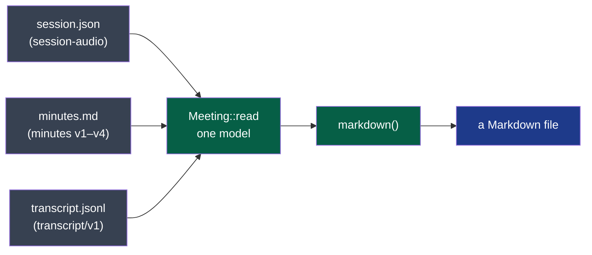

# export

Delivers the files of a session to where the user wants them.

- **Owner**: NapkinStack/maintainers
- **Criticality**: standard
- **Manifest**: [MANIFEST.yaml](./MANIFEST.yaml)



**Legend** — grey: a meeting's files and the contract each follows · green: this module · blue: what it writes.

A library and its program: a meeting's folder read into one model, every format written from it
(D108). It writes Markdown today; HTML, DOCX, subtitles and a PDF follow. The words a file shows that
no contract carries — « Transcription », who spoke — are given by its caller.

The program, `kitokey-export`, is what the shell starts ([`exporting/v1`](../../contracts/exporting/v1/README.md)):

```sh
echo '{"to": "<documents>/meeting.md", "name": "Réunion", "transcript": "Transcription", "me": "Moi", "others": "Les autres", "time": "Heure", "speaker": "Qui", "text": "Texte"}' \
  | kitokey-export <meetings>/2026-11-20_09-30 --format md --lang fr
```

It answers one JSON line, `written` or `failed`, and ends in failure with one sentence on its error
stream.

## Getting started

The standard verbs — `bootstrap`, `check`, `test`, `run` — are declared in the `commands`
section of the [manifest](./MANIFEST.yaml), for this module's stack. What each one must do:
`.nstack/handbook/09-platform.md` §2.

`THIRD-PARTY-NOTICES.html` is what the program owes its crates' authors, for the package to ship
(D102): each crate it links, under its licence's text. It is made with cargo-about from
`about.toml`, whose `accepted` list refuses any other licence, GPL among them, and committed;
`tests/notices.rs` is red once it no longer names the crates the program links, and `about.toml`'s
header gives the two commands that make it again. The module's release, once it has one (#1046),
puts it beside the program.

## Contracts

- Provided: see `provides` in the MANIFEST
- Consumed: see `consumes` in the MANIFEST

## Decisions

See `docs/adr/`.
