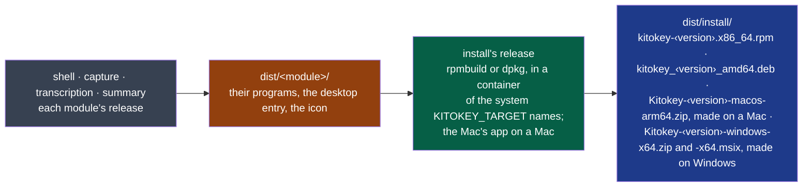
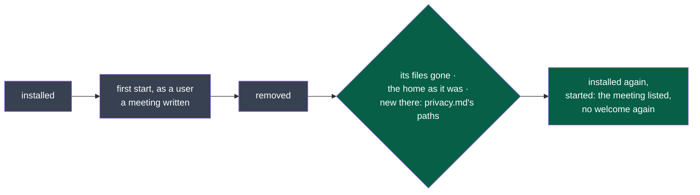
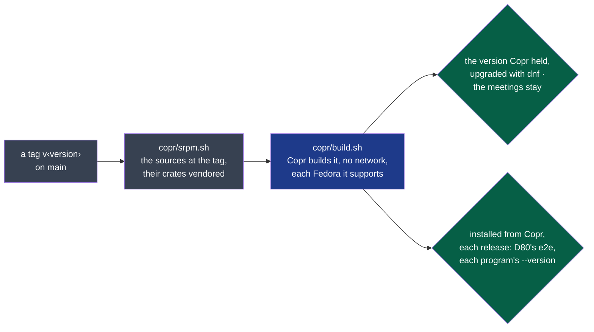

# install

What this module is for, who owns it and how critical it is: its
[MANIFEST.yaml](./MANIFEST.yaml), the one place they are written.



**Legend** — grey: the modules whose programs it packs · amber: their release artefacts ·
green: this module · blue: what a user installs. It provides and consumes no contract; why it
exists: ADR-0006.

## Getting started

Needs `podman`. From the repository's root:

```bash
nstack release                                    # for this Fedora: every module, then the rpm
sudo dnf install ./dist/install/kitokey-*.x86_64.rpm

KITOKEY_TARGET=ubuntu-24.04 nstack release         # each program built in an Ubuntu container, then the .deb
sudo apt install ./dist/install/kitokey_*_amd64.deb
```

`KITOKEY_TARGET` names the system the package is for — `fedora-44`, `ubuntu-24.04` — for every
module at once: each program is built in a container of that system, so that it links what that
system has (D27).

Removing it keeps what is yours (D80). `bash modules/install/scripts/e2e.sh <the package>`, with
`KITOKEY_TARGET` naming its system, installs it in a throwaway container, starts Kitokey as a user,
writes a meeting, removes the package, then installs it again:



**Legend** — grey: what the e2e does · green: what it holds. The paths Kitokey may leave are read
from [`docs/privacy.md`](../../docs/privacy.md)'s Linux line.

## On Fedora, from Copr (D78)

```bash
sudo dnf copr enable @napkinstack-labs/kitokey
sudo dnf install kitokey          # each new version then comes with the system's updates
```



**Legend** — grey: made by the forge's workflow · blue: Copr · green: what it holds.

`.github/workflows/copr.yml` runs on a tag `v‹version›` on `main`, the shell's version. With no
artefacts given, `kitokey.spec` builds from the source package (`from_source`): each module this
one assembles released by its own `release` command, as `nstack release` does (`assemble.sh`,
written by `srpm.sh`), each program saying the tag's version (`--version`, `KITOKEY_VERSION`); it
ships `LICENSE`. The project
`@napkinstack-labs/kitokey` belongs to a Fedora group, so that installing names no person; the token is
the forge's secret `COPR_CONFIG`. Copr builds on x86_64 only: transcription's whisper.cpp is built
for x86-64-v3 (`modules/transcription/.cargo/config.toml`). By hand, from the repository's root:

```bash
bash modules/install/copr/srpm.sh v0.2.0 0.2.0 dist/copr             # the source package, in a Fedora container
KITOKEY_TARGET=fedora-44 KITOKEY_VERSION=0.2.0 bash modules/install/scripts/e2e.sh copr:@napkinstack-labs/kitokey
```

On a Mac, `nstack release` makes `dist/install/Kitokey-<version>-macos-arm64.zip`: the app,
its four programs in `Contents/MacOS` and transcription's `kitokey-speech` (D42), signed ad hoc, not by Apple. GitHub's macOS runner makes
it on every change to a program on `main` (`.github/workflows/macos-app.yml`, the job *the app*; on a pull request only when it changes install) and keeps it 7
days on the run. Opened the first time through System Settings → Privacy & Security → Open
Anyway (D38).

On Windows, `nstack release` also makes `dist/install/Kitokey-<version>-x64.msix`, the package the
Microsoft Store takes (D54, PDR-0004), unsigned; it needs the Windows SDK. `windows-app.yml` signs it
for the run with a certificate it throws away, installs it, upgrades it and removes it
(`windows/trial.ps1`) — at each start, it prints what the Store answers for a package it did
not install (`shell.licence_read`, D83), and fails if that read would refuse a recording —, has the Windows App Certification Kit test it (`windows/certify.ps1`, each
failed test named in the run), and keeps it 7 days with the public certificate and the kit's report,
`appcert-report.xml`: a colleague runs, as
administrator, `Import-Certificate .\Kitokey-this-run.cer -CertStoreLocation Cert:\LocalMachine\TrustedPeople`,
then opens the package. What certification reads: [`windows/certification.md`](./windows/certification.md).
