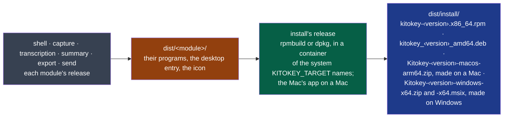
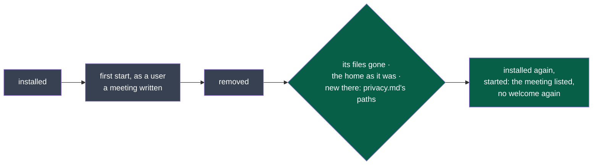
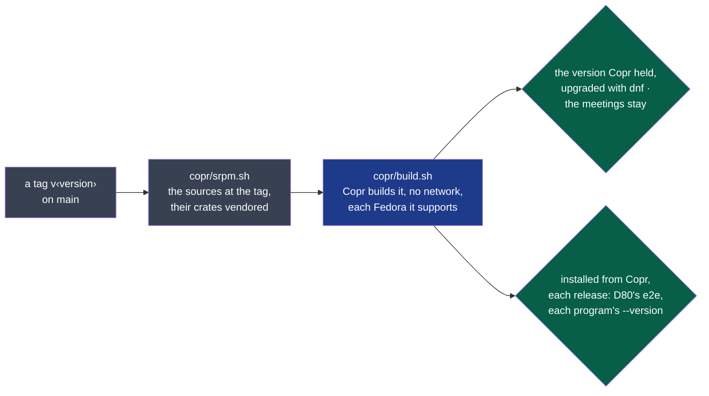

# install

What this module is for, who owns it and how critical it is: its
[MANIFEST.yaml](./MANIFEST.yaml), the one place they are written.



**Legend** — grey: the modules whose programs it packs · amber: their release artefacts ·
green: this module · blue: what a user installs. It provides and consumes no contract; why it
exists: ADR-0006.

## Getting started

Needs `podman`. From the repository's root:

```bash
nstack release                                    # for this Fedora: every module, then the rpm
sudo dnf install ./dist/install/kitokey-*.x86_64.rpm

KITOKEY_TARGET=ubuntu-24.04 nstack release         # each program built in an Ubuntu container, then the .deb
sudo apt install ./dist/install/kitokey_*_amd64.deb
```

`KITOKEY_TARGET` names the system the package is for — `fedora-44`, `ubuntu-24.04` — for every
module at once: each program is built in a container of that system, so that it links what that
system has (D27).

Removing it keeps what is yours (D80). `bash modules/install/scripts/e2e.sh <the package>`, with
`KITOKEY_TARGET` naming its system, installs it in a throwaway container, starts Kitokey as a user,
writes a meeting, removes the package, then installs it again:



**Legend** — grey: what the e2e does · green: what it holds. The paths Kitokey may leave are read
from [`docs/privacy.md`](../../docs/privacy.md)'s Linux line.

## What a computer needs

Measured on 2026-11-25 on one laptop: an AMD Ryzen AI 7 PRO 350 (8 cores, 16 threads), 24 GB of memory (23 GiB),
its built-in Radeon 860M graphics, Fedora 45. One machine and one set of runs: these are this machine's figures,
not bounds.

| | Measured | Read |
|---|---|---|
| Transcribing a 30-minute meeting with the default model (`ggml-large-v3-turbo-q8_0`, 874 MB) | **8 min 46 s** with `--features vulkan` on the built-in graphics; **54 min 36 s** on the processor, its memory at most 1.67 GB | the graphics card makes it six times faster; with Vulkan, the model's memory is shared with the graphics and not counted in the process's |
| Writing its minutes on the computer with the recommended model (`qwen3:8b`, 5,225 MB) through Ollama 0.40.16 | **about 8 min** with the built-in graphics, one retry included (482.5 s); Ollama's memory at most **10.7 GB** (on the processor) | the model sometimes answers without its sections and is asked again: #1221 |
| A meeting on disk | **about 2 GB free** while an hour records: two tracks of 1,037 MB an hour each (48 kHz, 24 bits, two channels). **About 0.2 GB kept** an hour once stopped, as FLAC without loss: 175 MB an hour, on 1.4 h of meetings | older meetings, recorded before FLAC, stay as WAV: #1215 |
| The package | the rpm of `main` at 30128b0: 17.1 MB to download, 85.6 MB installed | — |

Two ways to use it, and what each asks. The memory and disk come from the runs above, except « 8 GB », which is
not measured:

- **The transcript on the computer, the minutes by a service you choose**:
  - 8 GB of memory: the transcription takes 1.7 GB at most; the window and the system take the rest, not measured;
  - 4 GB free, then about 2 GB for each hour that records;
  - a graphics card with Vulkan, a built-in one being enough. With it, a meeting's transcript takes about a third
    of the meeting's length; without one, about twice its length.
- **Everything on the computer**:
  - 16 GB of memory at least (Ollama alone took 10.7 GB), and 24 to 32 GB to work in comfort;
  - 10 GB free for the two models, then about 2 GB for each hour that records.

**How it was measured.**
- The meeting was invented: 30 minutes of two French voices made by `espeak-ng`, taking turns on the two tracks, in
  a `session-audio/v1` folder, so that no one's meeting was used. A synthetic voice has no noise and no overlap:
  the transcription's times are those of clean speech.
- Each program was the release build of `main` at b66cadd, timed with `/usr/bin/time -v`, alone on the machine.
  Ollama ran apart, its processes' memory read every half second.
- The minutes' time is that of the same meeting: its 148 turns, the same sentences drawn from the same seed, given
  to `kitokey-summary` as a transcript (a request of 38,171 characters, against 39,011 from the transcribed
  audio). Ollama ran on the built-in graphics through Vulkan, every one of the model's 37 layers on it.
- The disk figures come from the headers and sizes of the meetings on that laptop, with no content read.
- The transcription's own README gives the same order on a real meeting of 5 minutes: 34 to 38 s with Vulkan,
  230 s on the processor.

## On Debian

Measured on 2026-11-25. The `.deb` made for Ubuntu 24.04 (`KITOKEY_TARGET=ubuntu-24.04`, 15.8 MB) was installed in
a container of each Debian, neither of which had seen Kitokey:

| | Debian 12 (bookworm) | Debian 13 (trixie) |
|---|---|---|
| Its C library | glibc 2.36 | glibc 2.41 |
| `apt install ./kitokey_*_amd64.deb` | **refused**: the package asks for `libc6 (>= 2.39)` and Ubuntu 24.04's « t64 » library names | installed |
| Each of the six programs' `--version` | — | each says its name |
| Kitokey started with no screen (Xvfb, a session bus) | — | still running after 15 s |

Debian 13 is verified that far: the tray, a recording and the player were not tried there. Debian 12 needs a
`KITOKEY_TARGET=debian-12`, built in a Debian 12 container with its own e2e. It is not made yet (#1214).

## What every package owes its third parties (D102)

Each format lays the same eight files beside the programs: Kitokey's `LICENSE`, as `LICENSE.txt`;
`notices/MPL-SOURCES.txt`, which says where the Mozilla Public License crates' sources are
(MPL-2.0 §3.2); and each program's `THIRD-PARTY-NOTICES.html`, the page its module's release left
in `dist/<module>/`, named by the program — `THIRD-PARTY-NOTICES-kitokey.html`,
`…-kitokey-capture.html`, `…-kitokey-transcription.html`, `…-kitokey-summary.html`,
`…-kitokey-export.html`, `…-kitokey-send.html`.

| Format | Where |
|---|---|
| rpm | `/usr/share/licenses/kitokey/` |
| .deb | `/usr/share/doc/kitokey/`, with its `copyright` file (Debian Policy 12.5, DEP-5 form, `deb/copyright`) naming the others: a minimised Ubuntu keeps that file alone |
| the Mac's app | `Kitokey.app/Contents/Resources/` |
| Windows' zip and package | beside `kitokey.exe` |

`windows/notices.py` names them for Windows; `mac/build.sh`, `deb/build.sh` and `kitokey.spec` lay
the same names, and `scripts/test.sh` reads all six. A module's page missing, no package is made.

## On Fedora, from Copr (D78)

```bash
sudo dnf copr enable @napkinstack/kitokey
sudo dnf install kitokey          # each new version then comes with the system's updates
```



**Legend** — grey: made by the forge's workflow · blue: Copr · green: what it holds.

`.github/workflows/copr.yml` runs on a tag `v‹version›` on `main`, the shell's version. With no
artefacts given, `kitokey.spec` builds from the source package (`from_source`): each module this
one assembles released by its own `release` command, as `nstack release` does (`assemble.sh`,
written by `srpm.sh`), each program saying the tag's version (`--version`, `KITOKEY_VERSION`); it
ships `LICENSE`. The project
`@napkinstack/kitokey` belongs to a Fedora group (`napkinstack-labs` in Fedora's accounts, `@napkinstack` in Copr), so that installing names no person; the token is
the forge's secret `COPR_CONFIG`. Copr builds on x86_64 only: transcription's whisper.cpp is built
for x86-64-v3 (`modules/transcription/.cargo/config.toml`). By hand, from the repository's root:

```bash
bash modules/install/copr/srpm.sh v0.2.0 0.2.0 dist/copr             # the source package, in a Fedora container
KITOKEY_TARGET=fedora-44 KITOKEY_VERSION=0.2.0 bash modules/install/scripts/e2e.sh copr:@napkinstack/kitokey
```

On a Mac, `nstack release` makes `dist/install/Kitokey-<version>-macos-arm64.zip`: the app,
its six programs in `Contents/MacOS` and transcription's `kitokey-speech` (D42), signed ad hoc, not by Apple. GitHub's macOS runner makes
it on every change to a program on `main` (`.github/workflows/macos-app.yml`, the job *the app*; on a pull request only when it changes install) and keeps it 7
days on the run. Opened the first time through System Settings → Privacy & Security → Open
Anyway (D38).

On Windows, `nstack release` also makes `dist/install/Kitokey-<version>-x64.msix`, the package the
Microsoft Store takes (D54, PDR-0004), unsigned; it needs the Windows SDK, and refuses to make it while
`windows/identity.json` holds a placeholder (D102): the three values Partner Center's *Product identity*
shows, or no package. `windows-app.yml` signs it
for the run with a certificate it throws away, installs it, upgrades it and removes it
(`windows/trial.ps1`) — it fails if the installed `kitokey.exe` holds `updater`, the name Tauri's
updater plugin is routed by, since the Store updates the package (D102); at each start, it prints what the Store answers for a package it did
not install (`shell.licence_read`, D83), and fails if that read would refuse a recording, and the
state of Kitokey's startup task as Windows holds it (`shell.startup_task`, D84), and fails unless it is off: the package declares it off, and only the user turns it on, in Settings (#1085) —, has the Windows App Certification Kit test it (`windows/certify.ps1`, each
failed test named in the run), and keeps it 7 days with the public certificate and the kit's report,
`appcert-report.xml`: a colleague runs, as
administrator, `Import-Certificate .\Kitokey-this-run.cer -CertStoreLocation Cert:\LocalMachine\TrustedPeople`,
then opens the package. What certification reads: [`windows/certification.md`](./windows/certification.md).
