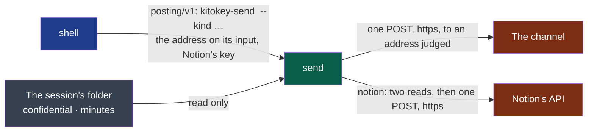

# send

Sends a meeting's summary to a channel the user set up — a webhook, Discord's, Slack's incoming
webhook, or a Notion database (D116) — once, on their gesture; a confidential meeting only when the shell
says the person confirmed it, for that send (D110, D118,
[PDR-0007](../../docs/pdr/0007-a-summary-leaves-for-a-channel-on-a-gesture-never-a-confidential-one.md), point 4
amended 2026-11-24).
Who owns it and how critical it is: its [MANIFEST.yaml](./MANIFEST.yaml).



**Legend** — green: this module · blue: who starts it · grey: what it reads · brown: what it contacts.

## Getting started

`cargo test --locked`: the addresses judged (`tests/address.rs`), the bodies (`tests/bodies.rs`), the
program's lines and exits (`tests/program.rs`), and the one POST against a server on this computer,
reached through the library with a test's policy (`tests/server.rs`); Notion's blocks and limits
(`tests/notion.rs`), and its two reads and one POST against a server standing for its API
(`tests/notion_server.rs`) — the program never reaches this computer.

```sh
echo '{"address": "https://discord.com/api/webhooks/<id>/<token>", "name": "Réunion"}' \
  | kitokey-send <meetings>/2026-11-20_09-30 --kind discord
echo '{"address": "https://www.notion.so/Notes-<32 hex>", "name": "Réunion", "key": "<integration key>"}' \
  | kitokey-send --check --kind notion
```

`THIRD-PARTY-NOTICES.html` is what the program owes its crates' authors, for the package to ship
(D102): each crate it links, under its licence's text. It is made with cargo-about from
`about.toml`, whose `accepted` list refuses any other licence, GPL among them, and committed;
`tests/notices.rs` is red once it no longer names the crates the program links, and `about.toml`'s
header gives the two commands that make it again. `release` puts it beside the program.

## Contracts

- Provided: [`posting/v1`](../../contracts/posting/v1/README.md).
- Consumed: `session-audio` (its `confidential`), `minutes` v1 to v4 — v5 once it is merged.

## Decisions

[ADR-0018](../../docs/adr/0018-a-module-send-of-its-own-the-one-to-reach-a-channel.md): a module of its own.
