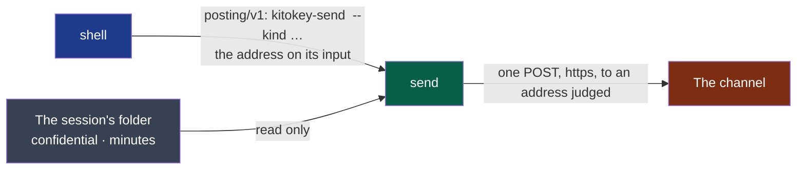

# send

Sends a meeting's summary to a channel the user set up — a webhook, Discord's, Slack's incoming
webhook — once, on their gesture, never a confidential meeting (D110,
[PDR-0007](../../docs/pdr/0007-a-summary-leaves-for-a-channel-on-a-gesture-never-a-confidential-one.md)).
Who owns it and how critical it is: its [MANIFEST.yaml](./MANIFEST.yaml).

**Legend** — green: this module · blue: who starts it · grey: what it reads · brown: what it contacts.

## Getting started

`cargo test --locked`: the addresses judged (`tests/address.rs`) and the one POST against a server on this
computer, reached through the library with a test's policy (`tests/server.rs`) — the program never
reaches this computer. The program, `kitokey-send`, what it reads of a meeting and what each kind
receives come with D110's next pull request.

## Contracts

- Provided: [`posting/v1`](../../contracts/posting/v1/README.md), once its program is delivered.
- Consumed, by the program: `session-audio` (its `confidential`), `minutes` v1 to v4 — v5 once it is merged.

## Decisions

[ADR-0018](../../docs/adr/0018-a-module-send-of-its-own-the-one-to-reach-a-channel.md): a module of its own.
