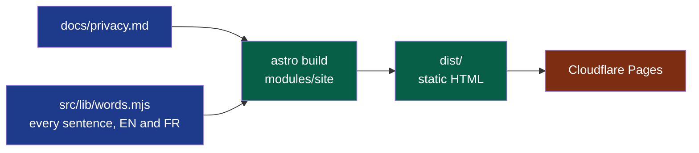

# site

kitokey.com, Kitokey's shop window: a landing and the privacy policy, in English and French, built by
Astro as static pages and served by Cloudflare Pages ([ADR-0019](../../docs/adr/0019-kitokey-com-a-static-site-built-by-astro-served-by-cloudflare-pages.md)).

**Legend** — blue: what the build reads · green: this module · red: the host.

| Command | What it does |
|---|---|
| `npm ci && npm run dev` | The preview, at <http://localhost:4321/> |
| `npm run build` | `dist/`, what Pages serves |
| `npm test` | Builds, then the tests: closed, the site's own domain only, the policy equal to its source, every sentence kept |
