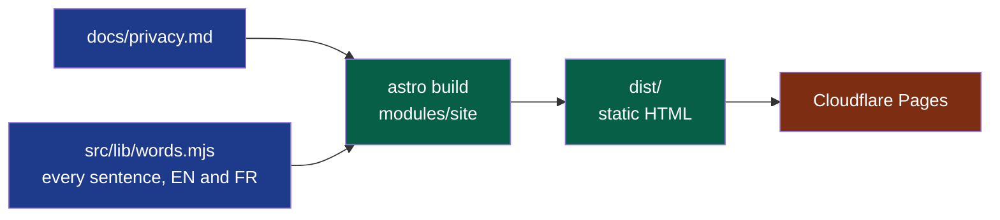

# site

kitokey.com, Kitokey's shop window: a landing and the privacy policy, in English and French, built by
Astro as static pages and served by Cloudflare Pages ([ADR-0019](../../docs/adr/0019-kitokey-com-a-static-site-built-by-astro-served-by-cloudflare-pages.md)).

**Legend** — blue: what the build reads · green: this module · red: the host.

| Command | What it does |
|---|---|
| `npm ci && npm run dev` | The preview, at <http://localhost:4321/> |
| `npm run build` | `dist/`, what Pages serves |
| `npm test` | Builds, then the tests: open, the site's own domain only, the policy equal to its source, every sentence kept |

**Two branches, two sites** (the decider, 2026-11-28). `main` is the **preview**, `main.kitokey.pages.dev`, behind
Cloudflare Access: every merge lands there first. `site-production` is **kitokey.com**: it moves only on the decider's
« publie », by a fast-forward to a commit of `main` (`kitokey-team/promote-site.sh`), never by a commit of its own.
Before a site pull request merges, the decider looks at it locally (`kitokey-team/site-preview.sh <pull request>`).
