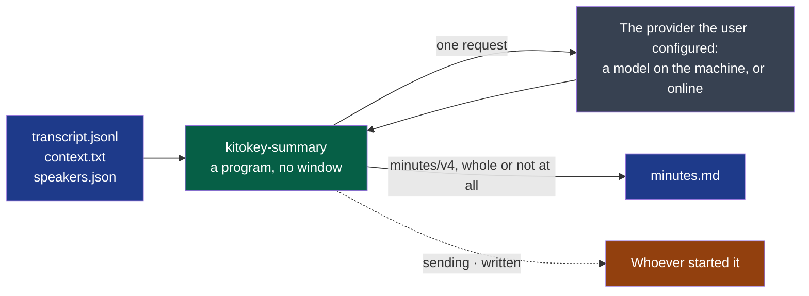

# summary

Writes the minutes of a transcript.

- **Owner**: NapkinStack/maintainers
- **Criticality**: standard
- **Manifest**: [MANIFEST.yaml](./MANIFEST.yaml)



**Legend** — blue: files of the session's folder · green: this module · grey: the only host
it contacts · orange: who reads its events, one JSON object per line.

```bash
# The example: an online provider and a large model — the one that kept every action of the
# meeting it was tried on (cycle 01, D5). The key is read from the environment, written nowhere.
kitokey-summary <session-folder> --provider https://openrouter.ai/api/v1 --model anthropic/claude-sonnet-5.5

# A model on the machine: nothing leaves it, no key — and, on a laptop, fewer of the actions.
kitokey-summary <session-folder> --provider http://localhost:11434/v1 --model mistral

# In a structure (D111): the sections of a kind of meeting, minutes/v5 — general, one_to_one,
# stand_up, client_call, interview, project_review. Without --structure, minutes/v4 as above.
kitokey-summary <session-folder> --provider http://localhost:11434/v1 --model mistral --structure stand_up

# Whether a model answers, before any meeting: one sentence of the program's own is sent,
# `sending` then `answered` said, or why not in one sentence. What the settings' Tester runs.
kitokey-summary --test --provider http://localhost:11434/v1 --model mistral

# Its version, the package's (D78): nothing else is done.
kitokey-summary --version
```

| Tried on one meeting, with its context | Of seven actions agreed: missing | Time |
|---|---|---|
| The large model of the example | 0 | 15 s |
| A fast online model | 2 to 3 | 3 s |
| A 7B model on a laptop's processor | 4 | minutes |

**The transcript is read through its errors.** The model is told the transcript comes from a
speech recogniser and names its errors: a word heard as another, a name or a figure misheard,
a sentence written twice, the remote side written again as an echo, a reply missing. Where the
rest of the meeting makes what was meant certain, it writes that. Where a name, a figure, a
date or an owner stays uncertain, it writes it as heard and says so. A task said as "I" gets
its owner only when the meeting names them, otherwise "probably" someone, or nobody: the
minutes are less often wrong about who, and less often sure. The price, too:
a stray word can make a fact said clearly read as uncertain — "c'est nantes" misheard beside
"je garde celui de Paris" made the kept server "Paris or Nantes". The transcript itself is
never changed.

**Attach a context** — `context.txt` in the session's folder, a few lines: who was there, on
which side — in the room or remote — and who is only talked about. Without it, a person the
meeting talks about was written as the owner of an action.

**Speakers named** — `speakers.json`, written by the shell when the user names a meeting's two sides
(#1205): each line of the request says the name beside the transcript's word, `me (Sarah)`, and one
rule says it is the name to write. Without the file, the request is the one sent before.

On the bench's meeting, four of the engine's transcripts, three answers each from the model of
the example: told of the errors and given a context, the minutes give the support rota — said
over six turns — right 12 times in 12, against 5 in 12 without either, and no task to the wrong
person without doubt, against four. Which of the two does the most is not measured apart. What
no request recovers is the owner of a task said as "I": each track holds two people (cycle 02,
D16).

Ollama's OpenAI route keeps 4096 tokens and drops the rest in silence, the request's rules first:
a meeting of 45 minutes did not fit (measured on `qwen3:8b`, 2026-10-31). So an address of that
form, without a key, whose host answers `GET /api/version` as Ollama does, is asked on Ollama's
own `/api/chat`, with a window sized to the request, an answer of at most 16 384 tokens, and a
patience that grows with what it has to read: 600 s, and a second for each 20 bytes. A thinking
model's thinking counts in its answer: at 4096 tokens it filled the answer on long meetings, and
16 384 held every run (#1083, measured on `qwen3:8b`, 2026-11-21). Ollama also cuts a request
longer than its window without a word; it says how many tokens it read. Fewer than one for six
bytes of the request, or exactly what its cut keeps (Ollama 0.40.16 keeps
`num_ctx - (num_ctx - 4) / 2`), is refused as a meeting left partly out.

A key, when the provider wants one, is read from `KITOKEY_PROVIDER_KEY` and written nowhere.
Whatever fails — no network, a refused key, no credit left with the provider, an unknown
model, an answer cut short or that is not minutes — the reason is one sentence on the error
stream, the transcript is untouched and the minutes that were there are still there. An answer
that is not minutes is asked for once more first, the same request: with `qwen3:8b` on this
laptop, one answer in eleven had another form (#366).

What it does is logged — each step and each failure with its detail, never a word of the
meeting, its context or a key (ADR-0007): one JSON line per step in
`$XDG_STATE_HOME/kitokey/logs/summary.<date>.jsonl` (UTC), fourteen days kept and the folder
under 50 MB. `KITOKEY_LOG_DIR`, an absolute path, puts them elsewhere, `KITOKEY_LOG=debug` asks for more, and `KITOKEY_TRACE` is the id of
the making the shell passes, so that its lines and the shell's read together.

## Getting started

The standard verbs — `bootstrap`, `check`, `test`, `run` — are declared in the `commands`
section of the [manifest](./MANIFEST.yaml), for this module's stack. What each one must do:
`.nstack/handbook/09-platform.md` §2.

`release` puts `THIRD-PARTY-NOTICES.html` beside the program, for the package to ship (D102): each
crate the program links, under its licence's text. It is made with cargo-about from `about.toml`,
whose `accepted` list refuses any other licence, GPL among them, and committed; `tests/notices.rs`
is red once it no longer names `Cargo.lock`'s crates, and `about.toml`'s header gives the two
commands that make it again.

## Contracts

- Provided: [`minutes/v4`](../../contracts/minutes/v4/README.md) — written, how long the making took said (D97) —, and [`minutes/v3`](../../contracts/minutes/v3/README.md), [`minutes/v2`](../../contracts/minutes/v2/README.md) and [`minutes/v1`](../../contracts/minutes/v1/README.md) — written before, still read —, `experimental`; [`summarising/v1`](../../contracts/summarising/v1/README.md) — how it is started and what it says, `experimental`
- Consumed: [`transcript/v1`](../../contracts/transcript/v1/README.md)

## Decisions

See `docs/adr/`.
